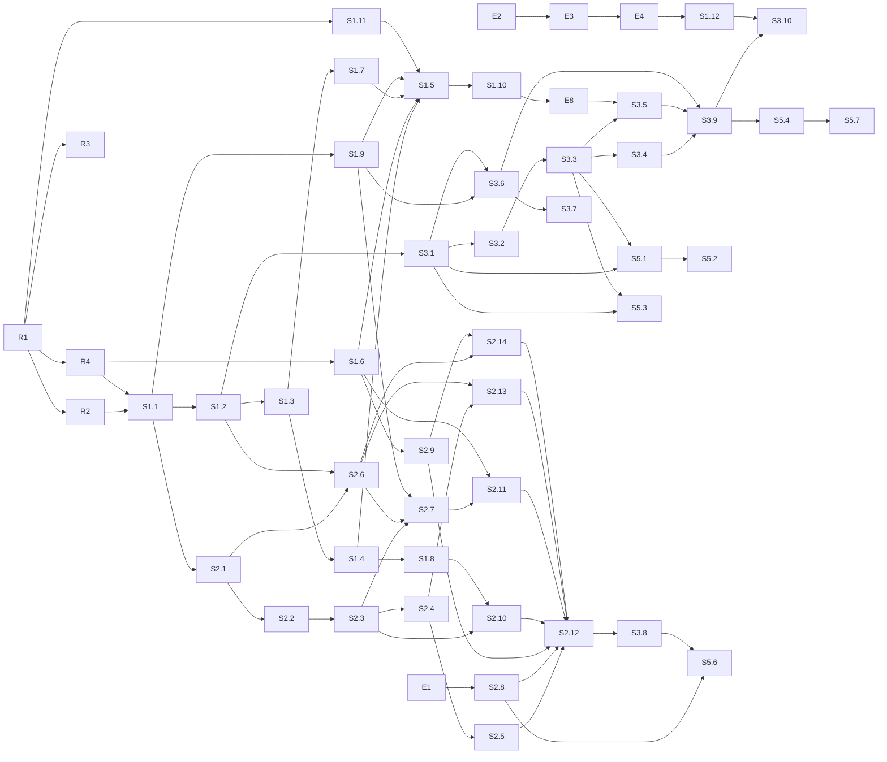

# 开发任务清单 v0.2 —— 基于 Graph 的 AI 中台

> 配套：`graph-ai-middle-platform-design.md`（v0.2）。任务按三条垂直切片组织：S1 一个用户能聊且每轮入图；S2 能经审批做事并动态拉起 Worker；S3 图有内容、看得见、找得到。S1 + S2 + S3 = 最小当前版本。
> 环境具体值不出现在本文件，用占位符，取值见未入库的 `docs/private/`。
> 日期：2026-09-01

---

## 0. 约定

### 0.1 任务字段

**目标 / 交付物 / 涉及路径 / 依赖 / 验收 / 建议执行者 / 需人工批准 / 不做**。验收必须是可执行命令加期望结果。

- 建议执行者：`Codex` 或 `Claude Code`（实现）、`人`（登录目标主机或决策）、`Claude Code@host`（经 SSH 在目标主机跑低风险命令）。
- 需人工批准 = 会影响目标主机上运行中的其他服务或不可逆；这类只写建议，不由 agent 执行。

### 0.2 占位符

`<TARGET_HOST>`、`${NEXTTIME_DATA}`、`${KERNEL_BIND_ADDR}`、`${NEXTTIME_SUBNET_CONTROL}` / `${NEXTTIME_SUBNET_WORKERS}`、`${WORKER_RUNTIME}`、`<CODE_DIR>`。

### 0.3 工程约定（全 TS）

- Node 24、TypeScript strict、pnpm workspaces、`erasableSyntaxOnly`；Biome 做 lint 与 format；Vitest。
- kernel：Fastify + `ws` + `pg`（原生驱动，显式 SQL，无 ORM）+ Zod + `@modelcontextprotocol/sdk` + `jose`（Handle 签名 EdDSA）+ pino + OpenTelemetry。
- 迁移：`packages/kernel/migrations/NNNN_name.sql` + 幂等 runner（`schema_migrations` 表）。
- 状态机一律转移表驱动，非法转移抛 `IllegalTransition`。
- 所有受治理写入与 `audit_records` 同事务（I11）。
- pi 锁 `@earendil-works/pi-coding-agent@1.1.0`（版本源是根目录 `pi.version`，升级按 `docs/runbooks/pi-upgrade.md`；2026-09-26 由 0.84.4 升到 0.87.1，2026-10-01 升到 0.99.2，2026-10-08 升到 1.1.0）；平台扩展只依赖文档化事件。
- 共享类型在 `packages/shared`：capability 注册表、事件、`ActionDescription`、Zod schema；HTTP 路由、MCP 工具、WS 方法都由注册表生成或校验。
- HTTP capability 投影约定：`POST /api/cap/<capability_name>`，`Authorization: Bearer <handle>`（S1.6 落地此约定）。
- 不写任何真实地址、密钥、知识库 ID；测试用 `example` 值。每任务一分支一 PR。

### 0.4 里程碑

| 里程碑 | 目标 | 设计目标 |
|--------|------|---------|
| E | 目标主机可跑 Postgres 与全部服务 | — |
| R | monorepo 能 lint / test / build / migrate | — |
| S1 | 登录 → 对话 → 自己的 pi 回答 → Turn 入图 | G3 部分、G4 部分 |
| S2 | 说需求 → find_workers → invoke_worker → 门动作 → 审批卡片 → 执行 → 写回 | G1、G2、G4 |
| S3 | 本体 v1 + 采集器 + Explorer + MCP gateway | G3、G5、G6 |
| S5 | 基座打磨：I2 写入点强制、新鲜度与失效、数据与代码分离、prompt 契约守卫、加固批次、稳定性、真实模型回归、交付与演示闭环（§5b） | G2、G3、G5 加固 |

---

> E、R、S1–S9（§1–§5g）已完成，原文在 `archive/e-r-s1-s9/development-tasks.md`（2026-11-27 移出），节号与标题不变。下面只留标题，便于按节号查。

## 1. E — 环境准备（目标主机）

已完成，原文在 `archive/e-r-s1-s9/development-tasks.md` 同名一节。

### E1 验证 gVisor

已完成，原文在 `archive/e-r-s1-s9/development-tasks.md` 同名一节。

### E2 目录树与密钥目录

已完成，原文在 `archive/e-r-s1-s9/development-tasks.md` 同名一节。

### E3 代码检出与 `.env`

已完成，原文在 `archive/e-r-s1-s9/development-tasks.md` 同名一节。

### E4 Postgres

已完成，原文在 `archive/e-r-s1-s9/development-tasks.md` 同名一节。

### E5 Docker 日志轮转与 live-restore

已完成，原文在 `archive/e-r-s1-s9/development-tasks.md` 同名一节。

### E6 收敛 0.0.0.0 端口

已完成，原文在 `archive/e-r-s1-s9/development-tasks.md` 同名一节。

### E7 平台备份定时器

已完成，原文在 `archive/e-r-s1-s9/development-tasks.md` 同名一节。

### E8 caddy TLS 与静态服务

已完成，原文在 `archive/e-r-s1-s9/development-tasks.md` 同名一节。

## 2. R — 仓库骨架

已完成，原文在 `archive/e-r-s1-s9/development-tasks.md` 同名一节。

### R1 monorepo 骨架

已完成，原文在 `archive/e-r-s1-s9/development-tasks.md` 同名一节。

### R2 迁移机制与连接池

已完成，原文在 `archive/e-r-s1-s9/development-tasks.md` 同名一节。

### R3 CI

已完成，原文在 `archive/e-r-s1-s9/development-tasks.md` 同名一节。

### R4 领域类型、转移表、capability 注册表

已完成，原文在 `archive/e-r-s1-s9/development-tasks.md` 同名一节。

## 3. S1 — 一个用户能聊，每轮入图

已完成，原文在 `archive/e-r-s1-s9/development-tasks.md` 同名一节。

### S1.1 核心表迁移（含隔离列）

已完成，原文在 `archive/e-r-s1-s9/development-tasks.md` 同名一节。

### S1.2 graph store 最小实现

已完成，原文在 `archive/e-r-s1-s9/development-tasks.md` 同名一节。

### S1.3 gateway human 通道 + audit + explain

已完成，原文在 `archive/e-r-s1-s9/development-tasks.md` 同名一节。

### S1.4 chat 模块与 WS RPC

已完成，原文在 `archive/e-r-s1-s9/development-tasks.md` 同名一节。

### S1.5 每用户一个常驻入口容器：agent 镜像、supervisor 最小实现、agent-host 事件桥

已完成，原文在 `archive/e-r-s1-s9/development-tasks.md` 同名一节。

### S1.6 platform-extension `entry` 模式

已完成，原文在 `archive/e-r-s1-s9/development-tasks.md` 同名一节。

### S1.7 `llm-proxy` 独立服务

已完成，原文在 `archive/e-r-s1-s9/development-tasks.md` 同名一节。

### S1.8 web：登录与对话

已完成，原文在 `archive/e-r-s1-s9/development-tasks.md` 同名一节。

### S1.9 Handle 最小实现（入口 Handle）

已完成，原文在 `archive/e-r-s1-s9/development-tasks.md` 同名一节。

### S1.10 S1 验收脚本

已完成，原文在 `archive/e-r-s1-s9/development-tasks.md` 同名一节。

### S1.11 出网代理

已完成，原文在 `archive/e-r-s1-s9/development-tasks.md` 同名一节。

### S1.12 最小备份（compose 内，不改主机）

已完成，原文在 `archive/e-r-s1-s9/development-tasks.md` 同名一节。

## 4. S2 — 能经审批做事，动态拉起 Worker

已完成，原文在 `archive/e-r-s1-s9/development-tasks.md` 同名一节。

### S2.1 治理表迁移

已完成，原文在 `archive/e-r-s1-s9/development-tasks.md` 同名一节。

### S2.2 Policy 引擎

已完成，原文在 `archive/e-r-s1-s9/development-tasks.md` 同名一节。

### S2.3 ActionRequest 状态机与审批队列

已完成，原文在 `archive/e-r-s1-s9/development-tasks.md` 同名一节。

### S2.4 通用门：协议、基类、四种传输、接口清单、命令策略表

已完成，原文在 `archive/e-r-s1-s9/development-tasks.md` 同名一节。

### S2.5 `docker` 预置清单与 `ragflow` 门实例

已完成，原文在 `archive/e-r-s1-s9/development-tasks.md` 同名一节。

- 实现说明（遗留 966，#1625，2026-11-27 合入，1e389fd，release.md §3.223）：`containers.list`、`compose.ls` 的每一项改成摘要（`ContainerListItem` / `listItemOf`：id、name、image、state、status，compose 的 project、service；`compose.ls` 的项不带 `project`），labels 只在 `container.inspect` 回。`payload-budget.test.ts` 按每个容器 320 字符卡住 40 个容器的列表（实测 11,845 字符，以前 56,858），这是内置门带载荷预算测试的第一个，以后的内置门照这个约定加。给模型的 JSON 不缩进归 967 阶段 1；过滤与分页、已发布行的旧描述、`status` 两处写法见遗留 974–976。

### S2.6 平台元本体与 WorkerDefinition 注册表

已完成，原文在 `archive/e-r-s1-s9/development-tasks.md` 同名一节。

- 实现说明（遗留 968 平台一半，#1633，2026-11-28 合入，b3824b0，release.md §3.227；内核 substrate/ontology、platform-extension）：`workerVocabulary`（`substrate/ontology/vocabulary.ts`）从已发布本体读出 Worker 能用的 LinkType，经 `get_task` 的 `ontologyVocabulary` 给 Task 自己的 Worker；评估运行的 Worker 拿不到工作区的本体（见遗留 987）。`renderVocabulary`（`platform-extension/src/modes/vocabulary.ts`）按 4,000 字符分三档写进 Worker 上下文，名字写成一行并限长，没有可写 LinkType 时给引导语；`ontology-guard` 拒绝 `undeclared_link_type` 时带出 `declaredBetween`。内置包提示词那一半随 969。

### S2.7 `find_workers` 与 `invoke_worker`

已完成，原文在 `archive/e-r-s1-s9/development-tasks.md` 同名一节。

### S2.8 worker-supervisor

已完成，原文在 `archive/e-r-s1-s9/development-tasks.md` 同名一节。

### S2.9 `worker` 模式扩展与结果契约

已完成，原文在 `archive/e-r-s1-s9/development-tasks.md` 同名一节。

- 实现说明（遗留 967 阶段 1，#1629，2026-11-28 合入，9e67893，release.md §3.225；platform-extension）：`renderToolResult` 替掉 `truncateToolResult`，入口、交互、worker 三种模式共用：门工具结果给模型时是紧凑 JSON，数组按整项截并写明看到几项、共几项，不是完整 JSON 时才按字符截。截尾起点用行首并按内核原文的私钥正则，有与内核一致的测试（类遗留 962 的「Worker 截尾与内核遮蔽对齐」子项）。`BudgetTracker` 在 worker 模式本地累计用量，余量不足上一次调用的三倍时提醒 Worker 先上报；只读一次 `tokenBudget` 见遗留 983。

### S2.10 审批卡片与任务视图（web）

已完成，原文在 `archive/e-r-s1-s9/development-tasks.md` 同名一节。

### S2.11 chat 与 Task 联动

已完成，原文在 `archive/e-r-s1-s9/development-tasks.md` 同名一节。

### S2.12 S2 验收脚本

已完成，原文在 `archive/e-r-s1-s9/development-tasks.md` 同名一节。

### S2.13 连接系统流程与清单导入

已完成，原文在 `archive/e-r-s1-s9/development-tasks.md` 同名一节。

### S2.14 Skill、Procedure 与提议流程

已完成，原文在 `archive/e-r-s1-s9/development-tasks.md` 同名一节。

## 5. S3 — 图有内容、看得见、找得到

已完成，原文在 `archive/e-r-s1-s9/development-tasks.md` 同名一节。

### S3.1 本体注册表与本体 v1

已完成，原文在 `archive/e-r-s1-s9/development-tasks.md` 同名一节。

### S3.2 冲突检测

已完成，原文在 `archive/e-r-s1-s9/development-tasks.md` 同名一节。

### S3.3 采集器 `host-inventory`（TS）

已完成，原文在 `archive/e-r-s1-s9/development-tasks.md` 同名一节。

### S3.4 `gatekeeper-ragflow` 与本体 v2

已完成，原文在 `archive/e-r-s1-s9/development-tasks.md` 同名一节。

### S3.5 Explorer 契约与挂载

已完成，原文在 `archive/e-r-s1-s9/development-tasks.md` 同名一节。

### S3.6 MCP gateway 与 `interactive` 模式

已完成，原文在 `archive/e-r-s1-s9/development-tasks.md` 同名一节。

### S3.7 语义一致性校验

已完成，原文在 `archive/e-r-s1-s9/development-tasks.md` 同名一节。

### S3.8 不变量监控与混沌

已完成，原文在 `archive/e-r-s1-s9/development-tasks.md` 同名一节。

### S3.9 S3 验收脚本

已完成，原文在 `archive/e-r-s1-s9/development-tasks.md` 同名一节。

### S3.10 运行手册与测试策略文档

已完成，原文在 `archive/e-r-s1-s9/development-tasks.md` 同名一节。

### S3.11 中台控制面（管理员面）

已完成，原文在 `archive/e-r-s1-s9/development-tasks.md` 同名一节。

### S3.12 Skills / MCP / 第三方能力的统一接入与治理

已完成，原文在 `archive/e-r-s1-s9/development-tasks.md` 同名一节。

### S3.13 每用户智能体配置：AgentProfile / AgentPolicy

已完成，原文在 `archive/e-r-s1-s9/development-tasks.md` 同名一节。

### S3.14 web 重构为控制台

已完成，原文在 `archive/e-r-s1-s9/development-tasks.md` 同名一节。

### S3.15 pi 升级契约与漂移检测

已完成，原文在 `archive/e-r-s1-s9/development-tasks.md` 同名一节。

### S3 实施波次（2026-09-09 排定）

已完成，原文在 `archive/e-r-s1-s9/development-tasks.md` 同名一节。

## 5a. S4 — 平台管理（W8，2026-09-11 立项，同日按维护者要求修订为平台级用户目录）

已完成，原文在 `archive/e-r-s1-s9/development-tasks.md` 同名一节。

### S4.1 用户目录与登录

已完成，原文在 `archive/e-r-s1-s9/development-tasks.md` 同名一节。

### P-A1 身份、用户与管理面骨架

已完成，原文在 `archive/e-r-s1-s9/development-tasks.md` 同名一节。

- 实现说明（遗留 965，#1627，2026-11-27 合入，c4e3299，release.md §3.224）：`changeOwnPassword`（`application/identity/credentials.ts`）在吊销 API key、其他登录会话与已签凭证的同一事务里写平台审计 `user.password_changed`，记在本人名下；载荷是登录名、是否被要求改、吊销的控制台会话个数、吊销了访问的成员身份个数（`membershipAccessRevoked`），不记密码，被拒的修改不写。字段名不能带 `Credentials` 一类词，否则 `maskSecretFields` 会把值遮成 `[redacted]`，`auth-routes.integration.test.ts` 断言载荷经 `maskSecretFields` 不变。控制台平台审计页的动作筛选（`audit-pickers.ts`）加上它，说明在 `capability-labels.ts`。身份路由的审计行「经由」为空见遗留 977。

### P-A2 使用面收口

已完成，原文在 `archive/e-r-s1-s9/development-tasks.md` 同名一节。

### P-B 集成与模块

已完成，原文在 `archive/e-r-s1-s9/development-tasks.md` 同名一节。

### P-C 运行层与运行状态

已完成，原文在 `archive/e-r-s1-s9/development-tasks.md` 同名一节。

### P-D 模型与供应商

已完成，原文在 `archive/e-r-s1-s9/development-tasks.md` 同名一节。

## 5b. S5 — 基座打磨（2026-09-16 立项）

已完成，原文在 `archive/e-r-s1-s9/development-tasks.md` 同名一节。

### S5 本体修正（增量）

已完成，原文在 `archive/e-r-s1-s9/development-tasks.md` 同名一节。

### S5 新增不变量（进 `substrate/audit/invariant-checks.ts` 与 `/internal/metrics`）

已完成，原文在 `archive/e-r-s1-s9/development-tasks.md` 同名一节。

### S5.1 本体约束在写入点强制（I2 落地）

已完成，原文在 `archive/e-r-s1-s9/development-tasks.md` 同名一节。

### S5.2 新鲜度与失效（Epistemic 闭环，关闭遗留 28）

已完成，原文在 `archive/e-r-s1-s9/development-tasks.md` 同名一节。

### S5.3 数据与代码分离（关闭遗留 9，部分关闭 11）

已完成，原文在 `archive/e-r-s1-s9/development-tasks.md` 同名一节。

### S5.4 prompt 契约修复与守卫

已完成，原文在 `archive/e-r-s1-s9/development-tasks.md` 同名一节。

### S5.5 加固批次（现有遗留 36 / 22 / 20 / 23 / 24 / 34 / 31 / 21）

已完成，原文在 `archive/e-r-s1-s9/development-tasks.md` 同名一节。

### S5.6 稳定性缺陷（遗留 30 与 Task 崩溃缺口）

已完成，原文在 `archive/e-r-s1-s9/development-tasks.md` 同名一节。

### S5.7 真实模型回归常态化

已完成，原文在 `archive/e-r-s1-s9/development-tasks.md` 同名一节。

### S5.8 交付与演示闭环（W11 最后一项，不扩大基座边界）

已完成，原文在 `archive/e-r-s1-s9/development-tasks.md` 同名一节。

### S5 明确不做（保持现状，记录理由）

已完成，原文在 `archive/e-r-s1-s9/development-tasks.md` 同名一节。

### S5 需要维护者决定的四项

已完成，原文在 `archive/e-r-s1-s9/development-tasks.md` 同名一节。

### S5 实施波次（2026-09-16 排定；2026-09-17 维护者确认按此开工，四项待决取推荐项：S5 先于 W8 剩余项、S5.1 主机先 `warn` 再 `reject`、失效语义在内核 `window.complete`、遗留 36 按端点拦截修）

已完成，原文在 `archive/e-r-s1-s9/development-tasks.md` 同名一节。

## 5c. S6 — 控制台完善（2026-09-19 立项，同日无人值守实施）

已完成，原文在 `archive/e-r-s1-s9/development-tasks.md` 同名一节。

### S6-A0 视觉体系落地 + 紧急修复

已完成，原文在 `archive/e-r-s1-s9/development-tasks.md` 同名一节。

### S6 遗留修复（42 / 43 / 44）与 B1

已完成，原文在 `archive/e-r-s1-s9/development-tasks.md` 同名一节。

### S6-A 内核能力（对话生命周期、approve.reason、审批过滤、审计分页、取消接入申请、export_prov）

已完成，原文在 `archive/e-r-s1-s9/development-tasks.md` 同名一节。

### S6-A 内核能力（工作区 / 用户清除、列表过滤、C10、遗留 41）

已完成，原文在 `archive/e-r-s1-s9/development-tasks.md` 同名一节。

### S6-A 对话页（W1 / W2 / W3）

已完成，原文在 `archive/e-r-s1-s9/development-tasks.md` 同名一节。

### S6-A 平台工作区 / 用户页（A1 / A6）、成员 / 访问（B3 / B4 / B5 / B7）

已完成，原文在 `archive/e-r-s1-s9/development-tasks.md` 同名一节。

### S6-C 接入（A7 / B7 / C26 / §5.7 入口）

已完成，原文在 `archive/e-r-s1-s9/development-tasks.md` 同名一节。

### S6-D 原生图谱页（A5）

已完成，原文在 `archive/e-r-s1-s9/development-tasks.md` 同名一节。

### S6-A 审批页 / 任务页 / 审计页 / 能力目录（B2 / C25 / C28 / A4 / C27 / A2）

已完成，原文在 `archive/e-r-s1-s9/development-tasks.md` 同名一节。

### S6-B 模型与供应商（A3 / C29 / 遗留 19）

已完成，原文在 `archive/e-r-s1-s9/development-tasks.md` 同名一节。

### S6 主机应用注意（本地分支，尚未合入 / 发版）

已完成，原文在 `archive/e-r-s1-s9/development-tasks.md` 同名一节。

## 5d. S7 — 稳定与平台面收尾（2026-09-22 立项）

已完成，原文在 `archive/e-r-s1-s9/development-tasks.md` 同名一节。

### S7-A / S7-B / S7-C（2026-09-22 派出）

已完成，原文在 `archive/e-r-s1-s9/development-tasks.md` 同名一节。

### S7-D 模块（P-B2b，design §6.4；P-B2 决定 ① / ④）

已完成，原文在 `archive/e-r-s1-s9/development-tasks.md` 同名一节。

### S7-E 运行层与运行状态（P-C，design §6.5 / §6.7）+ P-D 剩余

已完成，原文在 `archive/e-r-s1-s9/development-tasks.md` 同名一节。

## 5e. S8 — 产品化与修复（2026-09-23 立项）

已完成，原文在 `archive/e-r-s1-s9/development-tasks.md` 同名一节。

### 维护者决定（2026-09-23）

已完成，原文在 `archive/e-r-s1-s9/development-tasks.md` 同名一节。

### 波次

已完成，原文在 `archive/e-r-s1-s9/development-tasks.md` 同名一节。

## 5f. 底座化路线（2026-09-23 记录；2026-10-02 讨论结论见本节末，交付线立项为 S9，见 §5g）

已完成，原文在 `archive/e-r-s1-s9/development-tasks.md` 同名一节。

### 按 OS 结构对照现状

已完成，原文在 `archive/e-r-s1-s9/development-tasks.md` 同名一节。

### 交付线（草案）

已完成，原文在 `archive/e-r-s1-s9/development-tasks.md` 同名一节。

### 扩展线（草案，候选 S9）

已完成，原文在 `archive/e-r-s1-s9/development-tasks.md` 同名一节。

### 明确不做（除非讨论后改变）

已完成，原文在 `archive/e-r-s1-s9/development-tasks.md` 同名一节。

### 待讨论的问题

已完成，原文在 `archive/e-r-s1-s9/development-tasks.md` 同名一节。

### 讨论结论（2026-10-02）

已完成，原文在 `archive/e-r-s1-s9/development-tasks.md` 同名一节。

## 5g. S9 — 交付线：装得上、升得动、恢复得了（2026-10-02 立项）

已完成，原文在 `archive/e-r-s1-s9/development-tasks.md` 同名一节。

### D0 实现说明（2026-10-02）

已完成，原文在 `archive/e-r-s1-s9/development-tasks.md` 同名一节。

### D1 设计（2026-10-02）

已完成，原文在 `archive/e-r-s1-s9/development-tasks.md` 同名一节。

### D1 实现说明

已完成，原文在 `archive/e-r-s1-s9/development-tasks.md` 同名一节。

### D2 实现说明

已完成，原文在 `archive/e-r-s1-s9/development-tasks.md` 同名一节。

### D4 实现说明

已完成，原文在 `archive/e-r-s1-s9/development-tasks.md` 同名一节。

## 5h. S10 — 底座演进：可升级运行时 · 受治理的自进化 · 能力包（2026-10-04 立项，11 项决定全部落定）

方案全文、证据、领域模型增量与决定记录在 `s10-evolution-plan-2026-10-04.md`，本节只记任务拆分；实现说明随合入追加。
它取代 §5f 的"扩展线（草案）"，并回答 §5f 待讨论问题 2（包间依赖、定制组件升级）与问题 3（连接器预设）。
维护者 2026-10-04 提出三件事：pi 模块化可升级（上游 1.0.2 平台无提醒）、自进化的增强方案（参考 8 个项目）、可插拔能力包
（"Enterprise Agent & Operational Graph OS"，OpenMetadata 作为可选上下文层）。

**2026-10-16 起**：本节 W2–W4 未开工的项按 S10 方案 §12 并入 S11，排序与验收见 §5i 与 `global-roadmap-2026-10-16.md`；设计依据仍是 S10 方案，已有任务号不变。

| 线 | 项 | 内容 | 波次 |
|---|---|---|---|
| U 可升级运行时 | U0 | pi 0.99.2 → 1.0.2，按 `runbooks/pi-upgrade.md` §2 / §3 逐行核对（真实 `pi --mode rpc` + fake-llm），新增 §2.5 核对记录（实际升到 1.1.0，#481） | W1 |
| | U1 | 版本感知（维护者定为必须项，不做一键升级）：CI 把 `channel.json`（平台各发版 + pi 上游与漂移结论）发到固定的滚动 release，W1 不签名——只驱动提醒，真正升级仍由 `pull-images.sh` 验镜像签名；漂移检查成功路径开 / 更新 `pi-upgrade-available` issue；主机 `update-feed`（钉 digest 的 curl 类镜像，只取文件、不解析，无凭证、无 docker socket，直连 GitHub 不经 egress-proxy，写入 uid 专属子目录）；内核 `platform_updates` 读时校验 schema 与大小；W1 交付概览提醒条 +「pi 运行时」卡片的上游一行（区分"上游新版初查通过待发版 / 上游新版不兼容 / 有新平台发版"），侧栏提醒点与四版本并排在 W2。保持设计决定 E3：内核不出网 | W1 / W2 |
| | U2 | 运行时一致性套件（CI 真实启动 `pi --mode rpc`，覆盖 §2 的"人工"行），结论进 channel 记录；不做候选镜像轨道与控制台内拉镜像（决定 1 / 2 已定） | W2 |
| | U3 | 控制台内一键升级整个平台——不做（决定 3，维护者 2026-10-04） | — |
| E 受治理的自进化 | E1 | 结果归因：建 Task / 重入队时（内核 `resolveSkillsInline` 已解析出版本）同事务写 `worker_run_skills`；`report_turn` 可选 `procedureRef`（Turn 级，agent 自报，标 `claimed`）；目标结果 `unknown / achieved / not_achieved` 与执行状态分开——请求者标在 Turn、验证步骤标在 Task；草稿丢弃原因；同批遗留 123 的"嵌套 Worker Task 无 Turn 归属""`sources` 无上限增长"；对话里可标、任务详情页显示 | W1 |
| | E2 | `skill_version_stats` / `procedure_version_stats` 读模型、控制台统计、`find_procedures` 带达成率；真实模型回归结果入库；Skill / Procedure 详情页显示版本时间线与统计 | W2 |
| | E3 | 评测框架 MVP：只评 Skill；EvalSuite（冻结用例 + 夹具门 + 判定规则，钉一个 WorkerDefinition 模板版本）；评测 Task `purpose=evaluation`，观察与执行都只能碰夹具门（观察类不看 Handle 门范围，靠 `ObserveExclusions` 固定允许门集合）；`on_behalf_of` 为平台评测主体；用例 / 得分 / 转录存专用 `eval_*` 表、只由 human 通道读，图谱只落摘要 Observation；判定 `better / within_noise / worse / unmeasured`，δ 与 k 按 E1 / E2 数据校准；环境指纹含平台版本、模型、运行时镜像、WorkerDefinition 版本、`instanceInstructions` 摘要、用例集版本；**界面同波次交付**：评测总览、用例集详情、评测运行详情（逐步判定推导）、发布审阅证据卡；对人全透明、对 agent 只给判定与通过计数（I-E4） | W3 |
| | E4 | 入口 agent 个人记忆：pi-memory-evolution 扩展试点（决定 6） | W4 |
| | E5 / E6 | 治理调优提议（来自 `get_operation_stats`）、本体缺口提议 | 触发后 |
| P 能力包 | P0 | 不变量 I-P1：工作区内已发布各族 ObjectType / ActionType 名唯一，`assertOntologyNamespace` 在 `publishOntologyVersion` 与 `publishOntologyDraft` 两条路径都调用，拒绝而不是覆盖（遗留 124；先主机只读预检）；同批 `list_ontology_versions` keyset 与删 R-29 例外 | W1 |
| | P0b | 连接器接入路径统一为一条（遗留 73 的根治，含 CLI `register-gatekeeper` 补审计）+ 评测用夹具门重设计（gate-host 托管的 http / mcp 夹具实例）+ 遗留 118 残余 ①（自连门无平台切断） | W2 |
| | P1 | Pack Contract v1（数据层）：`packs/<name>/pack.yaml`、PackVersion / PackInstallation、安装计划 → owner 确认 → 单事务发布全部数据层组件并写 `installed_from`（失败整体回滚）→ 连接器预设落成"待配置"门实例 → `verify_pack`（可重复）；PackInstallation 每个工作区 × 包族一行；模块成为单组件包（能力名不变、无别名期）；ops-base 包 | W2 |
| | P2 | knowledge 包（RAGFlow，证明通用性） | W3 |
| | P3 | openmetadata 包：`mcp` 门预设 + Operation 分类 + data-catalog 本体 + Skill + data-steward 模板，v1 只联邦查询（决定 5） | W4 |
| L 遗留收敛 | L-W1 | 车道 K4（数据库与身份纵深，单独 PR）、D1（文档）；遗留 123 中 S10 的前置项（`anthropic-beta` 白名单随 U0、嵌套 Worker Task 的 Turn 归属与 `sources` 增长随 E1、`list_ontology_versions` keyset 与 R-29 例外随 P0） | W1 |
| | L-W2 | 车道 K1（网关与读模型，含溯源工具 viewer 过滤）、K2（认知层与 Worker）、K3（监控与运行时）、R1（agent 侧）、W1（控制台确认与人控）、S1（脚本与 CI，含决定 11：备份加 `gate-host/` 挂载与打包项，runbook 写明恢复依赖 `secrets/` 里的 `gate-host-store.key`）；遗留 48 ②（Skill / Procedure 族 id，决定 10，E2 前置）；遗留 118 残余 ②（推送持有者未纳入 R-17） | W2 |
| | L-W3 / L-W4 | W3：车道 R2（运行时服务）、控制台 W2（状态与表单）；W4：控制台 W3（文案与健壮性）；遗留 49 余项随控制台车道顺手迁 kit | W3 / W4 |
| | 保持推迟 | 遗留 10（P5，重启条件：决定 5 选 b 或门驱动采集）、48 ①、102（异地备份）、53（本机）、S9 D3（建议第一个外部企业部署前做） | — |

不变量与"明确不做"见方案 §3.3、§5.7：包不携带凭证、不自授权、不带 SQL 迁移；代码组件只经平台管理员、按 digest 验签；
平台代码、内核、镜像、Policy / Grant 永不因经验自动改变；评测只给证据、不替人发布。

### S10 实现说明

**P0 — 本体命名空间不变量 I-P1（遗留 124）+ 两个前置跟进**（#477，2026-10-08 合入）

- `substrate/ontology/namespace.ts`：`assertOntologyNamespace(client, workspaceId, candidateId, definition)` 拿候选定义与
  工作区内**其他每个族的最新已发布版本**比较（与 `loadPublishedLinkTypes` 判定写入时用的是同一口径），ObjectType 名、
  ActionType 名各自不得已被别的族声明，候选自身重复声明也算；LinkType 同名照旧累加签名；名字按种类唯一（ObjectType 与
  ActionType 可同名，`get_type` 的种类顺序已能区分）；草稿不进命名空间（他人草稿不可见，撞名的草稿在发布时拒）。
  两条落库路径都在写之前调用它：`loader.ts` `publishOntologyVersion`（种子、领域包、`install_module` / `upgrade_module`）
  与 `registry.ts` `publishOntologyDraft`（`publish_ontology_version`）。撞名抛 `OntologyNamespaceConflictError`
  （HTTP 409 / WS `illegal_transition`，code `ontology_namespace_conflict`，`conflicts` 列出种类、名字、已拥有它的族），什么都不写。
- 并发：新增工作区级 advisory 锁 `lockOntologyNamespace`，`lockOntologyFamily` 先取它再取族锁——所有发布者同一顺序取锁，
  一个事务连发多个族也不会与另一个发布者死锁；两个族并发发布同一个新名字只有先提交的成功。
- `mergeVisibleOntology` 的"按族 id 靠后者覆盖"保留，但只剩"调用者自己的草稿遮住已发布类型"这一种情形（该草稿发不出去），注释已改。
- 控制台：`ontology_namespace_conflict` 进 `platform-errors.ts` 双语文案；本体提议发布确认框本就走它，能力目录「模块」页的
  安装 / 升级失败也改走它（此前只显示内核英文原文）。
- 遗留 123 跟进 ①：`list_ontology_versions` 的 keyset 从 `(createdAt 毫秒, id)` 改成 `(createdAt 毫秒, id, version)`，游标
  `base64url(createdAt|id|version)`——同一族在同一毫秒里有多个版本时，翻页边界不再跳过后面的版本；旧的两段游标仍可解，
  语义同前（"该 (createdAt, id) 的全部版本之后"）。
- 遗留 123 跟进 ②：core `0041_drop_workspace_ontology_enforcement_allowance` 删掉 0035（R-29）为 v0.38.x 回归套件留的
  "工作区事务可改自己工作区的 `ontology_enforcement`"放行（策略与触发器里那一支）；可逆性判断与探针预期写在 `runbooks/release.md` §6。
- 主机只读预检：`runbooks/release.md` §3.7 的查询（只读事务），列出各工作区里已发布族之间重名的类型；空表才应用。
- 测试：`namespace.test.ts`（纯函数）；`registry.test.ts` 新增 I-P1 三例（草稿发布被拒且仍是草稿、loader 路径被拒且不落行、
  同族新版本与跨族同名 LinkType 照常）与 keyset 同毫秒三版本翻页；原有夹具改为每次用唯一类型名（同一工作区里反复发布同名
  新族，正是 I-P1 现在拒绝的写法）；`write-confinement.integration.test.ts` 改断言工作区事务改不了自己工作区的任何列；
  web `ModulesTab.test.tsx` 断言模块安装撞名显示映射后的文案与原始 code。
- 评审跟进（#477）：`registry.test.ts` 加并发用例——两个连接同时把同一个新 ObjectType 名发布进两个新族，第二个必须在
  工作区命名空间锁上等待（断言 `pg_locks` 里有未授予的 advisory 锁），第一个提交后它被 `ontology_namespace_conflict`
  拒绝，最终只有一个族拥有该名字；不变量巡检（`substrate/audit/invariant-checks.ts`）加 `I-P1`：按"各族最新已发布版本"
  数工作区内同种类同名、属于不止一个族的类型（与 §3.7 主机预检同一查询），进 `/internal/metrics`，对写入点的锁与检查做纵深防御。
- 可逆性探针：`packages/kernel/migrations/reversibility-deltas.json` 声明 0041 有意改变、v0.42.0 套件里两个
  `write-confinement` 断言，由本 PR 的新断言替代（机制见 `runbooks/release.md` §6）。

**K4 — 数据库与身份纵深（遗留 123 车道 K4；单独 PR，core 0042）**（#478，2026-10-08 合入）

- L4-11 余项：四个 `security definer` 函数不再信任调用方给的 `p_workspace_id`。`find_active_fact_for_identity` /
  `latest_fact_invalidated_for_identity` 由图存储直接调用，参数不是 `app_workspace()` 时报 42501（不返回空——"没有活跃
  Fact"会把调用方带进插入分支）；`link_visible_to_caller` / `conflict_visible_to_caller` 是 RLS 谓词，扫描时可能先于策略里
  `workspace_id = app_workspace()` 那一支求值，所以只答 false（隐藏），从不报错。所有调用方都在 `withWorkspace` 里，
  登录角色也设置 `app.workspace_id`，现有路径答案不变；`create or replace` 保留 0035 的授权。
- L4-13：`workspace_gate_links (workspace_id, gatekeeper_object_id)` 改唯一索引；`resolveGateLinkTarget` 唯一匹配的
  Gatekeeper 已关联到别的门实例时，预览与启用都拒绝 `gatekeeper_already_linked`（HTTP 409，什么都不写），索引是第二道墙。
  0035 留到"L4-13 之前"的 `workspace_gate_links` DELETE 授权一并收回（内核无删关联路径，手工解除关联走登录角色）。
  控制台：错误码进 `platform-errors.ts`，启用预览失败的提示改走映射文案。
- 主机只读预检：`runbooks/release.md` §3.8（已有重复关联会让建索引失败、整个迁移回滚）；可逆性见同文件 §6。
- L5-16 推迟：人类主体的 user 在 principal 行插入**之后**才由 `ensureUserForHumanPrincipal` 补上，CHECK 不能延迟；
  改成提交时检查的约束触发器会拒绝大量直接插裸人类主体的测试夹具，还会让可逆性探针里旧套件成片失败。
  理由写在 `users.ts` 该函数注释里，遗留 123 继续记着。
- L1-14 余项（`register-gatekeeper --publish` 补审计）随 W2 P0b"接入路径统一"做（§5h 表），不在本 PR。
- L4 注释漂移：`users.ts` `ensureUserForHumanPrincipal` 注释订正（`create_principal` 早已不调用它；`users` 插入在
  `nexttime_app` 上只有平台事务过得了 RLS）；`gates/store.ts` `findGateLinkByGatekeeper` 注释改为指向唯一索引。
- 测试：`write-confinement.integration.test.ts` 新增 K4 三例（跨工作区调用两个直调函数报 42501、两个谓词答 false、
  `workspace_gate_links` 上存在 `(workspace_id, gatekeeper_object_id)` 唯一索引）并把该表 DELETE 列入已收回清单；`platform-gates.integration.test.ts`
  新增同一端点换 GATE_ID 后预览 / 启用都被拒、不落行、原实例重复启用仍幂等；web `EnableGateConfirm.test.tsx` 新增预览被拒的文案。

**E1 — 结果归因（#480，2026-10-08 合入）**

- **迁移只用 task / worker 模块，不碰 core**（开工时 main 最高：core 0040、task 0005、worker 0003）：
  `task/0006_objective_outcome.sql`——`tasks` 加目标结果五列（`objective_outcome` / `outcome_given_by` /
  `outcome_given_at` / `outcome_revision` / `outcome_previous`，CHECK 保证"全空，或第 1 版无前值，或第 2 版前值是另一值"），
  `worker_runs.skills_recorded`（默认 false，旧行读作"未记录"），新表 `turn_outcomes`（Turn 级目标结果，同一 CHECK）；
  `worker/0004_skill_procedure_attribution.sql`——`worker_run_skills`（FK 到 `skills(ws, id, version)`）与
  `turn_procedure_claims`（FK 到 `procedures`），两表只授 `select, insert`（只追加）。均为工作区 RLS。
- **三类记录的认知地位不同，读模型照实标出**：Skill 加载是内核在建 WorkerRun 的同一事务里写的（`spawn.ts`，
  `resolveSkillsInline` 解析出的版本；重入队的新 run 重新记录），权威；Procedure 是入口 agent 自报，线上
  `basis: 'claimed'`，界面标"agent 自报"，第一次声明为准（`on conflict do nothing`）；目标结果在 Turn 上由请求者
  （`started_by`）给，在 Task 上由委派它的 agent 的 verify 步骤给（只限 `on_behalf_of` 是调用者的 Task、且已终态）。
  目标结果与执行状态分开：`unknown`（无行 / 全空）→ `achieved | not_achieved`，同一给出者可更正一次（第 2 版，保留前值），
  重复同值是 no-op，第三次 409；他人 403；进行中的 Turn / 未终态的 Task 409。线上 `ObjectiveOutcomeWire.basis` 区分判断来源——
  Turn 为 `requester`，Task 为 `agent_reported`（入口 Handle 的 principal 就是用户本人，`givenBy` 因此是用户 id，
  不靠 `basis` 就分不清"人的判断"与"agent 的上报"）；按主体推导，两种主体各只有一条写入路径，不改表。
- **新能力**：`list_chat_turns`（human，观察，auditor 可读）、`mark_turn_outcome`（human，member）、
  `record_procedure_followed`、`report_task_outcome`（entry Handle，进入入口天花板，不进 Worker 天花板）；`get_task` /
  `list_tasks` 的 Task 线上形状加 `turnId` / `turn` / `objectiveOutcome`，WorkerRun 加 `skills`（`null` = 未记录）；
  `chat.message` 加 `turnId`。`discard_draft` 加可选 `reason`（≤ 500 字），随调用自己的 AuditRecord 落库，不另建表。
- **与方案的偏离**：方案写"`report_turn` 可选 `procedureRef`"。`report_turn` 是扩展在 `agent_settled` 时自己调用的，
  模型看不到也传不了参数，所以改成模型可调用的 `record_procedure_followed(procedureId, version)`，归到调用者正在
  运行的 Turn（与 `record_decision` 同一规则、同一 409）；只接受已发布的版本，草稿与不存在都是 404。
- **遗留 123 两项**：嵌套 Worker 的 Task 没有 Turn 归属——已修，`invoke_worker` 由 WorkerRun 调用时继承根 Task 的
  `created_by_activity_id`，不再取调用者此刻在跑的 Turn（`invoke.ts`）。`sources` 每个 WorkerRun 一行无上限增长——
  **不在本批关**：每个写入的 WorkerRun 一个 Source 是遗留 16 认知语义要求的（Fact 溯源到具体的 run），增长与
  `worker_runs` / `activities` 同阶；要收住需要 core 侧的保留 / 归档策略，按"只用 task / worker 迁移"的约束转给
  core 车道（P0 / K4 之后）。
- **入口 agent 的 prompt**：`ontology/entry-agent.yaml` 加了两件工具的用法（照已发布 Procedure 做时先声明；verify 步骤
  报告 Task 结果）。只影响新建工作区的种子；已有工作区的入口定义仍是已发布的旧版本，要在控制台发新版本才会用上。
- **界面**：对话里每个已结束 Turn 的最后一条回复下方一行——自报的 Procedure（标"agent 自报"）与请求者的
  达成 / 未达成按钮，更正一次走 `medium` 确认；任务详情加"结果归因"一节（Task 目标结果、所属 Turn、流程、Turn 目标结果）
  与 WorkerRun 的 Skill 列，旧数据一律显示"未记录"（与"无"区分）；目录与本体抽屉的丢弃确认加"丢弃原因（可选）"。
- **已知缺口**：入口 agent 自己挂载的 Skill（agent-host 运行时加载）不记录，`worker_run_skills` 只覆盖 WorkerRun；
  对话超过 500 个 Turn 时只有最新 500 个显示结果控件。
- **验证**：`attribution.integration.test.ts`（真实 Postgres，10 例：加载记录与重入队、旧 run 为 `null`、弃用 Skill 不记、
  嵌套 Task 继承根 Turn、Turn 结果的首标 / no-op / 更正 / 第三次 409 / 他人 403 / 进行中 409 / 不可见、DB CHECK、
  Procedure 首声明为准与草稿拒绝、Task 结果的终态与归属）；内核全量（合入 main 后）180 文件 2142 例通过。主机侧：应用迁移、S1–S4、
  真实模型回归待维护者主机执行。

**U1 — 版本感知（#479，2026-10-08 合入；遗留 125 / 126 + 车道 D1）**

- **ReleaseChannel 记录**（`packages/shared/src/release-channel.ts`）：生产方与消费方共用一个 zod schema。`schema: 1`、
  `platform.releases`（schema 上限 50 条，CI 实际写最近 20 个发版；每条：版本、发布时间、内置 pi、相对上一版新增的迁移 `core 0041` 形式、是否 breaking、
  发版页链接）、`piUpstream`（上游最新、检查时间、SDK 套件 pass / fail、失败摘要、最早内置它的发版、运行链接）。每个字符串
  都有格式或长度上限，链接只能是 GitHub 的发版页或 Actions 运行页；文件上限 64 KiB。与方案 §4.2 示例的差别：发版说明只给
  链接 `notesUrl`、不带正文（伪造的记录最多误导提示，注入不了文字或外链）。
- **CI**：`scripts/release-channel.mjs` 从 git 标签算出各发版的事实（`git show <tag>:pi.version`、两标签间新增的迁移文件、
  CHANGELOG 该版本小节有无 `BREAKING`），用共享 schema 校验后才写文件；`.github/workflows/release-channel.yml` 下载上一份、
  重算、上传到滚动的 `channel` 预发布（不动各版本 tag 的资产；`channel` 标签打在仓库根提交上，主机 `git describe --tags`
  永远先找到 `vX.Y.Z`）。调用方两个：`release-please.yml` 在镜像发布成功之后（只更新平台半边，pi 半边沿用上一份；
  `bundledIn` 每次重算），`pi-drift.yml` 每晚（写 pi 半边）。漂移检查成功路径：`latest ≠ pinned` 且通过时开 / 更新一个
  `pi-upgrade-available` issue（不开 PR），`pi.version` 追上后自动关；无人消费的 `pi-drift.json` 产物删除。job 级
  `concurrency: release-channel-feed` 保证两个调用方的读改写不交错。W1 不签名（方案 §4.2 ①）。
- **主机 `update-feed`**（`deploy/update-feed/update-feed.sh`）：`curlimages/curl:8.22.0` 钉 digest，uid 10002、只读根、
  `cap_drop: ALL`、无 secret、无 docker socket、只挂脚本与 `config/update-feed/`，独占一个非 internal 网络直连 GitHub
  （不经 egress-proxy）。只用 https（含重定向）、60 s 超时、64 KiB 上限，写临时文件、成功才原子替换；失败保留上一份并
  1 小时后重试，成功后 24 小时再取。目录由 `host-env-init.sh` 建成 10002 专属 0755（`apply-release.sh` 也补建）；内核经已有的
  `config/` 只读挂载读 `/data/config/update-feed/channel.json`。`scripts/validate-compose.mjs` 把这些约束全部钉住。
- **内核 `platform_updates`**（`application/platform/updates.ts`，platform 平面、observe）：每次读先查大小再按 schema 校验，
  不合规 = `invalid`、不用其中任何字段；`feedFreshness` 取文件 mtime（最后一次成功下载）超 48 h 或记录 `generatedAt` 超 72 h
  （CI 停写，例如定时工作流被 GitHub 停用）即 `stale`，陈旧记录照用。`platformUpdate` 按 `KERNEL_VERSION` 解析出的
  `vX.Y.Z` 比较（`dev` 构建不判断"更新"），给出跨越的迁移（按应用顺序）、是否 breaking、准确命令
  `sh scripts/apply-release.sh --pull vX.Y.Z` 与回滚目标；`piUpdate.state` 五态：`up_to_date` / `pending_release`（①）/
  `incompatible`（②）/ `released`（③ 已有更新的平台发版内置它，提醒归平台发版）/ `unknown`。`pi_drift` 与它共用
  `readPiVersions`。无迁移。
- **控制台**：概览顶部 `UpdateReminder`（新发版：版本、内置 pi、迁移、breaking、发版说明、折叠的升级步骤与回滚目标；pi 待发版；
  pi 不兼容；版本信息陈旧 / 异常），每条"知道了"按版本键存 localStorage（换版本或换状态再出现）；没有任何升级按钮（决定 2 / 3）。
  「pi 运行时」卡片加「上游最新 pi」一行；运行状态页加「版本信息」块（`updateFeed` 状态机：fresh / stale / invalid / missing）。
  W2 余项：侧栏提醒点、四版本并排。
- **复核后续（#489，2026-10-08 合入）**：陈旧原因由内核给出（`feedFreshness.staleCause`：`download` 先于 `ci`），前端不再用浏览器时钟重判 48 h；每条发版记录带 `previousVersion`（紧挨着的上一个 tag，必须早于本版），只有主机版本早于窗口起点才标"迁移列表不完整"，旧记录没有该字段时退回"最旧列出的发版"；内核用 `ReleaseChannelReaderSchema` 读取（已知字段照旧严格、未知字段逐层剥离、不拒收也不使用），CI 仍用 strict 的 `ReleaseChannelSchema` 校验产出，`schema` 只在不兼容变更时提升；`UPDATE_FEED_URL` 只在 fork 时覆盖，且必须是该 fork 的 GitHub release 下载地址。
- **验证**：内核单测 16 条 + 集成 3 条（真库）、共享 schema 单测、脚本 `node --test` 6 条、web 单测；本地起真实内核
  （`AGENT_RUNTIME=fake`）与 vite 截图核对概览 / 运行层 / 运行状态的亮暗、1280 / 390 两档与五种状态；`update-feed` 脚本在
  钉住的镜像里以 uid 10002、只读根实测成功、404、超限、非 https 四条路径。主机步骤与四种状态的核对见 `runbooks/operations.md` §16。

**云端预发（#488，2026-10-08 合入）**

- `scripts/staging-rehearsal.sh` + `.github/workflows/staging.yml`：一次性 runner 上本地等价于 `drill-install.sh`（不走 SSH、镜像用
  `pull-images.sh` 验签）+ 运营者一次性状态（工作区、`ops-assets` 域包、采集器 Handle、`config/egress-sources.json` 交给 uid 10001、
  docker 门实例 enabled）+ 上一个发布版自己的验收作基线（失败重跑一次，显式 `STEP … RETRY`；apply 阶段从不重跑）+ 目标版本自己的
  `apply-release.sh` 副本。非 tag 目标打本地不推送的 `vA.(B+1).0-staging.<sha>` tag，退出时删除；RagFlow 门经 staging overlay 移出默认 `up`。
  `--disposable-host` 必填，拒绝在已有容器或非空工作目录的主机上跑。
- 真实模型回归：`plan` job 在进入 environment 前把 from / to / sha / runs / 配额写进 run 名称和摘要，`real_model` 要求从 main 触发、`to` 只能是存在的 `vX.Y.Z` tag
  或 main 上的提交；模型 id、供应商名、上游 URL、key 值全部 `::add-mask::`，上传的 artifact 先逐一 scrub。
  2026-10-09 维护者取消 `staging-real-model` 的 required reviewer（长期自动化回归不依赖人工批准）；剩下的控制是
  main-only、被测版本限制、`runs` ≤ 10 与 `token_budget` 配额，都只管单次运行（`staging-rehearsal.md` §4）。
- 预演抓到的两个产品缺陷：`config/egress-sources.json` 属主（#491）、Turn 结束顺序竞态（#493）。预演脚本里的 chown 在 #491 后变成无害的重复。
- **真实模型阶段补齐（2026-10-09，#496–#502）**：
  - #496：真实模型的 key 写成 provider key 文件（与主机 R-24 的布局一致），装栈前先校验；结束时打印用量与花费（`STEP real-usage`）。
  - #497：`accept_s2 --real --extended` 加 6 个场景：跨入口容器重启的会话记忆、Turn 中途停止、审批被拒、入口 agent 的 docker 观察、
    Worker 自己的出网、两个主体同时对话；判定规则同核心场景（只看结果、每个跑 `--runs` 次、零成功即失败）。workflow 的 `extended` 输入接到它。
  - #498 / #499：`staging-real-model` 不设 required reviewer（见上一条）；`token_budget` 限 1–10000000，同一时间只允许一个未结束的真实模型 run，
    这些都只管单次运行，累计花费靠供应商侧限额（`staging-rehearsal.md` §4）。
  - #500：`--real` 必须是不含空白的 `<provider>/<model id>`；gen-models 之后核对 models.json 里有这个 provider 和 id（只打布尔值与计数）；
    `accept_s2 --real` 在场景前先跑一个冒烟 Turn，失败时打印入口容器的状态与输出尾部（`DIAG` 行，长 token 形字符串先脱敏再截断）并停下，
    staging 跳过 real-s3；worker-supervisor 的 "resident container exited" 日志带上 `exitCode`。起因：main 上两次运行零调用，入口容器首个 Turn
    约 1.3s 退出；定位为 staging secret 的模型名与 providers yaml 对不上（配置问题）。没被提前拦下，是因为验收脚本经 bootstrap CLI 建工作区，
    `--entry-model` 不做目录校验（`packages/kernel/src/cli/bootstrap.ts`），而控制台建工作区会报 `unknown_model`；models.json 校验补的就是这一处。
  - #501：真实模型阶段改走控制台路径：临时平台管理员（随机密码走 stdin）经 caddy 登录、取 5 分钟 llm-admin token，逐个
    `POST /api/llm-admin/providers` + `PUT …/secret`，要求 `GET` 回 `modelsJsonError: null`，再跑控制台自己的供应商测试（一次补全 + 一次工具调用），
    两项都 ok 才进场景。`STAGING_LLM_PROVIDERS_YAML` 只作输入，在 llm-proxy 镜像里用 `LlmProvidersFileSchema` 解析后转成 `LlmProviderInputWire`；
    密码、cookie、token、key 只走 stdin 或 0700 目录下的 0600 文件，退出时删除。
  - #502：修 #501 首轮抓到的产品缺陷：控制台测试（`packages/llm-proxy/src/provider-test.ts`）在 Anthropic Messages 上强制
    `tool_choice: {type:'tool'}`，当前 Claude 模型返回 400，一律报 `tool_call: error`；改为 `{type:'auto'}` 加提示词里明确要求调用 `ping`，
    纯文本或只有 thinking 的回复仍判失败（负例单测），`max_tokens` 64 → 1024 给默认的自适应 thinking 留余量；OpenAI 类保持强制调用。
    预演第 11 段（控制台管理员 + file probe）改为每次都跑：往 `config/llm-providers.yaml` 写一个上游为 `.invalid` 的假供应商和假 key 文件，
    重建 llm-proxy，要求 `GET /api/llm-admin/providers` 列出它为 `source: file` 且找到 key、`gen-models` 输出它，然后还原
    （`STEP file-probe providers HTTP … listed-with-key=… gen-models=…`）。临时管理员结束时登出；scrub 覆盖 yaml 里所有 `id:`。
  - 结果（main e68ef76）：完整预演 push run 37894663047（v0.42.0 基线 S1–S4 → apply → S1–S4，`RESULT ok`）；控制台路径真实模型冒烟
    run 37894674445（seed=0、无基线，runs=1）：测试 completion / tool_call 均 ok，5 个核心场景全过，S2 51 / S3 32 零失败，19 次调用约 $0.45
    （按牌价估算；平台未配单价，`cost_usd` 记 0）。这是冒烟，不替代主机验收的 S5.7（runs=10，每场景 ≥ 8/10）。STATUS 遗留 133 / 134 由 #502 关闭。
  - extended（run 37896150189，main e68ef76，runs=3，`token_budget` 6M；不替代主机 S5.7）：apply 后 S1–S4 全过（seed=0、无基线；带基线的完整预演是 push run 37894663047）；真实模型 S2 53 / S3 32 零失败，123 次调用（`STEP real-usage` 只给 token 数；平台未配单价，花费以供应商账单为准）。concurrent / deny / docker / memory / observe / ssh_approve / stop / worker_egress 各 3/3、
    ssh_auto 1/1；docker_observe 2/3、dependency_chat 1/3。逐条 `RUN` 行看下来两项都不是产品回归：docker 门的观察结果（`docker-client.ts`
    `summaryFromListEntry` / `summaryFromInspect`）不含容器命令，场景却要求答出主进程命令（场景缺陷，STATUS 遗留 136；#506 改为只问门返回的字段——带 tag 的镜像与运行状态，`RUN` 行加 `says_unavailable`）；dependency_chat 失败的两次
    只调了 `get_object`、没走 `search` / `traverse`，入口上下文是最近 20 条 Fact（`get_entry_context`），又没有按关系类型列 Fact 的能力（能力缺口，遗留 135）。
    三次运行的治理不变量都成立。据此发 v0.43.0（#483，tag 在 d8c545e）。
  - #504：失败的真实模型 run 把自己的 `RUN scenario=… outcome=fail …` 行（至多 30 行，只有结果、计数与工具名）打进 staging job 日志，
    部分通过不用下载 artifact 就能区分模型没答对还是产品缺陷。
- **触发收紧（#509，2026-10-09）**：去掉 `push: main`（分支保护 strict，PR 最后一轮即落到 main 的树；带基线的完整预演证据此后来自 PR 最后一轮或 dispatch）；PR 路径过滤按依赖闭包补齐（`check-backup-freshness` / `prune-images` / `delete-workspaces-matching` 与 `deploy/{accept-s2,backup,caddy,fake-llm,update-feed,worker-runtime}/**`），`scripts/guards/staging-paths.mjs` 进 `ci:guards` 与 `quality`；`ci.yml` / `e2e.yml` 加 `changes` job（`scripts/ci-docs-only.sh`，fail-open），纯文档 PR 跳过 `quality` / `test` / `web-e2e`，"纯文档"只认 `docs/`（除 `docs/contracts/`）、根目录 `*.md`、任意层级的 `README.md` 与 `.github/` 下一层的 `*.md`；其余 `.md`（例如 `packages/` 下的提示词文件）按代码处理。CodeQL 对 PR 另用更宽的 paths-ignore（`docs/**`、`**/*.md`），它不是 required check。

**Turn 结束顺序（#493，2026-10-08 合入）**

- AgentHostRuntime 按 Turn 把 sink 调用串成一条链（`sinkInOrder`），兑现 `AgentRuntimeEventSink` "one event at a time, in emission order"；
  不同 Turn 之间仍并发，`activeTurns` 与 accept wait 的簿记仍在帧到达时同步完成。
- `endTurn` 只写、返回 `EndedTurn`，调用方在提交后调用 `publishTurnEnded`（event sink 在 `withWorkspace` 之后，`stop_agent` / `report_turn`
  在 `afterCommit` 里）。
- `report_turn` 在 `AgentRuntime.ownsTurnEnd` 为 true（Turn 仍在 `activeTurns` 或 sink 链上还有它的事件）时不结束 Turn，只记 summary、decisions
  与 context ack；runtime 不认识的 Turn（FakeAgentRuntime、内核重启后）行为不变。`report_turn` 返回值契约不变（status 可能是 `running`）。
- 回归测试先写、修复前稳定失败：`agent-host-runtime.test.ts`（gate 卡住 `message` 时 `turnEnded` 不进 sink）、`event-sink.test.ts`
  （`update → commit → push:chat.metadata`）、`turn-terminal.integration.test.ts`（真实 Postgres：慢 `message`、`report_turn` 抢先两种场景）。
  审查的非阻塞观察记为 STATUS 遗留 128–131。

**消息存不下的 Turn 落 `failed`（#508，2026-10-09 合入，遗留 128）**

- `turn-recovery.ts`：新增 `recordMessagePersistFailure`，单条 UPDATE 合并进 `activities.metadata.messagePersistFailure`
  （最早的 `firstAt`、累加 `count`、保留第一次的 `errorCode` / SQLSTATE），不看 Turn 当前状态。`endTurn` 的 CASE 在
  `stopRequestedAt → interrupted` 之后加一条：带这条记录的 Turn 收到 `completed` 时落 `failed`，走已有的 `running → fail` 边，
  `TURN_TRANSITIONS` 不变；`endTurn` 仍是 Turn 终态的唯一写入方，`report_turn` 结束 Turn 时同样受约束。
- `event-sink.ts`：`message` 写入失败后（原事务已回滚），sink 在新事务里写失败记录、打 error 日志，不再抛出；Turn 保持 `running`
  直到 runtime 报告结束，后续消息照常入库。记录本身也写不进去时留在进程内 Map，在结束该 Turn 的事务里、`endTurn` 之前写入，
  `turnEnded` 时删除。FakeAgentRuntime 因此不再因 sink 抛错让 Turn 卡在 `running`。
- 无迁移、不改线上契约与 `AgentRuntime` 端口；记录由同一条按 Turn 串行的 sink 链写入、先于 `turnEnded`，#493 的顺序保证不变。
- 回归测试先写、修复前稳定失败：`turn-terminal.integration.test.ts`（真实 Postgres，用含 U+0000 的回答触发 `jsonb` 22P05：
  AgentHostRuntime 链路落 `failed`、`report_turn` 路径不落 `completed`、已请求 Stop 时仍为 `interrupted` 且 `count: 2`）、
  `event-sink.test.ts`（失败后提交记录并正常 resolve；两次记录都失败、数据库恢复后在结束事务里补写）。
- 边界：insert 已提交但 COMMIT 回包丢失会误记为丢失（往安全方向偏）；三次写入都失败时 Turn 停在 `running`，由启动扫描结束为
  `interrupted`。未做：NUL 等无法存入 `jsonb` 的内容是否入库前清洗（provenance 取舍）、`chat.metadata` / `TurnCompleted` 是否带失败原因
  （改线上契约）。

**控制台供应商表单与 Base URL 规则（#510，2026-10-09 合入）**

- 表单：快速选择预设（Anthropic / OpenAI / DeepSeek / OpenRouter / Moonshot / DashScope / SiliconFlow，只收路径符合 `<base>/v1/…` 的厂商），
  默认 id 用 pi 内置 provider 名（agent 的 models.json 只剩 id 能让 pi 识别厂商），`platform-extension/src/pi-provider-ids.test.ts` 按锁定的 pi 校验；
  Base URL 失焦整理为源站并显示代理实际请求地址；密钥在表单里填，供应商建好后经 `PUT /providers/:id/secret` 写入，可勾选保存后立即测试；
  环境变量名移到可选区并按输入规范化（粘进来的若是密钥本身则移到密钥栏）；提交按钮旁写"还差：…"。
- `POST /admin/model-discovery`：一次上游 `GET /v1/models`，密钥去向沿用 R-23（表单密钥只发往表单上游；已存控制台密钥只在上游不变时用；
  环境变量密钥只发往已配对上游，否则 409 `api_key_env_not_allowed`；都没有时 409 `credential_missing`），重定向算失败，错误文本先脱敏，
  写 proxy 审计与内核审计 `platform.llm_provider_models_listed`。
- `tool_call` 探测：OpenAI 两种 API 先发强制 `tool_choice`，上游 400/422 时不带 `tool_choice` 用同一指令重试一次，以重试结果为准；
  401/404/429/5xx 不重试。仓库里只有 `provider-test.ts` 发 `tool_choice`，运行时只在调用方设置 `toolChoice` 时发，本仓库没有设置。
- Base URL 规则：shared `upstreamBaseUrlProblem` / `LlmProviderUpstreamBaseUrlWireSchema`，只允许 http/https，不允许 userinfo、查询串、片段，
  局域网主机允许（本地模型服务）；create / update / discovery 违规返回 400；已存的违规行仍加载，但不路由（404）、不测试（409
  `upstream_base_url_invalid`）、不写进 models.json，llm-proxy 启动时 warn。所有拼 `<base><path>` 的地方（discovery、`/test`、路由、models.json）都经这条规则。
- 遗留 138：上游响应体无字节上限、`provider-models.ts` 的 `headers.set` 在 try 之外。

**大流量拉镜像移出维护窗口、验收不在主机源码构建平台镜像（#513，2026-10-09 合入，遗留 137）**

- 约束：维护者 2026-10-09 定主机出网为长期约束（慢、会断，不再调优）。设计因此是：发版关键路径上不在主机源码构建；镜像在窗口前预拉并验签；必须联网的步骤单次限时、有界重试、明确失败。
- 验收：`scripts/lib/accept-common.sh` 新增 `compose_image_of`（与 `pull-images.sh` 的 `local_name_of` 同一推导）与 `release_image_check`——发布镜像的 `org.opencontainers.image.revision` 必须等于检出 commit；没有发布标签的报 `source build`，`ACCEPT_REQUIRE_RELEASE_IMAGES=1`（`apply-release.sh --pull` 设置）时判 FAIL。`accept_s3.sh` / `demo.sh` 的 `preflight-collector-build` 改为 `preflight-collector-image`（只核对不构建）；`accept_s2.sh` 只构建三个裸 fixture，两个门由 `preflight-accept-s2-gate-image` 把 gate-host 发布镜像重打成 compose 名字（同 Dockerfile、同 context、无 build args，`--dry-run` 确认重打后 `up` 不构建）。
- `pull-images.sh`：本机已有带 repo digest 的 `<registry>/nexttime-ai-<svc>:<tag>` 不重拉，照样按 digest 验签，并新增 revision = tag commit 的核对；pull 与验签各重试两次（15 s / 30 s），单次限时 `PULL_ATTEMPT_TIMEOUT`（默认 7200 s）/ `VERIFY_ATTEMPT_TIMEOUT`（默认 600 s）。`--prefetch`：只拉取 + 验签，另补拉目标 compose 里钉 digest 的第三方镜像、BuildKit frontend 与 fixture 基础镜像（只补缺失），单项失败不中断、最后列出；`--present`：不联网，全在 exit 0，缺失 exit 3。
- `apply-release.sh`：`--prefetch vX.Y.Z` 用 `git show` 取目标 tag 的 `pull-images.sh` 跑 `--prefetch`，检出、在跑的栈、数据库一概不碰；`--pull` 在备份新鲜度、dump、检出之前问目标 tag 的 `--present`，没预拉完 `FAIL not-prefetched`（`--allow-long-pull` 例外，留 WARNING）；`--pull` 拉取或验签失败 `fail_before_up images`，不再回退源码构建（源码构建只在不带 `--pull` 时显式选择，staging 未发布 commit 走这条）；第 3 步 `git fetch` 限时 300 s、tag 已在本地时失败不致命；`docker/dockerfile:1.7` 已在就不拉。
- `staging-rehearsal.sh`：每次预演对刚装好的 from 镜像跑目标版本的 `pull-images.sh --prefetch <from>`，要求全部"已在、不重拉"、验签通过、revision 正确（`STEP prefetch-probe ok`）；tag 目标先 `--prefetch` 再 `--pull`。预演 S4 只有 docker 门（无 RagFlow 上游），计数 17，比主机 22 少的是 RagFlow 门部分，属预期。
- 窗口内仍要联网的：每个镜像按 digest 重新验签（刻意保留，不缓存验签结果）、S1 / S2 出网探针（被测功能）、sshd fixture 缓存缺失时的 `apk add`；验签离线化是待评估的想法（遗留 141）。
- 残留与后续：S2 三个裸 fixture 与 fake-llm 仍在主机构建，sshd 的 `apk add` 层依赖构建缓存，fake-llm 不随发版重建（遗留 139）；控制台 update-feed 的 `applyCommand` 跑检出里的旧脚本、不提示 `--prefetch`（遗留 140，`packages/kernel/src/application/platform/updates.ts`）。

**入口上下文确定性与 `list_facts`（#514，2026-10-09 合入，遗留 135 关闭）**

- 根因：`links.recorded_at default now()`，一次 capability 调用一个事务，几十条 Fact 共享同一时间戳；`buildRecentFactsQuery` 的 `order by recorded_at desc limit 20` 在并列组里不确定（去掉 `id desc` 的变异测试让新集成测试失败）。只加 tiebreak 不够：每轮验收是新库新 UUID，选出的仍是任意 20 条，所以同时给"查全"的能力和"样本不是全部"的提示。
- kernel：`GraphStore.listFactsPage` / `countFactsByLinkType`（`queries.ts` 的 `buildListFactsQuery` / `buildFactCountsByLinkTypeQuery`，复用 `LINK_VISIBLE_PREDICATE` 与 `linkViewerFilter`，即遗留 123 的草稿可见性）；`list_facts` 为 graph 组 / observe / handle / member，auditor 可读，`limit` 默认 50、上限 200（超出截断并 `truncated: true`），游标是不透明的 `(recorded_at 毫秒, id)`，坏游标按无游标处理。按组派生的入口与 Worker 能力上限自动包含它。
- 注入上下文：`platform-extension/src/modes/entry-context.ts` 由 entry 与 interactive 共用；图概览在最近 Fact 样本之前，链接类型 `JSON.stringify` 输出（换行与 `###` 伪造不出小节），按计数取前 30 种、超长名截断，列表截断时引导语改为"没列出的仍可能有数据"。`ontology/entry-agent.yaml` 新增"回答图相关问题"一节，`prompt-contract` 守卫的 `checkGraphQuestionGuidance` 锁住关键措辞。
- 同类缺陷（取首行 / LIMIT 无 tiebreaker）：graph 查询、`find-means`、审批队列与幂等键回读、epistemic explain / decisions、不变式样本、门工具清单、identity / auth / default-workspace / task / worker definitions / gates / chat / host-bridge 各处补主键次序；需要迁移或游标改形的列入遗留 143 / 144。
- 验证：`entry-context-graph.integration.test.ts`（真实 Postgres，经平台 `entryScope` 签出的 member Handle）覆盖并列前提、样本确定性、`list_facts` 一次取到 `depends_on`、并列组内翻页不跳不重、截断与失效；`graph-draft-visibility.integration.test.ts` 覆盖草稿隐藏；`modes/entry-context.test.ts` 覆盖转义与截断。真实模型效果待 staging `real_model` 与主机 S5.7 确认。

**出网禁止名单的 `.x` / `*.x` 归一化（#515，2026-10-09 合入，遗留 142）**

- 模式语法（所有出网主机列表）：按后缀匹配，裸名 `x` 包含 `x` 本身及其子域。deny 侧（`egressDeny`、`DENY_HOSTS`、`EGRESS_DENY_HOST_SUFFIXES`、源映射 `deny`）额外接受 `.x` / `*.x`，等同于 `x`（`normalizeDenyHostPattern` 只去一层前缀，`matchesDenySuffix`）；allow 侧（`NEXTTIME_CONNECTION_ALLOW_HOSTS` / `NEXTTIME_CONNECTION_FIXTURE_HOSTS`、源映射 `allow`）严格用 `matchesSuffix`，不放宽。
- `hostPatternProblem` 说明一条模式为什么永远匹配不上；egress-proxy 的 `config.ts` / `source-map.ts` 加载时报告（不致命、不丢其余条目，源映射同一组问题只报一次），内核 `adapters/outbound-target` 对 allow-hosts 的坏条目逐条 error 日志并丢弃（审查后由"启动失败"改为不致命：这类条目修复前就从未放行，启动失败会让整栈停服）。
- 公网地址必须 https（#1129，遗留 413，13ecde8）：`decideOutboundTarget`（`packages/shared/src/outbound-target.ts`）加理由 `plaintext-public`，owner 给的 `http://` URL 只要解析出一个公网地址就拒，内网（RFC 1918、CGNAT、ULA）照旧，地址类理由先报；`NEXTTIME_CONNECTION_ALLOW_HOSTS` 仍跳过全部检查。覆盖 `create_connection` 的 `endpoint`、`manifestSource` 与 `HttpGatekeeperClient` 的非平台凭据调用（`target_refused`，不发请求）。`400 connection_target_refused` 带 `details.reason`（所有理由）与 `details.field`（`endpoint` / `manifestSource`，无对应参数时不带），控制台按 `details.field` 定字段，旧内核回退到解析消息开头的字段名。
- 存量门的拒绝（#1131，遗留 700，a8fe301）：#1129 之后，地址不是允许目标的门，调用在发出前以 424 `target_refused` 拒绝（此前是 502 `gatekeeper_error`）。`GatekeeperClientError` 加可选 `targetRefusal`，`gateRefusalOf` 只认 `CLIENT_REFUSAL_STATUS`（`status === 0`）并带出 `details`（`reason`），HTTP 映射与拒绝审计（不含地址）带出它；控制台 `lib/errors.ts` 按 `details.reason` 选文案，`ActionFailureNotice` 用 `gateReasonNextStep`，只在原因以这个 code 开头时用专门文案。
- 自接门换地址（#1156，遗留 701 内核与契约部分，ddc35d5；core 0057、governance 0044）：所有者 preview / propose / withdraw，平台管理员 list / approve / reject，24 小时惰性过期，门的 id 和引用不变。不变量 I-A1（巡检）到 I-A5；I-A3 让请求在插入时于自接门的锁下绑定 `gate_endpoint_key`，执行器按本次拨号的 `endpointKey` 比较，不一致在发送前以 `gate_address_changed` 拒绝。新密钥的 salt 单次使用，服务过提议的密钥 `create_connection` 也拒绝（`connection_secret_in_use`）。和设计、裁定的出入五条：
  1. I-A1 只查换过地址的门、只比 `endpoint_key`（没换过的门写法可能不同，自接行的 `endpoint` 是会被 scrub 截掉的显示副本）。
  2. 新增 409 `gate_address_change_blocked`：门上有迁移前在途且没回填地址键的请求时拒绝批准，未绑定地址的请求永远碰不到换地址。
  3. 撤回已过期的提议，落 expired，不落 withdrawn。
  4. 撤回先不加锁读一次，已决定的提议答 409 `gate_address_change_decided`，不再是 404。
  5. `list_gate_address_changes` 只在平台面；owner 用 `get_gatekeeper` 的 `pendingAddressChange` 看自己门上的提议。
- 自接门换地址的控制台入口（#1158，遗留 701 关闭，e73487b）：owner 在系统与授权 → ⋯ →「更换地址」三步（签出新密钥、预览、提交），待审批时签发暂缓、可撤回，撤回立即生效；拒绝文案按 owner 口吻，同一扇门可从失败处恢复。平台管理员在集成 →「自己接入的门」批准或驳回。web-e2e 旅程 ⑬ 第 7–11 步覆盖这条路径，CI 栈的自接门多了别名 `ci-self-gate-moved`。UX 验收余项登记为遗留 715（P2）、716、717（P3）。
- 换地址申请的结局（#1166，遗留 715 内核部分，7989193）：`get_gatekeeper` 给自接门的所有者加 `lastAddressChangeOutcome`，由 `findLatestEndedGateAddressChange` 读出最近创建且已结束的申请：已是终态，或仍是 proposed 但已过 `expires_at`，后者读出时标记为 lapsed。I-A2 保证一扇门的申请首尾相接，最近创建的就是最近结束的。过期的结束时间取 `expires_at`，不取懒过期落库时写的 `decided_at`。驳回原因走 `shownFreeText`。不带决定人，做法同 674 暂停原因。控制台显示随 PR-b。
- 换地址结局的控制台显示（#1168，遗留 715 关闭，3d0265f）：所有者在「健康与操作」和「更换地址」里看到 `lastAddressChangeOutcome`。有开着的申请时不显示，撤回不显示。已批准时提示到旧主机清账号凭证，被驳回时显示原因。平台驳回框提示原因会给所有者看到。#501 与 UX 的可选项并入 668。
- 门卡片的换地址待审批标记（#1187，遗留 716 关闭，a48f403）：`list_gatekeepers` 只对工作区所有者、只在自接门上带 `addressChangePending`（开着且没过期的申请为 true，否则 false）；系统与授权的门卡片显示「换地址待审批 · 查看 ›」，点它打开「更换地址」，关闭「更换地址」或「健康与操作」后重读；成员看不到，页面也不为成员去读。
- 已结束换地址申请的平台历史（#1191，遗留 717 关闭，fff093d）：集成 → 自己接入的门下方新增「已结束的换地址申请」折叠历史（`integrations/GateAddressChangeHistory.tsx`，打开才读，每页 20 条，`GateAddressChanges` 的 `onDecided` 在批准、驳回后触发重读）；`list_gate_address_changes` 加 `ended`、`cursor`、`limit`，取 `limit + 1` 行判断下一页，游标是 `created_at|workspace_id|id` 的 base64url，解不开从头开始；`status` 按显示状态筛选，过期未记的算 `expired`；撤回行不写撤回人（在平台审计里）。
- 换地址历史的游标（#1193 顺带，#1191 #493 P3）：游标的时间段必须是 `created_at::text` 的格式且是真实时间，否则从第一页开始（以前 `Date.parse` 放过的伪造值会回 22007）。
- `EgressDenyListSchema`（`shared/src/worker-definition.ts`，两种 kind 共用）在列表层 transform 与校验：输出规范形式，拒绝通配符、`..`、URL、端口、路径、CIDR、空白、非 ASCII、IP 与空串，issue path 是 `egressDeny` 字段本身。内核刻意不在下发时归一化，`EGRESS_DENY_LABEL` 与下发列表保持一致，不触发容器重建。
- 相邻发现列入遗留 148（ssh 非锚定正则）、149（子网与 IPv6 规则不一致）。

**控制台升级提醒（#518，2026-10-09 合入，遗留 140）**

- `PlatformUpdateWire` 新增 `prefetchCommands: string[]`（无更新时为空数组），`applyCommand` 改为跑 `/tmp` 下目标 tag 的副本；命令只插入经 `PlatformReleaseVersionSchema`（`^v\d+\.\d+\.\d+$`）校验的版本号。web 端「升级步骤」渲染两步代码块，说明终端只打印日志路径、结果看日志最后一行，经 SSH 建议后台运行并跟日志。仍然只有「知道了」，控制台不执行升级（S10 决定 2/3）。

**控制台供应商逐模型探测与"能选不打"（#517，2026-10-09 合入）**

- llm-proxy `POST /admin/model-probe`：入参 schema 扩展自 discovery（`LlmProviderModelProbeInputWireSchema`，同一个 `LlmProviderUpstreamBaseUrlWireSchema`），对至多 `LLM_PROVIDER_PROBE_MAX_MODELS = 6` 个模型各跑 provider-test 的两轮（含 #510 的 `tool_choice` 重试），并发 3，单次请求至多 18 次上游调用；model id 只进 JSON body，`redirect: 'error'`；错误文本经 `describeFailure` / `scrubUpstreamText` 按实际用的密钥擦除；审计 details 只有上游、密钥来源与每个模型的两项结果。`resolveFormCredential` 是 #510 的 R-23 密钥选择原样抽出，discovery 与 probe 共用。内核审计枚举加 `platform.llm_provider_models_probed`。
- 控制台：新增 kit `combobox`（可搜索下拉）；供应商表单自动拉模型、自动 / 手动探测、预设 `suggestedModels`；其余页面按字段清单把可推导或可选择的值改为选择（20 处，表在 PR 描述），被拒（403）的列表降级为手填并说明。网络失败的错误条改为中文主句，原文降为第二行；`withDefaultScheme` 不再给已含 `://`、含空白或以 `:` 开头的值补前缀。
- 审查后修复：审计资源选择器按自有 key 查表（`Object.hasOwn`），`#/audit?resourceType=__proto__` 不再让页面崩溃（CodeQL）；审计 P0-1 / P0-3 / P0-4（默认模型、首跑清单、系统页空目录）。
- CI：`quality` job 新增 i18n-pairs 守卫及其单测（之前只在本地 `ci:guards` 里跑）。旅程测试 ⑦（`e2e/journeys/07-add-provider.spec.ts`）用 `page.route` 替身 `/api/llm-admin/**`，验证控制台一侧的操作链与请求。
- e2e（合入前补）：公共登录、登出、改密码、建用户 / 工作区、临时密码确认、owner 搜索按 `data-testid` 定位，不再依赖可见文案；`playwright.config.ts` 在 CI 里 `actionTimeout` 20 s、`maxFailures` 6（重生成基线除外）、`globalTimeout` 12 分钟，`e2e.yml` 测试步骤 13 / 14 分钟、job 20 分钟；种子步骤后台每 60 s 重新 announce `ci-fixture-mcp`，与真实门的心跳行为一致（`GATE_ANNOUNCE_INTERVAL_SEC` 默认 60 s，内核 `GATE_LOST_AFTER_SEC` 默认 180 s）。截图基线 56 张重生成，增量审查逐张归因（本 PR 改动、main 上早已变化但在容差内、运行期数据、抗锯齿噪声），见遗留 154。
- 遗留 150 的 owner 用户查找（#1556，2026-11-20 合入，e41c462，core 0064，release.md §3.209）：`lookup_users`（members，只给人用，minRole owner）经 security definer 函数 `lookup_users_for_owner` 读 `users`；函数只回答本工作区有效的 owner，其他调用者得到 42501，handler 映射为 403；匹配用 `strpos` 子串、不区分大小写，去掉空白后至少 2 个字符；只列 `add_member` 能加的人（没停用、不是本工作区有效成员、不是验收残留，与 `hideResidual` 同一条件）；只回登录名和显示名，最多 20 条并带 `truncated`，函数自己最多回 21 行；每次调用写一条带查询原文的审计行（已接受风险见遗留 912）。150 其余三项和控制台的搜索选择未做。
- 遗留 150 控制台部分（#1561，2026-11-20 合入，de711e0）：`AddMemberForm` 的用户字段改用 `members/UserLookup.tsx`（kit `combobox`），按登录名或显示名调 `lookup_users`，方向键加回车选中；「改为手动输入」带上已选登录名，切回时保留所选；`truncated` 时的截断提示放在滚动区外（UX 复验两次）。e2e 旅程 06、08 的所有者改为查找后点选。「曾被移出本工作区」的标记见遗留 915。

**本轮工具调用落库、agent 输出密钥脱敏与 `graph_overview`（#520，2026-10-09 合入；控制台审计 P1 / P2 的内核侧）**

- 工具调用记录：shared 新增 `ToolCallMessageContentSchema`（`kind: 'tool_call'`：工具名、`toolCallId`、状态 `done` / `failed` / `not_finished`、参数与结果预览及 `truncated` / `redactedValues`、内核收到开始 / 结束事件的时间）。`event-sink.ts` 按 Turn 记住已开始的调用，结束或 Turn 结束时经 `service.ts` 的 `insertToolCallMessage` 写一条 `role='tool'` 消息（`chat_messages.role` 本来允许 `'tool'`，无迁移），在 chat 序号锁下按 `(turn_id, toolCallId)` 去重，先写的为准，`not_finished` 之后到达的结束事件不改写；每 Turn 至多 200 条，写入失败只记日志、不让 Turn 失败；最多同时跟踪 1000 个 Turn，超出淘汰空闲最久的并记日志。语义：agent 运行时对自己一次调用的报告，与 assistant 文本同一可信级别；能力调用的权威记录仍是审计。只有内核 sink 写，agent 读不到（`get_chat_history` 只走 human 通道）。
- agent-host：`toolCallEnded` 增量转发 pi 的 `toolName`（可选字段，旧 agent-host 配新内核时用开始事件的名字；新 agent-host 配旧内核时结束帧被丢，界面上那次调用一直"运行中"到 Turn 结束，故须同版本）；工具事件在背压下的丢弃优先级与 `message` 相同。
- 脱敏 `kernel/src/governance/redaction/`：`secret-values.ts`（`scrubSecretValues` / 结构化 `redactSecrets`）与 `secret-stream.ts`（流式脱敏器）。位置：实时 `textDelta`（每 Turn 一个流式脱敏器，扣住末尾可能仍是密钥一部分的文本，在下一个非文本事件之前放出，至多扣 4096 字符，超出丢弃所扣内容、发一个 `[redacted]`、本段不再流式输出）；实时工具参数与结果、工具调用记录（载荷只读到预览长度 + 4096 字符，参数 4000、结果 16000，先脱敏后截断）；落库回复（每个文本字段先截到 256 Ki 字符）；`dispatch.ts` 里 Handle 通道调用写进 `audit_records.payload` 的副本（加 `redactedValues`，处理器拿原参数，human 通道不变）；`worker-result-handler.ts` 的报告部分（summary、findings、factsToAssert、evidence、artifacts，Activity 元数据记 `redactedValues`），提议的 Operation / Skill 原样保留。
- 形态：JWT（含 Handle）、`Authorization` / `Proxy-Authorization` / `Cookie` / `Set-Cookie` 头、`Bearer` / `Basic`、PEM 私钥（含未闭合）、厂商前缀 key、大写 env `NAME=value`（含带引号的值）、YAML / ini / `key=value` / 查询串 / camelCase / `X-Api-Key:` 头里以密钥命名的键、`--password x` / `--api-key=x`、URL 的 `user:password@`、JSON 文本里以密钥命名的键，以及能力声明的 `redactedParamKeys`。`name: value`、`--flag value`、`NAME=value`、JSON 键值四类先匹配名字和分隔符，名字是密钥名才取值（否则从分隔符之后继续扫），修掉了"非密钥名的一对吞掉值里的密钥对"的整段漏项。
- 线性时间：起点用 lookbehind 限定、前缀有长度上限、值模式分支互斥无嵌套量词；`secret-values.test.ts` 对 22 种对抗输入各跑 200 KB，要求低于 1 s。流式按 16 Ki 切片，每个分段重扫所扣文本（遗留 158）。
- 流式规则：只扣末尾一个"词"；未完成的名值对（`password: `、`token `）、未闭合的引号值与 PEM 扣到值结束；行里最后一个 `"` 之后最多扣 128 字符（后面的文字还可能成为 JSON 键），已闭合的密钥 JSON 对的结尾引号除外；不跨中文扣留。`secret-stream.test.ts` 的切分属性测试：密钥名 × 9 种分隔符 × 4 种值，加 41 种其他形态 × 7 种上下文，每个切点两段、每对切点三段、随机 2–9 段，断言流式拼接与整段脱敏逐字相同、替换计数相同（换回 af43e28 的实现有 38 项失败）；逐字符推送时任何时刻都不发出 Handle 的任何部分。
- 纯文本 `\"…\"`（#1575，2026-11-21 合入，380b055，关闭遗留 918，release.md §3.212）：`ENV_VALUE` / `VALUE` 认 `\"…\"`（到同一行的下一个 `\"`），写回 `\"[redacted]\"`；实时流的分段扣留认它；存量修复是 `secret-values` 的 `repairSplitQuotedMasks`（`SPLIT_QUOTED_MASK`，`[redacted]` 前须是名字规则的分隔符），用于工具调用记录、Turn 报告和 agent 决策的存量改写，不再限于 JSON 文本。两种分不出来的写法见 §3.212；两层转义与转义 JSON 键值见遗留 919，流分段露值见遗留 920，同一行不收尾见遗留 921。
- 多层转义与没收尾的值（#1577，2026-11-21 合入，79b53c4，关闭遗留 921、919 部分关闭，release.md §3.213）：`ESCAPED_QUOTED` 认 1 到 7 个（奇数）反斜杠、由同一串收尾，上限保证线性；`ESCAPED_JSON_SECRET_PAIR` 读 `\"键\": \"值\"`；`UNCLOSED` 只读以反斜杠加引号开头、同一行没收尾的值，到行尾或第一个 `"`，反斜杠两个一组读，纯引号没收尾的不算值（见遗留 923）；JSON 键值的收尾引号可选；不带引号的值，反斜杠两个一组读。值里有转义引号的 JSON 键值见遗留 922；919 第二步去掉 `repairSplitQuotedMasks`。
- 转义引号读到真正的收尾（#1579，2026-11-21 合入，1c1aa81，关闭遗留 922，release.md §3.214）：`QUOTED` 读带 `\` 转义的双引号值到第一个没被转义、后面跟着空白、`,;)}]&.'|<>` 之一或文本结尾的 `"`，排在 `ESCAPED_QUOTED` 之后、普通 `"…"` 之前，普通 `"…"` 留作没有这样的引号时的收尾；转义不跨行。实时流放出的那段在 `"` 后面切开时补一个字再读（`scrubbedBefore`）。以 `\` 结尾的前值读进下一对的已知限制见遗留 924。
- 收尾引号不是下一对的开引号（#1581，2026-11-21 合入，506a3f2，关闭遗留 924、925，release.md §3.214、§3.215）：`QUOTED` 的收尾引号前不能紧挨着名字、`--flag` 或环境变量三条规则各自认得的名字加分隔符（`A_PAIR_BEFORE`，名字最多 64、环境变量 128 个字符，空白最多 8 个，仍线性），后面不能隔着空白跟 `:` 或 `=`（`NOT_A_KEYS_QUOTE`）；实时流的 `endsAQuotedValue` 用同一个判断，看切点之后 10 个字符；`safeCut` 在切点后是 `:`、`=` 或还没有字时，不在 `"` 后的空白中间切（连串只扣最后一个）；`secretNameStart` 另按 `--flag` 与 env 规则自己的边界找名字（`FLAG_AND_SEPARATOR_AT_END`、`ENV_NAME_AND_EQUALS_AT_END`）。读过后一对名字的另两种形状见遗留 926。
- 带转义读的值停在下一对前（#1583，2026-11-21 合入，4c07114，关闭遗留 926，release.md §3.216）：带转义读的三种值（`QUOTED`、`ESCAPED_QUOTED`、`UNCLOSED`）每读一个字前看一次 `NEXT_SECRET_PAIR`（名字、`--flag`、env 三条规则会遮值的名字，各按自己的边界，加分隔符和开引号；`'` 只在那个 `'…'` 里有 `"` 时算），`UNCLOSED` 不读行尾空白；秘密词表抽成 `ENV_SECRET_WORDS`、`LAST_SECRET_WORDS`、`CAMEL_CASE_SECRET_WORDS`，名字判断和 `NEXT_SECRET_PAIR` 共用；`ESCAPED_JSON_SECRET_PAIR` 和实时流的 `ESCAPED_JSON_KEY_AND_COLON_AT_END` 分隔符认 `[:=]`。规则先后那类已知限制见遗留 928。
- 三条名值规则在原文上一起读（#1586，2026-11-21 合入，7bbb27a，关闭遗留 928、929，release.md §3.217）：`ENV_PAIR`、`NAME_PAIR`、`FLAG_PAIR` 合成 `NAMED_VALUES`（`ValuePatternsReadTogether`），`readTogether` 取最早起的一个，落在里面的丢掉，交叉的把剩下的值（`restOfValue`）接在后面、合成一处替换，替换文本分段存、最后一次拼（避免 200 KB 上退化成平方）；`TakenMatch.crossedAt` 记被交叉前的结尾，越过它的那条从它往下读；`secretMatches(pattern, text, from)` 与 `scrubSecretValues(text, { readAfter })` 从 `from` 起找、前文只给规则往回看；不带引号的值读过第一个字符（是 `,;&|` 之一时读过第二个）之后只在 `,;&|` 后看 `NEXT_SECRET_PAIR`；`UNCLOSED` 开头拒 `SECRET_KEY_AND_QUOTE`；`secret-stream.ts` 留已放出的最后 8 个原文字符（`CONTEXT_CHARS`）做前文。JSON 规则仍在改写后的文本上读，见遗留 930。
- 不带引号的值读过以会遮值的键开头的下一对（#1589，2026-11-21 合入，4b2774c，关闭遗留 931、部分关闭 930，release.md §3.217）：不带引号的值在 `,;&|` 后面停的那一处，下一对的开引号后面是 `SECRET_KEY_AND_QUOTE` 时不停；`bareValueEndsToCome` 列出切开会改变停不停的几段，实时流的 `safeCut` 不切在里面。同根的另一处退步见遗留 934。
- 起在值里、伸到外面的一对（#1591，2026-11-22 合入，1abbb25，关闭遗留 934，部分关闭 930，release.md §3.217）：规则取下一对以后从值的开头往下读，被盖住的值首字就起一对时从那一对读；交叉后被别人的引号收尾、或停在别人值里的值读到自己的引号（停在下一对、JSON 会读的键、行尾），被盖住的没收尾的值停在交叉那一对的值里或只隔空白时也一样；开着的值吃进只隔空白的下一对，在转义引号处收尾、下一对的 `'…'` 值里有 `"` 的 `"…"` 也一样；带转义读的值首字符照读；带转义的 `"…"` 读过值用 `'…'` 包着它引号的下一对；普通 `"…"` 和转义写法的值都照常当值、由键的那一对交叉，写在字符串里的 JSON 那一对键是名字时和名值规则一起读、值停在下一个名字和分隔符前；没收尾的 `\"…` 后面是键名加普通收尾引号时仍不当值读（遗留 929 的守卫）；JSON 写法的键后没收尾的 `"…` 名值规则读到行尾；实时流扣住开着的值。代价（普通值多遮、一行超 4K 停流、以 `\` 结尾的路径后多遮、JSON 值停在下一对前接着读时盖住再下一对的那 1 行）写在 §3.217。
- JSON 那一对也在原文上一起读（#1593，2026-11-26 合入，901884a，关闭遗留 930，release.md §3.218）：普通 JSON 那一对（`JSON_NAME_PAIR`）也和三条名值规则、`ESCAPED_JSON_NAME_PAIR` 一起在原文上读，只读名字规则读不出键尾名字的键（`theNameRuleReads`）；两种 JSON 键都是「键里写不下一对」（`KEY_WITH_NO_PAIR_IN_IT`：无 `:`、`=`、后面跟空白的 `--flag`，许空白、`,`、`'`、`--`，至多 128 个字符，与 JSON 规则读的键一样长）；JSON 值照它写在几层字符串里读（`jsonStrings`：普通的 1，`"` 前偶数个反斜杠才收尾；写在字符串里的 2，`\"` 前的反斜杠 1、5、9… 个才收尾；`closesAJsonString`、`closedByItsQuote`、`nextJsonQuoteOnTheLine`）；一起读的 JSON 值停在里面那一对前、那一对的值从这个字符串的收尾引号起、引号后面接着的还是 JSON 时，字符串在那里收尾，那一对不读（PC；`JSON_GOES_ON_HERE`、`jsonGoesOnAfterItsClose`；`}`、`]` 后面只隔空白开下一个对象或数组也算接着，`JSON_ON_TO_THE_NEXT_KEY`），实时流的切点在它看到的地方之前不切（`SecretMatch.settledAt`）。代价写在 §3.218，剩下的行见遗留 939。
- 每段也照 v0.70.0 的规则读一遍，作下限（#1595，2026-11-26 合入，3be2483，关闭遗留 939，release.md §3.219）：冻结的 `secret-values-v0.70.0.ts`（横幅以下和 v0.70.0 逐字节相同，测试钉住 SHA-256 和 6 段文本的输出与计数）每段再读一遍；`withFloor` 两读相同时走快路，不同时把只有 v0.70.0 遮住的段并进现在规则的输出（`placeIn` 按字面放置，只多遮，见遗留 946），计数合并；两个默认列表都带下限，调用方自己传的副本不带；实时流用 `floorReadSpans` 带上前文对齐切点。
- 引号里的值读到紧贴着的词尾（#1597，2026-11-27 合入，45a1c0c，关闭遗留 937，release.md §3.220）：env、名字、`--flag` 三条规则的引号值收尾后紧贴着字时（`restOfTheWord` / `moreOfTheWord`），读到这个词的结尾，写成 `"[redacted]"[redacted]`、只计一次；词停在空白、名字、转义引号、`"…"` 与 `'…'` 键、JSON 键（`wordClosedAt`）、反引号、全角标点前，JSON 字符串的值不往后读（`quotesOf` 的 `jsonStrings === 0`）；实时流用 `wordToComeAt` 在引号后面还在等键的引号和 `:` / `=` 时扣住。存量改写那份规则多读一种：以前版本写下的 `"[redacted]"`、`'[redacted]'` 后面紧贴着字的，照新读法再读一遍并计数（`rescrubStoredText`、`rescrubStoredToolCallResult`）。
- 转义引号的值也读到紧贴着的词尾（#1600，2026-11-27 合入，673d3cc，关闭遗留 948，release.md §3.221）：`\"…\"` 值（多转义几层的也是）、值里有 `\"` 的值、被转义引号收住的值，收尾后紧贴着的字照 §3.220 读到空白或引号为止，引号里的部分和后面的字各写一个 `[redacted]`、算一个值；§3.220「收尾引号前有反斜杠不往后读」去掉；实时流在 `"` 后切点补的字从 `x` 改成反引号。读法与收住的六处、生成器对拍与仓库全量对拍见 release.md §3.221。还露的写法登记为遗留 949、958；只多遮的两条幂等行并进 952。
- 门按字面值遮自己注入的凭据（#1618，2026-11-27 合入，8e0532c，关闭遗留 961，release.md §3.222）：脱敏换边界设计（`redaction-boundary-design-2026-11-27.md` §4.6）另立的一条。HTTP 与 MCP 门在回答离开门之前，按字面值遮掉自己放进请求的凭据（含常见编码），遮了几次记进门的日志。没做的登记为 963（次数进内核审计）、964（全数字值丢前导 0，只多遮）。
- 脱敏换边界阶段 1a：与上一版逐行比的验收（#1619，2026-11-27 合入，f931834，类遗留 962 的一步）：验收在 `packages/kernel/test/redaction-fuzz/`（生成器、读法、对齐、`corpus-baseline.json` 与 `stream-baseline.json`）；CI 的 `redaction` job 每次跑小样本，席位跑全量用 `run.mjs --seeds … --rows …`；变异用 `--mutations`（`mutations/*.patch`），编译不过或 harness 不过的补丁记 broken。已知局限：对齐取最早位置，一段保留的文本在输入里出现两次时可能放在前一处；内核席位用「放最晚位置」的版本核对过，0 行不同，不登记（README「已知的局限」）。
- 脱敏换边界阶段 1b：尾部检查与合成（#1631，2026-11-28 合入，2e3455b，关闭类遗留 962、982、972、973、952，release.md §3.226）：尾部检查 T 进整段与实时流，值不在上限内干净收尾就从值起遮到行尾，遮掉的尾巴单独计数；实时流按同样的步骤读，不带上文，跨段的行状态遮不住的 20 行钉成已知用例（遗留 920）。清洗报告另计「收尾未证明」，不改写。`redactSecretFieldsInJsonText` 遇到没收尾的 JSON 字符串时在第一个原样换行处（前面没有没收尾的私钥块）结束再解码，截点处开引号的值从引号遮到截点；存量改写按这两处读法改写旧截法的工具调用记录。验收：`pr-gate` 必过检查加 `redaction`；写基线时已有键的计数变大就拒绝，要写得加 `--allow-baseline-growth`。截前按内核下限整段先遮评估过、不提前做（类遗留 962 的截尾对齐子项）。图写入丢掉 `redactedValues` 见遗留 986。
- `graph_overview`：graph 组 / observe / handle / member，auditor 可读，返回每种关系类型的活跃 Fact 计数，复用 #514 的 `GraphStore.countFactsByLinkType` 与草稿可见性；自动进入入口与 Worker 的能力上限，入口 agent 的工具表不加（注入上下文已有同样的计数）。契约快照 `capabilities.json` 已更新。
- 同 PR 修的超线性正则：`interfaces/mcp/index.ts` 的 Bearer 解析改为前缀检查加切片；`identity/users.ts` 的 `derivedLogin` 去首尾 `-` 改为 `/^-|-$/g`；gatekeeper-base `kinds/http.ts` 路径模板改为 `[^{}]`、base URL 去尾 `/` 改为循环。Zod 3 的 `.max()` 不阻止 `.regex()` 执行，参数正则看到的输入上限是传输层的 1 MiB。
- 控制台应显示什么（PR 描述"控制台（前端）应显示什么"，归「控制台前端易用性整改」）：持久化工具行与实时 `ToolCallRowView` 同形、按 Turn 归组、运行中按 `toolCallId` 去重、标注"agent 报告的工具调用"、按关系浏览（遗留 147）；扣留超限提示与审计页 `redactedValues` 提示（遗留 159）。
- 遗留：155（Worker 运行中的工具调用）、156（Handle 对模型 shell 可读，P1 根因）、157（Worker 提议只计数）、158（流式增量扫描）、159（控制台脱敏提示）。
- 实现说明（遗留 155 内核一半：Worker 运行中的工具调用落库，#1531，2026-11-20 合入，7e8b760；迁移 task/0016）：写入——Worker 用自己 Handle 的会话报 `report_tool_calls`，运行由会话决定，已结束的运行 403。存储——和对话工具调用同一套 `buildToolCallRecord` + `storableValue`，表 `worker_run_tool_calls` 行级隔离，应用角色只有 select / insert，同一调用 id 只存第一次，每个运行最多 200 条。审计——不记 `calls`，只记计数。读取——`get_task_tool_calls` 可见性同 `get_task`（工作区所有者能读每个 Task 的记录，协调 2026-11-20 定，以后可改），按运行开始先后分页。秘密值——扩展截短参数时，内核要收集的秘密字段的值照原位置发出；`secretFieldLiterals` 与 `toolCallSecretKeyRule` 移到 shared，内核和扩展共用同一个收集函数和键规则；一条调用补回后超过 512 KiB 时不带结果发送、也不补秘密值。扩展——只在 `callerCapabilities` 带这个能力时上报，交结果前发完，单串只在 32768 以上切，整体预算整项省略。控制台一半（任务详情里显示 Worker 的工具调用，能力矩阵 console 由 none 改 required）由控制台负责人另开 PR。控制台一半由 #1537（2026-11-20 合入，6f9f3ad）完成：`TaskToolCalls.tsx` 在任务详情「运行环境」之后、「关联审批」之前，多次运行按运行分组（「运行 <id>（第 N 次尝试）· N 个」），行和对话工具调用行同一套（`lib/tool-call-record.ts`），先显示 100 个、可加载更多，到 200 条写上限；读不了的记录只计数；运行中有「刷新」；列表放在默认展开的「调用列表（N 个）」里；不链到任务审计筛选（那里看不到门的调用），改为写明写操作见「关联审批」、读操作在审计页对应的门下。

**llm-proxy 管理接口限流、上游响应体上限与密钥检查（#521，2026-10-09 合入，遗留 138 关闭、151 部分关闭）**

- 限流：`/model-discovery`、`/model-probe`、`/test` 按管理员（token `sub`）分桶，同时至多 2 个、再排队 4 个，每分钟至多 60 次上游调用，按最坏情况预扣（列模型 1、测试 3、每个探测模型 3）；超出返回 429 `rate_limited`，`details.reason` 与 `retryAfterSeconds`，不调上游，记一行 warn；控制台提示"暂停了 N 秒"。限额暂不可配置。
- 响应体上限：测试与探测 256 KiB、模型列表 8 MiB、非流式 usage 拷贝与 SSE usage 解析各 16M 字符；转发主路径按 chunk 原样转发、不设上限（背压与断开不中止上游见遗留 161）。
- 密钥：`provider-keys.ts` 的 `checkProviderKey`（trim 后用 shared 的 `isHeaderSafeProviderKey`）是密钥进 header 前的唯一检查点，覆盖转发主路径（502 `upstream_key_invalid`，日志只记供应商、来源与环境变量名）、启动检查（按供应商一行 warn，不阻断）与供应商列表的 `credentialInvalid: true`（控制台卡片、抽屉、测试面板与两种密钥输入框提示）。列模型被 401 / 403 拒绝后不再自动探测。
- 控制台「状态」列：`lib/provider-status.ts` 按停用、密钥无效、缺少密钥、地址不可用（shared `upstreamBaseUrlProblem`）、上次测试 401 / 403、补全失败、工具调用失败的顺序取第一条；供应商在测试后被编辑（`updatedAt` 晚于 `testedAt`）或测试模型已不在列表时上次测试结果作废；标签中文 ≤ 6 字、英文 ≤ 12 字符，列宽 140。判断不了：所有模型是否可用（探测结果不保存）、上次测试之后上游才坏掉。

**控制台显示落库的工具调用与实时输出暂停提示（#523，2026-10-09 合入；遗留 147、159 部分关闭）**

- 解析与归组：`packages/web/src/lib/tool-call-record.ts` 按 #520 的 `ToolCallMessageContentSchema` 解析 `role: 'tool'`、`kind: 'tool_call'` 消息，解析失败退回普通消息行；`threadItems` 只把同一 Turn 的**连续**记录收成一组（agent-host 会存每条带文本的 assistant 消息，所以被文字拆开的一轮是多组，按时间交错），标题「调用了 N 个工具」/ "N tool call(s)"，有失败或未完成时默认展开并在标题上计数；`persistedToolCallIds` 在落库记录到达后丢掉实时块里同一 `toolCallId` 的行。
- 行视图：`ToolCallRowView` 新增 `PersistedToolCallRow` 与 `ToolCallGroup`：工具名、结果、起止时间、参数与结果预览（能解析成 JSON 时缩进显示，否则原样显示），`truncated` 时「已截断，原文至少 N 字符」（截断后 `totalChars` 是下界），`redactedValues > 0` 时「已隐藏 N 处疑似凭据」，组内注明是 agent 报告的调用并链接审计页。
- 暂停提示：`lib/live-stream.ts` 在 Turn 运行中、流式文本**恰好**以 `[redacted]` 结尾时显示（不 `trimEnd()`：内核在中途替换的值后会连同空白一起放出，`trimEnd` 会让每个替换值都闪一次提示）；剩余误报见遗留 162。
- 渲染成本：流式期间每个 `textDelta` 都重渲染 ChatPage；`ToolCallGroupView`、`MessageBody`（react-markdown，历史里每条 assistant 消息）与 `MessageReferences` 改为 `React.memo`，它们的 props 在流式期间保持同一引用（`records` 来自 `useMemo(threadItems, [messages])`）。
- 范围：只改 `packages/web`，无 wire、内核或契约变化。e2e 的 fake 运行时不做工具调用，主机验收经 `release.md` §3.15 B 核对。

**Handle 移出 agent 容器：来源绑定（#524，2026-10-09 合入，governance 0018；遗留 156 关闭，R-24 后续与 code-review L6-18 关闭）**

- 领域：Handle 的 **Holder**（`container`：`entry`、`worker_run` 会话；`bearer`：`mcp_session`、`service`、`web`）只由会话种类决定，调用方不能选；新 token 带 `hld` claim，内核验证时再从签发会话推一次（旧 token、回滚期间签的 token 也覆盖），不加列、不加触发器。**Presentation**：`source`（取对端地址上的绑定）或 `bearer`（请求头），由对端是否在 `NEXTTIME_SUBNET_WORKERS` 决定；对不上即 401 `HandlePresentationRefused`。不变量 I19 写进设计文档 §5.4 / §11。
- 绑定：shared `handle-binding.ts` 定义绑定文件（地址 → {handle, sourceId, containerId, boundAt}）与读取器（同一版本读失败后每秒至多重读一次、错误只报一次、不引用内容）；只有 worker-supervisor 写，kernel 与 llm-proxy 只读，内容不进日志。tmpfs 卷 `handle-bindings`，0700 / 0600，uid 10001。
- 生命周期（worker-supervisor `handle-bindings.ts`）：容器启动后、spawn 返回前独占 bind（地址被另一个运行中的容器占着抛 `AddressHeldError`，写失败则 spawn 失败并删除新容器）→ 常驻复用 rebind → 主动停止、空闲回收、轮换、回收、Task 终止**先 unbind 再停** → 崩溃、退出事件、Task 回收再 unbind 一次，`unbind(ip, containerId)` 比较后再删 → 启动时（受理 spawn 之前）与 events 重连时 `retainLive` 对账。spawn spec 输入里没有 Handle 字段。
- 内核：`interfaces/source-binding`、`handle-auth.ts`、`resolve-caller.ts` 的 `resolveSourceBoundCaller`；`capability-route.ts` 对绑定来源只走来源鉴权；`workers` 平面只放行 `POST /api/cap/:name`、`GET /api/health`、`GET /api/source-binding`（返回绑在对端地址上的容器 id，不含 Handle），其余 403。设了 `NEXTTIME_SUBNET_WORKERS` 却没有绑定文件时 `workers` 请求一律 401，不回退到请求头。旧运行时镜像的 extension 发 `Authorization: Bearer source-bound`，内核当作无凭证。
- llm-proxy：同一套来源鉴权，`workers` 平面只放行模型路由与 `/healthz`，provider 头里除标记外一律拒。platform-extension 在 entry / worker 模式不读、不持、不发凭证。
- 入口镜像自检：`check=handle_env`（拒绝 JWT 形态的 env 值）与 `check=handle_binding`（启动 pi 之前确认本地址绑定指向本容器，20 s 超时退出）。compose 守卫 `validate-compose.mjs` 钉住卷权限与 `workers` 网络不开 IPv6。
- 迁移 governance 0018：吊销存量 `entry` / `worker_run` Handle，按 (工作区, 主体) 写审计 `principal.container_handles_revoked`；内核本来就按会话种类拒绝它们以 bearer 出示，0018 补的是只看 token 的 llm-proxy。可逆性见 `release.md` §6，窗口步骤见 §3.17。
- 取舍：不用"由 extension 持有"（与 `bash` 同 uid）、per-container unix socket、mTLS 或 supervisor 侧代理（都要往模型可读的容器里放东西）；方案 C（Turn 级短期 Handle）不做；被轮换的入口 Handle 解绑即不可用，不额外吊销。按地址认 Handle 的前提（runsc `--network=host` 下每容器仍有自己的 netns 与地址、`CapDrop ALL` 无法伪造源地址、地址复用、supervisor 重启、绑定文件丢失）逐条证明与测试见 PR §3。
- 验收：S1 新增 `env-no-handle`、`env-workers-plane`、`env-source-binding`；测试只用临时密钥对现签的合成 Handle。
- 遗留：157（bearer 副本仍在库内容里）、165–171。
- 实现说明（遗留 168 内核部分：列出与撤销 Handle，#1539，2026-11-20 合入，3b1657a；无迁移）：`application/gateway/handles-handlers.ts`。可见性——`list_handles` 列出代表调用者的各种会话的有效 Handle；owner 另看工作区 service Principal 的，不看平台内部服务主体的（`isInternalPrincipalDisplayName`）；不看其他成员的；auditor 可读。撤销——`revoke_handle` 只撤销 bearer：锁会话后标 revoked，governance 0042 触发器撤销其下全部 Handle，`revokedHandleCount` 在锁内读；容器持有的返回 409 `handle_container_held`，看不到的返回 404 `handle_not_found`；两次撤销同时到达时后到的返回 404、只记一条审计。owner 能撤销服务账号的 Handle，包括在主机上用 `issue-service-handle` 签发的（如采集器的），撤销后要在页面或主机上重新签发。两项能力都只在人的通道。测试缺口见遗留 897（随 168 PR-2 补）。控制台显示与撤销由控制台负责人做。「未绑定」被拒的原因由 #1545（2026-11-20 合入，5dae7cc，无迁移）带出：错误码——没有绑定的地址被拒时，llm-proxy 和内核回 401 `unbound_source`，消息以错误码开头（shared `UNBOUND_SOURCE_CODE` / `UNBOUND_SOURCE_MESSAGE`），其他 401 仍是通用的 `unauthorized`；模型调用——agent-host 按 Turn 最后一条助手消息的错误文字（同时有 `401` 和独立的 `unbound_source`）在 `turnEnded.modelRefusal` 上报告，内核把 `completed` 或 `failed` 的 Turn 结束为 `failed`，记 `metadata.modelRefusal`，写 `system.agent_reconnecting`，停止和预算拒绝优先；这条信息是容器里 pi 的记录经 agent-host 转述，没有与 llm-proxy 核对（遗留 901）；pi 升级前要重核识别（遗留 900）；工具调用——工具错误以 `unbound_source:` 开头，扩展的 `refusalText` 不重复加错误码；兼容——新内核读 `turnEnded.modelRefusal` 时不认识的值当作没有、不丢帧，旧内核的 `turnEnded` 是 strict 会丢掉带这个字段的帧，所以四个组件同版本发、内核不能比 agent-host 旧、回滚一起回滚；不含 Worker 的模型调用被拒。同一 PR 补了遗留 895、897 的测试。控制台的列表与撤销由 #1547（2026-11-20 合入，61031ca，无迁移）完成：共用组件 `components/handles/HandlesList.tsx` 按会话分组读 `list_handles`，「我的账户 → 会话凭证」显示本人的，「成员与授权」只给 owner 显示服务账号的；只有平台外客户端持有的行有「撤销」，确认框写明撤销整个会话、要再用需重新签发，服务账号的写出账号名和它的自动化会被拒；平台持有的不能撤销；审计员只读，请平台管理员在「集成 → 外部运行时」吊销；有下一页时提示「加载更多」接着读；连接 Claude Code 的说明改为先在「会话凭证」自己撤销。同类会话的短编号与备注见遗留 902，平台持有的行不链接对话或任务见遗留 903。内核的会话短编号与备注由 #1549（2026-11-20 合入，cc36427，governance 0049 给 `sessions` 加 `note` 列和约束 `sessions_note_bounded`，release.md §3.207）完成：备注——`issue_handle`、`issue_service_handle` 可选 `note`，去首尾空白，只有空白等于没有，至多 200 个字符（`HANDLE_NOTE_MAX_LENGTH`），`findSuspectedSecrets` 认出的内容写进备注返回 400 `invalid_params`、不回显、什么也不写，只在插入会话时写一次；短编号——shared `sessionShortId(sessionId)` 取会话 id 前 8 位十六进制，由 id 算出、不入库、不唯一，控制台遇到相同的多显示几位，撤销仍按完整 id；签发结果和 `HandleWire` 多 `sessionShortId`、`sessionNote`，撤销审计行带 `sessionShortId`；平台 API key——`generateApiKey()` 的 key 是 32 字节 base64url、43 个字符、没有前缀，substrate 完整规则多一种形态（前后不紧接 base64 字符、大小写混合且含数字或 `-` `_`），只遮不拒、不进高置信规则，同形的摘要和公钥也会被遮（遗留 906 加前缀后收窄）；存量清洗——3 类单向改写用 `STORED_REWRITE_SECRET_PATTERNS`（完整规则去掉平台 key），新增只计数类别 `turnReportKeyShapes`、`decisionKeyShapes`、`toolCallRecordKeyShapes`，审计存量见遗留 907；门地址里的这种形状按地址规则拒收、计数、剪掉，写在 §3.207。不在本 PR：控制台显示（遗留 902）、`list_external_runtimes`（遗留 904）、主机命令 `--note`（遗留 905）。审计存量（遗留 907）由 #1553（2026-11-20 合入，e9e69cf，无迁移，release.md §3.208）处理：新只计数类别 `auditPayloads` 按 id 列出 payload 里存着秘密的审计行；比对——改写之前读全库，表从 `pg_class` 取 `public` 下的普通表和分区父表，列取字符串类和 json / jsonb 及其数组，按主键 keyset 分批（没有主键用 `ctid`），每批 200 行，JSON 里的数组展开、对象键名也比，每个平台 API key 形状与仍签发着的 key 按哈希比对，`NOT_COMPARED_COLUMNS` 只跳过两列凭据哈希；dry run 同样比对；输出——只列表和主键、Principal、用户，key 和哈希都不出现，主键值被值规则删减或含 43 个以上连续 base64url 字符时整列遮住，汇总行带 `liveApiKeys=`；处置——升级后从清洗日志取 `live-api-key` 清单逐个轮换，再复跑到 `liveApiKeys=0`（§3.208）。主键嵌入形状的测试缺口见遗留 910；平台 key 加前缀见遗留 906。平台 key 前缀（#1571，2026-11-20 合入，32d810a，遗留 906 第一步）：`generateApiKey` 签发 `ntk_` 前缀的 key（`PLATFORM_API_KEY_PREFIX`），带前缀规则 `PREFIXED_PLATFORM_KEY` 进完整、高置信、存量改写三类规则，存量扫描改用 `platformApiKeys`；旧格式规则保留到第二步。平台 key、旧格式、compact JWT、厂商 key 四条规则把 JSON 转义（`AFTER_JSON_ESCAPE`）之后也当作值的开头，除旧格式外也认 URL 编码（`AFTER_URL_ENCODED_BYTE`）之后；平台 key 规则排在厂商规则前面（#493、#501 对本 PR 的审阅）。按名字认的值规则在 JSON 文本里的同类缺口见遗留 916。解码后再扫（#1573，2026-11-21 合入，096f113，关闭遗留 916，release.md §3.211）：`redactSecretFieldsInJsonText` 加可选 `scrubValue`，不在密钥名字段下、含反斜杠的字符串值用 `JSON.parse` 解码自己的字面量后交给它（`scrubPlain`：先字面量、再值模式），变了才按 `JSON.stringify` 写回并计数，键名不扫、不递归；返回 `decodedSpans`，按原文的那一遍经 `scrubOutsideSpans` 只跑在这些字符串之外，避免把 `\"[redacted]\"` 改坏；截断点所在的字符串先去掉拆开的转义再解码；`maskResultText` 用 `scrubDecodedResultString`，`rescrubStoredToolCallResult` 用存量改写规则集，并只对以 `{` / `[` 开头、不含控制字符、`[redacted]` 前是名字规则分隔符的文本把拆坏的 `[redacted]"<值>\"` 改回 `\"[redacted]\"`；`gatePayloadKeptRaw` 对截断成文本的历史 Observation 同样解码后只计数。双重编码见遗留 917，纯文本 `\"…\"` 见遗留 918。控制台显示（#1558，2026-11-20 合入，74514ef，关闭遗留 902）：「会话凭证」的 Handle 列表、「成员与授权」的服务账号列表和撤销确认里显示会话短编号与备注（`HandleNote`），同一种会话的几行可以分清；自己签发和给服务账号签发时可以写备注，提示备注会写进审计、本工作区 owner 和审计员能读到；签发后服务列表刷新。备注拒绝与读出（#1560，2026-11-20 合入，c07d6bd）：备注像凭证时经 `refuseCredentialText` 返回 400 `credentials_in_text`、`details.field='note'`，与其他自由文本一致（原为 `invalid_params`，控制台对旧码的兜底随后去掉）；`list_handles` 和两种签发结果里的 `sessionNote` 都经 `shownHandleNote`（即 `shownFreeText`，遗留 420）读出，不可见字符显示 `\u{XXXX}`，更早存下的带凭证备注遮盖后显示；存量行不改。注释措辞见遗留 913。

**含疑似凭据的内容生效前二次确认（#526，2026-10-09 合入，无迁移；2026-10-09 维护者决定「二次确认」）**

- 检测器：`kernel/src/governance/redaction/credential-review.ts` 的 `findSuspectedSecrets` 就是 #520 的 `redactSecrets` 本身（新选项 `schemaLiterals`、`onRedacted`、`pathKey`），计数 == 脱敏器替换的值，返回 N 与至多 20 个点路径（`[i]` 表示数组项，段内形似密钥的键名打码、过长截断，从不含值片段）。调用参数（ActionRequest params、WorkerDefinition 与 Procedure 步骤参数）另按字段名计：名字是密钥名的字段下每个字符串与有限数字都算；文档内容（Skill 正文、Operation 定义）只按值计，JSON Schema 的 `properties.password` 是声明不算，但密钥名属性下的 `default` / `const` / `enum` / `examples` / `example` 字面量算。
- 键名也扫（#1129，遗留 444，13ecde8）：`redactSecrets` 遍历对象时键也过同一套高置信值模式（`shownKey`），命中部分换成 `[redacted]`、计数，路径按读出写法报告（如 `headers.Bearer [redacted]`）；遮蔽后撞名加 ` (2)`、` (3)`；键不计入 `maxChars`；键下面的值仍按原键名判 `isSecretKey`。写入拒绝、审计计数、读出遮蔽都经这一处，一起覆盖。`plan.ts` 的 `writtenOfRead`：读出时写法变了的键连同其下内容不算写入者写的，原样回传保留存储原值，改了这一步则遮蔽键在原位被拒。控制台 `showsMask` 也看键。
- 字段名规则：`packages/shared/src/secret-field-name.ts` 的 `namesASecretField` / `isSecretFieldValue` / `maskSecretFields`，内核计数、内核脱敏（工具调用记录与实时流、JSON 文本里的键值对、流式扣留）与控制台 `redactSensitive` 共用，没有第二份；排除用量计数（`maxTokens`、`inputTokens`、`tokenCount`、`tokenizer` 等），线性时间。`credential-review.test.ts` 的 609 行表格断言控制台遮住的 == 计数的 == 脱敏的。
- 执行点：`decide.ts`（理由门之后、迁移之前）；四个发布服务在自身校验之后、只对人的调用（内部发布没有 actor，无需确认）；`publishOperation` 先 `select … for update` 锁草稿再计数（审查发现的 TOCTOU，有双连接集成测试）；策略引擎新原因 `params_carry_suspected_credentials` 返回 `require_approval`。N > 0 且未带 `credentialsReviewed: true` 时 400 `credentials_review_required`（`details: { subject, suspectedSecretValues, suspectedSecretPaths }`，typed error `CredentialReviewRequiredError`）；审计与 Decision 记 `credentialReview: { suspectedSecretValues, confirmed }`。
- wire：`ActionRequestWire.suspectedSecretValues` / `suspectedSecretPaths`、`SystemActionPendingContent.suspectedSecretValues`（可选）；五个能力加 `credentialsReviewed?: boolean`，契约快照已更新。
- 控制台：`components/kit/credential-review.tsx` 与 `lib/credential-review.ts`；审批页抽屉列字段路径、勾选前「批准」禁用并有提示；对话审批卡 N > 0 时只给「去审批页核对」与拒绝（旧卡片从 400 得知）；审批列表「含凭据」标记；发布面（目录详情、三个编辑器的成功页、接入向导重分类）在首次被拒后提问，换草稿或版本即关闭问题，回到同一 `id@version` 保留勾选。
- 范围外：verify / attest 事实、`resolve_conflict`（写入时已脱敏）、本体发布（遗留 176）、`publish_manifest` / `confirm_gate_manifest`（人写的）、`observe_operation`（按设计免审批，遗留 175）。
- 遗留：172–178。

**observe 参数凭据审查、门侧结构守卫与审计统一脱敏（#532，2026-10-10 合入，无迁移；遗留 175 / 180 关闭）**

- 审查入口：`observe_operation` 与 `request_action` 的 observe 分支共用 kernel `reviewObserveParams`（`governance/redaction`）。拒绝集只含高置信字面值（`secret-values.ts`：PEM、JWT、厂商前缀密钥、`Authorization:` / `Proxy-Authorization:` 后 20 位以上带数字的 `Bearer` / `token`、规范 base64 且解码为可打印 `user:password` 的 `Basic`、URL 字面密码），`$VAR` / `${VAR}` 豁免，命中即 400 `credentials_in_observe_params`；其余按 #526 的计数放行并记 `credentialReview {suspectedSecretValues, suspectedSecretPaths}`（没有 `confirmed`）。
- 审计副本：Handle、人、平台三个通道的 `params` 副本与 approve / reject reason、`chat.rename`、`connection.request_cancelled` 的调用方字段都走 #526 的字段名规则 + 值模式；处理器仍拿原参数。
- 门侧结构守卫（`gatekeeper-base` `kinds/http.ts`）：只看名字不看值，在发请求前拒绝落到门拥有的东西上的调用方参数——认证头与门注入凭据用的头（大小写不敏感）、key / token / secret 类头、`X-Forwarded-*` / `X-Remote-User` / `Impersonate-*` / `Sudo`、账号 / 租户选择头、`Host` / `Forwarded` / 方法覆盖头（`isGateOwnedHeader`）；凭据 query 与预签名参数（`isGateOwnedQueryParam`，空 schema 的 GET 同样检查）；`x-in: cookie`；覆盖 binding 固定 query 的参数（不分大小写）。`GateOwnedParamRefusedError` 继承 `OperationRefusedError`，403 `operation_refused`，apply 释放幂等 key。分页游标：名字按 camelCase 拆词后只看 `token` 前一个词，分页 / 重试词放行，凭据词照拒。
- 定义生效点：`importOpenApi` 不再声明门拥有的参数（内核 `create_connection` 与门的 host 都走它）；手写 manifest 的标记 / 拒绝留给遗留 188，门 host 自行导入绕过 R-18 是遗留 189。`McpTransport` 加 `redirect: 'error'`。
- 缺陷类清单（门里所有调用方参数能影响身份、认证上下文或目标的路径，18 条）在 PR 描述；未堵的 body 身份参数、ssh 模式锚定、docker `id`、空 schema、manifestSource 重定向分别是遗留 195–199 与 execute 类审批。
- 遗留：183–199。

**模型选择处显示供应商健康（#530，2026-10-10 合入，无迁移；控制台审计 P0-2）**

- 规则：`@nexttime/shared` `providerHealth(provider, lastTest)` 按 `disabled` → `key_invalid` → `key_missing` → `url_unsafe` → `key_rejected`（上次测试拿到供应商自己的 401 / 403）→ `test_failed` → `tools_failed` → `untested` → `ok` 取第一条；测试后编辑过或模型已不在列表时测试作废。`providerHealthUsability` 映射为 `ok` / `unverified` / `warn` / `blocked`。供应商表也用同一规则。
- 传输：llm-proxy 是唯一知道凭据状态与测试结果的进程，在 `models.json` 同目录写 `provider-health.json`（启动、每次目录改写、测试、设置 / 清除密钥后；设置或清除密钥同时丢弃上次测试）。每项只有状态与测试时间；`ProviderHealthFileSchema` `.strict()`，多任何字段内核即丢弃整个文件。验收用 fake provider 时文件跟随 `MODELS_JSON_OUT_FILE` 写到验收目录。
- 内核：`readModelCatalogWithHealth` 给每个模型挂健康；`list_models` / `list_platform_models` 带可选 `health`（没有即未知），只作提示：目录成员校验（`set_agent_profile`、允许的模型、Worker 模型）用 `withHealth: false`，路由从不读它。`platform_overview` 的 `modelsAvailable` 只计显式 `ok`（文件缺失或无效时为 0），新增 `counts.modelsConfigured`、`providerHealthFile: ok|missing|invalid`、`modelProviders`。
- 原子写与安全读：llm-proxy `atomic-file.ts`（随机临时名、fsync、rename、目录 fsync、失败删临时文件、临时文件权限从第一个字节起等于目标）与 gatekeeper-base 本地 helper；`models.json` 与健康文件各一把锁、快照在锁内构建；启动时清扫中断写入留下的临时文件。健康文件改写失败时删除或清空旧文件，绝不留下过期状态。内核 `application/safe-file-read.ts`（`O_RDONLY|O_NOFOLLOW|O_NONBLOCK`、`fstat` 须为普通文件、读前读中都查大小上限、mtime 取自同一 fd），覆盖 `models.json`、健康文件、`channel.json`、备份标记。同类清单（谁写谁读、是否原子）在 PR 描述。
- 控制台：`components/kit/model-health.tsx`（`ModelOption` / `ModelHealthNote` / `ModelHealthTag`）用在全部 8 处模型选择与模型清单、工作区 × 模型矩阵；概览「需要人处理」按状态分组列出供应商。e2e 安装合成的 `provider-health.json`，`e2e/provider-health.spec.ts` 覆盖主路径与损坏 / 缺失。
- 遗留：200–205。

**崩溃重试与取消的状态修复（#534，2026-10-10 合入，无迁移）**

- 规则：结束一个 WorkerRun 的那次调用才决定它的 Task；Task 决定之后它名下不留活 run。`terminateWorkerRunRow` 返回 `true` 当且仅当本次调用完成了带状态条件的转换（`moved`）。
- `reactToSupervisorStatus`：`failed` 的不重试分支、`exited`、`terminated` 分支只在 `moved` 时失败 Task（重试分支本来就要求 `moved` 且赢得 `retry_count` bump，R-58）。reaper 时长上限清扫同样。
- `terminateTask`：先做带状态条件的取消并提交，再列出并终止全部未终止 run（与 `failTaskAndReapWorkerRuns` 同序；另一写入方先决定了 Task 也照样清扫）。审计顺序变为 `task.cancel` 在 `worker_run.terminate` 之前，返回值不变。
- `spawnWorkerRun`：Task 状态读 `for share`。与取消竞争只有两种结果：取消先提交，spawn 读到 `cancelled` 拒绝；spawn 先提交，取消之后的清扫看到这条 `provisioning` 行并终止它，spawn 的 `provisioning → running` 写入不生效并停容器。
- `spawnWorkerRunForRetry`：认领之后的每一步都在 `try` 里，找不到可衰减的 Handle（`!handleRow`）或任何 spawn 前异常都走 `failTaskAndReapWorkerRuns(…, 'worker_failed')`。
- 测试：`invoke.integration.test.ts` R-58 区块 6 个确定性屏障测试（迟到的反应、reaper 的 `terminate` 钩子里先跑轮询、取消清扫中跑崩溃反应、取消中看到 `terminated: requested`、取消 UPDATE 未提交时 spawn 等锁（`pg_stat_activity` 判定）、认领后无 Handle），各自去掉修复即红；原「与取消并发完成」用例改在取消的 UPDATE 前注入完成。
- 剩余崩溃窗口（bump 提交后进程崩溃、取消两个事务之间崩溃）与增量审查的三条（`exited` / `terminated` 守卫无测试、取消后回收前崩溃、终态 Task 不清扫）并进遗留 206；纵深防御见 207。历史影响统计见 `release.md` §3.22。
- 收尾（#1133，遗留 206、207，dfd472e）：reaper 遇到已决 Task 下的活 run 直接结束（`task_ended`），不改 Task、不重试；`terminateTask` 对终态 Task 不再提前返回，也清扫残留 run。取消的第二个事务没有并进第一个（`terminateTaskWith` 先锁 Task 再扫 run，与反应路径的锁顺序合并会死锁），改由 reaper 一个 tick 内兜底。「running 却没有活 run」由遗留 320 的 `run_lost` 覆盖。

**caddy 日志不记凭据；apply 不再把没做完的事报成 ok（#556，2026-10-15 合入，无迁移；遗留 236、252 关闭）**

- caddy：`deploy/caddy/Caddyfile` 只有一个站点。两个日志出口都加 `request>headers delete` 与 `request>uri regexp "=[^&#]*" "=REDACTED"`：站点 `log`（`http.log.access.log0`）与全局 `log default`（错误条目 `http.log.error.log0`、DEBUG 下 reverse_proxy 带 `request` 的条目都落在这里）。删全部请求头是 fail-closed，以后新增的凭据头不用改配置。
- 检查：`scripts/check-caddy-log-redaction.sh <base-url>` 经真实入口发合成探针（带 `X-Api-Key` 与 `?caddyprobe=…&token=…&format=…`），再数 `LOGS_SINCE` 以来 caddy 日志里禁用值的出现次数；`logged` 一项要求探针确实进了日志，所以检查不会空跑通过；`EXPECT_ERROR_ENTRY=1` 时要求 default logger 也被实测到。接入点：e2e（禁用值来自 `GITHUB_ENV`）、云端预演、`apply-release.sh` 第 7 步之后（`STEP caddy-log-redaction`，日志 `-caddy-log.log`）。
- 单文件挂载过期（一类问题）：从检出目录单文件 bind mount 进容器的配置，文件被换掉后旧容器仍读旧内容，`up -d` 只在定义或镜像变了时重建——caddy 因此一直读旧 Caddyfile，按 digest 固定的 backup / update-feed 一直读旧脚本。`apply-release.sh` 第 6 步之后按 `MOUNT_REFRESH`（`<service>:<检出文件>:<容器路径>`）逐个比较、不同或读不到就 `--force-recreate`；`scripts/validate-compose.mjs` 在 compose 新增未登记的单文件挂载时失败。
- RESULT：新增 `RESULT degraded=<step>[,…]`（与 `acceptance-failures=<n>` 可并存），只有 `failed-at` 退出 1；降级项为 backup-now、raw-secret-scrub（跳过或中途失败）、observations-compaction、backup-marker、update-feed-dir、egress-sources、mount-refresh、acceptance-fixtures（第 7 步后按 profile 差集找残留的测试容器）、caddy-log-redaction，每项打印补做命令。唯一按结果分支的调用方 `staging-rehearsal.sh` 解析 RESULT 行，degraded 判失败。
- 测试：`scripts/apply-release-result.test.mjs` 用桩 docker / git / chown / timeout / sleep 跑真实的 `apply-release.sh`，断言 RESULT 行、退出码、补做命令原文，以及备份失败时两个改数据的 CLI 都没被调用；接入 quality。
- 清洗 CLI（接 #549）：扫描时把每条只计数的行打印成 `counted <category> <workspace>/<id>`，不截断；报告行与审计仍只列前 20 个。llm-proxy 改写非 2xx 错误体时去掉 `content-encoding`。
- 遗留：257（2xx 透传的压缩头）、258（`?<token>` 查询串）。

**敏感值不再原样落库与回显（#549，2026-10-15 合入，core 0043；遗留 183–187、238 关闭）**

- 规则同源：地址规则是 `@nexttime/shared` 的 `addressCredential`（userinfo 里的密码；查询或片段参数带值且名字命中 `namesASecretField` 或 `ADDRESS_SECRET_QUERY_NAMES`：`sig`、`signature`、`x-amz-signature`、`x-goog-signature`、`key`、`pwd`、`pass`、`auth`），内核 `governance/connections/credentials.ts` 与控制台 `lib/gate-input.ts` 都调用它；预检 SQL `packages/kernel/src/cli/scrub-raw-secrets.preflight.sql` 逐字取 `ADDRESS_CREDENTIAL_SQL`，`scrub-raw-secrets.preflight.integration.test.ts` 在 PG 里对拍（SQL 是 TS 规则的上界）。
- 地址入口：`request_connection`、`create_connection`（target、endpoint、manifestSource）、`create_gate_instance`、`enable_gate_instance`（拒绝启用 target 带凭据的旧实例）、门公告 `/internal/gates/announce`（与库中旧值相同放行）、`registerGatekeeper`（Gatekeeper 对象唯一写入者，纵深防御）。带凭据一律 400，不写库、不抓取。
- 图写入收口：`substrate/graph/scrub-properties.ts` 的 `scrubGraphProperties` 用于 `SqlGraphStore.assertFact`（在同源比较之前遮蔽，同一段原文再断言仍判为 unchanged）、`supersedeFact`、`upsertObject`；`upsertObject({kernelAuthored: true})` 豁免 `meta-objects.ts` 的 7 处内核自写投影（Gatekeeper 的 `connectionSecretSalt`、已过「已核对凭据」的 Skill / Procedure / WorkerDefinition / Operation）。纯内容原语 `secret-values.ts` 移到 `substrate/redaction/`（depcruise 不许 substrate 依赖 governance），`governance/redaction/secret-values.ts` 只留 re-export。
- 读回与审计：`readTerminalOutcome` 读回时对 `data` / `reason` 再遮蔽一次（审计行不改，I11）；`platform-extension` 的 `toSearchQuery` 先递归删掉秘密字段再截 200 字；llm-proxy `upstream-error-body.ts` 对非 2xx 体按 64 KiB 上界读、替换真 key 字面量与 token 模式后重新序列化（`type` / `code` / `request_id` 只替换真 key），超界换成 provider 形状的错误，重算 `content-length`。
- 存量：CLI `packages/kernel/src/cli/scrub-raw-secrets.ts`（机制在 `application/platform/scrub-raw-secrets.ts`），默认 dry run，`--yes` 按批短事务改写 `turnReports` / `decisions` / `toolCallRecords`，其余 7 类只计数并列 id，写一条 `cli.raw_secrets_scrubbed`；`apply-release.sh` 在 `BACKUP_NOW` 之后跑（`release.md` §3.25）。core 0043 只放宽 `audit_records_actor_shape`。
- 控制台：`ui/Field.tsx` 的 `errorDetails`（服务端原文收进「技术细节」）；清单来源建议只取 origin + path；`RequestConnectionForm` / `CreateGateInstanceForm` / `EnableGateConfirm` 按字段与场景给说明。
- 遗留：236（C1，另开 PR，带 llm-proxy `content-encoding` 修复）、237、239–241、247–251。

**控制台审计剩余 P1：可读的名称与按角色的下一步（#541，2026-10-15 合入，无迁移；审计 P1-2 / 3 / 4 / 5 / 7 / 8 / 9 / 12 / 13 / 14 / 16）**

- 内核：`models.json` 的 `providers` 缺省为空（`{}` 是空目录，不再 503）；`platform_overview` 新增 `modelsCatalog: 'ok' | 'unreadable'`；`queryRecentPlatformWrites` 在最新 1000 条平台审计里取改动（读操作 = 注册表里 `capabilityHasSideEffects` 为假的能力，与控制台审计页默认过滤同一判定），概览与 `platform_status` 共用。契约快照只多了 `modelsCatalog`。
- 名称：`packages/web/src/lib/capability-labels.ts` 给全部能力、生命周期动作和其他审计动作配中文名与一句话说明，测试保证注册表每个能力都有、标签互不重复；审批详情、动作卡把 `policyDecision`、`actorRuntime` 原值换成中文。
- 角色判定：`roleSatisfiesMinRole` / `roleMayUseCapability` 与 auditor 白名单移到 `@nexttime/shared`（内核 re-export，行为不变），并新增 `CapabilityName`（注册表能力名的联合类型）与 `isCapabilityName`；控制台所有接收能力名的入口只收 `CapabilityName`。`HttpClient.roleGate` 发请求前按本工作区角色（来自 `get_workspace`，60 秒内复用）预检，内核一定会拒的本地直接返回 `forbidden` 并广播 `nexttime:capability-refused-locally`；角色读不到时照常发，平台级能力不检查。403 或旧角色被拦时立即重读角色，角色变了广播 `nexttime:caller-role-changed`。
- 路由：`lib/route-access.ts` 的 `ROUTE_REQUIRES` 给受限路由（审批、成员、审计、`platform*`）声明所需能力；侧栏 `roleMayOpen`、组件 `useCanOpen` / `RouteLink`（`components/kit/route-link.tsx`）、推送提示都问这张表，打不开时显示纯文字并写明谁能打开。
- 守卫：`packages/web/src/role-gating.guard.test.ts`：能力名字面量都已注册；角色受限的读写要么同文件 `can('<name>')`，要么在 `WRITE_GATED_AT_ENTRY` / `READ_GATED_AT_ENTRY` 里写明入口（白名单只能缩小）；用到受限路由 href 生成器的文件必须问路由表。正则实现的局限见遗留 235 / 243。
- 旅程：`packages/web/e2e/journeys/08-least-privilege.spec.ts` 用 operator / builder / member / auditor 四个账户打开侧栏可见的每一页并跟过所有站内链接，断言零 403、零本地拦截、没有只写着「你的角色不能看」的页；系统卡 gate 短 id 加 `data-volatile` 后截图时遮掉。
- 未改与后续：13 个多字段表单的灰按钮（遗留 244）；验收与审查的 P2 / P3 见遗留 242、243、245、246。

**入口实时上下文只放一次、进缓存前缀（#575，2026-10-16 合入，61d5735，无迁移；遗留 228、229 关闭）**

- **快照放置**（`platform-extension/src/modes/live-context.ts`，entry 与 interactive 共用）：一次运行的首次调用把上下文放在最新一条消息（本轮用户输入）之后；之后每次调用在同一位置逐字节重复这条消息，于是它和之前的历史一起落在上次调用写下的缓存前缀里。每次调用仍读一次内核（R-57 租约语义不变）：没变就不加东西；运行中途某段变了，只把变了的段作为「更新」放在最后（声明替换前面的同名段，变空写 `(none now)`），这条不缓存，断点留在它之前（沿用 `prompt-cache.ts`）。下一次运行开始（`before_agent_start`）时内容变了才在新输入之后重新放置、撤掉旧快照；锚点消息被 pi 压缩掉时重新放置。快照加更新始终等于当前状态。
- **读失败**（内核出错、超时、结果不是对象）：快照留在原位，最后放上一次的更新（如有）并注明「本次未刷新、可能已过期」，断点挪开；没有快照则不注入。运行开始时首次读失败，到第一次成功读时再决定是否重新放置（审查 #481 must-fix）。
- **Fact 簿记字段剔除**（`entry-context.ts`）：最近 Fact 渲染去掉 `activityId`、`observationId`、`lastObservationId`、`lastObservedAt` 与空值字段（`explain` 仍可查），采集器重复观测不再改变上下文；按 20 条 UUID 形 Fact 估算这一段缩小约 44%。段字段类型不对时按空段渲染，不再抛错；`renderEntryContext` 输出不变。worker 模式本来每次运行算一次、放在启动消息之前，未改。
- **228 结论**：门工具集合不变时每轮刷新不改变 tools 声明（按名字稳定、只追加、指纹不变不重注册，SDK 测试覆盖）；集合变化时 system 与工具合成一条放在开头、整段 miss，属预期且少见。
- **度量**：`prompt-cache.sdk.test.ts` 用真实 pi-ai 构造的 Anthropic 请求逐字节断言放置与断点；预发真实模型阶段新增 `STEP real-usage-entry turn_call=first|later|unattributed …`（只算 `sessions.kind = entry`，每次调用按调用时刻归到当时开着的 `agent_turn`，不用上报时解析的 `llm_usage.turn_id`）；入口容器 stderr 每次调用一行 `nexttime-entry check=live_context result=placed|reused|empty|kept_on_read_error`（只有段名与字符数）。
- **取舍**：下一次运行开始时上下文变了，旧快照之后的历史要重写一次缓存（计在 `turn_call=first`）；按候选运行约 88% 是同一 Turn 的后续调用，净收益为正。若多 Turn 数据显示 `first` 写入偏大，另评估「旧快照留在原位」。`entry-agent.yaml` 的措辞留给下一个改提示词的 PR（遗留 282）。
- **付费实测**（run 38850995613，main 61d5735，runs=1）：20 次调用 $0.275、每次 $0.0137（v0.46.0 为 $0.0144）；入口未缓存输入每次约 3.8k → 0.9k（−76%），后续调用命中率 81%；每个 Turn 首次调用平均写缓存约 8.4k、读约 5.2k。单次总价只降约 5%，原因是每个 Turn 先写一次缓存而这轮每 Turn 只有约 3 次入口调用；合入前的 $1.48 → $0.3–0.4 估算偏乐观。
- **后续 #582（6ca7e93）**：中途更新改为按条目（`entry-context.ts` 的 `renderSectionChange`）：待审批、任务、最近 Fact、先例只列新增、改变（新行带旧条目 id 时算替换）和移出的条目，移出的有 id 只写 id；图概览只列变了的计数，结尾说明只在它变了时重发；按条目写比整段还长时整段重发。interactive 走同一渲染器，worker 模式无中途更新不涉及。`staging-rehearsal.sh` 把拆分查询抽成共享 CTE，新增 `STEP real-usage-entry-call`（每次入口调用：Turn 序号、调用序号、未缓存输入、读写缓存、输出；未归属写 `turn=- call=-`）。未跑付费实测；按条目去重的小瑕疵见遗留 298。

**U0 — pi 0.99.2 → 1.1.0（#481，2026-10-08 合入）**

- **目标版本**：方案写 1.0.2，开工时 npm `latest` 已是 1.1.0，直接升 1.1.0；核对覆盖 1.0.0–1.1.0 全部变更。逐行核对表在
  `runbooks/pi-upgrade.md` §2.5，本节只记改了什么。
- **版本**：`pi.version`、`platform-extension/package.json` 两个字段 → 1.1.0，`pnpm-lock.yaml` 更新。`pnpm -r typecheck` 不需要改
  任何代码（0.99 那次要改测试桩，这次没有）；`platform-extension` 124 / 124。
- **镜像安装方式**：1.0.1 起 pi 不再发布 `npm-shrinkwrap.json`，`npm install -g` 装出的依赖树随构建时间漂移。pi CLI 是自包含
  bundle（pi-ai 等已内联），漂的是 bundle 的外部依赖与 `/opt/pi` 文件树，不是 pi 执行的代码。新增
  `deploy/worker-runtime/pi/{package.json,package-lock.json}`，Dockerfile 改为 `npm ci` 装进 `/opt/pi` 并软链
  `/usr/local/bin/pi`，构建时校验已装 pi 等于 `pi.version`；`check-pi-version-consistency.sh` 加两条（依赖与锁文件版本）。
  升级步骤因此多一步 `npm install --package-lock-only`（`pi-upgrade.md` §4 第 2 步）。
- **llm-proxy**：1.0.1 起 pi 对 Anthropic 的中途工具变更改用 `inline-tools-2026-09-15` + `tool_addition` 内联定义。
  `FORWARDED_ANTHROPIC_BETAS` 加这个值（旧值保留给回滚镜像）；`stripProviderServerTools` 对 Anthropic 消息里与数组形态顶层
  `system` 里的 `tool_addition` 只保留客户端工具定义，否则内联定义会成为绕过 R-30 / D-29 剥离的新通道。平台 `models.json`
  不写 `compat`，今天的平台流量不走这条路，修的是"放行 beta 之后"的口子。`pi-upgrade.md` §2 耦合面表补了这一行。
- **测试**：`outbound-policy.test.ts` 四个新用例（pi 1.1 真实请求形状原样通过、内联服务端工具与未知形状被剥离、顶层
  `system` 同样过滤、OpenAI kind 不误伤）；`bridge.test.ts` 加 `agent_settled.aborted` / `tool_execution_end.durationMs` 形状。
- **真实运行**：开发机（node 22）两版各三种模式 + 本 PR 构建的镜像内（node 24、真实 `entrypoint.sh`、`--internal` 网络）
  三种模式，结果逐条相同（§2.5）。探针脚本没有入库：U2 运行时一致性套件会把它做成 CI 步骤，届时按 U2 的设计落地，
  而不是先固化一个临时脚本。
- **未做 / 待主机**：主机 S1–S4 + S5.7 真实模型回归；回滚目标 `nexttime-ai-worker-runtime:pi-0.99.2` 需保留并在
  `WORKER_IMAGE_ALLOWLIST` 里（`pi-upgrade.md` §7）。
- **遗留**：U2 加 beta 常量对照白名单的静态检查；镜像 label 的 `PI_VERSION` 构建参数未受构建断言约束（本 PR 之前就有）。
  两项记为 STATUS 遗留 132。

## 5i. S11 — 目标级执行与平台管理员 Agent（2026-10-16 立项，#580）

方案、领域模型、不变量与分叉在 `goal-orchestration-and-admin-agent-plan-2026-10-16.md`；波次、依赖、验收与审查级别在 `global-roadmap-2026-10-16.md` §4（排序以它为准）。本节只列任务号与标题，每个任务的「实现说明」随实现 PR 合入后追加。常驻车道 L（U2、U1 余项、控制台余项、123 车道余项、288；289、290、292 已由 #1135 关闭）与推迟项见路线图 §4。

### W0 — 收尾与前置

**181 — 第三方镜像 digest 每周比对工作流**（见 `global-roadmap-2026-10-16.md` §4）

- 实现说明（#585，2026-10-16 合入，9bf7f0b；遗留 181 关闭）：`scripts/image-pins.mjs`（单测 `scripts/image-pins.test.mjs` 在 `quality` 里跑）+ `.github/workflows/image-pins.yml`；每周一 05:41 UTC 与 `workflow_dispatch`，比对 `deploy/image-mirrors.json` 每个钉值与上游 tag 当前 digest，叠加 Trivy 对钉值与当前 digest 的 HIGH / CRITICAL；只开 issue、不改钉值，改清单、列表或脚本的 PR 上只写运行摘要（issue job 不在 PR 上跑）。查询逐个间隔并对 429 / 5xx 退避重试（按 `Retry-After`，否则 10 / 30 / 60 秒），仍失败的也开 / 更新 issue 并让运行变红；扫描失败只告警；issue 里的错误文本截断且不含上游响应内容。权限只用 `GITHUB_TOKEN`（compare `contents: read`，issue job `issues: write`），action 钉完整 commit SHA。合入后在 main 手动跑一次（run 38863473146），开出 issue #587（pgvector、node、postgres 落后）；后续按 issue 开升钉 PR，走正常审查。
- 首次升钉（#589，4dfc673）：pgvector 扩展 0.8.6 → 0.8.7（PG 17.11 不变）、Node 24.21.0 → 24.22.0、postgres 17-alpine 重建，共修掉 16 个 HIGH；先改清单让 `image-mirror` 复制，再改引用；主机步骤见 `release.md` §3.28；issue #587 已自动关闭（run 38868739621，0 落后）。

**218 — 「始终允许」策略与 Operation 定义摘要绑定，修订发布后失效**（见 `global-roadmap-2026-10-16.md` §4）

- 实现说明（#592，2026-10-16 合入，085c93a；遗留 218，连同 300、301 关闭）：
  - **绑定**：governance `0020_auto_approval_definition` 给 `gatekeeper_policies` 加可空 `operation_digest`（与门每次调用核对、ActionRequest 自 0019 记录的同一摘要）与 `operation_version`（显示用）。内核在按门规则打开自动批准时两者都写；`governance/policy/policies.ts` 的引擎只在请求摘要等于规则摘要时认 `auto_approve = true`，不带摘要的规则从不自动批准，显示为暂停。迁移按证据回填：同门、同动作种类、规则写入者在规则最后写入前批准（`d.status <> 'rejected' and ar.status <> 'rejected'`）的最新请求的摘要；无证据或早于 0019 的不绑定；每条规则一条审计（`policy.auto_approve_definition_bound` / `_unproven`），幂等。
  - **同一套检查**：「始终允许」与 approve 共用 `assertMayApprove`（自批、I14、R-17）；`set_auto_approved_action_kind` 按目标门做 I14（修复越权）并必填 `actionRequestId`；`set_policy` 拒绝门上不存在的 Operation 与动作种类，按门开自动批准必填 `operationVersion`（不是现行版本 409 `version_changed`），门已不再提供的 Operation 上的已有规则只许改为 `autoApprove: false` 且不放宽自批；省略 `requesterCanApprove` 保留原值，`null` 才清空，收紧分支拒绝把 `false` 清成 `null`（404，不泄露 Operation 是否存在）。
  - **300（发布绑定版本）**：`publish_skill` / `publish_procedure` / `install_module` / `upgrade_module` 必填 `version`，`publish_operation` 的 `draftDigest` 必填，`publish_manifest` 必填 `drafts`（只发布调用方读到的草稿，任一漏列或被改过整体 409 `draft_changed`），不一致 409、不写入。同类入口已在 PR 中逐个盘点。
  - **301 与控制台**：门删光 Operation 时芯片、「你的可达性」、就绪提示都说「门已不再提供」；审批页与对话卡片只在请求按现在发布的版本发起时提供「总是允许」并写明版本（wire `publishedDefinition {version | null, requestIsCurrent}`），没有已发布版本时说明原因；策略表显示「已暂停 · 待确认版本 / 定义已变」并可重新确认，编辑面板读门上当前版本、遇 409 就地重读；门已不再提供的规则按钮为「停用」；隐藏服务端必拒的三类按钮（自批、目录非提议人发布 / 弃用、零 Operation 门启用）。
  - **主机**：`release.md` §3.29（迁移、窗口后旧规则可能「待确认版本」、契约不向后兼容、只读核对、回滚）与 §6 的 0020 一行。脚本 `accept_s2.sh` / `accept_s4.sh` / `drill-add-gatekeeper.sh` / `lib/accept-common.sh` 已带新参数（审查 #488 范围），窗口里跑 S2 / S4 时验证。
  - **遗留**：STATUS 311–318（`enable_gate_instance` 的 `manifestDigest` 可选、无删除策略能力、两条 UX P3、目录 `not_proposer` 按钮、测试意图漂移、e2e 覆盖、向导清单名字转义）。
  - **遗留 216 内核一半**（#1565，2026-11-20 合入，2bb1d1a；无迁移）：待审批行的 `publishedDefinition` 带 `requestDigest`（请求记下的定义摘要，草稿发起时是草稿的摘要，`none` 或旧行为 `null`）和 `requestVersion`（以这个定义发布过的最新版本，只看 `published` 和 `deprecated`，从不给出草稿；`requestDefinitionVersions` 按门、动作、摘要去重，测试缺口见遗留 914）；两个字段线上可选。控制台审批卡显示未做。
  - **遗留 216 控制台一半**（#1608，2026-11-27 合入，e1d995e；只改控制台）：审批卡和审批详情读 `publishedDefinition.requestDigest` / `requestVersion`，写出一条旧请求是按哪份定义发起的（定义的版本和摘要，或「未发布过的定义」）。UX 审过；目录里看不到定义摘要登记为遗留 959。

**232 — `request_action` 在边界拒绝未知动作名，回显经转义与限长**（见 `global-roadmap-2026-10-16.md` §4）

- 实现说明（#593，2026-10-16 合入，a372f7b；遗留 232 关闭）：
  - **边界拒绝**：`request-action-handler.ts` 在 `!published` 分支里拿不到调用方看得见的草稿（`operationVisibleTo`：提出者或 builder 及以上）就抛 `UnknownOperationError` → 404 `unknown_operation`，details 只含 `gatekeeperId` 与 `operationStatus: "none" | "deprecated"`，消息不回显名字并提示调 `list_allowed_operations`；不建 ActionRequest。只对调用方治理范围内的门生效，范围外照旧记 `denied`（I7）。HTTP（`capability-route.ts`）、WS（`rpc.ts`，NOT_FOUND）、MCP（`server-factory.ts`，`unknown_operation:` 前缀）三处映射。404 分支三种情况（别人的草稿、已弃用、没有这行）执行同一条 SQL，集成测试比对语句序列。
  - **审计**：`dispatch.ts` 的 `auditUnknownOperation` 在独立事务里写，参数照常脱敏，`operation` 换成 `requestedOperation: {length, sha256}`，带 `refusal: {code, status, operationStatus}`。`request_action.operation` 改为 `z.string().min(1)`（契约快照只多 `minLength: 1`）。
  - **新 Operation 名**：`propose_operation` 与 `import_manifest`（写入前整体检查）要求非空、≤ 128 字符（`OPERATION_NAME_MAX`）、不含控制 / 格式（含 bidi override、零宽）/ 行段分隔字符与代理项，违反返回 400 `invalid_operation_name`（details `{problem, maxLength}`），什么都不写；已在库里的名字不受影响。
  - **回显统一**：`@nexttime/shared` 的 `echoed-text.ts`（`quotedName`、`boundedEcho`、`visibleText`、`clipCodePoints`；JSON 转义、看不见的字符显示为 `\u{XXXX}`、按码点截到 `ECHO_MAX` = 128），内核经 `governance/redaction/quoted-name.ts` 重新导出。覆盖执行器失败原因与审计、simulate、`observe_operation`、`decide.ts` 审批拒绝、各类 NotFound / Conflict / DraftChanged 错误、发布校验、工具投影描述、ontology_violation、`task.result_fact_rejected` / `task.result_proposal_rejected` 与 `tasks.result.factsRejected[]`、对话卡片正文。普通名字输出逐字不变。
  - **控制台**：`lib/format.ts` 的 `actionKindLabel` / `actionKindTagText` / `actionKindRaw` / `actionKindToastLabel`；审批位置完整显示并换行（`.wrap-anywhere`，上限 512，超长旧名从中间截断、原值在「能力」字段与悬停），toast 截到 80；能力目录、草稿提交页、治理变化、门详情、门实例详情、接入、启用门确认、授权表单、刷新治理确认、待审查清单、定义漂移、系统访问卡、接入向导、流程与策略编辑、审计筛选器、`actionTargetLabel` 都走同一转义（key、testid、请求参数与比较仍用原值）。`lib/errors.ts` 给 `unknown_operation`、`invalid_operation_name` 补中英文标题与下一步并进工具行说明。全仓库无 `dangerouslySetInnerHTML` / innerHTML。
  - **`report_task_result`**：`validateContract` 用 `manifest.ts` 的 `proposalRefusalFor` / `operationProposalRefusal`（与 `proposeOperation` 同一判断）逐条预检，新名字不合规记 `invalid_operation_name`、同名被别人的草稿 / import 草稿 / 已弃用身份占用记 `operation_identity_conflict`，进 `proposedOperationsRejected[]` 并写审计；每条提议在自己的 savepoint 里写，预检后被并发抢先的拒绝只回滚这一条。Worker 端 `report_result` 回显带 `detail`。
  - **未在本 PR**：合同任何字符串含 U+0000 时 Postgres text / jsonb 存不下、整次调用失败（所有能力共有，已报主线程决定）；共享命名空间的一位信息与两处导入草稿名未转义见 STATUS 遗留 319；同类排查已登记为遗留 302–309；两处「始终允许」问题并入 218。

**287 — 第一次执行时的网络错误分开处理（发送后断开记 `in_doubt`）；W1 硬前置**（见 `global-roadmap-2026-10-16.md` §4）

- 实现说明（#586，2026-10-16 合入，b19d0c2；遗留 287 关闭）：两跳共用 `packages/gatekeeper-base/src/network-failure.ts` 判定 `not_sent` / `maybe_delivered`（只读 Node / undici 的 `code` / `syscall` / `name`，从不读 message，沿 `cause` 链与 `AggregateError`，冲突取 `maybe_delivered`；TLS 白名单：证书校验结果、`ERR_TLS_CERT_ALTNAME_INVALID` 与只在握手阶段出现的码算没发出，其余 `ERR_SSL_*` / `ERR_TLS_*` 含记录层错误一律结果不明）。
  - **内核→门**：没发出记 `failed: gate_unreachable`，不当队头屏障；in-doubt 码集合 `APPLY_IN_DOUBT_CODES` = `gate_connection_lost`、`idempotency_conflict`、`invalid_response`、`unrecognized_gate_error`、`internal_error`，加 `GatekeeperTimeoutError`，行留 `executing`（R-50），审计 `action_request.outcome_in_doubt`；门自己明确的拒绝（`operation_refused`、`operation_definition_mismatch`、4xx 校验、`redirect_refused`）仍记 `failed`。
  - **门→目标**：`kinds/call-failure.ts` 统一「目标答复前 / 答复后」：答复前只有证明没发出才记普通失败，答复后只有目标的 `!ok` 状态与 JSON-RPC `error` 记普通失败，其余（body 截断、`HPE_*`、`Z_*`、200 但非 JSON 或无 `result`）记 409 `apply_outcome_unknown`；`kinds/exec-failure.ts` 处理 ssh / cli：超 `maxBuffer`、被信号杀记结果不明，spawn `ENOENT` / `EACCES` 记普通失败；ssh「从没启动」只认客户端经 `-E` 写到私有临时文件的整行报错；docker 已做过变更后的失败记结果不明。凭据头 `credentialHeaders` 移到 `try` 之前（http、mcp、ragflow），凭据解析失败不再被当成网络失败。
  - **reaper 只查不跑**：新路由 `gate/apply_lookup` 与幂等存储的 `lookup`（`GatekeeperBase.lookupApply` 作答）：有结果 → `executed`；absent → 写 `not_received` 墓碑并关闭键（重启后仍在，迟到的 `apply` 被拒）→ 行 `failed: apply_not_received`；门答结果不明、旧门 404（码不是 `apply_not_received` / `gate_not_found`）或查询 3 次未答 → `failed: outcome_unknown`；`gate_not_found` 的 404 按查询失败重试。用独立路由而不加 `lookupOnly` 标志，因为 `ApplyRequestSchema` 非 strict，旧门会忽略标志照常执行。首次查询在进入 `executing` 后 10–15 分钟（stale 10 分钟、reaper 每 5 分钟）。
  - **wire 与控制台**：`ActionRequest` 与 `request_action` 结果加可选 `outcomeInDoubt {{since, reason}}`、`queuedBehind {{status, outcomeInDoubt}}`（`waiting-state.ts` 读取时派生；`queuedBehind` 不给挡路行的 id 或内容，I14）；控制台在工具行、审批历史、审批详情、任务关联审批四处区分「没执行」「结果不明」「结果不明·查询中」「排队中」，新增 `data-action-outcome` 与 testid `tool-call-waiting` 等六个；ssh stderr 2 KB 上限沿用普通失败的脱敏链（`scrubSecretValues` → `reasonAuditFields` → `redactSuspectedSecrets`）。
  - **测试**：真实 socket / 子进程 / Postgres，无付费实测：`request-action.integration.test.ts`（gate_unreachable、断连只执行一次、`proxy_502`、未到门、`old_gate`、queuedBehind）、`kinds/call-failure.test.ts`、docker / ragflow `transport.test.ts`、`ssh.test.ts`、`cli.test.ts`、`idempotency-store.test.ts`、`server.test.ts`。设计文档 §7.5 与 §13 故障表、`packages/gatekeeper-base/README.md` 同步。
  - **留给 GO1 的输入**：结构化失败类别列（DS1，本 PR 仍走原因前缀 `gate_unreachable:` / `apply_not_received:` / `outcome_unknown:`）；门与目标之间代理的 502/504 与目标答复分不开、按目标答复记普通失败（§13 已写为取舍）；「核对后：已生效 / 没生效」的回填入口（UX P2-2 后半）；自定义 transport 抛未识别错误默认记普通失败（STATUS 遗留 310）。聊天动作卡片与系统状态行来自推送、不带等待原因。

**291 — `find_workers` 先过滤后截断**（见 `global-roadmap-2026-10-16.md` §4）

- 实现说明（#599，2026-10-16 合入，62a0208；遗留 291 关闭）：
  - **翻页收集**：`substrate/graph/find-means.ts` 的候选查询加 `offset`，排序稳定为 rank、`updated_at`、`id`；`application/task/service.ts` 的三个 `find_*` 经同一个 `collectUsable` 按 50 行一页翻候选，过滤（kind、现行已发布、调用方 Handle 范围的 attenuation 预演、AgentProfile 排除、Procedure 每一步可执行、execute Operation 在调用方门范围内）之后计数，凑够 `limit`（固定 20，调用方不可控）或候选取完为止；翻页间因并发写挪位的同一行只算一次。`find_workers` 把不读库的排除检查提到读定义之前。
  - **同类修复**：`request-action-handler.ts` `readTerminalOutcome` 经 `queryAudit` 内部过滤 `actions` 直接取 `action_request.complete/fail`；`substrate/audit/reconstruct.ts` 的 `at` 截止经内部过滤 `createdAtOrBefore`（毫秒精度，与 cursor 一致）下推；`explorer-read-service.ts` `listDecisionsForExplorer` 翻页时按 `category` 计数，扫描上限仍是 5000。两个新 `AuditQueryFilter` 字段线上 `toAuditQueryFilter` 不读，契约不变。
  - **取舍**：去掉了「最多扫 `limit` 行」的隐性上限，最坏一次 `find_*` 翻完工作区里所有匹配候选（每个 1–3 次查询）；目录规模受发布审批约束。弃用版本仍在候选集里见 STATUS 遗留 321；查过未改的 `queryRecentPlatformWrites` 1000 行上限与 Explorer 5000 批次见遗留 322、323。
  - **验证**：`application/task/find-means-limit.integration.test.ts`（真 Postgres；旧代码 4 个用例全部失败）、`reconstruct.test.ts`、`explorer-decisions.test.ts`。

**320 — 字符串含 U+0000 时在写库前处理，Task 不再停在 `running`**（STATUS 遗留 320，S11 W0）

- 实现说明（#602，2026-10-16 合入，4398d6a；遗留 320 关闭）：
  - **边界规则**：看字符串是被比较或被执行的（身份、名称、引用、地址、设置），还是已经在别处产出的内容。前者拒绝：`dispatchCapability` 在事务开始前对全部能力 params 默认检查，announce 地址（`target` / `endpoint` / `healthEndpoint`）、manifest 除描述外的字段、`/api/auth/claim` / `login` / `me` 的名字同样拒绝，统一抛 `UnstorableTextError` → HTTP 400 `unstorable_text`（`details: {path, in}`）、WS `INVALID_PARAMS`、MCP `unstorable_text:` 前缀；理由是转义后存下的会是另一个名字或地址。Operation 名走 #593 的名称规则（`invalid_operation_name`），`report_task_result` 只拒那一条。后者转义为 `\u{0}`（与 `echoed-text.ts` 的显示写法一致）并计数 `unstorableEscaped`。
  - **转义的能力**：`HANDLERS_SETTLING_UNSTORABLE_TEXT` 列出 `report_task_result`、`report_turn`、`submit_observations` 三类，它们跳过默认拒绝、在 handler 里转义；计数写在 `worker_result` Activity、Turn metadata 与审计行。
  - **门的回答**：`HttpGatekeeperClient` 对 observe / apply / lookup / revert 的结果与错误信息转义（apply 写不进去会卡在 `executing`，replay 拿回同一份回答）；`describe_operations` 的返回走 manifest 规则，不在这里转义。对话 event sink、spawn 失败审计 `message`、manifest 与 announce 的描述和显示名也转义。
  - **工具**：`@nexttime/shared` 的 `storable-text.ts`（`findUnstorableText`、`storableText`、`storableValue`，只复制改动的路径，键也处理）。`/internal/llm-usage`、`/internal/egress`、`/internal/llm-admin-audit` 不改（来源受配置、allow-list 或 URL 解析器约束）。
  - **reaper**：`runTaskReaper` 与 `spawn_lost` / `run_lost` 清扫都逐个候选隔离，失败汇总为 `TaskReaperCandidateErrors` 交给组合根的 `onTaskReaperError`。新增 `reapOrphanedTasks`：Task 在 `running` / `waiting_approval`、没有非 terminated 的 WorkerRun，且最后一个 run 结束（或 Task 创建）超过 `ORPHANED_TASK_THRESHOLD_MS` = 5 分钟，经 `failTaskAndReapWorkerRuns` 失败为 `run_lost`（转换表、`task.fail` 审计、`TaskUpdated` 事件、吊销 Handle）。
  - **给 GO1 的假设**：`run_lost` 清扫默认每个 Task 都由 WorkerRun 承载（今天 `invoke_worker` 是唯一创建入口）；GO1 引入 Task / StepRun 新关联或不靠 WorkerRun 运行的 Task 时必须复核并在清扫里排除（STATUS 遗留 325）。
  - **控制台**：`packages/web/src/lib/errors.ts` 加 `unstorable_text` 中英文标题与下一步，并进 `GATE_REASON_CODES`；Task 失败原因无中文标签见遗留 324。
  - **验证**：真 Postgres 集成测试 `worker-result`、`ingest-handlers`、`turn-terminal`、`reaper`（孤儿清扫 6 种形态与候选隔离）、`platform-gates`；legacy 128 的「写不进去的消息」改为注入 22P05。
  - **后续（#605，cbb17a5；遗留 327 关闭）**：WS 用 `WS_ERROR_CODES.UNSTORABLE_TEXT` = -32017（原来落到 -32602），控制台 `RPC_CODE_NAMES` 映射为 `unstorable_text`；控制台从内核消息 `the text|key at … "<path>" holds U+0000` 里取字段位置写进提示（HTTP、WS、工具行同一解析，兼容 JSON 转义引号）；`gateReasonNextStep` 的 `aboutTheSystem` 让这条提示不带门链接；`visibleJson` 把 JSON 写出的替身显示为 `\u{0}`，非 JSON 的工具结果走 `visibleLines`；WS 码 -32014 / -32015 / -32016 补了控制台映射（-32016 的中文文案见遗留 333）。

**H1 — 主机窗口：升到当时最新发版，含控制台核对**（见 `global-roadmap-2026-10-16.md` §4）

- 实现说明：（未开工）

**C-exit — 控制台阶段关闭**（见 `global-roadmap-2026-10-16.md` §4）

- 实现说明：（未开工）

### W1 — 可靠多步执行

**GO1 — 数据模型与转移：GoalRun、PlanRevision、StepRun**（见 `global-roadmap-2026-10-16.md` §4）

- 实现说明（前半，#601，2026-10-16 合入，47a88b8；governance 0021；遗留 310 关闭。后半 GoalRun / PlanRevision / StepRun 三张表、Task 与 ActionRequest 的归属列、I-G1 / I-G2 / I-G6 / I-G9 定时检查随下一个 PR）：
  - **撤回**：新终态 `withdrawn`，`withdrawActionRequest`（`governance/approval/service.ts`）只从 `pending_approval` / `approved` / `auto_approved` 进入（含 `auto_approved`：策略自动批准、排在门后还没开始的请求同样未执行，撤不回就会在步骤取消后照常执行，正是 I-G9 要防的）。`executing` 不能撤回，走 R-48 结果不明路径。数据库只守 `withdrawn` 这一个口子（触发器 `action_requests_status_guard`），整张转移图仍由 `transitions.ts` 转移表与 I6 事后检查守——整图触发器会让回滚后的旧代码（测试直接 UPDATE 状态）失败。drain、请求等待循环、聊天联动、控制台都处理了 `withdrawn`；目前没有生产调用方。
  - **给 GO3 的约束**（已写进 `withdrawActionRequest` 注释）：撤回和步骤转移同一事务；行已 `executing` 时撤回抛 `IllegalTransition`，整个步骤转移回滚。GO3 必须先在行锁下读状态，只撤回 `WITHDRAWABLE_ACTION_REQUEST_STATUSES` 里的行，`executing` 的走核对路径、步骤等待核对。撤回说明（遗留 328）须在 GO3 合入前补上；遗留 330 一并看。
  - **失败类别**：列 `failure_kind`，在发起门调用的地方决定（`action-executor.ts` `DEFINITE_FAILURE_KIND_BY_CODE`、过期执行回收器），作为 `markActionRequestFailed` 的必填参数同时写行和审计；`ActionExecutorResult` 改为联合类型。码表只在 shared `action-failure-reason.ts`：`not_delivered` = `gate_unreachable`、`gate_token_unavailable`、`connection_secret_missing`、`gate_not_found`、回收器查到的 `apply_not_received`、调用离开内核前的非门客户端错误；`refused` = 平台执行前的拒绝与门在 transport 运行前的拒绝码（`unauthorized`、`operation_not_found`、`invalid_params`、`invalid_operation_schema`、`operation_definition_mismatch`、`operation_refused`、`credential_unavailable`）及门判定的 `transport_error`（假设门是 287 之后的 gatekeeper-base，见遗留 332）；`outcome_unknown` = 门 409 `apply_outcome_unknown`、`response_too_large`、门没有 `apply_lookup` 路由、回收器重试到上限仍无答复。不在白名单的码留在途，由回收器按 key 去问门。
  - **存量回填（审查 M1 后）**：同一份白名单，只有确认什么都没执行的码才记 `not_delivered` / `refused`，且只对 `replay_attempts = 0`、开始执行两分钟内失败的行有效（回收器在 v0.35 及以前直接重跑 `execute`，0013 之后再发 `apply`，它们写的拒绝说明不了第一次调用）；`executing_at` 为空（早于 0006）的行按白名单读；`apply_not_received` 是门对这个 key 本身的答复，回收器写的也可信。其余（没码的、`outcome unknown:` 空格写法、裸超时、`network_error:`、`response_too_large:`、`invalid_response:`、`internal_error:`、`unrecognized_gate_error:`、287 之前的 `transport_error:`）全记 `outcome_unknown`。控制台读老工具结果用同一个 `failureKindOfReason`。
  - **310**：`gatekeeper-base` 对 transport 没有分类的异常默认记结果不明（`TransportInvokeError`、`BindingKindMismatchError`、`not_sent` 网络错误仍是普通失败）；ssh 与 cli 的前置失败（缺参数、`command_pattern` 编译失败、cli flag 注入拦截）改抛 `TransportInvokeError`；六个 transport 逐一核对。
  - **线上**：`ActionRequestStatus` 加 `withdrawn`；`ActionRequestWire` 加必填可空 `failureKind`；`request_action` 执行结果加可选 `failureKind`，字段顺序改为 `id`、`status`、`failureKind` 在前（控制台从截断预览里读）；聊天 `system.action_update` 加可选 `failureKind`。
  - **控制台**：审批详情、审批历史、关联审批、审计上下文、聊天状态行显示失败类别（`ActionFailure.tsx`、`action-outcome.ts`），只有「结果不明」用 danger 色并写明到哪个系统核对哪个动作（原始 Operation 名，UX P2-3）；`withdrawn` 显示「已撤回」。「核对后：已生效 / 没生效」的回写入口不在 GO1。
  - **验证**：`withdraw-failure-kind.integration.test.ts`（回填 CASE 原文逐条、回收器写入、两分钟窗口、0006 之前的行、触发器三种拒绝、旧代码不带类别）、shared `action-failure-reason.test.ts`、`action-executor.test.ts`（迁移码表与 shared 一致）；可逆性按 `reversibility-probe` 方式在本地用 v0.49.0 内核全套跑过。
  - **后续（#609，11e27b4；遗留 328、329 关闭）**：撤回说明覆盖 `failureReading` 的四个调用方；`failureReason` 读时从该行最新一条 `action_request.fail` 审计派生（`readActionRequestFailureReasons`，与 `readActionRequestsInDoubt` 同写法，不另存列），读出时再脱敏、截断到 1000 个 code point、不可见字符可见；只在 `failed` / `compensated` 行有值。审计按 `resource_id` 的部分索引与 `outcomeInDoubt.reason` 的同样处理见遗留 338。
  - **后续（#615，8a735f7，core 0044；遗留 338 关闭）**：部分索引 `audit_records_resource_idx (workspace_id, resource_id, created_at) where resource_id is not null` 覆盖 `waiting-state.ts` 的两个读、`readTerminalOutcome`、按 `resourceId` 的 `queryAudit` / `queryAuditPage` 与 I11；`audit-resource-index.integration.test.ts` 用包装 client 对读函数真实发出的 SQL 做 EXPLAIN，查询以后不再匹配部分索引时会失败（测试先写 5000 条审计并 `analyze`，否则规划器在共享库里可能选 `audit_records_workspace_created_idx`）。`shownAuditReason`（`shown-reason.ts`）定死脱敏 → 截断 → 可见化的顺序，`FAILURE_REASON_MAX` 改名 `SHOWN_REASON_MAX`；`request_action` 失败 `reason` 也写进 Worker 的门 Observation，随之存为截断、可见的形式。
- 实现说明（后半，#607，2026-10-16 合入，726f769；goal 0001 / task 0007 / governance 0022；GO1 完成）：
  - **三张表与守卫**：`goal_runs` / `plan_revisions` / `step_runs`，状态机在 shared `transitions.ts`（`GOAL_RUN_EDGES` / `PLAN_REVISION_EDGES` / `STEP_RUN_EDGES`）；新表上数据库守整张转移图（上一版从不读写，不花可逆性），`*_transition_allowed(from, to)` 与 shared 逐对比较。每张表的守卫四部分：列出可改列、其余列（含以后新加的）一律不可改（`to_jsonb(new)` 与 `to_jsonb(old)` 去掉可改列后比较）；终态整行冻结（只剩 `updated_at` 与 `cancelled` 上 `cleanup_pending` 由 true 清成 false）；子状态列（`pause_reason`、`waiting_reason`、`failure_category`、`outcome` + `outcome_basis`）只随进入对应状态的转移改；需要看 GoalRun 状态的守卫对 GoalRun 行加 `for no key update` 锁。
  - **计划版本链（I-G3）**：`current_revision` 是触发器检查的版本号，不是外键（互相外键成环，`purge-workspace.ts` 算不出删除顺序）。接受要求 GoalRun 在 `proposed` / `running` / `paused`、`based_on_revision` 等于当前版本、且没有另一个已接受未生效的版本；延迟约束触发器 `plan_revisions_adopted` 提交时要求 `current_revision` 已推进到它；推进时要求新版本已接受且基于旧值。被跳过的旧修订永远接受不了。`plan` 只依赖「对象、带 `steps` 数组、每项有唯一 `key`」，其余由提出计划的代码校验（GO2、GO5）。
  - **StepRun（I-G2）**：定义固定为引入它的那版计划里的条目，终身不变；新版本删掉或改了某步就 supersede，改过的步骤以同一 `step_key` 新建（每个 key 至多一个活的，部分唯一索引）；I-G2 检查用整条 jsonb 相等（`@>` 对对象是部分匹配）。新步骤只在 GoalRun `running` / `paused` 且当前版本下建；`ready → running` 只在 `running` 时、`attempt_count` 恰好加 1。
  - **预算全派生（I-G6）**：token = 该目标所有 Task 的 `tokens_used` 之和，步数 = 带 `step_attempt` 的 Task 数，修订数 = 第一版之后接受的版本数，墙钟从 `confirmed_at` 算；超额检查对 token / 步数 / 修订只在没有在跑的 Task、最后变化过宽限期后才计。
  - **Task 与 ActionRequest 归属**：`task/0007` 加 `goal_run_id` / `step_run_id` / `plan_revision`（三者同有同无，外键带 GoalRun）、`step_attempt`（推进器的尝试号，与 `worker_runs.attempt` 的 Task 内崩溃重试分开）、`run_config_snapshot`（尝试 Task 必填，内容由 GO2 写，从不放凭据），五列建后不可改（`tasks_goal_step_immutable`）；I-G1 唯一索引。`application/task/invoke.ts` 嵌套子 Task 继承步骤、不带尝试号。`governance/0022` 加 `action_requests.step_run_id`，`request_action` 从发起 Worker 的 Task 读出、建行后不变（`action_requests_step_run_immutable`）。执行侧不读 `step_runs`：`governance/approval/step-actions.ts` `listStepActionOutcomes` 按列读，类型里没有 reason 字段。
  - **定时检查**：`substrate/audit/goal-invariant-checks.ts` 的 I-G1 / I-G2（`accepted-off-chain`、`chain-not-accepted`、`guards`）/ I-G6 / I-G9 随 `runInvariantChecks` 跑；数据库已禁止的改为检查机制本身还在，触发器要求 `tgenabled in ('O','A')`（I4 / I12 同改）。step-mismatch 拆成两条走索引的查询（新索引 `worker_runs_task_idx`、`action_requests_parent_worker_run_idx`，前者也让 reaper 的活 run 查找走索引）。I-G9 暂不检查已 supersede 步骤的请求（等 GO3 的放行入口）；全量扫描见 STATUS 遗留 342。

- 实现说明（遗留 981 第 1 步，#1635，2026-11-28 合入，cd9e181，release.md §3.228；内核 application/goal、task）：`nestedProblem(key)` 是拒绝的文字，`parsePlan` 对每个 `nested: true` 的步骤加一条；`resolveStepAuthority` 不再收 `nested`，步骤的 Handle 从不带 `invoke_worker` / `find_workers`。第 2 步（worker 模式接通 `invoke_worker`）挂起，见遗留 981、983。

**GO2 — 确定性推进器**（见 `global-roadmap-2026-10-16.md` §4）

- 实现说明（#619，2026-10-16 合入，bf933cf；goal 0002；遗留 325 关闭）：
  - **调度状态只在库里**：`goal_runs.next_tick_at` 是唯一的调度状态（没有队列表、没有进程内定时器）；`claimDueGoalRuns` 用 `for no key update skip locked` 认领并在同一语句把 `next_tick_at` 推后一个租约（默认 60 s），推进中崩溃则回滚、租约到期再认领（S2）；每次推进写回下一次要看的时间（运行中取最早的重试退避、被挡重试的复查与墙钟截止，其他状态 `null`）。CHECK `goal_runs_next_tick` 保证终态行为空；守卫 `goal_runs_status_guard` 按 0001 重建只多放行这一列，`goal-schema.integration.test.ts` 比对两份函数文本。
  - **确认（I-G3）**：`createGoalRun` 建 `proposed` 的 GoalRun 与 revision 1；`confirmGoalRun` 只许请求者本人，先锁 GoalRun、复验计划，再接受 revision 1 → 推进 `current_revision` → 进 `running` 并立即到期 → 每步建 `pending` StepRun（`attempt_count = 0`）。计划（`plan.ts`）：key 唯一、依赖存在无环（报出环路径）、worker 为已发布的 worker 类版本、拒绝未知字段、≤ 256 KiB；步骤字段 `key` / `worker` / `input` / `dependsOn` / `nested`（默认 false）/ `maxAttempts`（默认 3，最多 5）。
  - **一次推进（`advance.ts`）**：请求者的 workspace 上下文、一个事务，锁序 GoalRun → 按建立顺序的 StepRun。A 记录已结束的尝试（按本次尝试自己的 WorkerRun 树发起的请求判定，`listStepActionOutcomes` 加 `raisedBy`）；B 重试 transient（未到上限、这一步所有尝试都没有在途请求（I-G4）、退避 30 s 起翻倍最多 10 分钟、仍在当前计划里；被在途请求挡住时一个扫描周期后复查）；C 解锁依赖（进 `ready` 前复核引入修订与当前修订的条目完全相同）；D 开始尝试（尝试 Task 与 `ready → running` 同一事务，I-G1；目标暂停时不开新尝试）。`stepActionEffect` 在途优先于 `action_refused`，任何 `failed → ready` 前再确认无在途请求。转移都走 shared 转移表与 `transition-log.ts`，payload 带 `by: 'advancer'`，时间取数据库 `now()`。
  - **尝试 Task（`task/step-attempt.ts`）**：与 `invoke_worker` 共用配额锁（抽出 `quota-check.ts`）、`spawnWorkerRun` 与 Handle 铸造；推进事务内插入 `queued` Task（带步骤、尝试号与 `run_config_snapshot`，无凭据），提交后 spawn WorkerRun；spawn 失败记 `spawn_failed`，提交后 spawn 前内核死掉由 reaper 的 `spawn_lost` 收掉、推进器视为 transient。
  - **授权（I-G7，S9）**：每次尝试 Handle 的父范围是请求者此刻的入口范围；子范围用 `computeChildHandleScope`，未写 `nested` 时去掉 `invoke_worker` / `find_workers`。请求者 / 平台用户 / workspace 被停用、角色不能再启动 Worker、缺 WorkerDefinition 声明的门或执行类能力时不开始，暂停 `authority_lost`。
  - **钉住配置（§4.4）与预算（I-G6，S10）**：第一次尝试解析 WorkerDefinition 版本、Skill、模型与运行时镜像写进快照，之后从快照读；实例指令每次现读，快照只记组合 prompt 的摘要。墙钟从确认算，token 为该 GoalRun 所有 Task（含嵌套）之和，步数为已开始的尝试数；超出暂停 `budget_exhausted`，尝试 Task 预算取工作区默认与目标剩余量的较小者。
  - **唤醒与对账（S3、S12，`advancer.ts`）**：outbox 消费者对 `TaskUpdated` / `ActionRequestUpdated` 只把 GoalRun 置为到期、从不抛错（dispatcher 串行全平台共用），`lock_timeout` 5 s；对账扫描每分钟把 (a) 当前尝试 Task 已结束的 `running` 步骤、(b) 已无在途请求的 `waiting(approval)`、(c) 运行中却没有 `next_tick_at`、(d) 运行中 token 已达预算的 GoalRun 置为到期。接入条件同 task reaper（有 `handleKeyPair`），tick 1 s、对账 60 s。
  - **Task 侧（来自 GO1 的输入）**：带 `step_attempt` 的 Task 崩溃直接 `worker_failed`，不在 Task 内 requeue；I-G1 加「带 `step_attempt` 的 Task 至多一个 WorkerRun」；`run_lost` 收窄为至少有过一个 WorkerRun 且全部已终止（遗留 325），没拿到 run 的 `queued` Task 归 `spawn_lost`。shared 新增 `GoalRunUpdated` / `StepRunUpdated`（`docs/contracts/events.json` 纯新增）。
  - **与设计的偏离（审查 #493 认可）**：① `contract_violation` 不自动返工，直接暂停 `needs_decision`（遗留 358，随 GO5）；② **钉住的组件被弃用时尝试不开始**（不建 Task），步骤留在 `ready`、GoalRun 暂停 `needs_decision`——**取代 roadmap GO2 行原来的「本次尝试失败」**（建一个注定失败的 Task 会白占配额、白铸 Handle）；③ 缺任何声明的门就不开始（比 `invoke_worker` 静默去掉观察门更严）；④ Task 被目标之外取消记 transient 并暂停 `needs_decision`；⑤ 步骤预算计已开始的尝试数；⑥ token 预算只在开新尝试前检查（遗留 357，随 GO3）；⑦ 暂停中发现的第二个原因只写审计 `goal_run.pause_noted`，同一原因与说明只写一次；⑧ 推进一直抛错不会自动停下（遗留 356）；⑨ 尝试 Task 的 `created_by_activity_id` 为空，溯源靠步骤审计与事件；⑩ 间隔没有环境变量，只有 `createBackgroundServices` 选项。
  - **验证**：`advancer.integration.test.ts`（25 个，真 Postgres + 真 Task 路径）覆盖确认、S1、S2(a–c)、S3、S9、S10、S12(a–d)、重试、等待、fencing、暂停中审计与钉住配置；`plan.test.ts`、`advance.test.ts`、`disposition.test.ts` 单测；内核全量 213 个文件 3642 个测试通过。
- 来自 GO1（#607 与审查 #493）的输入：
  - **尝试 Task 必须由 WorkerRun 承载**：走 `invoke` 的插入加启动路径；`reapOrphanedTasks` 的 `run_lost` 与 `spawn_lost` 会收割没有活 WorkerRun 的 `running` / `waiting_approval` Task。要建不经 WorkerRun 的 Task 必须在两个判据里显式排除；STATUS 遗留 325（`run_lost` 收窄为至少有一个已终止的 run）在新增 Task 入口时一并做。
  - 推进器建的 Task 关掉 Task 内崩溃重试（§3.1），重试由 StepRun `failed → retry → ready` 负责；把「带 `step_attempt` 的 Task 至多一个 WorkerRun」作为 I-G1 的一个条件加上。
  - **锁序**：写 PlanRevision 或 StepRun 前先锁 GoalRun 行（守卫也加同一把锁），否则会和取消目标的事务死锁。
  - **接受与生效同一事务、先接受再推进**：先 `plan_revisions` 改 `accepted`，再改 `goal_runs.current_revision`（需要时连同预算）；只接受不推进，提交时被拒。
  - **步骤写法**：新步骤在当前版本下以 `attempt_count = 0` 建；每次 `ready → running` 加 1；目标暂停时不开始新尝试（可以标 `ready`）。
  - **`stepActionEffect` 优先级（审查 #493 P2）**：同一步一个请求被拒、另一个还在 `executing` 时现在先判 `action_refused`，人选择重试会在旧动作执行中开始新尝试（违反 I-G4），旧动作之后结果不明时步骤也不会进 `waiting(reconcile)`。二选一：`executing` 优先于 `action_refused`，或 `failed → ready` 前确认这一步没有在途请求。
  - **进 `ready` 前复核（审查 #493 delta）**：推进器把步骤标 `ready` 前要确认它仍在当前修订里，数据库不检查这一点。

**GO3 — 恢复、等待、取消与修订**（见 `global-roadmap-2026-10-16.md` §4）

- **拆分**（2026-10-16，协调线程定）：GO3a「停下来」（#626）、GO3b「修订与 hold」、GO3c「核对与去重」三个 PR，同一条 lane 顺序做。2026-10-17 再细分（协调线程定）：GO3c 改为「去重与人工核对」，平台核对观察拆出为 GO3d；GO3 在 GO3d 合入后才算完成，GO4 排在 GO3d 之后。owner 暂停即 hold（「管理员锁定」）由 victor 2026-10-17 在决策卡上确认。
- GO3a 实现说明（#626，2026-10-16 合入，37ae610；goal 0003；遗留 330、357 关闭）：
  - **人的三个操作**（`application/goal/control.ts`，锁序 GoalRun → StepRun）：暂停、取消允许请求者或工作区 owner（同 `cancel_task` 的 D-21）；继续与继续时的重试只有请求者（propose → authorize → execute，§4.3）。`pauseGoalRun`：`running | verifying → paused(requested)`，只拦新尝试与重试，在跑的尝试与它已发起的请求照常（撤回不可逆，留给取消）。`resumeGoalRun`：`paused → running` 并立即到期，下一次推进复查预算与计划；`retrySteps` 走 StepRun 转移表「人的决定」那条边，可超尝试上限，但仍查 I-G4、I-G2，结果不明的步骤要先核对。`cancelGoalRun`：`running | paused | verifying → cancelling`，同一事务取消每个未结束的步骤、把各步骤下还没开始执行的请求改 `withdrawn`。已在目标状态的调用返回 `changed: false`；`proposed` 的目标走 `reject`（入口随 GO5）。
  - **撤回**（`governance/approval/step-actions.ts`）：`withdrawStepActions` 先在行锁下读状态再撤回（`for update`，`order by requested_at, id`，与排水器同序），排水器刚开始执行的行不会被选中，按 R-48 收尾；每次撤回写脱敏审计并发 `ActionRequestUpdated`，排水消费者见 `withdrawn` 立刻重新排水那个门。执行侧不读 StepRun，`startActionRequestExecution` 锁行后按转移表拒绝 `withdrawn`。
  - **取消中的推进**（`application/goal/cancelling.ts`）：`ADVANCED_GOAL_RUN_STATUSES` 加入 `cancelling`。没有活 Task 与 `executing` 请求时 `finish_cancel → cancelled`；否则在截止前（默认 30 分钟，从进入 `cancelling` 的 `updated_at` 算）提交后把活 Task 交 `terminateTaskWith`，下一次推进排在 min(截止, 现在 + 60 s)；过截止 `finish_cancel` 并设 `cleanup_pending`，审计负载列出 `liveTaskIds` 与 `executingActions`。每次也兜底再撤一遍可撤回的请求。残留清理 `sweepGoalCancelCleanup` 随对账周期运行，残留没了就清标记、写 `goal_run.cleanup_finished` 并发 `GoalRunUpdated`（每轮最多 20 个，遗留 364）。
  - **`cancelling` 时步骤不能从 `waiting` 回到 `running`**（GO1 审查留给 GO3 的取舍）：goal `0003_goal_cancelling` 照 goal/0001 重建 `step_runs_status_guard`，只把 `cancelling` 加进「步骤只能走向结束」的列表（测试比对两份函数文本）。理由：取消已在同一事务里取消所有未结束的步骤，`cancelling` 等的是 Task 与 `executing` 的请求；执行中的动作在自己的行上收尾；让步骤「恢复」等于在没人要它继续的目标下开新工作。
  - **I-G9 入口检查**（`task/goal-step.ts` 的 `lockGoalStepForNewWork`）：`request_action` 与嵌套 `invoke_worker` 先对 StepRun 加 `for share`，只有 `running` / `waiting` 放行，否则 `GoalStepClosedError`（继承 `IllegalTransition`，HTTP / WS 都是 409 `illegal_transition`）；与取消、修订的 `for no key update` 互斥。`invoke` 在配额锁之前取 StepRun 锁，与推进器同序。被拒的调用由 `dispatch.ts` 的 `auditGoalStepClosed` 在另一事务写拒绝审计（资源为 StepRun，`refusal.code = goal_step_closed`）。检查放在幂等重放之前：步骤关闭后同一幂等键的重放也返回 409。
  - **目标 token 余量**（#619 偏离 6，遗留 357）：余量 = 预算 − 每个 Task 占用（已结束按 `tokens_used`，活 Task 按 `max(tokens_used, token_budget)`）。同一次推进开的尝试在配额锁下均分余量，份额不足 1 时有活 Task 就等、没有就暂停 `budget_exhausted`。嵌套子 Task（`allotChildTokenBudget`，审查 #493 P2-1 后）先用目标空闲余量，不够时从调用方 Task 未花的预算分最多一半（`takeChildBudgetFromCaller`，同一事务从调用方 `token_budget` 扣掉并记 `task.budget_handed_down`；锁序 StepRun share → 配额锁 → 调用方 Task 行）；都不足 1 时 429 `goal_budget_exhausted`。一半的理由：调用方拿到子 Task 结果后还要继续跑。活 Task 预算之和不超过目标剩余量，目标最多超出「每个活 Task 跨过预算的那一次模型调用」；对账扫描 (d) 保留为兜底，不另做取消路径。已知限制见遗留 365、367。
  - **遗留 330**（`drainer.ts`）：队首在读队列与开始执行之间被撤回或被别处开始时，`IllegalTransition` 后重读队列继续；循环有界。
  - **GO2 审查小项**：A 段记录尝试结果前做 `inCurrentPlan` fencing（不在当前计划里就暂停 `needs_decision`）；解锁时 `skipped` 的依赖算完成。推进器与人的操作共用 `moves.ts` 的 `moveStepRun` / `moveGoalRun`，审计 `by` 分 `advancer` / `person`。
  - **测试稳定性**：goal / task 集成测试手动投递事件、不起 dispatcher，留下约 900 条未投递 outbox；`ws/server.test.ts` 与 `turn-terminal.integration.test.ts` 起的 dispatcher 要先排空它们，CI 上超时。两个文件在启动前把已有未投递行标为已投递（有数据库时测试文件串行跑）；遗留 123 里两条偶发超时的尾巴随之关闭。
  - **验证**：`advancer.integration.test.ts`「stopping a run」8 个（权限、继续时重试、S7 取消、`cleanup_pending` 与清理、执行中动作结束唤醒、I-G9 与在途事务串行、余量均分、fencing）；`goal-schema` 2 个；`request-action` 1 个；`invoke` 2 个（含 P2-1 端到端：目标 150000，子 Task 75000，总花费 ≤ 150000）；`drainer` 1 个（330）；内核全量 213 个文件通过。
- GO3b「修订与 hold」输入（来自 #626 与审查 #493）：修订移除步骤（`reviseGoalRun`：默认终止、「让它跑完」、逐条放行），复用 `withdrawStepActions` 与 `lockGoalStepForNewWork`，「让它跑完」的步骤只拒绝新工作；步骤成功要求名下动作含嵌套子 Task 都到终态；遗留 356、364；I-G9 定时检查补上已 supersede 步骤的请求；场景 S8；**owner 暂停是 hold**（协调线程拍板，赶在 GO5 暴露能力之前做）：owner 暂停别人的目标时请求者不能直接继续，必须等 owner（或权限更高的人）解除，请求者自己的暂停可以自己继续；记录 `paused_by` 与暂停方的权限级别并写审计。
- GO3b 实现说明（#633，2026-10-17 合入，088611e；goal 0004；遗留 356、364 关闭）：
  - **hold**（`control.ts`）：新列 `paused_by`、`paused_by_authority`（`requester` | `owner`），CHECK 两列同空同有且只在 `paused` 时有值，离开 `paused` 清空；推进器的暂停两列为空。操作者是请求者时为 `requester`（即使也是 owner），否则 `owner`；判定集中在 `stopAuthority` 与守卫一段。owner 对已暂停目标再暂停是加 hold（不是转移，只改暂停者，`goal_run.hold` 审计）；`releaseGoalRunHold` 任一 owner 可解除（`goal_run.release_hold`，记 `heldBy`）；被 hold 时 `resumeGoalRun` 拒绝，取消与修订仍允许。守卫照 goal 0002 重建只加 hold 一段，比较用 `is not distinct from`（NULL 不让拒绝落空，有测试）。
  - **修订**（`revise.ts` 的 `reviseGoalRun`）：先锁 GoalRun 再锁 StepRun；只有请求者、只在 `paused`；`basedOnRevision` 必须等于当前修订（I-G3）；原因 ≤ 2000 字符；修订数超 `maxRevisions` 拒绝（带新预算时按新预算算，I-G6）；新计划走 `validatePlan`。`splitSteps`：定义没变保留；已结束且被改拒绝（要求换新键），被去掉保留为历史；其余 `superseded`。`removals`（`plan_revisions.removals`，zod 严格校验，随修订冻结）：每个被移除步骤 `terminate`（默认）或 `let_finish` 带 `release` 列表（只能是该步骤当前待批或已批排队的请求，行锁下读）。写入顺序：插入修订 → 接受 → 更新 GoalRun（仍 `paused`、立即到期）→ supersede → 新键 `pending` → 撤回（原因「its step was revised away」，放行的除外）→ 审计。放行不是新状态。
  - **推进**（`advance.ts`）：0 段终止 superseded 且非 `let_finish` 的活 Task（含嵌套子 Task）；A、B 段与重试要求步骤没有活 Task；`settled()` 要求无活 Task 且 superseded 步骤无在途请求才进 verify；D 段开始尝试前任一 superseded 步骤有结果不明的请求就暂停 `awaiting_reconcile`（审查 P2-1，不按键过滤）；前驱闸门 `predecessorBusy` 按键挡：改过定义的键要等旧 StepRun 无活 Task、无在途请求。
  - **遗留 356**（`advancer.ts` 的 `recordAdvanceFailure`）：`goal_runs.advance_failures`，提交的推进清零，抛错的在另一个事务里加一；连续 5 次（`DEFAULT_MAX_CONSECUTIVE_ADVANCE_FAILURES`，程序化选项可覆盖，无环境变量，推进器与对账扫描读同一值）`running` 暂停 `needs_decision`、`paused` 清租约、`cancelling` 保留租约并各写一条 `goal_run.advance_failing`；系统是暂停方（两列为空），不覆盖也不解除 hold；继续与修订清零（审查 P3-a），对账扫描跳过到达上限的目标。
  - **遗留 364**：`sweepGoalCancelCleanup` 改按 `id` keyset 轮转（`GoalCleanupCursor`，内核进程持有，重启从头）。
  - **I-G9 与对账**：I-G9 定时检查覆盖 superseded 步骤，放行的请求（`RELEASED_BY_REVISION`）除外；对账扫描新增条件 (e)（superseded 且非 `let_finish` 的步骤还有活 Task 就到期），(a)、(b) 加「步骤没有活 Task」。
  - **审查拍板（#493 认可）**：前驱闸门而不是拒绝修订；已结束步骤去掉保留、改了拒绝；任一 owner 可解除 hold；被 hold 时允许修订与取消；修订预算按新预算判断；连续失败上限 5；放行的请求挡 verify 直到终态。
  - **验证**：`advancer.integration.test.ts`「stopping, holding and revising a run」7 个（hold、嵌套子 Task、S8 默认终止、S8 让它跑完与 `removals` 非法形状、修订校验、前驱闸门与改名、356）加遗留 364 一个；`goal-schema`「goal/0004」4 个；`goal-invariant-checks` 1 个；变异验证 A 段、B 段、`settled()` 与游标。
- GO3c「去重与人工核对」输入（来自 #626 与审查 #493）：I-G4 步骤范围去重；人对结果不明动作下「已生效 / 重新执行」结论（`resumeGoalRun` 现在拒绝重试结果不明的步骤；GO3b 的前驱闸门与 superseded 步骤结果不明时目标暂停 `awaiting_reconcile`，核对后要能放开它）；同一身份已执行或结果不明时重放原行，某个 Operation 在本步骤有结果不明的请求时拒绝该 Operation 的新请求（#633）；被取消目标下结果不明的动作仍要能核对、能列出，reconcile 入口不要只看 `running` / `paused` 的目标；`await_decision` 两条路径；场景 S4、S5、S11。
- GO3c 实现说明（#642，2026-10-17 合入，7e14195；governance 0023；新登遗留 392–394）：
  - **步骤范围身份（I-G4）**（`governance/approval/request-action.ts`）：步骤里的 `request_action` 身份为 `auto:step:<stepRunId>:<gatekeeperId>:<operation>:<sha256(canonicalJson(params))>`，忽略调用方的 `idempotencyKey`（`wire-contract-conventions.md` 词条同步）。同身份最新一行在途、`executed`、`verified`，或 `failed + outcome_unknown` 且没有重新执行决定时重放该行，不再调门；其余新建一行，走完整的策略评估与审批。同门同 Operation 有结果不明且未核对的请求时，其他参数的调用 409 `action_in_doubt`（`ActionInDoubtError`），拒绝审计 `refusal.inDoubtActionRequestId` 指向那个请求，形状同 `goal_step_closed`。并发沿用 `auto:` 键的在途唯一索引。
  - **核对与重新执行**（`governance/approval/reconcile.ts` 的 `reconcileActionRequest`，governance 0023）：`action_requests` 加 `reconciliation`（`effect_seen | effect_absent`）、`reconciliation_decision_id`、`reexecute_decision_id`，两种决定都写 `decisions` 行（core/0035 起应用角色只可插入）。结论由请求人或工作区 owner 记录（`human`、未停用；目标任何状态，包括已取消、已结束、被 hold，结论不执行任何东西）；重新执行只有请求人（owner 也不行），只在目标 `running | paused`（被 hold 也算）、步骤未结束未被修订掉时（`application/goal/reconcile.ts` 检查）。重新执行不改原行，只让同身份的下一次请求新建一行。CHECK：有结论必有 Decision、只有 `outcome_unknown` 的行能有结论、重新执行必须在 `effect_absent` 之后。守卫触发器 `action_requests_reconciliation_guard`（`before insert or update of …`）：两列只写一次、只给 `failed + outcome_unknown`、插入时三列必须为空（审查 P3①，本 PR 修）、Decision 必须写明本请求 id 与自己的种类（结论还要写 verdict）、决定人从 Decision 与 `principals` 读；`decided_by` 为空只许 `basis = 'observation'`，留给 GO3d（遗留 394）。同一结论重复提交 `changed: false`，不同结论 409；note 在 Decision 里原样保留，审计副本经 `redactedForAudit` 脱敏。
  - **推进器的处置**（`disposition.ts`）：未核对 → reconcile（等待）；`effect_seen` → executed；`effect_absent` → unconfirmed（失败类别 `outcome_unknown`）；`effect_absent` + 重新执行 → 瞬时重试；优先级 reconcile → approval → outcome_unknown → action_refused → transient。被同身份新行取代的旧行不进 `listStepActionOutcomes`。`judgeFinishedAttempt`：Task 失败且动作效果是 `action_refused` / `outcome_unknown` 时按该类别判并暂停 `needs_decision`，审批被拒或过期不再自动重发（S11）。`assertRetryable`（`control.ts`）：有 `effect_absent` 且未重新执行的请求时，人的重试被拒。
  - **核对后由请求人继续**（审查 #493 P2，修法 A，协调线程定）：首版的 phase R（推进器在没有待核对请求后自动解除自己加的 `awaiting_reconcile`）会覆盖请求人叠加的暂停与 hold 解除后的状态，已去掉。记录结论只让目标到期，推进器在暂停的目标上照常判定步骤，运行保持暂停、`pause_reason` 不变（只记 `goal_run.pause_noted`），由请求人 `resumeGoalRun` 继续；无迁移。GO3b 的前驱闸门与 superseded 步骤的 `awaiting_reconcile` 也由请求人继续放开（`supersededInDoubt` 只认未核对的请求）。
  - **取消后仍可核对**：`listGoalRunUnresolvedActions` 列出整条目标所有步骤（含被修订掉、已取消的步骤）里 `needs: 'finding'`（缺结论）与 `needs: 'decision'`（`effect_absent` 且目标还能跑、步骤还在计划里）的请求；目标取消后可记结论、不能重新执行。
  - **I6 检查一类误报**：只有带 `resultingStatus` 的 `action_request.*` 审计行参与转移比较，同状态的一对不算转移；三个实例（GO3c 的 `reconcile` / `reexecute`、GO3b 的 `release`、遗留 287 的 `outcome_in_doubt` 自环）一并修。同事务审计行排序不定是遗留 392。
  - **契约**：ActionRequest 结果多一个可选 `reconciliation {verdict, reexecute}`（strict，7 处同样新增），旧客户端不受影响。
  - **已知局限**：in-doubt 检查只认识已知结果不明的行；可自动审批的 Operation 被重新执行时，唯一的人工关卡是请求人的重新执行决定（策略层的选择）；遗留 393（继续时不重试非瞬时失败的步骤，运行空转）。
  - **验证**：`reconcile.integration.test.ts`（重新执行后同身份请求得到新的 `pending_approval` 行与自己的 `action_request.request` 审计、只写一次、插入绕过）、`request-action.integration.test.ts`（端到端重新执行后新行被重放）、`advancer.integration.test.ts`（S4 / S5 / S11、`await_decision` 两条路径、按暂停来源 × 结论断言暂停四列不变；把 phase R 放回去会失败）、I6 注解行两例。
- GO3d「平台核对观察」输入（2026-10-17 从 GO3c 拆出）：判定式引擎放内核 substrate / epistemic 层，不反向依赖 gatekeeper-base，GO4 的验收检查复用；计划步骤声明核对观察，`waiting(reconcile)` 用平台观察加判定式自动核对；场景 S4；#642 留下：核对守卫的 observation 分支（`decided_by` 为空、`basis = 'observation'`）在落地观察写入时收紧，比如要求已决状态或特定 activity kind（遗留 394）。
- GO3d 实现说明（#649，2026-10-17 合入，bb52bc9；governance 0024；遗留 394 关闭；GO3 完成）：
  - **判定式**（结构 `packages/shared/src/predicate.ts`，求值与 lint `packages/kernel/src/substrate/epistemic/predicate.ts`）：叶子 `{path, op, value?}`（JMESPath；`eq / ne / gt / gte / lt / lte / contains / exists`，比大小只接受数字或字符串），组合 `all / any / not`；嵌套 ≤ 4、叶子 ≤ 32、每层子项 ≤ 16、值 ≤ 4096 字节、路径 ≤ 512 字符。三值求值 `satisfied / unsatisfied / undetermined`，只有 `satisfied` 证明什么。lint 在计划校验时拒绝：编译不过、经过 `__proto__ / constructor / prototype`、只读字面量的路径；**锚定规则**（根作用域读结果必须经过具名字段，`@`、`keys(@)`、`values(@)`、`*`、`[0]` 右边要紧跟具名字段，构造出来的对象不算锚定，`||` / `&&` 各分支各自锚定）；**探针**（判定式不得在"说不"的回答上成立：整个结果为空 / 无关字段 / 三种典型拒绝回答；判定式读到的每一层位置放"没有内容"或"说不"；每个位置取至少两个可判定值都成立的拒绝；全由 `exists` 叶子组成的判定式不在各位置上试，但豁免只给读具名字段链的 `exists`（`exists status`、`exists data.id`），`exists keys(data)[0]`、`exists data.items[0]` 这类仍走位置探针并被拒（#493 lint 复核））。**有意拒绝**缺席判定式（`length(items) == 0`、`found == false`），结果不明的删除类动作交给人；有真正比对值的条件时放行。计算量上限：单个判定式 64 个位置、探针工作量 262144，一个计划共用 2097152，超了整条拒绝。两轮审查表格的写法都在 `predicate.test.ts` 作拒绝用例。
  - **字面值凭据审查**（`plan.ts` 的 `predicateCredentialProblems`）：比较值与路径字面量过 `findSuspectedSecrets`，命中即拒绝、不提供「已核对凭据」（核对对脱敏后的结果求值，这样的字面量永远对不上）；建计划时与每次核对前各查一次。
  - **计划声明**（`application/goal/plan.ts`）：步骤 `reconcile: [{action: {gatekeeperId, operation, params?}, check}]`，最多 8 条，同一动作身份只声明一次；动作必须是已发布 execute 类 Operation，检查必须是平台未截断、已发布 observe 类 Operation。匹配按 GO3c 的 I-G4 身份（`stepIdempotencyKey`）精确匹配，多一个参数就交给人。
  - **核对行**（`governance/approval/reconcile-checks.ts`，governance 0024 `action_request_reconcile_checks`）：每请求一行，`pending → seen | not_seen | unavailable | preempted` 只落一次；`attempts / next_attempt_at / lease_until` 单飞认领与租约（120 s），`first_attempt_at` 首次认领写入后不变；`seen` 必须对应请求上平台的 `effect_seen` 且引用同一观察，`preempted` 必须已有结论；每次尝试写审计 `action_request.reconcile_check`（含 `retry`）。人记录结论时同一事务把 `pending` 检查落 `preempted`。
  - **执行器**（`application/goal/reconcile-check.ts`，每 5 秒一轮）：认领 / 按请求人读取 / 事务外调门 / 落定四段，落定锁序 GoalRun → StepRuns → 请求 → 核对行，以 `pending` 与认领时尝试次数隔离。以请求人身份（R-35 角色、未停用、请求人 agent 的排除项、参数凭据审查、digest 与 `onBehalfOf`）。`unsatisfied` / `undetermined` / 瞬时门错误按 30 s 起翻倍、单次最长 5 分钟退避，上限 `GOAL_RECONCILE_CHECK_MAX_ATTEMPTS`（默认 5）与 `GOAL_RECONCILE_CHECK_MAX_DURATION_MS`（默认 900000，从首次尝试起按墙钟算），先到先停；到上限看到过结果落 `not_seen`，从没看到落 `unavailable`。确定性失败（`adapters/gatekeeper-client` 的 `gateFailureRetry` 归类；判定式不再过 lint、请求人不再能观察、门或 Operation 不在、参数带凭据）立即 `unavailable`、不调门。重试期间目标保持 `running`、步骤 `waiting(reconcile)`，不动尝试预算，墙钟预算照常封顶；暂停或 hold 期间不调门，继续后再核对；目标或步骤结束的检查立即 `unavailable`（`goal_ended` / `step_ended`）。
  - **证据与守卫**：Activity `goal_reconcile_check` + 门 Source 上的 Observation（请求、步骤、门、Operation 与 digest、脱敏参数、判定式、三值、脱敏后结果，截断到 8000 字符并标注），判定式对脱敏后的结果求值，不写图谱 Fact。平台只记 `effect_seen`；governance 0024 重建 `action_requests_reconciliation_guard`：`decided_by` 为空的结论只能是 `approved`、`source_id` 必填、`rationale.observationId` 指向同一 Source 上关于本请求且判定式 `satisfied` 的 Observation，人的结论必须 `basis = 'person'`（遗留 394）。观察压缩不删被核对行引用的 Observation（已知外键集合加入新表）。
  - **读模型**：`UnresolvedGoalAction` 加 `platformCheck: {status, attempts, lastError, observationId, nextAttemptAt} | null`（`nextAttemptAt` 只在 `pending` 时有值）。
  - **包位置与分层**：判定式结构放 shared（计划、GO5 契约、GO6 确认卡片共读）；求值与 lint 放内核认识论层，只依赖 shared 与 jmespath（内核自己的依赖），GO4 的 `observe_predicate` / `fact_predicate` 直接复用；核对行归 governance（与请求结论共用守卫与锁序）；何时建、何时跑归 application/goal。depcruise 无新违规。
  - **可回退性**：可回退探针只有 `compact-observations.integration.test.ts` 4 例失败（上一版压缩看到 0024 指向 `observations` 的新外键而安全拒绝运行，不删东西），已在 `reversibility-deltas.json` 声明并以新测试替代；保留外键是核对证据不被删、不悬空的数据库级保证。
  - **拍板点**（协调线程定）：平台只记 `effect_seen`；暂停原因沿用 `awaiting_reconcile`、在暂停说明里区分平台核对结果；精确身份匹配；带请求人 agent 的排除项；只在 `running` 时核对；对脱敏后的结果求值；判定式强度由计划作者与 GO6 确认卡片把关（选错观察对象、比对错字段 lint 挡不住）；重试期间保持 `running`；时长上限含暂停时间；字面值命中凭据直接拒绝；暂停或 hold 期间不调门；缺席不能由平台判定。
  - **范围外**：真实夹具门（执行成功但丢响应）跑 S4 并断言门侧执行计数为 1 属 GO7 主机验收；控制台呈现属 GO6；不改线上契约，`contract:check` 无漂移。
- 遗留 393 实现说明（#657，2026-10-22 合入，8fabd51；无迁移）：推进加阶段 E「卡住」（`advance.ts` 的 `pauseIfStuck`，详见该文件模块注释）：没有步骤还在动（`ready / running / waiting` 或 `failed + transient`）而有非瞬时失败的步骤时，立即暂停 `needs_decision`，说明按步骤名列出每个失败步骤在等什么，`effect_absent` 未决定重新执行的写明先决定重新执行；`resumeGoalRun` 注释写明没点名的失败步骤保持失败、等其余停下后再次暂停。
- 来自 GO2（#619 与审查 #493）的输入：一步在嵌套子 Task 还在跑时就会判 `succeeded`（§3.4 要求名下动作都到终态）；A 段记录尝试结果时补 `inCurrentPlan` fencing；解锁也要认 `skipped` 的依赖；token 超出的取消路径与同一次推进的尝试均分剩余量（遗留 357）；推进连续抛错后自动暂停（遗留 356）。
- 来自 GO1（审查 #493 delta）的输入：GoalRun 在 `cancelling` 时步骤能否从 `waiting` 回到 `running`，由 GO3 定（只允许走向终止，或写明为什么允许）；锁序同 GO2，先锁 GoalRun 再锁 StepRun。

**GO4 — 验收检查**（见 `global-roadmap-2026-10-16.md` §4）

- 拆分（协调线程定）：GO4a「目标验收」（#664）、GO4b「步骤验收」、GO4c「事实判定式」（`fact_predicate`），同一条 lane 顺序做。
- 计划变更（协调线程定，#664）：「门确认不存在」不在 GO4 里做，改为 GO7 之前的一个小 PR，由它先定义门类型的「未找到」观察；在那之前判断"不存在"的判定式继续被拒，删除类目标由请求人确认完成。
- GO4a 实现说明（#664，2026-10-22 合入，c348b2e；goal 0005；场景 S6）：
  - **数据**（`goal/0005_goal_acceptance.sql`）：新表 `goal_acceptance_checks`，每轮每项检查一行（尝试次数、租约、证据 `observation_id` / `decision_id`、`last_error`）。只能在目标 `verifying`、计划为当前版本、轮次不早于最新一轮时以 `pending` 创建；一行只结算一次后冻结，且只有当前轮、目标仍在 `verifying` 时能结算；观察类通过必须挂属于这项检查且满足判定式的 Observation，确认类通过必须挂请求人本人对这一轮这一项的 Decision；目标离开 `verifying` 或已开更新一轮时才能 `superseded`；RLS，不授 delete。新列 `goal_runs.outcome_decision_id`。两个新词表 `GoalAcceptanceCheckKind`、`GoalAcceptanceCheckStatus`（shared）。
  - **I-G5 守卫**：重建 `goal_runs_status_guard`（在 goal 0004 基础上允许 `outcome_decision_id` 变化，测试逐字比较两版守卫）。`verified_by_check` 只能从 `verifying` 进入，要求最新一轮全部通过、计划为当前版本、至少一项平台观察、不带人的 Decision；`requester` 依据要求请求人本人批准、指明这个目标和这个结果的 Decision；`reviewer_assessed` 暂不能写（W4）。Worker 或入口 agent 的 `agent_reported` 给不出目标结果。
  - **轮次**：进入 `verifying` 开一轮；观察全过后若有 `requester_confirm` 再请请求人确认；全过 → `complete`；有检查最终没通过 → 暂停 `needs_decision`，暂停说明逐项点名。验收期间不看墙钟预算。离开 `verifying`（暂停、hold、取消、完成）时 `moves.ts` 同一事务把本轮 pending 行改 `superseded`，暂停或 hold 期间不做观察，继续后开新一轮。
  - **执行器**（`acceptance-check.ts`）：与 GO3d 共用 `platform-observation.ts`（领取、准备、结算三个事务），结算先锁 GoalRun 再锁行，要求目标仍 `verifying`、行仍 pending、尝试次数未变、仍是最新一轮，否则不写。退避沿用 GO3d，两个可选环境变量 `GOAL_ACCEPTANCE_CHECK_MAX_ATTEMPTS`（默认 5）、`GOAL_ACCEPTANCE_CHECK_MAX_DURATION_MS`（默认 15 分钟）；每 5 秒一轮 tick。请求人失去观察权限时检查立即 `unavailable`。
  - **请求人的结论**（`acceptance.ts`）：`confirmGoalAcceptance` 只有请求人、只在 `verifying`、要等观察全过；`endGoalRun` 只有请求人，可从 `paused` 或 `verifying` 以 `not_achieved` 结束，`achieved` 只能从 `paused`；不能有在跑或在等的步骤、活着的 Task、在等审批或执行中的动作（逐条判断，结果不明的动作不掩盖同一步骤里另一条在途动作，本身也不挡结束，审查 #493 P2）；未开始的步骤 skip；认定达成时 `overriddenChecks` 逐项列出 `failed` / `unavailable` / `superseded` / `not_run` 的检查与证据，写进 Decision 和 `goal_run.complete` 审计。owner 能 hold 或取消别人的目标但不能给结论。`endGoalRun` 在 owner hold 期间也允许请求人调用（结束不是继续），需要禁止时 GO5 在能力层加。
  - **读模型** `readGoalAcceptance`：各轮次与检查，被覆盖的检查标 `overridden`，给出结果依据；控制台据此区分「平台检查通过」与「检查未通过，由请求人认定达成」，不解析暂停说明。
  - **I-G5 定时检查**（`substrate/audit/goal-invariant-checks.ts` 的 `checkIG5`，审查 #493 P3）：由 `runInvariantChecks` 执行，指标 `nexttime_invariant_violations{invariant="I-G5"}`。四类：两个守卫缺失或未启用（含只在 replica 下触发）；`verified_by_check` 的目标结果不是 `achieved`、最新一轮有未通过或不属于当前计划的检查、没有平台观察或没有轮次；`requester` 依据的 Decision 不是请求人本人批准、指明这个目标和结果的；`passed` 的检查缺证据。数据条件与守卫重复（与 I-G2 同做法），用来发现守卫本身失效。
  - **同类全找**：`compact-observations.ts` 条件 (a) 与已知外键加 `goal_acceptance_checks`；`ADVANCED_GOAL_RUN_STATUSES` 加 `verifying`；推进连续失败到上限时 `verifying` 的目标也暂停；`markReconcileDue` 加条件 (f)（`verifying` 但没有 pending 检查）；删除工作区顺序加新表；清空工作区预览新表标签「目标验收检查」（遗留 337 守卫）；`reversibility-deltas.json` 为 goal 0005 单独声明（与 governance 0024 同类）；`advance.ts` 与 `control.ts` 的 `assertRetryable` 已把 `wait` 两种原因都当阻塞，只有 `endGoalRun` 需要改。
  - **范围外**：契约与能力属 GO5（`contract:check` 无漂移）；控制台目标页面属 GO6；步骤验收与事实判定式属 GO4b / GO4c，落地时 I-G5 定时检查同步扩到它们的新行和新证据。
- GO4b 实现说明（#670，2026-10-22 合入，a8910e7；goal 0006）：
  - **数据**（`goal/0006_step_acceptance.sql`）：`step_runs.waiting_reason` 加 `acceptance`、`acceptance_unavailable`（换掉 goal 0001 的 CHECK）。新表 `step_acceptance_checks`，列和状态与 `goal_acceptance_checks` 的观察类相同，另有 `step_run_id`、`step_attempt`；只有步骤在 `waiting(acceptance)`、尝试次数等于 `step_attempt`、目标在 `running` 时能以 `pending` 创建，行必须逐字等于引入该步骤计划条目的修订版里声明的检查，不能加进比最新一轮更早的轮次；只结算一次后冻结；`passed` 必须挂属于这一步、这一轮、这一项且满足判定式的 Observation（`purpose: step_acceptance_check`）；只有轮次结束后（步骤不再等、目标不在 `running`、或已开更新一轮）才能 `superseded`；RLS，不授 delete。新触发器 `step_runs_acceptance_guard`（`step_runs_status_guard` 不动）：声明了验收的步骤只能从 `waiting(acceptance)` 成功，且最新一轮每项声明的检查都 `passed`、都属于当前尝试。
  - **计划**（`plan.ts`）：步骤 `acceptance` 1 到 8 项，只有 `observe_predicate`（步骤验收不等人，`requester_confirm` 被拒；`fact_predicate` 在 GO4c 之前被拒），键在步骤内唯一；与目标级同一套判定式 lint（与 reconcile 声明共用整计划预算，"不存在"判定式照样被拒）、凭据审查与引用检查，问题按 `step "k": acceptance[i] "key": …` 点名。改动步骤的验收等于改动它的计划条目，修订时按 I-G2 重新定义。
  - **推进**（`advance.ts` 阶段 A）：尝试成功且声明了验收 → `waiting(acceptance)`，目标在 `running` 时同事务开一轮；暂停中完成的尝试也进入等待但不开轮，继续后再开。之后每次推进：有 pending → 等；有 `failed` → `verification_failed` 并暂停；否则有 `unavailable` → `waiting(acceptance_unavailable)` 并暂停；全部 `passed` → 成功。当前一轮是步骤开始等待之后开的最新一轮。步骤验收期间墙钟照常计时。目标离开 `running` 或步骤离开验收等待时，`moves.ts` 同事务把 pending 行改 `superseded`。阶段 E 的暂停说明写明 `verification_failed` 不会自动重试、重试会重做工作。
  - **执行器**（`acceptance-check.ts`、`acceptance-checks.ts`）：与目标验收同一个执行器、同一组上限，到期列表合并两张表；结算锁序 GoalRun → StepRun → 行，要求目标 `running`、步骤仍 `waiting(acceptance)` 且尝试次数未变、行仍 pending、尝试计数未变、仍在最新一轮，否则不写。Activity `goal_step_acceptance_check`；审计 `goal_run.step_acceptance_check` / `goal_run.step_acceptance_round`（`failedChecks` 与 `unavailableChecks` 分开）。旧版本遗留、轮次已结束的 pending 行不调门，直接 `superseded`（`step_left_acceptance`）。
  - **读模型**：`readGoalAcceptance` 加 `steps`，每个有验收轮次或正在验收的步骤带 `state`（`verifying` / `unavailable` / `failed` / `passed`）、当前尝试和各轮检查（每轮带 `stepAttempt`）。
  - **同类全找**：`markReconcileDue` 条件 (g)（目标 `running`，步骤在两种验收等待里却没有开始等待以来的 pending 行）；`compact-observations.ts` 条件 (a) 与已知外键加 `step_acceptance_checks`；删除工作区顺序；清空工作区预览标签「步骤验收检查」；`reversibility-deltas.json` 为 goal 0006 单独声明（与 goal 0005 同类）；I-G5 定时检查扩到步骤验收（两个守卫存在且启用、声明了验收的 `succeeded` 步骤没有轮次或最新一轮未为当前尝试全过、`passed` 缺证据）。
  - **有意不做**：`endGoalRun` 照旧拒绝有步骤在等待的目标，`waiting(acceptance_unavailable)` 时的入口是继续、修订、取消；请求人认定目标达成时 `overriddenChecks` 只列目标级检查，步骤验收失败在读模型 `steps` 里看。
- GO4c 实现说明（#674，2026-10-22 合入，d22c19a；core 0046 + goal 0007；GO4 完成）：
  - **草稿可见性**（#1146，遗留 704，8ebb882）：事实检查的 Object 读取（提议时按 id、按身份、类型取样；判定时解析两端）按发起人过滤 Operation 草稿，和图上其它读取一致；`factCheckViewer` 复用 `planViewer`。
  - **计划**（`plan.ts`、shared `FactCheckSchema`）：目标和步骤都接受 `fact_predicate`：链接类型，加两端对象（id 或 ObjectType + identity），可选一个针对这条事实自身属性的判定式（没有时存在即通过）。同一套 lint 与凭据审查，identity 值也过审查；用 id 指定的对象必须存在，用 identity 指定的不查（可能由目标自己创建）；有事实检查的计划不带 `requester_confirm_only` 提示。链接类型不按本体校验，不存在时检查一直看不到事实、最后 `unavailable`。
  - **可作证据**（goal 0007 `goal_fact_admissible`，以本轮开始时间为界）：有效（未取代、未作废、在有效期内）；状态 `observed`；最近一次确认在本轮开始之后，且确认它的 Observation 来自不归请求人所有的 Source（Worker 代表请求人，能提交的一律排除），挂在三种 Activity 之一：门观察且触发 Task 为空或不属本目标（没有触发记录的历史数据一律不作证据，不回退成可信）、门执行且请求不由本目标的步骤或其 Task 的 WorkerRun 发起、非门 Source 的采集器提交；请求人看不到的行同样不作证据。以最近一次确认为准：之后被请求人自己的 Source 再确认就不再可作证据。
  - **触发记录**（core 0046）：Activity 的 `kind` 与 `metadata.triggeredByTaskId` / `actionRequestId` 写入后不可改（否则事后补一条就能让旧观察看起来与本目标无关）；`runObserve` 记录 `triggeredByTaskId`（WorkerRun 调用时为它的 Task，否则 `null`）。记录挂在 Activity 上而不是 Observation 上。
  - **数据**（goal 0007）：两张检查表加 `fact_check`、`fact_id`（外键指向 `links`），一行按 kind 只带一组字段；守卫：事实检查创建时不带事实、`fact_check` 不可改，`passed` 必须落在 `goal_fact_admissible` 认可的事实上，`failed` 必须落在所指链接的一条事实上（判为假是保守方向），函数返回 null 一律拒绝；步骤的事实检查与计划条目逐字一致。新函数 `goal_fact_admissible` / `goal_fact_is` / `goal_fact_endpoint_is` / `goal_declared_acceptance`。
  - **目标级检查绑定计划**（审查 #493 P3，补 GO4a 起的缺口）：`goal_declared_acceptance` 与 `roundAcceptance` 同义（有 `acceptance` 就是它，否则是对目标陈述的请求人确认）；`goal_acceptance_checks_guard` 要求每行是这份计划声明的一项（key、kind 一致，`check` / `fact` / `prompt` 逐字一致）；`goal_runs_status_guard` 的「按检查达成」要求计划在用版本声明的每个 key 都在最新一轮，平台做的检查观察与事实都算，读不到计划时拒绝。
  - **执行器**（`fact-check.ts`、`acceptance-check.ts`）：同一个执行器、上限与租约，在结算的锁内运行；判定式或 identity 不再通过审查、请求人被停用或不能再 `list_facts` 时立即 `unavailable`；以请求人身份读最近一条可作证据的事实（按 Observation 时间取最新），属性先按 `secretFields` 遮蔽再判定；满足 → `passed`，不满足 → 退避重试、最后 `failed`，看不到 → 退避重试、最后 `unavailable`（更早的尝试看到过不满足的事实则为 `failed`）。
  - **看不到与判为假**：判为假 → `failed`、`fact_id` 指向看到的事实、`last_error = predicate_unsatisfied`，步骤 `failed(verification_failed)`；看不到 → `unavailable`、`fact_id` 为空、`last_error = fact_not_observed`，步骤 `waiting(acceptance_unavailable)`；暂停说明与审计（`code`、`factId`，判为假时带 `evaluation`）都分开。读模型每项检查带 `fact` 和 `factId`，被覆盖的检查也带 `factId`。
  - **同类全找**：所有只认 `observe_predicate` 的地方改为「平台做的检查」（到期列表、领取、提示、请求人确认、读模型、`listDue`、目标与步骤推进、达成守卫）；删除工作区顺序加新外键；观察清理不受影响（新外键指向 `links`）；I-G5 定时检查扩到事实检查（只复核通过之后不会再变的部分：所依据的事实是所指的链接），并加 `achieved-not-as-declared` / `step-succeeded-not-as-declared`，纯 SQL、不调守卫函数。
  - **范围外**：「门确认不存在」移到 GO7 之前单独做（事实检查判的是「存在」，不能用来证明删除）；控制台属 GO6。不需要 `reversibility-deltas.json` 条目。
  - **身份校验**（#1139，遗留 466，d083290）：`acceptanceReferenceProblems` 多传 `requester`，对按身份指定的一端调用 `factIdentityProblems`：先精确匹配（jsonb 等值）放行；否则字段必须正好是本体的 `identityKey`（`getType`），图里已有同样字段组合的对象，且每个字段的 JSON 类型与已存对象一致（采样有上限）。提出、确认、修订时查；Procedure 发布时不查，展开成计划后在提出时查。读对象起初不经草稿可见性过滤，#1146（遗留 704，8ebb882）起按发起人过滤 Operation 草稿。
- 来自 GO3d（#649）的输入：验收检查复用 `substrate/epistemic/predicate.ts` 的求值与 lint（`observe_predicate` / `fact_predicate`）。要自动验收删除类动作时，先定义"门确认不存在"这种观察类型（门给出有类型的不存在证据，例如明确的 `not_found`，而不是空结果），不放开缺席判定式（#649 拍板点 13，协调线程定）。GO4 引入验收不过的暂停时，再看是否与 `awaiting_reconcile` 统一命名（拍板点 2）。

**GO5 — 能力与入口 prompt**（见 `global-roadmap-2026-10-16.md` §4）

- GO5 按协调线程批准的拆分走 GO5a→e 一条线。
- GO5a 实现说明（#680，2026-10-22 合入，f6a8deb；无迁移、无新环境变量；只有读，不改任何状态）：
  - **能力**：新组 `goal`，`get_goal {goalRunId}`、`list_goals {status?, onBehalfOf?, limit?, cursor?}`（`(created_at 毫秒, id)` 倒序键集，同 `list_tasks`；`GOAL_LIST_DEFAULT_LIMIT` 50 / `GOAL_LIST_MAX_LIMIT` 200，超上限带 `truncated`）、`get_goal_revision {goalRunId, revision}`、`list_goal_unresolved_actions {goalRunId}`；都是 `mode: observe`、`channel: handle`、`minRole: member`。`goal` 组暂不进任何 Handle 上限（入口 agent 的上限在 GO5c/GO5e 与 `propose_goal` 一起加）。
  - **可见性**（`application/goal/views.ts` `goalVisibleTo`）：工作区 owner 与请求人（`on_behalf_of`），同 `taskVisibleTo`；其他人与不存在的 id 一样 404 `not_found`。owner 看全部只在 human 通道；handle 通道一律只看 Handle `obo` 本人的目标，owner 的 Handle 也一样（协调决定，#493 提出）。`list_goals` 的 `onBehalfOf` 过滤只收窄不放宽。四个读加入 `AUDITOR_READ_CAPABILITIES`。
  - **线上契约**：shared `goal-plan.ts`（计划结构、两种验收检查、常量、`PlanHint` code 枚举、预算与 removals schema，从内核 `plan.ts` / `revise.ts` 移来，内核再导出；校验逻辑留在内核）；`wire/goal.ts`（`GoalRunWire`、`GoalDetailWire`、`PlanRevisionWire`、`StepRunWire`、验收各层、`GoalLeftoversWire`、`UnresolvedGoalActionWire`）；`originatedInTurnId` 线上叫 `turnId`；内核 `GoalRunBudget` / `StepRemoval` / `StepAcceptanceState` 改为 shared 类型别名。
  - **读法**：`summarizeGoalRuns` 一页目标三条查询（用量、版本数、步骤计数）；已用量沿用 I-G6 计法（新批量版 `readGoalRunsUsage`）；修订次数 = 已接受版本数 − 1；步骤动作用 `governance/approval` 新批量读 `listStepsActionOutcomes`（与原函数共用一条 SQL）；步骤尝试用 `application/task` 新增 `listGoalRunStepAttempts`（不含嵌套子 Task）；步骤与步骤验收按创建时间、再按在生效计划里的位置排。`GoalRunNotFoundError` / `GoalRevisionNotFoundError` 在 HTTP 与 WS 都映射为 404。
  - **计划里的凭据**：计划参数按原值存储与执行，读出时同 `get_task`（遗留 184）用 `redactSuspectedSecrets` 遮蔽：步骤 `input`、reconcile 动作参数、reconcile 检查与步骤 / 目标验收的观察参数、验收轮次复制的检查行（`goal_acceptance_checks` / `step_acceptance_checks` 的 `observation_check`）；`get_goal` 与 `get_goal_revision` 经同一个 `planRevisionView`。谓词字面量、事实检查 identity 与 `requester_confirm` 的 `prompt` 在 `parsePlan` 拒收带凭据的（`prompt` 是本 PR 新加）。目标陈述与修订理由不在读出时遮，由 GO5b（`revise_goal` 的理由）与 GO5c（`propose_goal` 的陈述）在写入时拒收。
  - **有意不做**：Task 读在 Handle 通道收紧到 obo 本人（遗留 417，GO5b 后单独小 PR）；控制台页面与审计页资源类型下拉补 `goal_run` / `step_run` 属 GO6；「门确认不存在」的观察类型在 GO7 之前单独小 PR。
  - **顺带**：`goal-invariant-checks.integration.test.ts` I-G5 用例十个 `breach(...)` 补 `await`，并在检查前断言 `cases` 有 10 条（否则可能是空测试）；把这类扫描做成守卫是遗留 416。
- GO5b 实现说明（#685，2026-10-23 合入，4dd3f25；无迁移、无新环境变量；遗留 389 关闭，新登 420）：
  - **能力**（`goal` 组，只在人的通道）：`confirm_goal`（请求人）、`reject_goal`（请求人或 owner，新：proposed → cancelled）、`pause_goal`（请求人或 owner，owner 暂停别人的目标即锁定）、`resume_goal`（请求人，锁定期间不行，`retrySteps` 逐个列出）、`cancel_goal`（请求人或 owner）、`release_goal_hold`（owner，minRole owner）、`revise_goal`、`confirm_goal_acceptance`、`end_goal`（请求人）、`reconcile_goal_action`（结论：请求人或 owner；重新执行：请求人；至少给 `verdict` 或 `reexecute: true`）。停止类 `write`、做决定的 `execute`；十个都进 `HUMAN_ONLY_CAPABILITY_NAMES` 与「成员能力不进 Handle 范围」守卫。
  - **判定顺序**（`application/gateway/goal-handlers.ts`）：`actorOnVisibleRun` 从 `ctx.principal` 取 `{id, role}`（params 全部 strict、没有操作者字段），按 GO5a `getGoalRunVisibleTo` 判可见（看不到 404），再交 `application/goal`，403、409 与写入都在 `lockGoalRun` 之后的同一事务里判。审计资源统一为 `goal_run`。
  - **错误类**：新 `GoalRunStateError`（409 `illegal_transition`）、`GoalRunForbiddenError`（403）、`GoalRunInputError`（400 `invalid_params`），`control.ts` / `revise.ts` / `acceptance.ts` 原来抛 `Error` 或通用状态错误的地方全部归类，HTTP 与 WS 映射同步；另一个目标名下的动作请求 `ActionRequestNotFoundError`（404）；`GoalControlActor` 移到 `types.ts`。
  - **确认与拒绝**：`confirmGoalRun` 必须带 `revision` 且是提议那一版（1），重发同一 `(goalRunId, revision)` 返回 `changed: false`、不新建 StepRun、不重复审计（场景 S3 按协调线程拆分用状态 + 版本绑定实现，不加幂等键）；新 `rejectGoalRun` 把提议版改为 `rejected`（记 `decided_by`），审计 `plan_revision.reject`，目标经 `moveGoalRun` 走 `proposed --reject--> cancelled`；拒绝后确认、确认后拒绝都是 409（#493 并发探针 12 轮恰好一个成功）。
  - **自由文本里的凭据**：`governance/redaction/credential-review.ts` 新 `refuseCredentialText` / `TextCarriesCredentialsError`（400 `credentials_in_text`，`details` 给字段名与个数、不回显值），用在 `revise_goal` 的 `reason` 与 `confirm_goal_acceptance` / `end_goal` / `reconcile_goal_action` 的 `note`；检测器用 `findSuspectedSecrets`（偏严，`token=expired` 会被拒，#493 同意保持）；停止类操作不带文字，不会被挡。`MAX_REVISION_REASON_CHARS` / `MAX_GOAL_NOTE_CHARS` 都是 2000，shared 与内核共用（params 按 UTF-16 计、内核按 code point 计，控制台计数用 `.length`）。目标陈述在 GO5c（`propose_goal`）拒收。
  - **锁定期间**：只挡「继续」（10-17「管理员锁定」）；修订后目标仍暂停、锁定不变；以未达成结束是终态，锁定字段清空、审计保留谁锁定的。
  - **之后、GO5c 之前**（2026-10-23 计划变更，按顺序）：A 遗留 417（Handle 只读本人的 Task）；B 读出时遮蔽自由文本（目标陈述与目标其他自由文本、审批理由即遗留 420、Decision rationale、冲突裁决理由、Fact `invalidationReason`、人工证明的 note / link、审计 payload 的缺口、平台自连接的暂停理由；Operation 描述写入时做凭据审查，`invalidate_fact` 写入时清洗），合入时关 420；C Decision 可见性跟着主体走：目标结果与核对的 Decision、审批 Decision、非目标请求上的核对 Decision 经 `query_decisions` / Explorer 的可见性改为与 `get_action` 同一个谓词（目标类只给 owner 和请求人）；`record_decision` 写的 Decision 只给能看到对应对话的人，冲突裁决的 Decision 只给能看到这条冲突的人；都在 RLS 里做，带一个可逆迁移（遗留 421，P2，10-23 两次扩大范围）。
- GO5c 前小 PR A 实现说明（遗留 417 / D-21，#688，2026-10-23 合入，866a231；无迁移）：
  - **规则**：owner 看全部 Task 只在人的通道；Handle 上读者是 `obo`，只能读这个人自己的 Task，加上 Handle 自己那个 WorkerRun 的 Task（按 `sid`，与角色无关）；读不到 404。与目标读取（`goalVisibleTo`）一致。
  - **代码**：`application/task/service.ts` 的 `TaskViewer` 改为 `seesEveryTask: boolean`，`taskVisibleTo` 只认这个标志；`application/gateway/handlers.ts` 新 `taskViewerOf(client, workspaceId, ctx)`（人的通道 `role === owner`；Handle 通道 `obo` + `false` + `claims.sid`；没有 `ctx` 时取 RLS 会话主体与角色），`get_task` 与 `cancel_task` 共用；`cancel_task` 不传 `sessionId`，Worker 不能取消自己的 Task。
  - **Worker 有没有正当地读别人的 Task**：没有。Worker 模式只读自己的 `taskId`（`sid` 分支）；Worker 再调 Worker 的子 Task `on_behalf_of` 与父 Task 同一个人；入口 agent / 交互会话 / 外部 agent 读自己的人发起的 Task；目标的步骤 Task 代表请求人。唯一依赖 owner 特权的是 owner 的 agent 读成员的 Task，正是要堵的口子。
  - **同类全找**：`list_tasks` 只在人的通道、本来只列自己的；`list_action_requests{taskId}` 只返回审批；`get_entry_context` 只返回调用者自己的；`invoke_worker` 去重键带 `on_behalf_of` 或会话；`resolve_refs` 的 Task 名称全工作区可见不变（D-21 原决定）。不改：草稿按 `obo` 角色可见（D-26 有意决定）；owner 的 Worker 能对任何门发起执行请求是权限而非读私有内容，每次仍要审批。
- GO5c 前小 PR B 实现说明（遗留 420，#691，2026-10-23 合入，38fcb0e；无迁移）：
  - **遮蔽在哪一层**：内部逻辑不需要原文的（Decision 摘要与 rationale、Fact 作废原因、人工证明备注与链接、冲突裁决、对象属性）在 substrate 行映射里遮（`substrate/epistemic/decisions.ts` / `explain.ts` / `conflicts.ts` / `evidence.ts`、`substrate/graph/sql-store.ts` / `shown-object.ts`）；内部要读原文的（Task 结果、审计 payload、目标计划、门宣告、安装记录里的 Operation 字段）只在 wire 投影上遮（`application/gateway/handlers.ts`、`resource-wire.ts`、`platform-handlers.ts`、`goal-handlers.ts`、`change-segment-handlers.ts`、`application/task/invoke.ts`），内部照样读库里的原值。审批理由在 `governance/approval/reads.ts`，自接入暂停原因在 `application/gates/self-connections.ts`。库里的行不改（I11），不回填。
  - **共用函数**（`substrate/redaction/shown-text.ts`，经 `governance/redaction` 导出）：`shownFreeText(text)` = `scrubSecretValues` + `visibleLines`，与 `shownAuditReason` 同规则但不截断；`shownFreeTextIn(value, {secretFields?})` 遮 JSON 值里每个字符串，默认只按值的样子判断（内核自己的 `credentialReview` / `suspectedSecretValues` 字段名也像密钥名），`secretFields: true` 再按字段名判断，只用于审计里的调用参数副本 `params`；`shownAuditPayload(payload)`。
  - **写入时**：`update_operation_description` 是不经发布审查就能改 agent 读到的文字的唯一途径，带疑似凭据 400 `credentials_in_text`，还留着 `[redacted]` 400 `redacted_text_submitted`（`details.field`，`refuseRedactedText` / `RedactedTextSubmittedError`），都不写；审计 `before` 存去掉凭据后的旧文本。`invalidate_fact` 的原因存之前去凭据、不拒绝。拒绝理由与暂停原因从不在写入时拒绝（不能挡住拒绝危险动作或暂停连接），只在读时遮。#690 的 `operation_version` 改动项在计划时已拒收凭据。
  - **同类全找（没遮的及原因）**：Skill / WorkerDefinition / Procedure 发布时有凭据审查（#526），能力包内容来自仓库；`propose_operation` 返回不带描述；Operation 改动项其余五个字段是枚举、布尔与类型名；对话消息与待注入上下文按决定保持原样；连接目标写入时已拒；Task 输入遗留 184 已遮（Task 自己的 Worker 读原值），Task 结果对每个读者都遮（Worker 报告写入时已 `scrubReport`）；`lastError`、`pauseReason`、`failureReason` 是代码。
  - **往返的风险**（协调线程定）：读出的是遮蔽副本，原样写回会把 `[redacted]` 永久存进库。编辑框照常用读到的内容预填，提交里还留着 `[redacted]` 的拒收（400），在出错字段上提示重写。
  - **顺带**：`Authorization` / `Cookie` 头的模式会把自己的输出 `Authorization: [redacted]` 再认成凭据，加前瞻只放过值就是 `[redacted]` 到行尾的头，标记后还有内容的整行照旧遮（审查 #493 指出）；幂等测试：每种模式的输出再扫一遍找不到可替换的内容。
  - **控制台**：共用 `kit/redacted-note.tsx`（「[redacted] 处的内容看起来像密码、令牌或密钥……」），用在审批理由、审计 payload（`auditPayloadShown`）、来源链作废原因与证明备注（被遮的链接显示成文字）、先例列表、平台集成暂停原因、任务详情（需求 / 输入 / 结果）、Operation 详情描述与编辑框、安装历史 Operation 改动项。
- 来自 B（#691）的输入：**GO5c**：`propose_goal` 拒收带凭据的陈述；`propose_goal` 与 `revise_goal` 都拒收带凭据的计划文本；`revise_goal` 拒收含 `[redacted]` 的提交（`refuseRedactedText`，400 `redacted_text_submitted`）。**GO6**：目标详情显示陈述、修订原因、计划与验收提示时用 `RedactedNote`；修订编辑器照常从读到的计划预填，`redacted_text_submitted` 时在对应字段上提示重新填写。**GO5d**：步骤输出 `{from, path}` 从库里读 Task 结果，不经过读面。**P1-E2 前瞻**（审查 #493）：开放手写 `operation_version` 条目时，`planOperationItem` 补 `refuseRedactedText`（今天没有可达路径）。
- GO5c 前小 PR C 实现说明（遗留 421，#700，2026-10-23 合入，f0f3e38；governance 0028）：
  - **主体记在行上**：`decisions` 加 `chat_id`、`action_request_id`、`goal_run_id`、`conflict_id`、`subject_unresolved`；触发器 `decisions_subject`（插入，以及改到主体列或 `activity_id` / `rationale` 的更新）与回填共用函数 `decision_subject`，只从平台写入方的 Activity kind 与 metadata 推导（审批 `governance.approval_decision`、核对 `governance.reconcile_decision`、目标结果 `goal.outcome_decision`、冲突裁决 `epistemic.conflict_resolution`，其余按 Activity 的 `chat_id`）；rationale 只往保守方向判（点名主体却找不到 → `subject_unresolved`，只给 owner 看）。写入方写的值一律被覆盖；把 Decision 挂到写入方看不到的 Activity 上报 42501。`action_request_id`、`goal_run_id` 不加外键（`purge-workspace.ts` 拒绝外键环）。
  - **谁能读**：对话、冲突类在 RLS `decisions_visibility`；目标类（`get_goal` 规则）、请求类（与 `get_action` 共用 `actionRequestVisibleToCallerSql`，挪到 `substrate/epistemic/decision-visibility.ts`，不带通道与角色下限，agent 按 obo 读）与 `subject_unresolved`（人的通道上的 owner）在应用层 `decisionVisibleSql`，因为要知道通道。七个读面都带 `DecisionViewer`；内部读（`readApprovalDecisions`、`readGoalAcceptance`、不变量检查）不经应用层过滤。
  - **顺带收口**：`resolve_conflict` 的作废原因只写 `conflictRulingInvalidationReason`（哪个 Conflict、怎么裁），旧行读出时由 `shownInvalidationReason` 去掉括号里的理由，三处 Fact 映射共用；Explorer 的 explain / provenance 改用 `humanReadViewersOf`；`export_prov` 对 auditor 按普通成员过滤。
  - **性能**：四条规则写成不关联的 `in (select …)`（关联 `exists` 会越过 `jit_above_cost`，每次读多约 0.5 s JIT）；20 万条压测下成员 / 请求人的 `query_decisions` 150 / 222 ms，插入 80 µs，回填 5.8 s。排序索引缺失是原有问题，记遗留 429。
  - **控制台**：共用文案 `lib/decision-visibility.ts`，推理链工具、溯源、导出与「最近的决定」候选在 404 与空列表处说明范围。GO6 要接着做：目标详情链到结果 Decision 的溯源时用同一句「找不到，或者你无权查看」。
- GO5c 实现说明（入口 agent 替它代表的人提议目标，#704，2026-10-23 合入，d9dde0a；goal 0008）：
  - **能力与上限**：`propose_goal`（handle 通道，`mode: propose`，`minRole: member`）经 `propose_` 前缀进入口上限，四个目标读能力显式加进 `ENTRY_CEILING_EXTRA_CAPABILITY_NAMES`；Worker 上限显式排除（`WORKER_CEILING_EXCLUDED_PROPOSE_NAMES`，步骤里的 Worker 不能自己再开目标）。注册表新标记 `actsForPerson`：人的通道上调用者不是人类主体时 `authorizeCapabilityCall` 403，Handle 通道上 obo 不是 `human` 就 403，`issue_service_handle` 静默去掉、CLI 拒绝，不能和 `scope: platform` 同用。每个请求人同时 `proposed` 的目标最多 `GOAL_MAX_PROPOSED_PER_REQUESTER`（默认 5，内核启动校验），按请求人加事务级咨询锁，幂等回放在计数之前。Handle 上读目标只看 `requester = obo`。来源一轮用 `findAttributableTurn` 记 `originated_in_turn_id`。
  - **重发返回原来的目标**（R-54，goal 0008）：`goal_runs.idempotency_key`，显式键 `explicit:<obo>:<sid>:<key>`（任何状态都回放），派生键 `auto:<sid 或请求人>:<陈述、计划、预算哈希>`（只在 `proposed` 时去重）；两个部分唯一索引兜底并发，撞上唯一约束在保存点里回放赢家。
  - **不收的内容**：陈述空白 / 超 2000 字符 / 凭据 / `[redacted]`；计划带凭据或 `[redacted]`，`details.field` 是第一个位置，`suspectedSecretPaths` / `paths` 列全部（最多 20，`plan.` 点分路径）；schema 字面量写在密钥名字段下只算一次；计划检查问题以 `step "<key>": ` 或 `acceptance[<i>] "<key>": ` 开头；内容检查在幂等回放之前。
  - **修订时没改的值保留原文**：`reviewRevisedPlan`（`plan.ts`）按 key 对齐到 `basedOnRevision` 那一版，以整次调用为单位（Worker + `input`；reconcile 的一条 `action` / `check` 整个对象且条数不变；一条验收检查按 key）：原样提交换回存储的调用，任何地方改过就按提交的算、留下的 `[redacted]` 拒收；先换回再检查，只查新写的值；显示形式统一用 `planAsRead`；换回后的计划再去 `validatePlan` 与 `samePlanEntry`。前瞻：修订将来若可由请求人以外的人发起（W2 planner、管理员 agent），换回规则要重新评估。`update_operation_description` 同一规则。
  - **确认卡片**：`application/goal/precheck.ts` 的 `planAuthorityHints` 对每一步跑 `resolveStepAuthority`（从 `createStepAttemptTask` 提出来，推进器与确认卡片共用），四个 code：`requester_cannot_start_workers`、`step_gate_not_held`（`gatekeeperIds`）、`step_capability_not_held`（`capabilityNames`，推进器的 `authority_lost` 也带）、`step_definition_excluded`；提示不存进修订，每次读现算。
  - **不在本 PR**：入口 agent 在对话里真正调用 `propose_goal` 要等 GO5e 注册入口工具、加入口 prompt 与 fake-llm 旅程；Procedure 作为计划模板在 GO5d。
- 实现说明（GO5d-1：步骤之间的数据交接与返工一次，#716，2026-10-23 合入，16b9b48；task 0008；遗留 358 关闭）：
  - **输出约定**：`@nexttime/shared` 的 `output-schema.ts` 是 JSON Schema 的有界子集与自带校验器（根必须是对象；深度、节点数、字节数、属性数、枚举数有上限；校验位置不带值；挡 `__proto__`）。推进器建尝试时把计划步骤的 `outputSchema` 抄进 `tasks.output_schema`（`application/task/step-attempt.ts`），`report_task_result` 按脱敏后的样子检查；被拒时调用回滚，内核另起事务写 `rejected_output` `{output, problems, problemCount, at}` 并审计（`application/gateway/dispatch.ts`），Worker 在自己的会话里改了再报，一直交不出被接受的结果就以 `no_result` 结束。
  - **返工一次（358）**：`advance.ts` 对步骤第一次 `no_result` 直接开下一次尝试（不等退避，计入 `maxAttempts` 与步骤预算），新 Task 的 `rework_of` = `{taskId, attempt, rejectedOutput}`，`get_task` 读得到，扩展上下文加「Previous attempt」一节；第二次仍 `no_result` 暂停 `needs_decision` 并写明已返工一次；人手动重试的尝试也带 `rework_of` 但不再自动返工；被取消的 Task 仍等人。
  - **绑定**：`bindings: [{to, from, path}]`，`plan.ts` 在接受计划时逐条检查（`from` 必须在 `dependsOn` 里且声明了约定；`path` 是 JMESPath，走谓词同一套 lint 并能沿约定字段走通；`to` 不与写死的输入或别的绑定冲突），错误写成 `step "x": bindings[i]: …`。每次尝试开始时从库里取上游被接受的输出组装输入，不取 Worker 消息；取不到值暂停并指出绑定；绑定值与写死输入过同一道凭据复核（按字段名一起判断，上游已脱敏的值也算命中），命中暂停、不回显值。`revise_goal` 审阅 `outputSchema` / `bindings` 与 `input` 相同（显示形相同保留原文）。
  - **迁移 task 0008**：`tasks` 加 `output_schema` / `rejected_output` / `rework_of` 三列 nullable jsonb，不回填；CHECK `tasks_output_schema`（只在步骤尝试上）、`tasks_rejected_output`（只在有约定的 Task 上）、`tasks_rework_of`（只在第 2 次及以后的尝试上）；触发器保证 `output_schema` 与 `rework_of` 写入后不再改。
  - **控制台**：目标页每步显示绑定句子、「输出约定」字段表（原文折叠）、「这一步交回的输出」（遮敏感字段）、每次尝试的失败原因与「自动返工」标记、被拒位置（`outputProblemText` 译成中文，英文界面照原文）；任务详情新增「输出约定」一节（重做的是哪一次、约定字段、最后一次被拒的报告）；计划编辑器原样带上 `outputSchema` 与 `bindings`。
  - **不在本 PR**：GO5d-2（Procedure 作为计划模板）；凭据扫描不看对象键名（遗留 444，已升 P2）。
- 实现说明（GO5d-2：Procedure 成为计划模板，#722，2026-10-23 合入，9d9aafc；goal 0009 + worker 0005；GO5d 完成，下一步 GO5e）：
  - **shared**：`ProcedureWorkerStepSchema` 加可选 `key`、`dependsOn`、`input`、`bindings`（`from` 可以是 `$params`）、`outputSchema`、`maxAttempts`；`ProcedureVerifyStepSchema` 加可选 `check`；`ProposeProcedureContentSchema` 加可选 `parameters`；新增 `GoalFromProcedureSchema`；`validateOutput` 可指定根名（位置写成 `fromProcedure.parameters.<字段>`）。
  - **展开**（`from-procedure`）：Worker 步骤 → 计划步骤（默认名 `step-<n>`，默认等上一个 Worker 步骤，显式 `dependsOn: []` 不等）；来自前面步骤的绑定原样保留，`$params` 绑定展开时取值填进输入（嵌套、数组下标；取不到值或与写定输入 / 其他绑定冲突都报）；带 `check` 的验证步骤成为验收检查，没带的合成请求人确认（键名 `verify`，多条按顺序编号）；门操作 / 审批步骤、没有 Worker 步骤 400 并指明第几步。展开后的计划与手写计划同一套 `refusePlanCredentials` + `validatePlan`；参数凭据 / `[redacted]` 在其他检查之前拒，重放同样拒。
  - **发布检查**：`publish_procedure` 对用了模板字段（`usesPlanTemplateFields`）的流程按「不带参数」展开一次，过 `parsePlan` 与凭据检查（`$params` 绑定改为对照 `parameters` schema 检查路径），展开与计划的问题一轮全部报出、绑定按流程步骤位置编号；确认过疑似凭据也不能进计划。
  - **来源与幂等**：计划第 1 版记 `source_procedure_id` / `source_procedure_version`，`get_goal_revision`、`get_goal` 的 `planRevision` / `revisions` 带 `fromProcedure`（`name` 按自由文本规则遮蔽），审计 `goal_run.propose` 带来源，之后的修订版不带；不传 `idempotencyKey` 时派生键用 `fromProcedure` 计算。
  - **迁移**：goal 0009 `plan_revisions` 加两列（两列同有同无、只在第 1 版上，`plan_revisions_guard` 写入后不可改）；worker 0005 `procedures.parameters jsonb`（必须是对象，发布后不可改的触发器覆盖这一列），外键 `plan_revisions (workspace_id, source_procedure_id, source_procedure_version) → procedures` 与部分索引放在 worker 0005（goal 模块迁移先跑）。都不回填、可回退。
  - **控制台**：流程详情 `ProcedureTemplateView` 按步骤写句子（能否生成目标、等哪些步骤、每条绑定一句、验证步骤由平台检查还是请求人确认、「启动参数」字段表），页面能看出的绑定问题就地标出；发布被拒就地列出原因（role=alert、聚焦，固定句式译中文）；目标页「由流程 … 生成」并链接目录；编辑器原样保留模板字段并提示（表单编辑见遗留 453）。
  - **不在本 PR**：表单编辑模板字段（遗留 453）；目标页显示启动参数与 `verify` 键名（遗留 454）；绑定取自不存在步骤的报错（遗留 455）；对象键名凭据（遗留 444，范围已扩大）。
- 实现说明（GO5d-2 后续：遗留 454/455，#745，2026-10-24 合入，59f30cd；goal 0010）：
  - **迁移 goal 0010**：`plan_revisions.source_procedure_parameters jsonb`，只能和 `source_procedure_id` 同时出现（所以只在第 1 版上），必须是对象；`plan_revisions_guard` 让它写入后不可改；不回填，之前的修订版为 `null`。审计 `goal_run.propose` 的来源仍只带流程 id 与版本，不带参数值。
  - **线上形状**：`get_goal`（`planRevision` 与 `revisions[]`）与 `get_goal_revision` 的 `fromProcedure` 加必有字段 `parameters`（过读面遮蔽；`null` 表示没填或 goal 0010 之前发起）与 `confirmCheck: { key, procedureSteps } | null`（合成的请求人确认验收的键与它来自流程的第几步，从 1 数；由流程版本内容算出，读不到流程版本时为 `null`）。
  - **绑定检查顺序**：`plan.ts` 先判断取自的步骤是不是自己（「takes from this step itself」）、在不在计划里（「which is not in the plan」），然后才是 dependsOn 与输出约定；控制台流程页把两条内核原因翻成中文，本地检查对「取自自己」不再让人加 dependsOn。
  - **测试**：`manifest.test.ts` 丢弃竞争的辅助函数在事务一开始就挂上 `allSettled`，避免全量负载下报未处理的 rejection。
  - **不在本 PR**：目标页显示启动参数与「请求人确认（流程第 N 步）」（控制台，遗留 454）；参数对象键名不扫凭据（遗留 444）；「取自没等的步骤」的说法（遗留 468）。
  - **控制台一侧（#751，2026-10-24 合入，84969a4）**：`lib/goals` 的 `goalPlanSource`（第 1 版的 `fromProcedure`）、`planSourceParameters`、`confirmCheckOrigin`；目标信息与计划版本列出启动参数，验收、计划编辑器、确认卡片写出请求人确认来自流程第几步；来源固定取第 1 版（后续版本保留检查 key，key 被删时说明不再出现）。参数说明未显示（遗留 474）。
- 实现说明（GO5e-1：入口 agent 在对话里发起目标，#728，2026-10-23 合入，5b4b7aa；无迁移；GO5e 拆两个 PR，GO5e-2 做对话里的目标卡片与里程碑消息）：
  - **工具注册**：入口与 interactive 模式各加 `propose_goal`、`get_goal`、`list_goals`、`get_goal_revision`、`list_goal_unresolved_actions`；入口 Handle 范围按角色算、本来就有这些能力，内核不改；`confirm_goal` 等目标操作不注册，内核对任何 Handle 也拒绝（真实 pi SDK 测试锁住：模型看不到 `confirm_goal`，硬调时 pi 返回工具错误、内核收不到）。
  - **描述与模板分工**：`propose_goal` 描述里的要点（判据、反例、优先平台检查）随工具下发、到达所有工作区；完整「Goals」一节只在 `ontology/entry-agent.yaml`，只写进新建工作区，已有工作区在遗留 145 之前只靠描述。
  - **判据与反例**：后一步要用前一步的结果，或要等前一步（或它的审批）完成才能开始，才发起目标；一个委派任务仍是 `invoke_worker`，哪怕是要审批的写操作、跨几个门或要跑很久。三层说明同步：只由 Worker 与验证步骤组成的已发布流程可以 `fromProcedure` 发起，带操作或审批步骤的照旧逐步执行。`fact_predicate`：目标自己步骤产生的 Fact 不算证据（`goal_fact_admissible`）。
  - **自包含 schema**：谓词 `all` / `any` / `not` 与输出约定 `properties` 的内层出现写成 `{}`（调用仍按 Zod 校验），与 `$refStrategy: 'none'` 输出一致但不再打警告；`tool-schema.ts`、内核 MCP 投影、契约快照、词表守卫、提示词守卫同类一并修；提示词契约守卫规则 5 检查 Goals 一节关键句、反引号字段名都是 `propose_goal` 参数或拒绝码，描述里必须有判据与反例。
  - **验收**：fake-llm 新增 `entryGoalChatScenario`、`goalStepScenario`，自测用共享包 Zod schema 解析每次脚本化调用；`accept_s2.sh` fake 模式第 9 步六条断言；`accept_provider_up`（s1–s3 fake 模式）每次先按当前检出构建 fake-llm（fake-llm 不随发版、`build-images.sh` 不建 `test` profile、`up` 只在没有镜像时构建，此前 apply 阶段一直用最早那次构建），s2 / s3 runbook 删掉手动重建一步。
  - **不在本 PR**：对话里的目标卡片与里程碑消息（GO5e-2）；已有工作区入口提示词升级（遗留 145）；悬空旧 fake-llm 镜像（遗留 460）。
- 实现说明（GO5e-2：目标在发起它的对话里，#737，2026-10-24 合入，4d533ab；linkage 0003；GO5e 完成，GO5 完成）：
  - **事件**：shared `GoalRunChange` = 状态机事件加上不是状态迁移的变化（`propose`、`hold`、`release_hold`、`revise`、`cleanup_finished`）；`GoalRunUpdated.change` 可选（之前写进 outbox 的事件没有它）；审计动作 `goal_run.<change>` 由同一个值生成，`transition-log.ts` 改传 `change`。
  - **聊天消息**：`system.goal_update` 带目标 id、变化、变化后的状态、暂停原因、是否被所有者锁定、结局与依据、是否还有遗留要清理、修订号；不带目标陈述，也不带任何自由文本。`system.task_update` 加可选 `goalRunId`、`stepKey`。
  - **联动消费者**：两阶段读写、按 outbox id 去重；「提出」不进入口上下文；路由到发起那一轮的对话，否则默认对话，步骤 Task 跟着目标走；步骤 Task 不再写入口上下文条目，预算提醒也不写（`budget-consumer.ts` 先用 `readTaskGoalStep` 判断，与 `task-consumer.ts` 一致）。
  - **迁移 linkage 0003**：`pending_context_items.kind` 的 CHECK 加上 `goal_update`；上一版读到这种行会放进 `tasks` 那一组，回滚不动数据。
  - **入口模板**：里程碑一段列全 `change` 原词（`hold`、`verify`、`cleanup_finished`、`fail` 带短注），说明条目在 Running tasks 下、按时间先后，最后一条是「已告知的最新变化」、现状用 `get_goal`；步骤的审批仍在 Pending approvals 下、归属目标。提示词守卫 `checkGoalChangeWords` 从构建后的 shared 读 `GOAL_RUN_CHANGE_VALUES`（除 `propose`）。
  - **验收与控制台**：accept_s2 `step9-goal-milestones`；控制台目标卡片、里程碑行（与目标页同一套结束说法与结果标签，所属目标的陈述单独一行、每个目标只读一次）、步骤标签，窄屏换行；浏览器旅程用 socket 替身。
  - **不在本 PR**：kernel 新建对话的标题（遗留 467）；推送通道还没有目标的事件（目标页仍是打开时读取、操作后重读，对话里的里程碑行是实时推送的，未登记）。
- 实现说明（遗留 464 第一步：平台观察检查的谓词编辑器，#743，2026-10-24 合入，3ed8278；只改 `packages/web`）：`PredicateEditor` 在流程编辑器（`ProcedurePlanFields`）里编辑平台检查的 `predicate`：条件一行一条（路径、比较、选定类型的值），放在全部或任一成立的分组里，每条可取反；值的类型随比较走（大小比较只能是数字或文本，`exists` 不带值）；表单说不了的（`not` 套 `not`、不认识的键）保持 JSON 原样，没动过的谓词读进表单再写回不变。草稿与谓词的互转在 `lib/predicate-draft.ts`，层数与条数上限取自 shared。事实检查（`fact`）的编辑器是第二步（#746）。
- 实现说明（遗留 464 第二步：事实检查的表单编辑器，#746，2026-10-24 合入，4a76699；只改 `packages/web`；关闭 464）：`lib/fact-check-draft` 是事实检查在表单上的投影，`FactCheckEditor` 编辑它，`ProcedureStepForm.checkFactText` 换成 `checkFact: FactCheckDraft`；值的读写与校验从 `predicate-draft` 抽出共用。关系类型从本体选；两端可以「按类型和身份」（对象类型只列这个关系类型在这一端允许的类型，声明了身份字段时字段名只读列出，缺或多都就地提示，可以从图谱里找一个对象按原样填入身份）或「就是图谱里已有的这一个对象」（只列这一端能接的类型，显示「名字 · 类型」，重开草稿时按 ID 读出）；属性条件复用 `PredicateEditor` 并列出这类事实已有的属性名；身份值按文本填了数字时提示（身份按 jsonb 全等匹配，发布时校验身份字段与 identityKey 是遗留 466）。`kit/Combobox`：调用方接管输入文字后高亮跟着显示的文字走，新增 kit 单测。不在本 PR：检查句子里的对象写法（遗留 470）。
- 实现说明（遗留 465：Operation 参数摘要，#1293，2026-11-16 合入，412b327；无迁移）：`list_operations` / `get_gatekeeper` 的每个 Operation 带 `params`（name、in、required、type、gateOwned，只列顶层）；`type` 只由 `packages/shared` 的 `operationParamType` 判定（单个类型或去掉 `"null"` 后的单个类型，且在 `OPERATION_PARAM_TYPES` 里才给，否则不给）；按参数名排，因为 Operation 存在 `properties jsonb` 里，jsonb 不保留键的原顺序，与 `gateOwnedParams`、修订差异的排法一致。控制台接入见遗留 775。
- 实现说明（遗留 145：已有工作区的入口定义对齐平台模板，#747，2026-10-24 合入，a9d2e83；无迁移）：
  - **能力**：`get_entry_template_status`（observe）返回镜像自带模板（`systemPrompt`、`capabilities`、`digest`）、当前生效的入口版本（`definitionId`、`version`、`digest`）与不同的字段（`differs`）；`propose_entry_template_upgrade`（propose）带 `templateDigest` 与 `basedOn`，生成入口家族下一版的私有草稿。两者都是 human channel、构建者起，入口 agent 与 worker 都拿不到。
  - **相同草稿（#1200，遗留 691，ebd1e6a）**：工作区还没有已发布的 entry 定义时，`propose_entry_template_upgrade` 带 `basedOn: null` 再调一次，也返回调用者相同的那份草稿，不再建第二份。#1206（遗留 736，92b023f）起先拿 WorkerDefinition 注册表锁，再读已发布的 entry 和查相同草稿，同一调用者并发调两次也只有一份。
  - **WorkerDefinition 一人一份待审草稿；确认完成后重试不再 409（#1218，遗留 680、682，a23d20f）**：`propose_worker_definition` / `propose_entry_template_upgrade` 在调用者自己同族有待审草稿时回 409 `draft_pending`（`details.familyId` / `draftVersion`），别人的草稿不挡（I16，且按版本号发布）；能力包安装在同一事务里发布，传 `ownPendingDraft: 'beside'` 豁免。改草稿用 `propose_worker_definition{replacesDraft}`：同一事务删掉自己的那份、加族里的下一版，已不是自己的待审草稿时回 409 `draft_changed`；agent 只能替换 agent 写的草稿，本人写的回 409 `draft_pending`。控制台：已发布版本在有自己的草稿时给「打开草稿 vN」，草稿有「修改这份草稿」（遗留 302 的「改好引用」也走它），编辑器被拒时可「查看那份草稿」或「用这次的内容替换」。`confirm_goal_acceptance` 在运行已因这次确认完成（`verified_by_check`，或 `requester` 且 `outcomeDecisionId` 相同）时返回 `changed: false` 与同一 `decisionId`。能力矩阵 `ratchet.repeat_unclear` 1 → 0。低版本在高版本发布后还能发布的问题见遗留 742。
  - **WorkerDefinition 低版本不能在更高版本之后发布（#1221，遗留 742，0a8faf1）**：`publish_worker_definition` 在行级授权与状态检查之后、族授权之前读族的已发布 head，草稿版本低于它就回 409 `draft_superseded`（`details.familyId` / `draftVersion` / `publishedVersion`），内容可用 `replacesDraft` 提成下一版；弃用的版本不算 head。`getPublishedEntryDefinition` 改为取最近发布过的入口族的 head（族内按版本号），控制台 `inUseEntryVersion` 同步；控制台草稿详情在落后时说明并去掉「发布」。WS 补映射 `draft_changed`（#1218 漏掉）与 `draft_superseded`。主机步骤见 `release.md` §3.180。
  - **摘要**：`sha256:` 加两字段规范 JSON 的哈希，能力按集合比；模板每次调用时从 `ONTOLOGY_DIR` 读，发版后不用重启。读模板的函数从 `workspace/create.ts` 挪到 `worker/entry-template.ts`，创建工作区与比对共用。
  - **草稿**：模板的 `systemPrompt` 与 `capabilities` 覆盖上去，保留工作区自己的 `model`、`egressDeny`、`name`、`description`；模板或入口版本在调用方看过之后变了 409 `entry_template_changed`，已一致 409 `entry_template_current`，调用方已有一模一样的草稿时原样返回（`created: false`）；审计记模板摘要、`basedOn`、草稿版本、`differs`、`created`。发布仍走 `publish_worker_definition`（所有者，带疑似凭据核对）。
  - **Handle 上限**：入口与 worker 的 Handle 上限按「名字以 `propose_` 开头」收能力时，先排除 human channel 能力（`assertValidScope` 本来就不让它们进 Handle）；全注册表目前只有 `propose_entry_template_upgrade` 受影响。
  - **控制台**：目录 → Worker 入口定义列表下的不同提示、那一版详情里的说明、能力增减（按中文名、不折叠，放在提示词差异前面）、逐行提示词差异与「按平台模板生成新版本草稿」；任何入口草稿的详情都写「与当前生效的 vN 相比」的能力增减与提示词是否改动；只有构建者和所有者读这个状态。
  - **不在本 PR**：未变行展开（遗留 471）、入口定义名字与草稿说明（遗留 472）、创建工作区时记模板摘要（遗留 473）。
- 实现说明（「门确认不存在」A：门的有类型不存在，#753，2026-10-24 合入，12a256c；无迁移）：
  - **声明**：observe 类 Operation 的 `binding` 可声明 `absent_statuses`（http，只能 404、410）或 `absent_exit_codes`（cli / ssh，1–125，最多 8 个；0、126、127、128 以上与 ssh 的 255 都不是命令的回答）；mcp 不能声明；execute 类带声明在清单、导入、提议时拒收。声明是 `binding` 的一部分，算进 Operation 摘要。只能声明「在门用的凭据下只有东西不存在时才会给」的回答（`ls`、`stat`、`test -e`、`kubectl get`、`sudo -n` 的退出码、隐藏资源或配错地址的 404 都不合格；门基础库 README 与 `add-gatekeeper.md` §6）。`operationAbsentAnswers` / `isDeclaredAbsence` 是唯一读法。
  - **门**：三种传输只在拿到目标自己的回答时记 `TransportInvokeError.targetAnswer`（http 非 2xx 状态码，不读响应体；cli / ssh 退出码），超时、连接失败、信号、ENOENT 从不带它；`GatekeeperBase.observe` 拿到声明过的回答回 `{data: null, observedFacts: [], absent: {status} | {exitCode}}`，`absent` 只在 `/gate/observe` 的信封上；execute 类同样的回答照旧算失败。
  - **内核**：`gateAbsenceOf`（`adapters/gatekeeper-client`）是唯一入口，只接受发布的定义声明过、且没有数据和 Fact 的 absent，否则 `invalid_response`（确定性失败，不重试）；从不从 `data` 读「不存在」（门侧与端到端各一条测试证明目标响应体伪造不了）。`observe_operation` 返回 `{status: 'ok', data: null, observedFactCount: 0, absent}`，不写 Fact，审计与 WorkerRun 记下；平台观察记下 `absent`、谓词按 `null` 判定，`PREDICATE_EMPTY_PROBES` 保证结果为未满足。
  - **混跑**：老门或老内核解析时丢掉这两个字段，摘要不一致，一律拒绝，不会被悄悄当成「不存在」。
  - **按集合（#1493，2026-11-19 合入，82cba27；遗留 860）**：`absent_statuses` / `absent_exit_codes` 按集合处理，门和内核的 Operation 摘要（遗留 K）与内核清单审核（`manifest-review`）都先按升序规范（gatekeeper-base `canonicalBinding`，经 `operationDefinition` 两边共用），只换顺序不再改摘要、不进待采用、不列出；已经按升序写的声明摘要与旧算法逐字节相同。不改写存着的定义、清单和摘要；声明乱序的自接旧版门见 release.md §3.204。
  - **不在本 PR**：发布时人确认（B-a）、按门确认不存在判定验收（B-b，goal 0011）、reconcile（B 之后的小 PR）；修订对比（遗留 475）；docker 门（遗留 476）；平台清单审核页显示声明（遗留 477）；「存在」类旧事实的取代（遗留 469）。
- 实现说明（「门确认不存在」B-a：发布时由人确认，#757，2026-10-29 合入，3086f49；无迁移）：
  - **确认**：`publish_operation` 的 `absentAnswersReviewed` 只认人的通道上解析出的调用人（`PublishOperationInput.actor`），服务账号（`kind: 'service'`）带它 403；`publish_operation` 在 `HUMAN_ONLY_CAPABILITY_NAMES`，`assertValidScope` 拒绝放进 Handle 范围。记下 `absentAnswersReviewedBy` / `absentAnswersReviewedAt` 簿记字段，不算进定义与摘要，在 `setOperationStatusObject` 翻成 published 的同一条语句里写，之后由 core 0047 守着不变也删不掉。
  - **草稿与整批**：`registerOperationDraftObject` 丢掉两个键（清单、导入、`propose_operation` 三条夹带路径有测试）；没有调用人也没有沿用确认的内部发布一律拒绝；`publishImportedDrafts`（`publish_manifest`、`enable_gate_instance`）留下带声明的 import 草稿，结果 `absentAnswerDrafts: [{name, absentAnswers}]`，检查顺序在「门自己设置的参数」之后。
  - **修订**：ChangePlan 的 Operation 修订沿用当前版本的定义与确认（当前版本没有确认则也没有）；提议出的修订草稿（如接入向导重分类）发布时要重新确认。
  - **控制台**：反例按声明种类说（http：没权限、地址或代理配错；退出码：没权限或命令出别的错）；勾选按草稿摘要（接入向导按 `${gatekeeperId}:${name}:${declaredAbsent}`）区分，内容或回答变了即清掉；已发布行写「确认于 N 前」；接入向导第④步留作草稿的带声明行不提供重分类、链到目录（UX P2-1）；`scripts/guards/disabled-reason.mjs` 白名单加 `absentReview.blocked`。
  - **测试**：`absent-answers-review.integration.test.ts` 7 条；`e2e/gate-absence.spec.ts` 1440 / 390 各一遍。
  - **不在本 PR**：验收按门确认不存在判定（B-b，`observe_absent` + goal 0011，需要确认过的 Operation）；「发布清单」确认里点名留下的草稿（遗留 490）。
- 实现说明（「门确认不存在」B-b：按门确认不存在验收，#780，2026-10-29 合入，1d804c8；迁移 goal/0011）：
  - **检查**：`observe_absent` 没有判定式；门回答 absent 才达成，拿到数据记 `target_still_present`，按验收检查现有的有界退避重试；prepare 拒绝码 `absence_not_declared` / `absence_not_reviewed`，plan lint 同样要求声明加确认。
  - **证据**：Observation 带门的 `absent` 与 `absentAnswersReview`（当时版本的确认人和时间）；goal/0011 guard 只认这种证据（同一个门和 Operation、结果 satisfied），`observe_predicate` 只认带 `expect` 不带 `absent` 的；I-G5 把 `observe_absent` 算作平台检查，审计检查器同步。guard 只核对确认的形状、不回查 Operation 行见遗留 496。
  - **控制台**：目标详情、确认卡、流程编辑器；入口提示词说明删除类目标用 `observe_absent`（实模型核对并入阶段收尾那一轮）。可访问性与编辑器 Esc 见遗留 497、498，目标级检查失败时的步骤标记见遗留 499（计划随 B-c 修）。
  - **不在本 PR**：「存在过」基线（B-c：确认目标时或第一步开始前先观察一次，基线没拿到过数据则 `never_seen_present`）；reconcile 检查用门确认不存在（B 之后的小 PR）。
  - **遗留 496 后续**（#1289，2026-11-16 合入，2a95090；迁移 goal/0020、governance/0046）：确认不存在的检查通过，以及 reconcile 在「不存在」回答上记 `effect_seen`，都要求该 Operation（同一个门、同名）有一个已发布或已弃用的版本记着 Observation 上的同一次确认（`absentAnswersReviewedBy` / `At`）；两张验收检查表各加一个独立触发器，排在原 guard 与 I-AB1 之后；I-G5 审计检查器同步。
- 实现说明（「门确认不存在」B-c：「存在过」基线，#786，2026-10-30 合入，ecbf656；迁移 goal/0012）：
  - **基线**：新表 `goal_absence_baselines`，状态 `pending` / `seen_present` / `never_seen_present` / `unavailable` / `superseded`，`take` 每重看加 1；看的方式与验收观察相同（请求人上下文 prepare、事务外调门、结算事务记录，上限 `GOAL_ACCEPTANCE_CHECK_MAX_ATTEMPTS` / `_MAX_DURATION_MS`），Observation `purpose: absence_baseline`。
  - **推进**：推进器在阶段 D 前把关（有 pending 不开始步骤，`never_seen_present` / `unavailable` 停到 `paused(needs_decision)`）；`resumeGoalRun` 重看失败的基线；修订保留同一调用沿用基线；`moves.ts` 移出 running 时作废还没看完的；验收执行器对没有 `seen_present` 基线的检查兜底记 `never_seen_present`；审计动作 `goal_run.absence_baseline`（outcome 取 opened / retry / 各结算状态）。
  - **I-AB1**：两张验收表各一个触发器（排在原有 guard 之后），`observe_absent` passed 须有同一目标、同一检查、同一调用、Observation 更早的 `seen_present` 基线；基线表 guard 只建 pending 且只在 running、只为当前计划声明且调用一致的检查、take 连续、只结算一次、`seen_present` / `never_seen_present` 落在本次门答复的 Observation 上；I-G5 检查器同步。基线引用的 Observation 不被压缩删除。
  - **控制台**：每条「不存在」检查下 `goal-absence-baseline` 行；步骤开始后才看的基线按 `goalFirstAttemptAt` 区分说法；目标级检查失败的暂停说明指向「验收」（遗留 499）。
  - **不在本 PR**：reconcile 检查用门确认不存在（goal 0013 小 PR）；按响应体判断不存在（遗留 507）。
- 实现说明（「门确认不存在」reconcile，#799，2026-10-30 合入，661cbfd；迁移 governance/0029；关闭遗留 507）：
  - **计划**：reconcile 声明的 `check` 可以是不存在调用，计划校验要求它与这一步或目标的一条 `observe_absent` 检查同一调用（同门、同 Operation、同 params）；判定式检查与别的步骤的检查都拒绝。
  - **执行**：`reconcile-check.ts` 调门前用 `absenceSeenBeforeAction` 查基线，没有早于动作的 `seen_present` 就记 `unavailable`（`never_seen_present`）、不调门；门说还在时错误码 `target_still_present`，按有界重试，试满后 `not_seen` 停到 `paused(awaiting_reconcile)`。Settlement 带上 `absentAnswersReview`。
  - **数据库**：governance/0029 的函数 `action_request_absence_seen_before` 与触发器 `action_requests_reconciliation_seen_before` 兜底（确认人 / 时间空串检查与 goal/0011、I-G5 写法一致）；I-G5 检查器新条件 `reconciled-absent-unbaselined`。
  - **遗留 507**：`absence-baseline.ts` 的 `presenceShown`（方案 A）：有 `result_mapping` 时按映射看 identity；没有映射时，回答没有内容（没有响应体、空白响应体、cli / ssh 什么都没打印）以成功状态码 / 退出码为准算看到；看不出记 `unavailable`（`presence_not_confirmed`）并在开工前暂停，继续后重看。剩下的边角见遗留 510。
  - **控制台**：步骤卡核对声明下单独一行说明（`goal-reconcile-absence`），待核对动作在 `never_seen_present` 时说明平台没有去问门，基线行与暂停说明有 `presence_not_confirmed` 的中英文说法。
- 实现说明（安全修复：观察型写入不能改写平台元本体对象，#759，2026-10-24 合入，a431d79；无迁移；关闭遗留 478）：Operation Object 本身就是已发布的定义（审批读的 mode、binding、`auto_approvable`、`blast_radius` 都在 `properties` 里），而 `upsertObject` 按 identity 合并属性，`submit_observations` 与门回写的 observedFacts 原先都能就地改写已发布版本。修复收口在图写入的唯一入口 `SqlGraphStore.upsertObject`：元本体类型只接受 `kernelAuthored` 写入；`submit_observations` 校验阶段整批拒收；`writeObservedFacts` 跳过并记 `refusedObservedObjectTypes`（apply 时动作已执行，不整单拒绝）；`ResultMappingSchema` 拒绝指向元本体类型。写入口清单（`meta-objects.ts` 6 处带 `kernelAuthored`、`registry.ts` 写 `ConnectedSystem`、`resolveObjectRef` 前有 `checkObjectRef`、原生 SQL 写 `objects` 的都是内核写）见 PR 正文与 #493 审查。不在本 PR：门摘要覆盖影响审批的字段（遗留 482）。
- 实现说明（遗留 482：已发布 Operation 由数据库守护，#765，2026-10-29 合入，c7710cb）：遗留原文要把 `auto_approvable`、`await_decision`、http `blast_radius` 纳入门的 `operationDefinitionDigest`；协调线程 2026-10-29 改选数据库守护，门协议不动（「门做下限」会改授权模型，留给维护者）。迁移 `core/0047_operation_version_guard`：BEFORE UPDATE 触发器 `objects_operation_version_guard`（离开草稿的行只许改 `status` 沿生命周期、`description` 与治理字段；identity 用 `is distinct from` 比较；status 缺失按草稿补齐；core 0016 回填补 `version` 是唯一例外，判断不出时按不成立处理；禁止改类型进出 Operation）与提交时检查的约束触发器 `objects_operation_governance_audited`（治理字段改动须有同事务、同 Operation 的 `operation.governance_refreshed` 审计，`payload.after` 是对象并写明每个改动字段的新值）。`refreshOperationGovernance` 每次就地写入后自己写审计，`gate-instance-handlers.ts` 不再写。草稿仍可整行重写；发布时可在翻状态的同一条语句里盖簿记戳（#757 的 `absentAnswersReviewed*`）。测试：`operation-version-guard.integration.test.ts`（真库 18 条，含工作区角色与登录角色、审查 F1 的两步改写探针）、`manifest.test.ts`（每次就地写入一条前后值审计）、`operation-governance.integration.test.ts`（每个 Operation 恰一条）。INSERT 规则延后为遗留 484。
- 实现说明（遗留 484 第 2 步：Operation 行只能以草稿插入，#1637，2026-11-28 合入，2e83e05，release.md §3.229）：迁移 `core/0065_operation_insert_draft` 加触发器 `objects_operation_insert_draft`，新插入的 Operation 行不是草稿就拒绝。用 AFTER INSERT，因为图存储的 `insert … on conflict do update` 会让 BEFORE INSERT 对拟插入的行触发、误拒冲突改写；更新仍归 core 0047 的 `objects_operation_version_guard`。`setOperationStatusObject`（`substrate/ontology/meta-objects.ts`）的注释改为说明对不存在的 identity 调用会被数据库拒绝；测试在 `operation-version-guard.integration.test.ts`。第 1 步夹具改造见 #1287（b1df4b9）。
- 来自 GO4a（#664）的输入：`confirm_goal_acceptance` 和 `end_goal` 是请求人的成员能力，永远不进 Handle scope（membership-not-in-handle 守卫）；`createGoalRun` 和 `reviseGoalRun` 返回的 `hints` 原样带到能力结果里；如需 owner hold 期间也禁止请求人结束目标，在能力层加一道。
- 来自 GO3a（#626）的输入：`pause_goal` / `resume_goal` / `cancel_goal` 直接调用 `control.ts`，权限按 GO3a 划分（owner 能停不能续）；角色必须由能力层从已认证主体取，不能从参数取（`lockControlledRun` 信任传入的 `role`）；`resume_goal` 的 `retrySteps` 必须逐个列出步骤，不提供不列步骤的「全部重试」；`proposed` 的目标走 `reject`。
- 来自 GO3c（#642）的输入：`reconcile_goal_action` 调用 `reconcileActionRequest`，能力带 minRole 与 `channel: 'human'`，决定人取已认证主体；读接口 `list_goal_run_unresolved_actions`；Worker 提示词写明步骤内调用方的 `idempotencyKey` 被忽略、409 `action_in_doubt` 表示等人核对。
- 来自 GO3b（#633 与审查 #493）的输入：`revise_goal` 调用 `reviseGoalRun`，`release_goal_hold` 调用 `releaseGoalRunHold`，角色必须由能力层从已认证主体取、不能从参数取（守卫不知道角色，任何能 UPDATE 的写者都能解除 hold，遗留 389）；agent 提议的修订（`propose_revision`）走 `proposed` 状态、由请求者接受，计数规则与 `reviseGoalRun` 同一套；提议修订若提高预算或 `maxRevisions`，接受卡片上必须单独、显著地显示。
- 来自 GO2（#619 与审查 #493）的输入：确认卡片要预检请求者是否持有步骤声明的门，否则第一次尝试会以 `authority_lost` 暂停；`contract_violation` 返工一次需要步骤输出与输入绑定（遗留 358）；幂等键（S3 的另一半）。

**GO6 — 控制台：我的目标、确认卡片、目标详情**（见 `global-roadmap-2026-10-16.md` §4）

- 实现说明（GO6 只读部分：目标列表与详情，#683，2026-10-23 合入，f401289；web-only，无迁移；新登遗留 426–428）：「目标」列表页（`list_goals`：状态、陈述、步骤进度、预算用量）与详情页（`get_goal` 一次取全：计划卡片、步骤图与步骤验收状态、目标验收区分「平台检查通过」与「由请求人认定达成」、版本时间线、待核对动作与核对状态、取消残留逐条）；状态色在 `lib/status-tone.ts` 新增 goalRun / stepRun / goalCheck / planRevision 四个状态机；审计页资源类型补 `goal_run` / `plan_revision` / `step_run`；核对代码读成人话（含 `fact_not_observed`）。**不在本 PR**：确认卡片与暂停 / 恢复 / 取消 / 锁定等操作（GO6 下一个 PR，用上面 GO5b 的显示内容）；审计动作中文标签（遗留 366）。
- 实现说明（GO6 操作部分：目标操作栏与确认卡片，#697，2026-10-23 合入，8472942；web-only，无迁移；遗留 366 关闭）：
  - **谁此刻能做什么**集中在 `lib/goal-actions.ts`，与能力说明里的授权规则一一对应：按请求人、所有者、锁定、状态推出可用操作与禁用原因、可重试的失败步骤、核对选项、锁定时间与锁定后的计划版本、结束时会被判定通过的检查；内核仍是最终裁决（403 / 409），控制台只是不展示必然被拒的按钮。`reexecute` 的可用条件与内核一致（审查 #501 P3，PR 内修）。
  - **组件**：操作栏 `GoalOperationsBar`、核对控件 `GoalReconcileControls` 都用 `kit/confirm`，每个写操作经 `useRoleCan` 按角色把关；读审计只在角色确定能读时发起（role-gating 守卫的 `=== true`）。解除锁定时的锁定时间不靠翻审计找（会被读操作留下的 `goal_run` 审计行挤出分页，审查 #501 P2，PR 内修）。
  - **错误提示**：`credentials_in_text` 在确认框内联提示照着改的写法并保留已填备注；409 区分「状态刚变了，它现在是 X」与「刚才的操作此刻不能执行，什么也没改」（审查 #501 P2），重读失败时不显示状态那句；确认框未关时提示原因写在操作按钮下方。
  - **审计标签**：`goal_run.*`、`step_run.*`、`plan_revision.*`、`task.budget_handed_down`、`action_request.release / reconcile / reexecute / reconcile_check` 共 38 个动作有中文标签并进动作筛选建议（遗留 366）；能力说明里目标相关的「发起人」统一为「请求人」。
  - **不在本 PR**：`revise_goal` 的计划编辑器（GO6 下一个 PR；照常从读到的计划预填，`redacted_text_submitted` 时在对应字段上提示重写，见上面来自 B 的输入）。
- 实现说明（GO6 计划编辑器，#702，2026-10-23 合入，0013ffd；web-only，无迁移；在 GO5c #704 之后合入）：
  - **结构**：草稿模型 `lib/goal-plan-draft.ts`（纯函数：预填、组装 `plan` / `budget` / `removals`、本地校验、把拒收映射到字段）；界面 `components/goals/GoalPlanEditor.tsx`；`lib/goal-actions.ts` 新增 `revise`（仅请求人、目标暂停时可用，被锁定也可以）；`GoalOperationsBar` 与 `GoalDetailPage` 接线。
  - **规则**：已结束的步骤只能移除（要重做加一个新名字的步骤）；平台检查（observe / fact）在这里只能移除，修改要在对话里让入口智能体改；请求人确认（`requester_attests`）在这里写。正在跑的步骤被移除或改动时可选让它跑完并放行部分请求，默认终止。
  - **遮蔽与原文**：读出的显示形式（`[redacted]`、`\u{…}`）不改就原样提交，由内核按 GO5c 的整次调用规则保留原文；改了这一项却还留着就在提交前标出；换了 Worker 或版本，遮蔽的输入要重填（与内核「换了 Worker，input 不换回」一致）。
  - **并发与拒收**：修订始终基于打开编辑器时的那一版（页面重读只更新步骤状态），有新版本就在顶部说明并停用提交；改一处只清掉那一处的拒收提示；400 按 `details.field`（`reason`、`plan.steps.<i>.input…`、`plan.acceptance.<i>.prompt`，已对照 #704 核对）标到字段，不认识的路径退回编辑器顶部并附原始字段名；`invalid_params` 的 `details.problems` 按步骤名或序号标到步骤；409 沿用详情页的「重读后说明现状」；预算检查与内核一致（还有要启动的步骤时预算不得低于已用）。
  - **e2e**：`e2e/goal-detail.spec.ts` 新增一组，在 1440 与 390 各跑一遍（遮蔽输入提交前标出、`credentials_in_text` 标在原因、`redacted_text_submitted` 标在步骤输入、改好后修订成功并校验参数），替身返回值先过 capability 自己的 `resultSchema`。
  - **修订结果的权限提示**（#713，3b759de；遗留 445 关闭）：修订完成提示下面列出 `revise_goal` 返回的请求人缺授权提示（`goal-op-note`），因为重读运行中的目标时内核只对提议中的目标计算这类提示；`planHintText` 的 `PlanHintContext` 区分提议（「或者驳回」）与修订（「或者再修订计划，换掉或移除这一步」）；计划本身的「只凭请求人确认」提示仍只在验收卡片里显示。
- 来自 GO5b（#685 与审查 #493、UX 轻检）的显示内容：确认卡片「确认」调 `confirm_goal`（`revision` 取 `get_goal` 的 `planRevision.revision`），「拒绝」调 `reject_goal`，`createdStepRunIds` 点亮步骤图，`changed: false` 照常刷新不报错；操作栏按 `status`、`onBehalfOf` 与当前用户、`pausedByAuthority` 决定按钮：owner 看别人的目标时「暂停」显示为「锁定」并讲清后果，被锁定时请求人看到「已被工作区所有者锁定」（谁、何时，锁定期间仍可修订或结束）且没有「继续」，owner 看到「解除锁定」，确认框显示锁定之后有没有新的计划版本（有就列出版本号与差异入口，没有写「锁定后计划未改」，因为 `release_goal_hold` 不绑定版本）；「继续」把失败步骤列成复选框进 `retrySteps`；「修订计划」`basedOnRevision` 取 `currentRevision`、结果 `hints` 原样展示；「结束目标」验收中「已达成」不可选并写原因，暂停时按「已达成」结束的确认框列出会被判定通过的检查；验收面板「确认达成」；待核对区块「已生效 / 未生效」与请求人的「重新执行」，核对后提示「核对已记录，可以继续」；409 统一提示「目标状态已变，已刷新」；`credentials_in_text` 的标题与改写示例已在 `errors.ts`。
- 来自 GO5a（#680）的显示内容：目标列表页用 `list_goals`（状态、陈述、步骤进度条来自 `stepCounts`、预算用量来自 `usage` 与 `budget`、墙钟从 `confirmedAt` 算）；目标详情页用 `get_goal` 一次取全：计划卡片（`planRevision.plan` 已定类型，`hints` 给确认卡片的「只靠请求人确认」提示）、步骤时间线（每步 `attempts` 链接到任务详情、`actions` 链接到审批）、验收面板（`acceptance` 各轮与 `overriddenChecks`）、取消后残留提示（`leftovers`）；「待核对」区块用 `list_goal_unresolved_actions`；版本历史用 `revisions` + `get_goal_revision` 取单版全文做对比；审计页资源类型下拉补 `goal_run` / `step_run`。
- 来自 GO4c（#674）的显示内容：`last_error = fact_not_observed` 的 `unavailable` 检查，下一步写「等采集器或请求人自己观察一次，再继续目标」；`failed` 的事实检查用 `factId` 链接到看到的那条事实的详情。
- 来自 GO4b（#670 与 UX 验收）的显示内容：从读模型 `steps[].state` 区分「验收中 / 无法验收（继续目标重新验收，不重做工作）/ 验收未通过（重试会重做工作）/ 已通过」，各自给出对应入口；同一页面要分清目标验收和步骤验收，并说明步骤验收没通过时目标会怎样（暂停等人决定）。
- 来自 GO4a（#664）的显示内容：确认卡把提示 `requester_confirm_only` 显示为「此目标只能由你确认完成」；目标详情从 `readGoalAcceptance` 区分「平台检查通过」和「检查未通过，由请求人认定达成」，后者逐项列出失败的检查及其证据并标「已覆盖」；暂停 `needs_decision` 时从读模型给出「按未达成结束 / 认定达成 / 修订 / 继续 / 取消」几个入口。
- 来自 GO3d（#649 与审查 #493）的显示内容：核对状态中文标签「平台核对中 / 平台已见效果 / 平台未见效果 / 平台无法核对 / 已由人核对」；目标暂停或被 hold 时，pending 的检查显示「核对已暂停，继续后再核对」；`lastError` 短码的中文说明（`predicate_unsatisfied`、`predicate_undetermined`、`predicate_refused`、`credentials_in_predicate`、`requester_may_not_observe`、`gate_timeout`、`gate_unreachable`、`attempts_exhausted`、`goal_ended`、`step_ended` 与门错误码）；未决动作列表从 `platformCheck` 渲染（状态、第几次、最新证据、`nextAttemptAt`），不解析暂停说明文字；审计里平台核对的执行者显示为「平台（代请求人）」，`action_request.reconcile_check` 各结果（含 `retry`）与 `action_request.reconcile` 的 `basis: observation` 有标签；证据 Observation 的可见范围按 `observe_operation` 的最低角色，目标详情里可点开（结果、判定式、三值结论、是否截断）；计划确认卡片把 reconcile 声明与判定式渲染成可读句子（比对了错误字段这类 lint 挡不住的问题靠这里让请求人看到）；判定式被 lint 拒绝时把原因说成人话并给改法（缺席判定式不被接受）。
- 来自 GO3c（#642）的显示内容：目标详情的「待处理动作」列表（`needs` 为 finding 或 decision，含被修订掉与已取消步骤的请求）；核对卡片「已生效 / 未生效」与请求人的「重新执行」卡片，被 hold 时提示需 owner 解除；核对之后运行仍是 `paused(awaiting_reconcile)`，现状要从「待处理动作」列表推导而不是看 `pause_reason`：没有 `finding` 项时显示「核对已记录，可以继续」并给请求人「继续」入口，有 `decision` 项（`effect_absent`）时提示先决定是否重新执行或修订计划；恢复卡片对非瞬时失败的步骤引导「重试或修订」（遗留 393）；wire 字段 `reconciliation` 的展示；activity kind `governance.reconcile_decision`、审计 `action_request.reconcile` / `.reexecute`、拒绝码 `action_in_doubt` 的中文文案。
- 来自 GO3b（#633）的显示内容：暂停的目标显示谁暂停、以什么身份；被 owner 锁定的目标只有 owner 或更高权限能解除，请求者本身也是 owner 时可以自己解除；请求者看到「继续」不可用及原因与找谁，owner 看到「解除暂停」，owner 在已暂停目标上也能「暂停（hold）」；修订：在暂停点编辑计划（步骤从当前计划派生、不手打），对每个被移除或改过且还在跑的步骤选「终止」（默认）或「让它跑完」并逐条勾选可放行的请求，其余明确提示会撤回，填原因，预算可选；修订时间线（原因、谁、基于哪个修订、移除与新增步骤、处理方式、放行的请求）；推进连续失败暂停显示「推进连续失败 N 次」与最后一次错误；解除记录显示原来是谁 hold 的（`heldBy`）；审计标签 `goal_run.hold`、`goal_run.release_hold`、`goal_run.revise`、`goal_run.advance_failing`、`plan_revision.accept`、`step_run.supersede`、`action_request.release`（「修订时放行」）与撤回原因「its step was revised away」的中文文案。
- 来自 GO3a（#626）的显示内容：目标的暂停原因与「继续」（可勾选重试失败步骤，结果不明的步骤不可勾）；「暂停」与「取消」（owner 也可见）；`cancelling` 时等待中的 Task 与执行中的动作；`cleanup_pending` 时逐条残留项（审计 `goal_run.finish_cancel` 的负载）；审计标签 `goal_run.cancel` / `finish_cancel` / `cleanup_finished`、`step_run.cancel`、`action_request.withdraw`、`task.budget_handed_down`（「预算分给子任务」）与资源为 `step_run` 的拒绝行（遗留 366）；暂停原因 `budget_exhausted` 的说明。

**GO7 — 验收与真实数据（主机 S1–S12、维护者日常旅程、一次付费回归）**（见 `global-roadmap-2026-10-16.md` §4）

- 实现说明：（未开工）
- 计划变更（协调线程 2026-10-30 定）：拆成两段。**GO7a**（主机窗口前）：staging 上用夹具门 + fake-llm 跑 S1–S12 里能在部署环境跑的目标场景；内核线程从最新 main 开分支，审查 #488 + #493。**GO7b**（主机窗口）：主机实跑、遗留 230 的真实目标、一次付费真实模型回归。
- 实现说明（GO7a-1，#806，2026-10-30 合入，a779298；无迁移）：S1、S5、S6、S11 场景在 `scripts/lib/accept-s2-goals.sh`，由 `accept_s2.sh` fake 路径调用（S3 原本由第 9 步覆盖）；夹具账本 `ledger.get` / `ledger.add` 在门侧计数，`--real` 下发布前丢弃、不进真实模型的工具列表（`real-ledger-withheld`）；S1 里程碑 60 秒内轮询到两类行都到齐，按值排序后整体比较（重复一条也判失败）；S6 等待时长依赖内核默认 `GOAL_ACCEPTANCE_CHECK_MAX_*`，写在 `host-accept-s2.md`；S5 的 `await_decision: false` 与 S11 的审批过期两半在主机上不覆盖，只由 `advancer.integration.test.ts` 覆盖。下一步 GO7a-2：S2、S4、S7、S12 与 S8–S10 冒烟，需要夹具门的「丢响应」模式。
- 实现说明（GO7a-2，#811，2026-10-30 合入，7f28dc7；无迁移，含运行时修复）：
  - 夹具的 `lose-` 丢响应模式是 S4 的门侧结果不明来源；
  - S7 用门队列（与 `listExecutableQueue` 同一条件）做前置断言，10 秒内排水作为「不等周期 tick」的判据；
  - S9 用撤授权代替降角色（同一处检查），a 写 docker 门，因为 http 门按人取凭证、bob 在那里没有令牌；S10 用 `maxTokens: 1` 加阻塞的首步，让用量在尝试仍在运行时落地；
  - 目标场景的 FAIL 行带每条动作审计里的失败原因；
  - S10 在 staging 上查出 `recordWorkerRunUsage` 只判 `running` 的 Task，本 PR 修了：未结束的 Task 都判，已结束的终止仍活着的 Worker；同类排查结论在 PR 说明里；
  - S7 运行中 Worker 被终止、S7 第二种、S9 降角色与禁用只由集成测试覆盖；
  - 下一步 GO7a-3：S2、S8、S12（S12 的 psql 加锁只加行锁、带超时、失败时确保释放）。
- 实现说明（GO7a-3，#817，2026-10-30 合入，97452a5；无迁移，GO7a 完成）：
  - fake-llm 扣住回答：`HOLD=`，`/accept-s2/holds`（含每个名字的 `held` / `dropped` 计数），最多 120 秒；扣住前先发响应头，因为 llm-proxy 等上游响应头只等 10 秒。
  - 行锁辅助：只能锁 `goal_runs` / `step_runs` 的一行；`lock_timeout` 5 秒，持有上限由场景给（S12 90 秒、S2 180 秒，限制在 300 秒内），`statement_timeout` 为上限加 15 秒，`client_connection_check_interval` 1 秒；用 materialized CTE 结束会话。
  - S2 用 `SIGKILL` 杀内核，用一把步骤行锁让推进停在事务中间；内核回来后断言锁仍在、死掉的推进仍在等。
  - 被扣住的回答是否到了 Worker，从 Worker 一侧确认：放行前 Task 仍 running，结束后存下的 summary 是 fake-llm 写好的那句（fake-llm 的计数只看得到 llm-proxy 那一段；#493 审查 P2 本 PR 修）。
  - `ACCEPT_DISRUPTIVE=1` 才跑 S12、S2；`staging-rehearsal.sh` 打开，`apply-release.sh` 不设，只在 S2 摘要里显示 NOTE 行。
  - 计划 §7.2 的 S12 不再写死信：失败的唤醒直接丢弃，由周期扫描兜底。
  - **下一步** GO7b：主机窗口里跑（破坏性场景需维护者当场同意，见 STATUS 的 GO7b 主机窗口待办）。

### W1a — 统计车道（与 W1 并行）

**48 ② — `propose_skill` / `propose_procedure` 带族 id**（见 `global-roadmap-2026-10-16.md` §4）

- 实现说明（W1a E2-0，#764，2026-10-29 合入，1317f47；无迁移）：`application/worker/family-version.ts`（新）`FamilyDraftPendingError`、`readFamilyHead`、`assertNoPendingDraft`、`familyVersionDigest`；`skills.ts` 的 `nextVersion` 加锁（`lockWorkerRegistry`）后读族最新版本，判断族是否存在、有无待发布草稿、名称是否一致（`SkillFamilyNameChangedError`），`ProposeSkillInput.onMissingFamily` 只供能力包内部路径传 `start`（线上 schema strict 带不进），`assertNoPendingSkillDraft` 供能力包审阅；`procedures.ts` 的 `nextVersion` 先拿族级 advisory lock、再锁最新一行（`for update`）后重读，避免与正在丢弃的草稿竞态（#493 P3-2）；`skillDraftDigest` / `procedureDraftDigest` 与 `publish-authority.ts` 的 `assertReviewedDraft` / `ReviewedDraftChangedError` 让发布绑定所审草稿（#493 F1，`draftDigest` 必填）；`change-plan/family-item.ts` 的 `planFamilyItem` 在内容有变化时先查待发布草稿、`applyFamilyItem` 传 `onMissingFamily: 'start'`；`gateway/skill-procedure-handlers.ts` 透传族 id，HTTP 409 / WS `ILLEGAL_TRANSITION`；`latestPublishedSkills` / `latestPublishedProcedures`（`distinct on (id)`）给草稿行挂 `inUse`，`getSkill` 加可选 `version`（UX P2-1）。Worker 定义族仍是旧规则（草稿可叠加、未知 id 建 v1），runbook 写明差异。#493 F2（他人待发布草稿锁住整个族）由 E2-0b 做（协调线程选 b）。
- 实现说明（W1a E2-0b：拒绝待审草稿，#772，2026-10-29 合入，0f3e6d2；无迁移）：`application/worker/draft-lifecycle.ts` 的 `rejectDraft` 先拿族锁（Skill `lockWorkerRegistry`；流程 `lockProcedureFamily`，即 #764 的族级 advisory lock 抽成函数），再 `for update` 锁草稿行，依次检查可见（D-26）→ 是草稿 → 拒绝权限 → `draftDigest`，全部通过才删行；`publish-family.ts` 的 `assertFamilyRejectAuthority` 读族最新已发布版本，规则是所有者或那一版的提议人，返回在用版本号写进审计；`NotProposerError` 可带自己的规则句；`gateway/reject-draft-handler.ts`（一个能力一个文件），`DraftNotRejectableError` 继承 `DraftNotDiscardableError`（409 `not_a_draft` / WS `ILLEGAL_TRANSITION`）。shared：`REJECTABLE_DRAFT_KIND_VALUES`、`RejectDraftResultWireSchema`，`reject_draft` 进 `HUMAN_ONLY_CAPABILITY_NAMES`（#493 N1）。控制台：`lib/publish-authority.ts` 的 `provenNotDraftReviewer`（只在已证实时收起按钮）、`CatalogPage.tsx` 的 `RejectDraftConfirm`。设计结论：拒绝 = 删行 + 审计，不加持久 `rejected` 状态；模块注释「Do not add an owner/admin override」改为丢弃仍只限提议者、拒绝是独立的审核转换。被拒原因如何带回提案人见遗留 491。
- 实现说明（遗留 491 / 492，#792，2026-10-30 合入，14e0031；迁移 worker/0006）：491 按协调线程决定 (a) 用只追加的 `draft_rejections` 表（不对 skills / procedures 建外键，被拒行已删除；`proposed_by` / `rejected_by` 外键指向 principals），`rejectDraft` 删行后同事务 `recordDraftRejection`，`reason` 存审计里 `redactedForAudit` 处理过的那份、读出走 `shownFreeText`；`list_draft_rejections` 进 `HUMAN_ONLY_CAPABILITY_NAMES`。492 判断都按「调用方是否看得到这一行」：Worker 定义草稿只有提议人看得到、没有审核人例外，agent 经 Handle 时 `proposed_by` 是它代表的人；改动点 `worker/definitions.ts`（按提议人看族、`requirePublishedWorkerDefinition` 的 `visibleTo`）、`change-plan/family-item.ts`（能力包安装 `onMissingFamily: 'start'`）、`task/invoke.ts`、`worker/procedures.ts`、`goal/plan.ts`（及 `goal/service.ts`、`goal/revise.ts`）、`gateway/resolve-refs-handler.ts`。已知不修：同族版本号共用序列，空档能暗示别人有过草稿；提议并发撞主键（main 上已有）。
- 实现说明（W1a E2-1：Skill 使用情况，#781，2026-10-29 合入，d9688a6；无迁移）：协调线程 10-29 对 E2 七个分叉全部选 a：读时聚合不建表，只给数字，builder 起可见，联合归因写在页首。`get_skill_stats` 一个 Task 只算在它最后一次运行加载的 Skill 版本与环境下；结果主体各自按 key 去重：对话轮（`tasks.created_by_activity_id` 的 `turn_outcomes`，`requester`，一轮只算一次）、Task 自报（`objective_outcome`，`agent_reported`，代理）、目标步骤（步骤声明验收时用 `step_declared_acceptance(…, introduced_in_revision, step_key)` 判，成功 = 达成，`failed` 且 `verification_failed` = 未达成，其他 = 尚无结果且不退回目标结果，`verified_by_check`）、目标（未声明步骤验收时用 `goal_runs.outcome` 与 `outcome_basis`）；步骤验收与目标结果只挂到 `step_attempt = attempt_count` 的 Task，嵌套 Task 沿 WorkerRun 树找到所属尝试（#493 N1）。「建议复核」= 某环境段最近 3 个主结果都未达成；失败分组的拒绝来源优先 `output_rejected`，其次运行树最近一次被拒的操作，否则 `none`。界面说明只在悬停提示里见遗留 495。
- 实现说明（W1a E2-2：流程使用情况，#784，2026-10-29 合入，45d2319；无迁移）：协调线程 10-29 对四个分叉全部选 a，并要求 `find_procedures` 描述写明是平台统计、只含由该版本生成的目标、样本少时不代表质量，E2-1「只算最后一次尝试」口径同样适用。计数规则：目标归属只看计划第 1 版的 `source_procedure_id/version`（goal/0009 写入后不可改）；被取消目标的 `failed` 步骤被移到 `cancelled` 时 `failure_category` 清空，所以从 `audit_records` 的 `step_run.*` 读：`step_run.fail` 比 `step_run.retry` 多一次的步骤取消时处于失败，类别取最近一次 fail 记录的 `failureCategory` 并对照 `STEP_RUN_FAILURE_CATEGORY_VALUES` 校验（同事务审计行时间相同，不能按 `created_at` 判「最后一次转移」）；「验收没过」只看最近一轮（`max(round)`）有无 `failed` / `unavailable` 检查。设计：读时聚合，`application/task/procedure-stats.ts` 只读投影；`plan_revisions.source_procedure_id` 无索引，单主机数据量下按工作区扫第 1 版计划，量大时再补部分索引；两份统计共用部分移到 `application/task/stats-read.ts`（`SubjectOutcome`、`outcomeTallyWire`、`readJudgedStepTasks`、`unique`）；shared `SKILL_REVIEW_STREAK` 改名 `REVIEW_STREAK`（线上 `reviewStreak` 不变）；控制台共用 `components/catalog/usage-common.tsx`；`get_procedure_stats` 进 `HUMAN_ONLY_CAPABILITY_NAMES`。
- 2026-10-23 决定（协调线程，依据自进化闭环审查 §7.1）：W1a 的第一个 PR 是 WorkerRun 运行指纹：每个 WorkerRun（非目标 Task 也记）记模型、镜像 digest、平台版本、系统提示摘要、`definition@version`，与 `RunConfigSnapshot` 同字段；数据没记就补不回来，有空车道就开，文件主要在 `application/task` 与 task 迁移，与 GO5 后续 PR 的重叠由协调线程看。
- 实现说明（W1a 第一个 PR：运行指纹 + 达成率按依据分列，#730，2026-10-23 合入，aa55f45；task 0009）：
  - **分叉**（协调线程）：1a 指纹记在每个 WorkerRun 上；2a 镜像 id 由 worker-supervisor 回报建容器实际用的那个；3b 没指定模型时用 supervisor 读到的 `models.json` 摘要代表模型；4a 规则定在 shared，统计读模型留给 E2；5 控制台 Task 详情加「运行环境」。
  - **worker-supervisor**：`runtime-report.ts` 的 `readModelsConfigDigest` 每次 spawn 前读 `${localDataDir}/models/models.json` 算 sha256（只在 `MODELS_JSON_HOST_PATH` 正是数据目录下那份时读，读不到 spawn 照常、不报这一项，遗留 459）；`taskRuntimeReport` 取 Docker 建出容器的 `Image` 与容器标签；`POST /task/spawn` 应答变为 `{containerId, ip, runtime}`；compose 挂 `models/` 目录只读（llm-proxy 与 `make gen-models` 用 rename 换文件，单文件挂载会停在旧 inode）。
  - **内核**：`run-fingerprint.ts`（`RunSpecSchema` / `RunRuntimeReportSchema` strict、`v: 1`，`buildRunSpec`、`environmentDigest`、`readRunEnvironment`；存的值解析不了按「未记录 / 未上报」读）；`spawn.ts` INSERT 带 `run_spec`，supervisor 应答后在原 `provisioning → running` UPDATE 里写 `runtime_report` 与 `environment_digest`，spawn 失败的运行只有 `run_spec`；`supervisor-client` 的 `parseTaskRuntimeReport` 镜像引用 / id 不合格式整份不收，标签与摘要逐个校验；目标步骤的 `run_config_snapshot` 不动，集成测试断言与指纹重叠的四项一致。
  - **迁移 task 0009**：三列、三个 CHECK（没 `run_spec` 不能有 `runtime_report`，没 `runtime_report` 不能有指纹，指纹格式固定）、部分索引 `(workspace_id, environment_digest)`；触发器 `worker_runs_fingerprint_write_once` 覆盖 INSERT 与写这三列或 `status` 的 UPDATE（#493 F1、F2），用 task 模块同一个 advisory lock；不回填、可回退。
  - **shared**：`outcome-basis.ts`：请求人确认、平台验收检查是主数字，agent 自报、独立评审是代理指标，`Record` 保证新依据必须先归档；`tallyOutcomesByBasis` 分开计数与达成率、无样本为 null。wire 加 `RunRuntimeReportWireSchema`、`RunEnvironmentWireSchema`、`WorkerRunWire.environment`（nullable）。
  - **控制台**：`TaskDetail` 的 `RunEnvironments`（每次运行一块，多次运行开头说明哪几次指纹相同 / 不同 / 无法比较，不显示系统提示原文）；`ProxyOutcomeNote` 标代理指标；`lib/tasks.ts` 缺省按「未记录」读。
  - **可比范围**（#488 审查）：`imageId` 是本机 Docker 解析出的 id，同一份镜像本机构建与从 GHCR 拉取时可能不同，启用 containerd 镜像存储时也可能是 manifest digest；`environment_digest` 只在同一台主机内可比，不能拿 staging 与主机比较，E2 的分段要按工作区（即按主机）理解。
  - **不在本 PR**：统计读模型与详情页（E2）；`MODELS_JSON_HOST_PATH` 指到别处时没有指纹（遗留 459）。

**E2 — Skill / Procedure 版本统计读模型 + 详情页**（见 `global-roadmap-2026-10-16.md` §4）

- 实现说明：（未开工）
- 2026-10-23 输入（victor 定分叉 3 = a，与自进化闭环审查 §7.1）：统计按运行指纹分段，「建议复核」不跨指纹比较；达成率按 `basis` 分列，`agent_reported` 不进主数字；确定性失败分组（定义版本 × 失败类别 × 拒绝原因）并进 E2，不新开 E 号；轨迹挖掘与参考 agent 运行等 E3 跑起来、额度允许再立项。

### W2 — 动态组队与改计划

**GO8 — WorkerSpec 组合与准入（随之决定遗留 288）**（见 `global-roadmap-2026-10-16.md` §4）

- 实现说明：（未开工）
- 拆分（2026-10-31 协调线程定）：GO8a = spec schema 与原因码 / 提示码、准入函数、计划校验、确认卡提示、开工时准入、快照 v2、`observeScope` 写入 Task、控制台显示 spec 与结论（无迁移）；GO8b = `needs_approval` 审批（有该 Skill 族发布权的 owner / admin 经 human 通道批准一次试用，绑定 spec 摘要与草稿摘要，草稿改动即失效，快照记批准人）。推迟到 GO9+：Operation 子集、执行能力声明校验、单步预算阈值转审批。遗留 288 决定保留现状并关闭（见 STATUS 10-31 决定行）。
- 实现说明（GO8a，#853，2026-10-31 合入，0f77552；无迁移）：`shared/goal-plan.ts` 的 `WorkerSpecSchema`（strict，空 spec 拒绝）挂在 `PlanStepSchema.spec`，四个新提示码与 `PlanHint.skillRefs` / `model`。`kernel/task/step-attempt.ts`：`resolveStepAuthority(…, spec)`（spec 的能力与门替换定义声明，再走 `computeChildHandleScope` = Worker 上限 ∩ 请求人当前入口范围）、`workerSpecComponentRefusals`、`workerSpecModelRefusal`（每次尝试）、`workerSpecDigest`（`sha256(canonicalJson(spec))`）；`createStepAttemptTask` 做首次准入与后续尝试的摘要守卫。`kernel/task/goal-step.ts` 的 `RunConfigSnapshotSchema` 为 v1 / v2 判别联合。`kernel/worker/skills.ts` 的 `classifySkillRefs`；`kernel/platform/instance-instructions.ts` 的 `STEP_INSTRUCTIONS_MARKER`（步骤说明在基础 prompt 之后、平台说明之前）。`kernel/goal/plan.ts` 的 `workerSpecProblems` 与 `validatePlan(…, sources)`；`precheck.ts` 按 spec 与第一次 / 后续尝试做检查键；`views.ts` 的 `stepsToCheck`；`advance.ts` 把 admission 暂停为 `needs_decision`；`gateway/goal-handlers.ts` 在确认、修订、建目标与读取时传目录，`toWirePlanHint` 带 `skillRefs` / `model`；`kernel/index.ts` 推进器用 `readModelCatalogIds`。控制台：`lib/goals.ts`（文案、芯片、`workerSpecFields` / `workerSpecSummary` / `workerSpecCombination` / `retriedStepKeys`、暂停说明）、`components/goals/WorkerSpecFields.tsx`、`GoalStepsSection`、`GoalPlanEditor`（spec 原样带回）。测试：`goal/worker-spec.integration.test.ts`（20 条，含两条不变量、每次尝试重查模型、目录变化、变异确认）、`gateway/goal-propose.integration.test.ts`、`goal/plan.test.ts`、`platform/instance-instructions.test.ts` 与控制台 `lib/goals.test.ts`、`GoalDetailPage.test.tsx`、`GoalPlanEditor.test.tsx`。决定：AgentPolicy `allowedSkills` 只约束入口智能体，不约束 Worker 的 Skill。留给 GO8b：`needs_approval` 试用审批；留给 GO15：spec 编辑与「与定义的差异」；推迟到 GO9+：见上一条拆分说明。遗留 543、544 另记。
- 实现说明（GO8b，#855，2026-10-31 合入，fae85cb；迁移 goal/0013）：契约 `approve_step_trial`（人工通道，builder 起，`HUMAN_ONLY_CAPABILITY_NAMES`，`check-membership-capabilities-not-in-handle-scope.sh` 守住不进 Handle），`get_goal.trialApprovals[]`（state `pending|used|lapsed`，lapse `draft_changed|step_changed|run_ended`），`step_skill_draft` 提示的 `trial{specDigest, drafts[]}`，409 `draft_changed`（WS `ILLEGAL_TRANSITION`）。表 `goal_step_trial_approvals` 只追加，guard 触发器冻结字段；`paused` 时插入即带 StepRun，`proposed` 时由第一次尝试在 `moveStep('start')` 前用 `nameTrialStepRun` 命名一次。权限：`assertMayPublishSkillDraft`（看不见 404，别人的草稿 403 `not_proposer`），凭据 400 `credentials_review_required`。绑定：StepRun + spec 摘要 + `skillDraftDigest`；`step-attempt.ts` 只在第一次尝试且全部对得上时采用，快照记 `trial`，重试比对摘要；`readStepTrialApprovals` 读时推出状态。草稿只挂 `skillsInline`。控制台 `StepTrialApproval`（复用 `kit/credential-review`）、`lib/goal-trials.ts`。测试：`goal-trial-approvals.integration.test.ts`（11 条，只有人能写、不可复用、DB 拒绝改与删）、`StepTrialApproval.test.tsx`（7 条）、`delete-workspace.integration.test.ts`（新表排在三个父表之前）。同 PR 带入验收修复（原 #856：`deploy/accept/docker-compose.fake.yml` 给 kernel 只读挂 `accept/models`，`scripts/lib/accept-common.sh` 的 `accept_provider_up` / `accept_provider_restore` 带 kernel 用 `--force-recreate --wait`）。GO8 完成。
- 后续实现说明（遗留 543、544，#857，2026-10-31 合入，0dcc347；无迁移）：`task/step-attempt.ts` 新增 `pinnedSkillsRefusal`、`previousAttemptSkillsRefusal`（尝试被拒与预检共用），543 的回落只对 profile 来源的模型（`content.model === undefined` 且 spec 未设）生效，审计 `modelFallback`；`goal/precheck.ts`、`goal/views.ts` 对等待重试的步骤按上一次尝试的快照查 Skill 版本与试用草稿，名称依次取族最新一行、批准里的名称、id；`shared/goal-plan.ts` 的 `PLAN_HINT_CODE_VALUES` 加 `step_worker_unavailable`、`step_skill_version_unavailable`；控制台 `lib/goals.ts`（文案、标签、暂停原因、`skillVersionShown`）、`lib/goal-trials.ts` 的 `trialApprovalText(…, tried)`。测试在 `worker-spec.integration.test.ts`（含定义自带模型重试不回落的变异验证）、`goal-trial-approvals.integration.test.ts`、`StepTrialApproval.test.tsx`、`goals.test.ts`。
- 前置实现说明（遗留 302，#848，2026-10-31 合入，4e5ec7c；无迁移）：`application/worker/definition-references.ts` 的 `unresolvedWorkerDefinitionReferences` / `assertWorkerDefinitionReferencesResolve` 在 `publishWorkerDefinition` 内容校验之后、凭据确认之前调用（注册表锁内，读取走调用方 `PoolClient`，同事务刚写的 Gatekeeper 与 Skill 可见）；门用新增的 `existingGatekeeperIds`（`governance/gatekeepers/registry.ts`）。能力按 `WORKER_CEILING_CAPABILITIES`（含 `<gate>.<op>` 模式）；Skill 按 id 或名字匹配已发布版本，与 `resolveSkillsInline` 一致；模型只在 `publishWorkerDefinitionHandler` 传入目录时查（`readModelCatalog(…, {withHealth:false})`，只在版本写了模型时读），建工作区（`application/workspace/create.ts`）与能力包安装（`change-plan/family-item.ts`，`WORKSPACE_OWNED_WORKER_FIELDS`）不传。入口定义的能力仍由 `validateWorkerDefinitionContent` 按入口上限检查；门与 Skill 只对 kind `worker`。错误映射：HTTP `capability-route.ts`（`details.unresolved` 只含版本自己写的值），WS `rpc.ts`。控制台：`lib/definition-reference.ts`（解析与 zh/en 文案，`packInstallReferenceText`）、`catalog/PublishReferenceProblem.tsx`（`CatalogPage` 与 `DraftProposed` 共用）、`PacksTab`、`WorkerDefinitionEditor`（`unresolved` 作初始字段错误与 `worker-unresolved-notice`）。不回溯已发布版本；组建时准入留给 GO8 本体。遗留 540（`uses` 链接）、541、542 另记。

**GO9 — 规划 Worker 与自主修订**（见 `global-roadmap-2026-10-16.md` §4）

- 实现说明（GO9a，#864，2026-11-01 合入，3ef3ae5；迁移 goal/0014、task/0012）：默认值见项目共享计划 `s11-w2/go9-default-plan.md` §6（项目文件，不入库）。`goal/planner.ts`（推进器的规划阶段：开轮、拒绝原因、作废、报告复查）、`goal/planning-rounds.ts`（读写与 `closePlanning`）、`task/planning-task.ts`（规划任务：`observe_scope '{}'`、`egressDenyAll`、必须带输出契约、不做崩溃重试，Handle 只有 `get_task` / `list_allowed_operations` / `report_task_result`，token 上限取规划器默认值、目标余量、工作区默认值的最小者，`find_workers` 按族排除规划器）、`goal/decide.ts`（`decide_plan_revision`，只有请求人）、`revise.ts` 抽出 `checkRevisionCandidate` / `adoptRevision`（人与规划器同一套检查与采用；人自己修订时未决定的规划器修订被拒）。规划器报告在 `report_task_result` 当场复查（`TaskOutputRejectedError`）；接受时不再重新复查（报告时已在同一基准复查，二次复查对脱敏值不幂等，#493 P2-1）。规划器这一族不能当步骤的 Worker（计划校验点名哪一步，规划任务的 `input.workers` 也不列它）。契约：`confirm_goal.planner`（模式枚举，GO9a 只有 `'propose'`）、`GoalDetailWire.planner` / `planningRounds`、`PlanRevisionSummaryWire.proposer`、`WorkerDefinitionWire.goalPlanner`，审计 `goal_run.planner_granted`、`goal_planning_round.open` / `settle`、`plan_revision.propose`。控制台 `GoalPlannerSection`、确认卡 `goal-op-confirm-planner`。下一步 GO9b：`apply_minor` 模式（平台替请求人采用小修订）。
  - **只读工具**（#1148，遗留 697，67f1f0e）：规划器容器里 pi 只有 read、grep、find、ls（`builtinTools: read_only`，按 Task 的 `purpose` 定，机制同 GO18a N6）。
- 实现说明（GO9b，#866，2026-11-01 合入，a1ada5c；迁移 goal/0015）：`confirm_goal.planner` 增加 `'apply_minor'`；推进器在 `apply_minor` 的目标上把「需要决定」的暂停换成 `kind = autonomous` 的规划轮（期间不开新尝试），规划器报告复查通过后由平台分级（`revision-class.ts`，原因 `class_reasons` 带可选 `capabilities` / `gates`，`get_goal` 原样读回），小修订按授权采用（`acceptedBy` 记授权人，轮记 `applied`），大修订暂停交请求人；同一份工作按来历最多替改两次，第三次 `step_keeps_failing`；任何暂停以 `run_left_pause` 作废自主轮，非运行态以 `run_not_running` 作废（只限 autonomous）。契约：`PlanningRoundWire.kind` / `revisionClass` / `classReasons`、`PlanRevisionSummaryWire.acceptedBy`。控制台：确认卡三选一、规划器卡片的自主轮与分级原因、计划版本「平台代为接受（授权人 …）」chip。遗留 552–557。下一步 GO10（#870）。

**GO10 — 目标预算全量**（见 `global-roadmap-2026-10-16.md` §4）

- 实现说明（GO10，#870，2026-11-01 合入，2cef7c6；无迁移）：默认值与协调线程的决定见项目共享计划 `s11-w2/go10-default-plan.md` §3、§7（项目文件，不入库）。推进器规划阶段加无进展熔断（自上次确认、继续或步骤成功以来已自主规划 3 轮时不开新轮，暂停 `paused(no_progress)`，原因只写审计、不写规划轮）；开轮前检查两个计数各对 `maxRevisions`：计划修订（已接受）与规划器轮数（拉起过规划任务的轮，`goal-step.ts` 按去重的 `planning_round_id` 计 `planner_rounds`），到上限记 `failed` / `revision_budget_exhausted`。契约 `GoalUsageWire.plannerTokens`（规划任务 `tokens_used` 之和，已含在 `tokens`）、`plannerRounds`。控制台预算卡、规划器卡片、确认卡规则与 `no_progress` 暂停说明。术语统一为「规划器轮数 / planner rounds」。下一步 GO10b（#872，goal/0016，验收未通过时的规划轮）。
- 实现说明（GO10b，#872，2026-11-01 合入，0f3eaf3；迁移 goal/0016）：默认方案见项目共享计划 `s11-w2/go10b-default-plan.md`（F1-A、F2–F6 按推荐）。`shared` 加 `PLANNING_POINT_VALUES = ['step_failure', 'goal_acceptance']`，`PlanningRoundWire` 加 `point`、`acceptanceRound`、步骤字段可空。`goal/planner.ts`：`RoundOpening` 为两种锚的联合，`failedAcceptanceRound` 找判断点（最近一轮、都在现行修订、至少一个 `failed`、还没有规划轮、这一轮最早 `created_at` 之后没有 `goal_run.resume`）；`openPlannerRound` 两种锚共用 GO10 的检查顺序（规划器轮数，然后修订次数），验收锚只开提议轮，熔断与同一份工作改两次不适用；验收锚的轮计入规划器轮数、不计入无进展熔断。`plannerInput` 加 `failedAcceptance`（检查的 `key` / `kind` / `status` / `lastError` 代码，不给观察值）与 `plannerRoundsLeft`。读取 `planning-rounds.ts`、`goal-handlers.ts` 对 `step_runs` 改 left join。`ontology/goal-planner.yaml` 写明第二个判断点（已成功的步骤留原处；只在检查没写对目标意思时才改检查）。遗留 560、561。下一步 GO12（Operation 目标冲突域）。
- 实现说明（遗留 560，#894，2026-11-01 合入，c5f5367；无迁移）：预发 `accept_s2` 的 S6 确认目标时用 `"planner":"propose"`，`accept-s2-goals.sh` 断言验收锚的提议轮结算为 `no_revision`、只开一个规划 Task、run 仍 `paused needs_decision`，再 `end_goal`；fake-llm 加对应场景与自测；alice 的 profile 模型在 S6 前设、S6 与反向 S4 后复位。

**GO11 — 任务级观察范围**（见 `global-roadmap-2026-10-16.md` §4）

- 实现说明（#796，W1a 车道记为 E3-0，2026-10-30 合入，7368b25；迁移 task/0010）：协调线程 10-29 定先做通用机制，评测 Task（`purpose=evaluation`，E3-2）是第一个使用者，WorkerSpec 到 GO8 接上；E3 的评测 Task 用 GO11 的观察范围。
  - **判定**：错误码沿用 `excluded_by_policy`（S10 I-E1「复用现有谓词」），`observeGateRefusal` 带来源（`agent_policy` / `task_scope` 加 `taskId`）；两者同时排除时先报 Task 范围（所有者也放不开）；`ObserveExclusions` 只多 `taskScope`，`observeRefusal` 顺序不变；`readObserveExclusions` 第 4 个参数必传。
  - **身份**：Handle 调用方一律用 `readHandleObserveExclusions`（`application/task/observe-scope.ts`：会话 `sid` → WorkerRun → Task，与 `report_task_result`、`request_action` 相同），用于 `observe_operation`、`request_action` 观察分支、`list_allowed_operations`、`find_procedures`；成员读模型与平台验收观察传 `null`。范围不进 Handle，按会话从 Task 上读。
  - **继承**：`invoke.ts` 在建 Task 的加锁事务里与调用方 Task 范围取交集（`InvokeWorkerTaskOptions{observeScope}`，handler 不传，生产代码暂无调用方），`worker_runs` 触发器兜底；范围里的门 id 不校验存在（只会收窄）。
  - **`find_operations`**：`reachability` 注解跳过所有 WorkerRun 会话。
  - **测试**：`observe-access.test.ts` 3 条，`task-observe-scope.integration.test.ts` 9 条（两个假门 HTTP 服务，四组变异对照），`TaskDetail.test.tsx` 3 条。

**GO12 — 按「门 × 目标资源」的执行队列**（见 `global-roadmap-2026-10-16.md` §4）

- 实现说明（GO12，#876，2026-11-01 合入，4de22d8；迁移 governance/0030、core/0048）：默认方案与协调线程 06:42Z 的决定见项目共享计划 `s11-w2/go12-default-plan.md` §8（F1–F5 取 A，项目文件，不入库）。`shared/action-description.ts`：`OperationTargetSchema`（在 `OperationSchema` 的 superRefine 里查 I-Q4）、`operationTargetProblems`、`manifestTargetProblems`、`operationTargetRefusalOf`、`actionTargetOf`、`actionTargetsConflict`。内核 `governance/approval/queue.ts` 的纯函数 `planGatekeeperQueue(rows) → {next, holds}` 供排水器与 `waiting-state.ts` 共用（一行能开始当且仅当前面没有冲突行；被挡的行把根传给后面的冲突行）；顺序靠每轮重读数据库，`executing` 行结束前留在队里，`startActionRequestExecution` 的条件更新保证一行只被开始一次；结果不明的行记存疑后继续排。`request-action-handler.ts` 发起时快照 `target`，内联执行前读同一份队列规划。`target` 是治理字段，不进 `operationDefinitionDigest`，方向规则 I-Q5（无 → 有算放宽）。gatekeeper-base `parseManifestJson` 启动时同样拒绝不合法声明；`add-gatekeeper.md` §6.1 写目标声明规则。遗留 565（发版前必修）、566–568、570。下一步 GO13（能力发现增强）。
- 实现说明（遗留 565，#881，2026-11-01 合入，a5cb0a2；迁移 governance/0031）：同门冲突的执行请求可能同时 `executing`（`requested_at` 取事务开始时间，提交顺序倒置；两个排水实例读到不同快照）。检查放进库里、在进入 `executing` 时做：`action_request_targets_conflict`（I-Q1 的 SQL 版，与 shared `actionTargetsConflict` 对拍 16 例）、`action_request_execution_lock`（每门一把事务级 advisory lock，类号登记在 `adapters/db/advisory-lock-namespaces.ts`，扫描测试保证字面量锁号都已登记且不重号）、触发器 `action_requests_execution_guard`（冲突报 `NTQ01`，内核映射为 `ActionRequestExecutionConflictError`；非 READ COMMITTED 报 `NTQ02`，不映射）。`planGatekeeperQueue` 让任何冲突的 `executing` 行都挡住已批准行，包括排在它后面的。语义是互斥，不是严格顺序（`add-gatekeeper.md` §6.1）。可逆性探针在 `reversibility-deltas.json` 为 0031 声明一条旧用例（遗留 338 用例改成各用各的门）。#493 xhigh、#488 通过。遗留 565 关闭，新登 573。

**GO13 — 能力发现增强**（见 `global-roadmap-2026-10-16.md` §4）

- 实现说明（GO13，#880，2026-11-01 合入，4258441；无迁移）：默认方案见项目共享计划 `s11-w2/go13-default-plan.md`（协调线程定 F1–F6 取 A，F4 提示带样本数与时间窗口、标样本不足，F5 的 64 KiB 降级记日志）。`shared` 给 `kind: worker` 定义加 `inputSchema` / `outputSchema`（与步骤输出约定同一校验器，`entry` 不能带），新增 `wire/worker-discovery.ts` 与两个计划提示码。内核 `application/task/worker-discovery.ts`：约定读取；门访问 `act` 用 `computeChildHandleScope` 并要求执行类能力，`observe` / `none` 与执行侧共用 `observeGateRefusal`、`observableGatekeeperIds`；提示统计两次查询覆盖全部 ref，只算普通 Task、90 天窗口、主结果按 `readSubjectOutcomes` 同一规则；`emptyReason` 只给计数，排序不变（I-C2）。`application/goal/contract-hints.ts`：`step_output_contract_unused`、`step_input_mismatch`（有绑定的步骤不查，`inputProblems` 只给位置，`inputProblemCount` 是确切处数），不进 precheck、不进修订分类。`planner.ts` 的 `fitPlannerWorkers`：`startable` / `why` 来自 `resolveStepAuthority`，超过 64 KiB 从后往前去掉约定并记 `goal_planner.workers_contracts_omitted`。变更分类器把只改约定算非扩大。控制台复用 `SchemaFieldsEditor` / `OutputContractFields`。遗留 569、571、572。下一步 GO14（步骤间产物交接）。

**GO14 — 步骤间产物交接**（见 `global-roadmap-2026-10-16.md` §4）

- 实现说明（GO14，#884，2026-11-01 合入，a10d716；无迁移，内核与 worker-supervisor 同版）：默认方案见项目共享计划 `s11-w2/go14-default-plan.md`（协调线程定 F1–F5 取 A：交接子目录 `/workspace/out/`、步骤显式声明 `filesFrom`、租约刷新未结束目标里所有已成功步骤的目录、改 `filesFrom` 算 minor、Procedure 模板这次不支持）。worker-supervisor `src/upstream-files.ts`：带 `goalRunId` 的 spawn 建空 `out/`，在 Task 平台目录写 `owner.json`；带 `upstream` 的 spawn 逐个检查（上游没有容器在跑、Task 工作目录不是链接、`owner.json` 的工作区与目标相符、`out` 按 `lstat` 是目录且 realpath 正好是工作目录加 `out`），任一不过 409 `upstream_unavailable`，什么都不写；已有 `owner.json` 的 Task 再 spawn 一律 409 `goal_task_spawned`（不只靠内核 R-58）；`owner.json` 按不跟随链接的句柄读（CodeQL file-system-race）；`POST /task-dirs/keep` 只刷新 `kept` 的 mtime；`TASK_WORKDIR_RETENTION_HOURS` 小于 2 不启动。内核 `plan.ts` 校验 `filesFrom`；`goal/step-files.ts` 只按本次 GoalRun 数据库里的 StepRun 解析上游 Task，再经 `keepTaskDirs` 检查；`advance.ts` 按结果开始、5 秒后再看或暂停 `needs_decision`（不花尝试，被跳过或没成功的上游同样暂停）；`step-attempt.ts` 带 `goalRunId` / `upstream`，系统提示加交接说明；`goal/files-keep.ts` 每小时续租。`/upstream` 不在 Worker cwd 上级链与 pi 配置目录里，白名单启动测试断言预埋的 `AGENTS.md`、扩展、skills 不被加载。已知边界：步骤间文件是唯一不经凭证复查的通道（方案 §7 的取舍）。#493 xhigh（三条 P3 在 PR 内修）、#488、UX 复验通过，CodeQL 高危已修。遗留 574、575（GO14 推迟项），新登 576–580。

**GO15 — 控制台：WorkerSpec 详情、规划修订差异**（见 `global-roadmap-2026-10-16.md` §4）

- 实现说明（GO15a，#888，2026-11-01 合入，4fbd852；无迁移）：默认方案与出入见项目共享计划 `s11-w2/go15-default-plan.md`（F1–F6 取 A，拆成只读的 GO15a 与可编辑的 GO15b；§6 记出入）。shared：`PLAN_HINT_ADMISSION`（`satisfies Record<PlanHintCode, …>`，每个提示码归为 refused / needs_approval / note / plan）与 `stepAdmissionOf`；新能力 `get_worker_definition`（observe、人类通道、成员与审计员可读，HUMAN_ONLY）；`PlanRevisionWire.checkedStepKeys`。内核：handler 按版本读取，已发布与已弃用的人人可读、草稿只有提议人可读，看不到的一律 `null`（F2 出入）；`views.ts` 的 `stepsToCheck` 对暂停运行的规划器提议检查新增或改动的步骤（按第一次尝试，不沿用试用批准）与保留不变、现行规则本来会检查的步骤，已结束的步骤跳过。控制台：`lib/worker-spec-detail`（对照、结论文案、接受时会停下的步骤）、`lib/plan-step-diff`（纯函数字段级差异，只列路径不显示值）、`StepChangeList`，`WorkerSpecFields` 改为对照显示，提议卡、版本时间线与修订确认框三处共用。#493 通过（两条 P3 在 c4e8f9a7 修），UX 通过（五条 P3 在 PR 内修）。关闭遗留 580，遗留 581 另记（早于 GO15a）。下一步 GO15b（修订计划里编辑 spec，#889）。
- 实现说明（遗留 581，#890，2026-11-01 合入，78cae45；无迁移）：`application/goal/revision-class.ts` 比较目标验收时用 `?? []` 代替 `?? null`（步骤级本来就用 `?? []`），模块注释同步；`revision-class.test.ts` 新增 3 例（缺省 ↔ 空列表判 minor，空列表加一条检查判 `goal_acceptance_changed`）。
- 实现说明（GO15b，#889，2026-11-01 合入，04ad970；无迁移，内核不改）：按方案 F6-A（项目共享计划 `s11-w2/go15-default-plan.md` §7）。「修订计划…」每步加「对 Worker 的调整」折叠区（输出约定之后、前置步骤之前；没有调整默认折叠，展开才读目录，字段有错自动展开）。草稿模型 `lib/goal-plan-draft` 的 `StepDraft.spec`：字符串 `''` 表示不设，列表 `null` 表示沿用定义、`[]` 表示设为空列表（观察范围 `[]` 是不读任何门，`null` 是不限）；`specOf` 与原值相同（列表按集合比较）时返回原对象，没改的步骤原样带回、遮蔽过的说明在内核原文保留；改了任何一项就整份发送，被遮蔽的说明就地拦住提示重写。选择器：Skill 按名字列（只有草稿的标要批准试用，已弃用的不列，目录外的现值也列出）；门与观察范围用门目录；能力用 `list_capability_names` 里 Worker 能持有的，复用从 Worker 定义编辑器移出的 `catalog/DirectoryPickers`；模型用 `list_models` 按 `get_agent_policy().allowedModels` 收窄，定义没设模型时写「沿用定义（由请求人的智能体设置来选）」（内核用 `readEffectiveAgentProfile`，不是工作区默认模型）。错误映射：内核 `invalid_params` 的 `step "x": spec: <字段>` 与 zod 的 `steps.N.spec.<字段>` 落到对应字段，`credentials_in_text` / `redacted_text_submitted` 落到说明。暂停说明与提示改为指向控制台入口。UX 有条件通过（P2-1 取消 Skill「沿用定义」时勾上已弃用 Skill，已修），P3-1、P3-2 已修，P3-3 按全控制台约定保留（「工具调用失败」的模型可选但带标注），复验通过。新登遗留 582（早于 GO15b）。

### W3 — 管理员 Agent 配置层

**214 — 自连门的「重新描述 → 预览差异 → 开修订」路径**（见 `global-roadmap-2026-10-16.md` §4）

- 实现说明（#612，9a109eb，无迁移）：
  - **真相源**：自连门（`create_connection`，无平台实例链接）没有平台公告，它的清单就是门自己的 `describe_operations`，经连接已有的凭据通道（`resolveGateTarget`）读取；kernel 不持凭证。
  - **预览**：新能力 `preview_gatekeeper_resync{gatekeeperId}`（owner，observe，列入 `HUMAN_ONLY_CAPABILITY_NAMES`）返回 `manifestDigest`、`operationsToImport`、`operationsAlreadyPresent`、`notDescribed`；需要修订承载治理变化的行标 `governanceByRevision`。差异判定抽成 `application/gateway/announced-operations.ts` 的 `compareAnnouncedOperations`，平台预览、自连预览与写入共用。
  - **写入**：复用 `refresh_operation_governance`，没有第二条写入路径或接入路径。未关联平台实例时：重新 describe 并核对 digest，变了返回 409 `manifest_changed` 不写；定义变了的开 import 修订草稿；被扣下的 import 草稿原地重写；门新增的名字导入为 import 草稿（审计 reason `new_on_gate`）；不自动发布。
  - **治理字段方向（审查 #493 M1）**：`governanceChangeNeedsRevision(source, direction)`：来源为 `gate` 时，放宽或混合变化由 version + 1 的 import 修订草稿承载，已发布行保持原值直到 owner 发布（审计 `revision_drafted`，reason `governance_loosened` 或 `definition_changed`，带 `governanceDirection`）；纯收紧就地生效；平台门已采用清单的对齐不变（那份清单已由管理员审过）。
  - **错误码**：新增 409 `gatekeeper_linked`（已关联的门引导去「与门公告对齐」）；`no_announced_manifest` 收窄为门在平台门实例地址上但不是从能力目录启用的（CLI 注册）。
  - **控制台**：系统抽屉「门的清单」一节与「更多」菜单；确认框列出每个 Operation 的变化（新名字带 mode / 影响范围 / 审批）、门不再提供的名字，修订承载的写明「发布后生效」；结果链接到目录里的草稿；`GateOwnedParams` 的 fix 枚举、被扣下的草稿、引导向导、错误文案与 `add-gatekeeper.md` §12 的「重新接入」指引全部改为「重新读取门的清单」。`kit/confirm` 的中档 popover 限高到 Radix 测得的可用高度并自滚动，不可逆档与 `kit/dialog` 限高到视口。
  - **验证**：`gatekeeper-resync.integration.test.ts` 用真实 gatekeeper-base 门在同一端口重启复现重建（409 → 预览 → 同步 → 发布 → 调用恢复；预览与确认之间门变了返回 `manifest_changed`；已关联返回 `gatekeeper_linked`）；web-e2e journey 2 打开超过视口高度的确认框并断言标题与放宽警告可见。
  - **遗留**：343（已关联工作区对齐不导入新名字）、344（`await_decision` / MCP hints / reads / writes 变化不显示不应用，P1 收口）、345（已弃用行在预览里被标为将开修订）。

**P0b — 连接器接入路径统一 + 评测用夹具门重设计 + 遗留 118 残余 ①**（见 `global-roadmap-2026-10-16.md` §4）

- 实现说明（#620，2026-10-17 合入，a2c5a4e；core 0045；遗留 118 残余 ①、343 关闭）：
  - **范围调整**：评测用夹具门重设计移出 P0b，作为 P1 的第一个小 PR（托管实例挂在按系统命名的接入包上，`create_gate_instance` 的 `connector` 可选，和连接器预设的包组件同一形状）。P0b 只做接入路径统一与 118 残余 ①。
  - **唯一落地路径**：`landGatekeeper`（`application/gates/landing.ts`），`create_connection` 与 `enable_gate_instance` 都经过它，有静态守卫防第二条路径；CLI `register-gatekeeper` 移除（`bootstrap.ts` 只剩报错分支），遗留 123 的 L1-14 余项随之关闭。
  - **来源表**：`workspace_self_connections`（core 0045，强制 RLS）：工作区事务只能插入自己的行（必须带 `endpoint_key`、不能带暂停字段），只能在同一门已有 `workspace_gate_links` 行时删除未暂停的行；只有平台事务能暂停 / 恢复。每个门恰好一个来源：目录关联或自己接入。回填所有没有目录关联的存量 Gatekeeper（`connected_by` 为空，时间取 Object 的 `created_at`），没有对应接入包的跳过并在 NOTICE 计数（遗留 373）。
  - **切断**：`suspended_at` 是平台的切断，两种切断（目录实例状态与自接暂停）共用 `operationPlatformStatus`，所有调用路径生效；平台读取对已暂停行 fail-closed，不靠 `order by` 让目录行胜出。平台能力 `list_self_connections`、`suspend_self_connection`、`resume_self_connection`；暂停只管一条连接。
  - **一个地址一个门**：409 `endpoint_already_connected`，在发送密钥、发起网络请求之前判定；同址判断、暂停匹配、认领匹配共用 `canonicalGateAddress` / `normalizeGateEndpoint`（大小写、末尾点、默认端口含 ssh 22、userinfo、查询串和片段、尾斜杠、IDN → punycode、`%xx`），咨询锁按规范拼写；`endpoint_key` 列加部分唯一索引，回填行为空（遗留 73 之前同址的两个门都保留来源，新接入仍被落地路径的检查拒绝）。
  - **认领与暂停的竞态**（审查 #488 阻塞 2）：目录启用认领同址自接门时先写关联再删自接行，删不掉（已暂停）就回滚并报 `self_connection_suspended`；「先查后改」的工作区路径持共享咨询锁到提交，暂停 / 恢复持排他锁（`lockSelfConnectionState`）；审计 `gatekeeper.self_connection_linked`。
  - **地址展示**（审查 #488 阻塞 1 与后续 delta）：平台面看自接门只看协议、主机和端口（`gateAddressOrigin`），完整地址只在工作区自己的视图；地址展示统一走 `redactConnectionAddress`（自接门、门实例与宿主定义、工作区目录、启用预览差异、连接请求、Gatekeeper / ConnectedSystem Object、认领审计），存储值不变；以目标命名的名字同样脱敏，出口是门的读取函数（`registry.ts` 的 `getGatekeeper` / `listGatekeepers` / `findGatekeepersByEndpoint`）和 Object 投影 `displayedObject`（含 Explorer），存储的名字留给清洗（384、387）。0045 回填按清洗预检的模式剪掉地址里的凭据，清洗新增改写类 `selfConnectionAddresses` 按精确规则收口。
  - **对齐**：「与门公告对齐」把门新增的名字导入为草稿（遗留 343）。
  - **验证**：S2 新增 5 条 `landing-*`（ssh / http 走 `request_connection → create_connection`，docker 走 `enable_gate_instance`；`landing-origins` 断言没有无来源的门；重复接入 409；暂停后 403、恢复后可调用），staging rehearsal 从 v0.49.0 基线升级（S2 72 → 77，回填在真实旧数据上跑过）；集成测试覆盖两个事务交错的认领 / 暂停。
  - **遗留**：371–387。
- 遗留 384、387 实现说明（#637，2026-10-17 合入，1a476bf；无迁移）：
  - **清洗**（`application/platform/scrub-raw-secrets.ts`）：两个新扫描，改写条件是读到的值没变（ConnectedSystem 还要求 identity key 与 properties 都没变），中途被改的行留给下次；ConnectedSystem 一条语句里先查同工作区是否已有别的 ConnectedSystem 持有剪后的 identity key，没有就写入，有就写成重复件。唯一竞态是查完到写入之间恰有门以同样显示名落地，这一轮失败（`objects_identity_key_uidx`），补跑会写成重复件。改写不碰 `updated_at`。
  - **图搜索**：`substrate/graph` 不做脱敏（分层），`search` / `searchPage` 多可选参数 `shown`（哪些类型按显示文本匹配，以及每个 Object 显示出来的 properties 与 identity key），SQL 对这些类型只匹配 `shown` 条目、渲染同 `jsonb::text`，不在条目里的匹配不上（失败关闭），不传时查询逐字节不变。`application/gateway/shown-search.ts` 读出本工作区连接 Object 套用 `displayedObject`，`search` 处理器、Explorer 节点列表与图搜索都传它；空查询与按其他类型过滤时不多读。
  - **find_operations**：门名从关联子查询读存储值改为调用方绑定的「Gatekeeper id → 显示名」映射（`gatekeepers` 的 `gatekeeperNamesShown`），`findOperationCandidates` 必填，不给的门不匹配。
  - **同类出口排查**：`ilike`、`includes` 与带 `q` / `query` / `need` / `search` 参数的能力与路由全过一遍；`list_gatekeepers` 自 #620 用显示名，其余不碰连接 Object；没有按存储名排序的路径。遗留 375（`activities.metadata.target` 旧地址副本）不在本次范围，仍开放。
  - **验证**：`scrub-raw-secrets` 集成测试（改写、撞名写成重复件、dry run 计数、`--yes` 后只列类、二次运行不改）；`platform-gates` 集成测试用真实落地的自接门写回遗留 186 之前的名字与地址，三个凭据子串在三个搜索出口都搜不到、`find_operations` 不返回（让 `shownForSearch` 失效时测试失败）；预检 SQL 在只读事务里整份执行。

**P1 — （改造）ChangePlan 核心，验收含手写 knowledge 包**（见 `global-roadmap-2026-10-16.md` §4）

- 实现说明（第一个小 PR：评测用夹具门重设计，#644，2026-10-17 合入，bbcaa08；无迁移；新登遗留 395–399）：
  - **`connector` 参数**：`create_gate_instance` 多一个可选的 `connector`（接入包名，按服务的系统命名）。新名字在同一事务里建出接入包：种类同实例、`packaged = false`、`platform_preset`，另记平台审计 `connector.created`（`resourceRef`、`kind`、`mode`、`gateId`）；已有名字必须同种类且不是打包门的接入包，否则 409 `connector_kind_mismatch` / `connector_packaged`，什么都不写。不填时照旧挂通用接入包（兼容直接调能力的 staging、S2 验收）；控制台默认用系统自己的接入包。
  - **一条接入包规则**（`fitConnector`，`application/gates/store.ts`）：一个接入包下的实例同种类、同类别，打包门的实例只进打包接入包，门宿主实例只进通用接入包或管理员为门宿主起的接入包。`create_gate_instance` 与每次会写接入包的 announce（首次或之后、门宿主或打包门）都过它；冻结的 announce 不写接入包，照旧由冻结挡住。通用名不读行、按名字判断；新名字按实例的种类与类别建出接入包；拒绝在写实例之前返回。并发：先 `insert … on conflict do nothing` 再读回，同名并发时第二个等第一个提交后按它写下的种类判断；拒绝或 gate id 冲突时整个事务回滚，不留接入包与审计行。
  - **announce（`upsertAnnouncement`）**：门宿主实例的拒绝条件从「还没 announce 过」改为「未冻结」（审查 #493 P2：之后的 announce 原来能把 `discovered` 实例改挂到别的接入包，甚至新建打包接入包），未冻结时接入包或种类与定义不符一律 409 `identity_mismatch`。打包门 announce 过同一条规则（#493 P3，早于本 PR，一并修）：通用名或门宿主接入包 409 `connector_not_packaged`，同名别的种类 409 `connector_kind_mismatch`。抢先占名不会被劫持：管理员先用某打包门将来的 `GATE_CONNECTOR` 名建了门宿主实例，那个打包门 announce 被拒（`connector_not_packaged`），不另加预留名单。
  - **门宿主**（`gatekeeper-base/src/host.ts`）：列表项多可选 `connector`，不给时回落到传输种类，接入包与显示名一样就地更新、不重建实例。共享定义 `GENERIC_CONNECTOR_NAMES`、`isGenericConnector`、`CONNECTOR_NAME_PATTERN` 挪到 `shared/wire/platform.ts`。
  - **控制台**：新建实例表单多「接入包」一组（名字按门 ID 派生可改、列出同种类已有接入包可点选加入并写出实例数与模式、名字错误就地报错并进「还差」）；选通用接入包时说明代价；集成页「来源」列多「门宿主」，非通用接入包的自连列显示「—」；模式确认、目录隐藏说明、启动器预置提示只对通用接入包说「工作区不能再自己接入」；「通用」改按名字判断，不再借用 `packaged`；`connector.created` 文案与平台审计筛选项。CI 夹具门 `e2e-hosted-mcp` 改挂自己的接入包，e2e 断言它一建好就是平台预置、`mcp` 始终 `self_serve`。
  - **取舍**：新接入包直接 `platform_preset`（实例仍要管理员启用才进目录）；不能挂进打包门的接入包；最后一个实例删除后接入包留着（同名再建会加入它，沿用当时的模式）；抢先占名与空接入包是设计选择，不记遗留。
  - **验证**：`platform-gate-host.integration.test.ts` a、n、o 与表驱动的 p（四条 announce 路径各一组探针，去掉打包门检查或把门宿主条件改回只查首次都会失败）；`host.test.ts` 就地更新；web `CreateGateInstanceForm`、`PlatformIntegrationsPage`、`ConnectSystemLauncher` 测试；几个打包门测试夹具从通用 `http` 改到自己的 `fixture-http`。
  - **留给 P1 后续 PR**：`importManifest` 的 `requireDescription`（遗留 372）与 344。
- 实现说明（P1-A：ChangePlan 核心，工作区段与本体条目，#650，2026-10-22 合入，788eb42；governance 0025；新登遗留 406–409）：
  - **数据**（`migrations/governance/0025_change_segments.sql`）：段一创建就是 `applied`，状态机 `applied → verified / verification_failed → rolled_back` 与 shared `CHANGE_SEGMENT_EDGES` 逐对比较（P1-A 只写 `applied`）；通道、来源、审阅摘要、提议人、应用人永不改，`rolled_back` 后冻结；时间由数据库写（`created_at` / `applied_at` 取应用事务时间，`verified_at` 只随新的验证结果变）。条目只能由创建所属段的事务写入，之后不可改不可删（应用角色无 UPDATE / DELETE，触发器再挡一层）；扩大授权的条目必须列出原因、确认人必须是应用人。外键带 `workspace_id`、开 RLS。
  - **核心**（`application/change-plan/`）：`planWorkspaceSegment` 干跑（按条目上锁、读当前状态、分类、算摘要，不写不存）；`applyWorkspaceSegment` 在调用方事务里重算比对审阅摘要（I-A8，不同 409 `change_plan_changed`），检查确认，逐项调用已有发布函数（本体条目调 `publishOntologyVersion`），记段、条目与审计；未知条目种类直接拒绝。段存、计划不存。
  - **白名单分类器**（`classify.ts`）：规则表类型 `Record<keyof 定义, 规则>`，新字段不写规则编译不过，测试比对规则表键与 Zod 形状键，运行时无规则的字段标 `unrecognized` 算扩大。ActionType 规则：有方向的字段放宽算扩大、收紧不算（`mode` execute → observe、`blastRadius` 降级、`autoApprovable` 变 true（不写等同 false）、`requesterCanApprove` false → 不写 → true 依次变宽）；没有被证明安全方向的字段（`reversibility`、`awaitDecision`）任何变化都算扩大；新增、删除（原来压住的默认值会回落到没人审过的值）、同名重复都算扩大。**ObjectType / LinkType 的任何变化都不算扩大**：它们只约束写进图的形状（I2），没有授权、审批或凭证路径读它们。
  - **审计**：动作 `change_item.apply`、资源类型 `change_item`，`payload.capability` 写所代表的已有能力（`publish_ontology_version`），`payload.channel` 为 `human | platform`。不复用 `publish_ontology_version` 作动作名，因为建工作区这条路是 platform 通道，而 I16 要求 `publish_*` 行是 human；`install_module` 的分发审计行形状不变。
  - **段上的 `channel`**：`human` 是本人调用能力；`platform` 是平台代工作区应用（如建工作区装默认模块），这时提议人与应用人记首个 owner，owner 本人什么都没做。
  - **模块**：一个模块就是只有一个本体组件的包，安装或升级 = 应用一个工作区段；线上契约不变（`confirm` 仍只回答 D3 的两个问题，审阅绑定仍是遗留 300 的 `version`）。**模块路径不接受逐项确认**：内容扩大授权的模块不管 `confirm` 都 400 `change_confirmation_required`（`details.items` 列出各项与原因），逐项确认在 P1-B 包页；建工作区时这类默认模块跳过、记进 `skippedDefaultModules`。锁换成本体族锁（先命名空间锁，I-P1），与 `publish_ontology_version` 共用。行为变化：模块所在本体族的当前版本是人工定制且声明了 ActionType 时，`upgrade_module` 被拒，原来带 `confirm: true` 会直接覆盖。
  - **溯源**：`loadOntologyProvenance` 回答本体族当前版本是哪个条目写的：`recorded`（段、条目、来源、通道）/ `provenance_unknown`（P1 之前装的或核心之外发布的，不当成「没有变化」也不可回滚）/ `not_installed`；P1-B 回滚与包页从这里取。
  - **取舍**：段内名字冲突（两个本体条目抢同一 ObjectType 名）在应用时由 I-P1 拒绝、整段回滚，预览时跨组件查重随 P1-B 包校验做；I-A1「应用人永远不是 Handle」不做运行时检查，靠类型与调用方（遗留 407，随 AA1）。
  - **留给后续（#493 审查提出）**：`publish_ontology_version` 与 `propose_ontology_change` 目前不经分类器；现在没有问题，因为策略（`governance/`）还不读 ActionType 的治理字段、`requesterCanApprove` 取自工作区策略，**等某个 ActionType 字段开始被策略读取时，这两条发布路径也必须走分类器**。P1-B：Pack Contract v1（`modules.yaml` 并入包）、Skill / Procedure / WorkerDefinition 条目、包能力（列出 / 预览 / 应用，带审阅摘要与逐项确认）、验证与回滚（先比较再写，从 `recorded` 出发；回滚的状态变更与逆操作同一事务；「段已回滚、头版本仍是它写的」时溯源给出明确状态）、`verified_at` 刷新、控制台包页（含 `provenance_unknown`，关闭遗留 406）。P1-C：Operation 条目、门「是否已就位」检查、ops-base 包、遗留 344 / 372。P1-D：手写 knowledge 包验收。
- 实现说明（P1-B：安装记录可读、可撤销，#663，2026-10-22 合入，0e0e90d；无迁移；遗留 406、408、409 关闭）：
  - **能力**（`scope: workspace`、`channel: human`）：`list_change_segments`、`get_change_segment` member 起可读，审计员也可读（加入 `AUDITOR_READ_CAPABILITIES`，安装记录本身是来源证据，与 `list_workspace_modules` 一致）；`preview_roll_back_change_segment`（只读预演）与 `roll_back_change_segment` 仅 owner，`confirmedOrdinals` 只接受人的确认，owner 角色的服务账号带确认 403（与 `attest_fact` 同规则）。
  - **撤销语义**：把该记录发布的本体版本标 deprecated，本体 head 退回安装前的版本（首次安装则不再有 head）；对象与事实保留（S10 I-P4）；版本号不复用，重新安装拿下一个版本号。写之前逐项比对：head 必须仍是这条记录写下的版本、要退回的那一版仍是 published 且摘要一致、退回后不与其他本体重名；任一不满足整条拒绝 409 `change_rollback_conflict`（`details.items` 逐项原因）。
  - **比对与锁顺序**（`application/change-plan/rollback.ts`）：段行 `FOR UPDATE` → 每个本体族 `lockOntologyFamily` → 逆序规划与执行；撤销本身用同一个白名单分类器 `classifyOntologyDefinitionChange(head, to | null)`，去掉 ActionType 算扩大、需要 `confirmedOrdinals`（I-A4）；每个改动项写审计 `change_item.roll_back`（channel、segmentId、from / to、去掉的类型、分类、确认人）；并发撤销同一条只有一个成功。段状态机沿用 P1-A 的 `CHANGE_SEGMENT_EDGES` 与 DB 守卫，`rolled_back_at` 由 DB 写。
  - **引擎新不变量**：一个段里每个目标只改一次（同一本体族出现两项时在加锁和读之前拒绝），否则第二项记下的 `before` 不实、该段也永远撤销不了（审查 #493 P3，本 PR 修）。
  - **在用计数口径**：上限 `CHANGE_ROLLBACK_IN_USE_CAP`（1000，超出显示「至少」）；仍被其他本体族声明的 LinkType 名不计入；只统计、不删除。
  - **溯源进结果**：`list_workspace_modules` / `install_module` / `upgrade_module` 的结果加 `provenance`（`recorded` 指向段 / `provenance_unknown` / `not_installed`）。错误映射（HTTP 与 WS）：404 `change_segment_not_found`、409 `change_segment_rolled_back`、409 `change_rollback_conflict`。
  - **控制台**：`components/catalog/ChangesTab.tsx`「安装历史」（列表 + 详情，状态色：已应用 / 已核验 / 核验未通过 / 已撤销；改动项：生效中 / 已被后来的改动替换 / 已不在工作区）；撤销为 medium 级 `danger` 确认，预览没就绪、不可撤销或扩大项没勾全时禁用并写「还差：…」，成员与审计员看不到入口，预览读在确认 owner 之后才发；「模块」页签「安装记录」列；审计页 `change_segment` / `change_item` 可跳转；kit `Tabs` 放不下时换行。用词统一：一次安装 = 「安装记录」，其中每项 = 「改动项」。
  - **不在本 PR**：记录核验（`verify_change_segment`、`verified` / `verification_failed` 的写入）推迟到 P1-C（状态色与文案已覆盖）；Pack Contract v1、Skill / Procedure / Worker 定义改动项 → P1-C；Operation 改动项、门是否就位、ops-base（遗留 344 / 372）→ P1-D；知识包验收 → P1-E。前瞻说明沿用 P1-A：`publish_ontology_version` 仍绕过扩大分类器，等审批策略读取 ActionType 字段时必须改为走同一个分类器。
- 实现说明（P1-C：能力包 Pack Contract v1，#668，2026-10-22 合入，a103055；无迁移；新登遗留 414）：
  - **清单**（`application/packs/manifest.ts`）：`packs/<name>/<version>/pack.yaml`，`schema: 1`、`name`、`version`、`summary`、`notes`、`breaking`、`components.ontology: [{family, domainPack}]`；严格 Zod，未知字段报错；包名 `^[a-z][a-z0-9]*(?:-[a-z0-9]+)*$`。`summary` / `notes` 给工作区所有者看，写白话、不写类型名和实现说明。本 PR 只迁了 `ops-assets` v1 / v2，内容不变。
  - **注册表规则**（`registry.ts`）：目录名即包名与版本号，清单里的 `name` / `version` 必须一致；版本从 1 连续；一个本体族只属于一个包；某版本发布的族之后每个版本都必须继续带着；`domainPack` 按发布时同一条解析路径读出并算摘要。整体校验，任何一处不合规整份拒绝（不半装）。`PACKS_DIR` 未设时读仓库根 `packs/`，镜像里是 `/app/packs`。
  - **整包状态判定**（`state.ts`）：安装状态不入库，每次现算。单个组成部分按摘要匹配：对上最新是「已是最新」，否则取最早对上的旧版本，都对不上是「已定制」；整包要求一个版本的所有族都对上，且该版本还没有的族在工作区里也没有。
  - **经过版本与 breaking 口径**（`install.ts`）：`planPackInstall` 在规划事务里先命名空间锁再族锁，然后读 head；经过的版本 = 已装版本之后到目标（`outdated`），或只有目标（`not_installed` / `customized`）；`breaking` 看经过的版本（`customized` 看目标）。`installPack` = `assertReviewedVersion` → `applyWorkspaceSegment(reviewedDigest)`（I-A8，规划在应用事务里重算并比对摘要）→ 未勾选的权限扩大项拒绝（I-A4）。
  - **在用计数口径**：只算装好后真的不再有的类型（同包其他族仍声明的不算，LinkType 名同理）；抽成 `countRemovedTypeUsage`，撤销预览与安装预览共用。改动项带类型差异 `ChangeItemDetail.types`（新增 / 去掉 / 修改的对象、关系、动作类型）。
  - **能力**（`scope: workspace`、`channel: human`、`group: modules`）：`list_packs` member 起可读、审计员可读（加入 `AUDITOR_READ_CAPABILITIES`）；`preview_pack_install`、`install_pack{name, version, reviewedDigest, confirmedOrdinals?}` 仅 owner，`confirmedOrdinals` 只接受人的确认，服务账号带确认 403。错误：404 `pack_not_found`（HTTP 与 WS）、409 `version_changed`、409 `change_plan_changed`、400 `change_confirmation_required`、409 `ontology_namespace_conflict`。
  - **模块从能力包派生**（`application/platform/modules.ts`）：模块 = 每个版本都只有一个本体组成部分、且族名等于包名的能力包；`list_modules` / `list_workspace_modules` / `install_module` / `upgrade_module` / `set_default_modules` 契约不变（会改变权限边界的版本仍 400 `change_confirmation_required`，改走 `install_pack`）；`create_workspace` 的默认模块同样从能力包读；删除 `ontology/modules.yaml`。
  - **摘要换成 `contentDigest`**：统一用 ChangePlan 的 `sha256:` + 规范化 JSON，取代模块索引旧的十六进制哈希；D2 规定这类哈希从不入库、每次现算，切换对已有工作区透明。
  - **控制台**：`components/catalog/PacksTab.tsx` 取代 `ModulesTab.tsx`（`#/govern/catalog/packs/<name>`，旧链接落到这里），状态机 `packInstall`；审阅框 medium 级确认，已定制或不兼容时 `danger`，预览读在角色确认是 owner 之后才发，`version_changed` / `change_plan_changed` 时自动重读预览；安装历史来源统一叫「能力包 X vN」；平台「模块」页说明模块是只含一个本体的能力包。`operations.md` §14 改写为「能力包与模块管理」。
  - **不在本 PR**：记录核验（`verify_change_segment`、`verified` / `verification_failed` 的写入）移到 P1-E（与 Operation 改动项、gate readiness 一起）；WorkerDefinition / Skill / Procedure 改动项与 ops-base 属 P1-D；知识包验收属 P1-F；主机私有能力包目录（`config/packs/`）以后再做；默认模块仍只能选「模块」形状的能力包；`publish_ontology_version` 仍绕过权限扩大分类器（沿用 P1-A 前瞻说明）。
  - **遗留 414 / 765 的后续**（#1265、#1281，2026-11-16 合入，b015e2c、46f104b；无迁移）：内核镜像里四处内容（`ontology/`、`packs/`、`connectors/`、`pi.version`）、应用代码与 `/app` 目录本身都不再 `--chown`，归 root、只读；构建阶段对这些路径 `chmod -R a+rX,go-w`，不随检出的 umask 变。内核运行时不往 `/app` 下写。升级说明见 `docs/runbooks/release.md` §3.193。
- 实现说明（P1-D：能力包可带 Skill 与 Worker，首个 ops-base 包，#679，2026-10-23 合入，2167026；governance 0026；新登遗留 418、419）：
  - **变更项**（`application/change-plan/family-item.ts`）：新 kind `skill_version` / `worker_definition_version`；头部 = 最新已发布版本；应用 = 无 actor 的 propose + publish；撤销 = 把这一项发布的那一版标弃用，前后比对后才写；被后来的版本替换的不撤。迁移 governance 0026 只放宽 `change_items_kind_check`。
  - **锁**：同一工作区一把 `lockWorkerRegistry` 咨询锁；应用与撤销按 `change-plan/lock-order.ts` 同一顺序（本体在前、Skill / Worker 注册表在后，审查 #493 提出，集成测试抓反序）。
  - **分类器**（`classify.ts`）：Skill 的名称、说明、正文任何改动算放宽，`applicable` 不算；Worker 的提示词、模型任何改动算，`skills` / `gates` 变多、`capabilities` 出现 / 消失 / 变多、`egressDeny` 变少算放宽，不认识的字段算 unrecognized。
  - **Skill 名不变式**：工作区里已发布的 Skill 名唯一（Worker 按名字挂载）；`publishSkill` 与计划阶段都查，`SkillNameConflictError` → HTTP 409 `skill_name_conflict`（`details.skillName`）、WS ILLEGAL_TRANSITION。Worker 名重名不拦（按 id 调用）。
  - **能力包**（`application/packs`）：清单 `components` 为 `ontology?` / `skills?` / `workers?`，至少一个、名字不重复；部件 id 由包名、类型、名字按 uuid v5 推出（升级是同一 Skill / Worker 的新版本）；一个部件只属于一个包，后一版必须带着前一版所有部件；安装顺序本体 → Skill → Worker。Skill 文件 `skills/<name>.md`（frontmatter `name` 等于文件名、`description`、可选 `applicable`，`validateSkillContent` 校验）；Worker 文件 `workers/<name>.yaml`（不能写 `name` / `kind` / `gates` / `model`，`skills` 只能挂同版本的 Skill，`capabilities` 不超出 Worker 上限）；两类都做疑似凭据检查，有就整个注册表拒绝加载。部件状态里 Worker 带 `headVersion`（只读，供控制台链到 `id@版本`）。模块仍是每版只有一个本体部件且族名等于包名的包，`ops-base` 不是模块。
  - **控制台**：能力包详情按类型列部件并链到「Skill」/「Worker」页；安装审阅逐项给 Skill 正文（Markdown 预览）、Worker 的挂载 Skill、能力范围、禁止访问的地址与系统提示词，放宽原因用平常话；安装历史按「本体 / Skill / Worker x」说明对象；`skill_name_conflict` 有中英文说明；没有已发布 Worker 的就绪提示引导所有者装 ops-base。
  - **取舍**：Procedure 部件不做（没有包要带，W2 重塑）；清单用 `workers` 而非设计稿的 `workerTemplates`；能力包 notes 写单行（YAML 折行会在中文之间插空格），`registry.test.ts` 守住仓库里所有能力包给人读的文字。
- 实现说明（P1-E1：安装记录核验、能力包要用到的系统、Operation 改动项，#690，2026-10-23 合入，f466cf4；governance 0027；新登遗留 423–425）：
  - **Operation 改动项**（`application/change-plan/operation-item.ts`）：只修订已发布 Operation 的治理字段（description、`blast_radius`、`auto_approvable`、`await_decision`、reads、writes），门定义摘要必须不变（ssh 的 `blast_radius` 在摘要里，不能改）；有未发布修订草稿时拒绝计划，撤销预览给 `revision_pending`；是否生效按内容判断（当前发布内容摘要 = `after.contentDigest`），后来的记录撤销后前一条可从当前版本撤销；撤销发布补偿版本（带上一版设置），不重新启用旧版本；锁顺序本体 0、Skill / Worker 1、Operation 2。
  - **原地修改入口**：`update_operation_description`、`refresh_operation_governance` 先锁当前行再写，与发布同一锁顺序（草稿在先）；锁住后当前行已被发布换掉就改锁新的当前行。撤销 Operation 项在同一事务里锁在线行再算方案，发布补偿版本时比对版本号与内容摘要，期间被原地改过就拒绝。改动项被原地改过（版本号不变、内容变）时「替换它的记录」「挡住撤销的记录」为空，不指向自己（审查 #493 P3，PR 内修）。
  - **分类器**（`classify.ts`）：description 改动算 changed；`auto_approvable` false → true、去掉 `await_decision`、调低 `blast_radius`、增加 reads / writes 都算扩大，只有收紧算 neutral，表驱动测试两个方向；放宽原因按路径排序。
  - **核验**（`application/change-plan/verify.ts` `verifyChangeSegment`）：先锁记录行；已撤销 409 `change_segment_rolled_back`，被同一来源后来的记录取代 409 `change_segment_superseded`（`details.supersededBy`）；冷却按数据库时钟算、在探测之前检查，429 `change_verification_cooldown`（`details.retryAfterSeconds`，同一条记录 60 秒）；通过 = 来源版本还在 ∧ 每项仍生效 ∧ 每个要用到的系统已接入且至少一扇门健康；结果写 0025 已有的 `verification` / `verified_at`，每次写审计 `change_segment.verify`（带 trigger）。门健康探测走 `get_gatekeeper` 同一路径（`application/gateway/change-verification.ts`），不新开带凭据的调用。WS 下 superseded 归 ILLEGAL_TRANSITION，冷却归 QUOTA_EXCEEDED。
  - **要用到的系统**（`application/packs/requirements.ts`）：清单 `requires.connectors` 可选、至少一个、不重复，`http` / `mcp` / `cli` / `ssh` 等通用连接器不能写；四种状态（已接入 / 待启用 / 待接入 / 平台未提供）只读门目录，不对外调用，不拦安装。`install_pack` 提交后在单独事务里以安装人身份核验（`trigger: system`），出错只记日志、返回 `verification: null`。`ops-base` v2 内容同 v1，写明要用到 docker。
  - **控制台**：能力包详情「要用到的系统」一节（状态标签，待启用 / 待接入链到「系统与授权」，平台未提供说明找平台管理员）；安装审阅同样列出并说明不等它们接好，装好后的提示写明自动核验结果；安装历史记录详情「核验」一节（结果、由谁核验、不再生效的改动项、「再核验一次」与冷却倒计时）。
  - **迁移**：`governance/0027_change_item_operation_kind.sql` 只给改动项 kind 约束加 `operation_version`，可逆。
- 来自 P1-D（#679）的输入（P1-E）：包声明 Worker 要绑定的系统类型、连接器预设；升级时保留工作区自己给包里 Worker 绑定的系统与模型（现在包升级按包内容发新版本，不保留这两项，审阅框会列出改动，`operations.md` §14 有排错）；Skill / Worker 页显示「来自能力包 x vN」（遗留 418）；已发版的 PackVersion 不可变（遗留 419）；Operation 改动项、gate 就绪检查、`verify_change_segment`、遗留 344 / 372 照旧在 P1-E。
- 来自 P1-E1（#690）的输入（P1-E2）：Worker 声明要绑定的系统类型并在升级时保留工作区自己的系统与模型绑定、连接器预设、遗留 344 / 372 / 418 仍在 P1-E2；P1-E2 之前先做遗留 422 的小 PR；遗留 425（装好 ops-base 后就绪提示不刷新）可随 P1-E2 的控制台改动一起做。
- 遗留 422 实现说明（pi 白名单启动，#698，2026-10-23 合入，a3557f1；无迁移）：
  - **原则**（victor）：平台只用 pi 的核心 runtime，外层一律由平台自己包装；平台扩展充分利用 pi 的扩展机制、显式传入。不变量写在 `pi-upgrade.md` §2.6：pi 的资源默认全关，只加载 `entrypoint.sh` 点名的，新增的资源类型按关处理；升级第 5 步是门槛，新资源没有关闭开关又中和不了就不升级。
  - **启动**：`entrypoint.sh` 传全部 `--no-*` 开关与 `--append-system-prompt ""`，`-e` / `--skill` / `--system-prompt` 显式传平台资源；pi 配置目录在每次启动重建的 `/tmp/pi-agent`（`settings.json` 整份拷自镜像 `pi-settings.json`，`models.json` 软链到只读挂载），`src/pi-agent-dir.ts` 在每次 `session_shutdown` 恢复；平台资源从只读的平台目录挂进；`JITI_FS_CACHE=false`（文件访问用例当场发现 jiti 把扩展编译结果缓存在可写的 `/tmp/jiti`）。
  - **守卫**：`packages/platform-extension/src/runtime-whitelist.test.ts` 真实跑 `entrypoint.sh` 与锁定版 pi（`NEXTTIME_RUNTIME_ROOT` 测试前缀，入口 / Worker 模式设了就拒绝启动），种资源的用例拦已知类型，文件访问用例经 `NODE_OPTIONS=--import test-support/fs-trace.mjs` 记录 pi 在 `/workspace`、`/tmp` 下问过的路径、不在 `KNOWN_PI_PATHS` 就失败；CI quality / test 与每晚 `pi-drift.yml`（`@latest`）都跑。U2 建成后并入 U2 套件。
  - **布局版本**：镜像 label `ai.nexttime.runtime-contract=2`（`runtime-contract.test.ts` 断言 Dockerfile 与 supervisor 一致），supervisor 起的容器打 `nexttime.runtime-contract`，缺失或不对就在下一次 spawn 重建（`layoutChanged`；请求的镜像本身不兼容且只有布局一项触发时继续用旧容器并记 warn，审查 #488 B1）。不兼容镜像返回 409 `runtime_image_incompatible`：supervisor 两个 spawn 路由（记 warn）、内核 `set_active_runtime_image` / `rollback_runtime_image` / `roll_entry_containers`；kernel task client 新 kind `runtime_image_incompatible` 进 `worker_run.spawn_failed` 的 reason；`RuntimeImageWire` 加 `runtimeCompatible`，控制台运行层页标出不兼容镜像、拦住「设为活动」并在按钮旁写明原因。
  - **其余**：写入探针（三条都应报 `Read-only file system`）、`models_json` 自检与 `pi_resource_discovery` 日志行、`delete-workspace.sh` 只认 UUID；operations.md §13 新增 409 排障行；到下一次 pi 升级之前只能整版回滚（§7）。
- 实现说明（P1-E2a：包里的 Worker 按系统类型绑定工作区的门，#705，2026-10-23 合入，7c4c562；无迁移；遗留 418、425 关闭）：
  - **Worker `systems`**：`packs/registry.ts` 的 `PackWorkerComponent.systems` 是连接器名，必须在这一版的 `requires.connectors` 里、不能重复，解析严格 schema 前剥离、永远不是 gate；版本摘要只在 `systems` 非空时纳入（已有版本摘要不变）。`ops-base` v3 的 `ops-runner` 写 `systems: [docker]`。
  - **安装时绑定与 `workerGates`**：`packs/install.ts` 在 Worker 没有门且写了 `systems` 时绑到这些系统已接入的门（`readWorkerGateCandidates`，复用 `readPackRequirements` 的 `gatekeepers`）；`WorkerGateChoice` 不传即全部候选，传了不在候选里的门或这一版没有这个 Worker → 400 `invalid_params`；选择计入计划摘要，审阅后门接入或停用 → 409 `change_plan_changed`。有候选但一个都没留时发一版 `gates: []`（从没有到 `[]` 不算扩大权限，之后 `bindable` 为假）；没有候选时不写 `gates`，门接好后能力包页给「把 Worker 接上系统」，再装一次接上且包仍「已是最新」。核验不检查 Worker 绑没绑门。
  - **门和模型属于工作区**：`WORKSPACE_OWNED_WORKER_FIELDS = ['gates','model']`，`packOwnedWorkerDigest` 剔除这两项，`packs/state.ts` 据此比较、改了不变「已定制」；`change-plan/family-item.ts` 的 Worker 改动项带 `keepFromHead`，在注册锁内读头版本、原样保留。
  - **需求三态**：`packs/requirements.ts` 只剩 `connected` / `can_enable` / `needs_platform`（删掉从未发版的 `can_connect`），`gatekeepers` 带名字，`offered` 列平台提供的实例；控制台就地启用（与「系统与授权」同一确认框）或给平台管理员「集成」页链接。
  - **wire**：`PackRequirementWire` 加 `gatekeepers`、`offered`；Worker 组件加 `systems`，状态加 `systems` / `gates` / `gatesKept` / `bindable`；安装预览 Worker 项加 `binding`（`source`: `workspace` / `install` / `none`）；`get_change_segment` 的 Worker 项加 `gates: {before, after}`。
  - **控制台**：`PackOrigin` 显示来源包与版本（418）；装包、撤销后 `announceReadinessChange`（425）；安装记录写「接上的系统」并附「（之前：…）」，撤销确认写「撤销后 Worker 不能再操作：…」。
  - **不在本 PR**：P1-E2b（遗留 344、372）；后续版本改了 `systems` 不提示重新绑门（遗留 442）；Worker 详情门显示成 UUID（遗留 441）。
- 实现说明（P1-E2b：Operation 治理字段收敛到同一套分类器，#710，2026-10-23 合入，38ba2db；无迁移；遗留 344、372 关闭；P1-E 完成）：
  - **九个治理字段**：`mode`、`blast_radius`、`auto_approvable`、`await_decision`、`reads`、`writes`、`read_only_hint`、`destructive_hint`、`idempotent_hint`（未声明的提示为 `null`）。`governance/gatekeepers/governance-fields.ts` 提供 `OperationGovernanceFields`、`operationGovernanceFieldsOf`、`diffOperationGovernanceFields`（`reads` / `writes` 按集合比较，只改顺序不算变化）、`classifyOperationGovernanceChange`、`operationGovernanceChangeDirection`、`operationGovernanceChange`、`operationGovernanceProperties`（写库 `{set, removed}`）、`withOperationGovernance`、`OPERATION_GOVERNANCE_KEYS`。
  - **方向取 `OPERATION_FIELD_RULES`**：规则表从 `change-plan/classify.ts` 移到 `governance-fields.ts`（classify.ts 导入并重新导出，内容不变）；规则原语（`FieldRule`、`sameValue`、`NOT_WIDENING`、`ANY_CHANGE`、`strictness`、`rankOf`、`stringList`、`listRule`）移到 `governance/field-rules`，governance 层不反向依赖 application。每个变了的字段按规则判放宽或收紧，合成 `loosened` / `tightened` / `mixed`；`neutral` 仍不证明任何事（`binding`、`params_schema`、`reversibility` 不在其中）。`destructive_hint` 未声明同 `true`，`idempotent_hint` 未声明同 `false`，`read_only_hint` 任何改动算放宽。
  - **五处同一判定**：对齐预览（`preview_gate_instance_enable` 的 `differs` / `direction`）、对齐写入（`refresh_operation_governance`）、能力目录发布（`governanceChange`）、接入向导重新分类、平台「集成」页待采纳清单（`pendingManifest.changed`；`manifest-review.ts` 的 `otherChangedFields` 排除 `OPERATION_GOVERNANCE_KEYS`）；`announced-operations.ts` 两边都取九个字段。控制台删掉 `lib/connections.ts` 的 `isLooseningGovernanceChange`，方向一律取内核。
  - **原地写入**：`manifest.ts` 删掉旧三字段实现与 `MODE_STRICTNESS` / `BLAST_RADIUS_STRICTNESS`；`refreshOperationGovernance` 写九个字段，宣告里去掉的提示被删；`meta-objects.ts` 的 `setOperationGovernanceFieldsObject` 改为一条 `properties = (properties || $set) - $removed::text[]`、按 identity 定位、影响行数不是 1 报错。平台门照旧原地写，自连门放宽照旧走修订草稿（`governanceChangeNeedsRevision`）。
  - **wire 与控制台**：`OperationGovernanceFieldsWire` 加 `awaitDecision`、`reads`、`writes`、`readOnlyHint`、`destructiveHint`、`idempotentHint`（只出现在结果里）。`GovernanceChange.tsx` 只列变了的字段（`governance-diff-list-field`），三个分类字段有变化时才显示分类标签，新增四条后果（不再等审批结果、多读写哪些类型、MCP 提示放宽、只读提示变了「当作放宽，需要你确认」）；`OperationClassificationWire` 用在只需分类的首次发布。
  - **372**：删掉 `importManifest` 的 `requireDescription` 与 `OperationDescriptionRequiredError`，导入接受空描述。
  - **不在本 PR**：ActionType 的 `awaitDecision` 规则是 `ANY_CHANGE`，与 Operation 表方向不同（遗留 446）。
- 实现说明（P1-F1：接入预设，首个 RAGFlow，#715，2026-10-23 合入，2d3eb03；无迁移；内核镜像新增 `/app/connectors`）：
  - **预设是平台目录数据，不是能力包组件**：`connectors/<名字>/preset.yaml` + `operations.json`，随内核镜像发布（`CONNECTOR_PRESETS_DIR`）。`application/gates/presets.ts` 每次调用从目录读（同 `packs/registry.ts`）：`preset.yaml` 严格 schema、名字与目录名一致且不能用传输种类名；`operations.json` 逐条过 `OperationSchema`、绑定必须是 http、不能重名；整个预设过 `findSuspectedSecrets`；任何一条不合规整组拒绝加载（部署 bug，由测试先抓住）。
  - **建实例**：`create_gate_instance` 的 `preset` 在 `requestedDefinition` 里展开成定义与接入包（接入包名即预设名），凭证检查走原来那一处；`transportKind` / `credentialMode` 由 `superRefine` 按是否带 `preset` 决定必填。`connector.created` 审计记 `preset`。`list_connector_presets` 带 `readConnectorOccupancy` 的 `packagedConnector` / `instanceCount`。
  - **下发与升级（R-18）**：`GET /internal/gate-host/instances` 只在存在预设实例时读预设，`withPresetOperations` 只给 `definition.preset` 有对应预设的实例附 `operations`；预设读不出来整次拉取失败、宿主保持现状下轮重试。门宿主（`gatekeeper-base/src/host.ts`）用下发的 Operation 建实例、不从目标导入；`presetOperationsKey` 变化置 `rebuild`（不清数据目录、保留凭证，失败保留已建 gate）；镜像里没了某个预设时保留已建实例并记日志。升级改了 Operation 由内核挂成 `pendingManifest`，平台管理员确认前生效的仍是旧清单（已启用 / 已禁用挂起，「未启用」直接采用）。
  - **能力包需求**：`PackRequirementWire.platformPreset` 只在 `needs_platform`、平台带同名预设、接入包没被打包门占用三条同时成立时为真；列能力包时读预设名，安装和校验不读预设。
  - **控制台**：`PresetGateInstanceForm.tsx`；`CreateGateInstanceForm.tsx` 外层读预设并按传输种类过滤（原表单改为内部 `CustomGateInstanceForm`，testid 不变，两项都不预选）；`useGateInstancesPanel.ts` 消费 `?preset=` 深链接；`ChangeVerification.tsx` 按 `platformPreset` 与角色给链接或说明；`GateInstanceDetailPanel.tsx` 未启用宿主实例的「接下来」与预设实例的清单来源；`router.ts` 的 `hrefs.platformConnectorPreset` / `readConnectorPresetLink`；`PendingManifestReview.tsx` 的 `gateOperationLine` 复用。
  - **不在本 PR**：P1-F2（knowledge 能力包 v1 与 `requires.packs`）；新遗留 447–451（multipart、打包门退役、对象类型归属、按实例 CA、孤儿凭证目录）。
- 实现说明（P1-F2：knowledge 能力包 v1 与能力包依赖，#721，2026-10-23 合入，6760198；无迁移；P1-F 完成）：
  - **清单与注册表**：`packs/manifest.ts` 新增 `PackRequirementManifestSchema`，`requires` 为 `{connectors?, packs?}`（至少一个），拒绝重复与依赖自己；`packs/registry.ts` 的 `PackVersion.requiredPacks` 与 `assertPackRequirements`（依赖存在、版本够，DFS 查环并写出整条环）；`requires` 本就进版本摘要，`packs` 随之进入。`platform/modules.ts`：模块（只含一个同名本体组件的包）不能声明 `requires.packs`，因为 `install_module` 与默认模块不做依赖检查。
  - **阻止安装**：`packs/requirements.ts` 的 `readPackDependencies`（用 `loadPackState`，与包状态同一判定）、`packDependencyMet`、`PackDependencyUnmetError`（409，WS `ILLEGAL_TRANSITION`）；`installPack` 在核对审阅版本之后、放宽确认之前检查。安装与依赖被并发撤销之间不加锁，装完的自动核验会判不通过并留在记录上。
  - **核验第四件事**：`change-plan/verify.ts` 的 `SourceRequirements.dependencies`，`passed` 要求依赖都满足，审计 payload 带 `dependencies`，存量 jsonb `.default([])`；`change-plan` 核心不能引用 `application/packs`，所以另写一份同规则的 `dependencyMet`。`gateway/change-verification.ts` 按记录对应的版本读依赖。
  - **knowledge v1**：`packs/knowledge/1`，`requires.connectors: [ragflow]`、`requires.packs: [{name: ops-assets, minVersion: 2}]`（`KnowledgeBase` / `Document` 仍由 ops-assets v2 定义，遗留 449）；Skill `kb-retrieval` 只用检索到的内容作答并注明出处；Worker `knowledge-researcher` 只有平台默认能力。端到端验收 `knowledge-pack.integration.test.ts`（真 Postgres、假 RAGFlow）：预设建实例 → 门 announce → 依赖未装 409 → 装 ops-assets 与 knowledge、核验通过 → Worker 列知识库 / 文档 / 检索并写进图谱，RAGFlow 只见门的 key → `document.parse` 被拒。
  - **控制台**：`PacksTab.tsx` 的 `PackDependencyList`（复用 `InstallPack` 就地安装，装完焦点落在该行并提示可以继续）、审阅框「还差」、`pack_dependency_unmet` 归入需要重新审阅；`ChangeVerification.tsx` 列依赖（`minVersionText`、`dependencyNowText`）；包页安装后焦点落在「已装上」通知上。
  - **不在本 PR**：RAGFlow `document.parse` 收紧为 medium、不可自动批准（下一个小 PR）；依赖只在安装入口检查（遗留 452）。
- 实现说明（P1-F 收尾：RAGFlow `document.parse` 每次都要人批，#726，2026-10-23 合入，66066e5；无迁移；P1-F 完成）：
  - **两份清单一起收紧**：`gatekeepers/ragflow/manifest.json` 与 `connectors/ragflow/operations.json` 的 `document.parse` 改为 `blast_radius: medium`、`auto_approvable: false`，描述写明「已经解析过的文档再解析，会先删掉它原有的全部分块，包括手工添加或编辑过的，无法恢复」；两份清单一致由 `manifest.test.ts` 锁住。
  - **理由**：RAGFlow `api/apps/sdk/doc.py` 的 `parse()` 重新排队前清零分块计数并删掉该文档下全部分块（`add_chunk` 手工添加、`update_chunk` 原地编辑的都没有副本）；核对 v0.18.0、v0.19.0、v0.20.5、v0.21.0、v0.21.1、v0.22.0、v0.22.1、v0.23.0 行为一致（main 上文件已换位置，未核对）。门分不出是否首次解析，按坏情况分类。
  - **升级路径**：已启用 / 已禁用的门重新 announce 时新清单挂起待采用（R-18），分类不进定义摘要，待采用期间调用不被拒；平台采用后各工作区已部署副本仍是旧分类，所有者在「已部署 Operation 的治理字段」对齐一次（收紧直接生效）；对齐不更新描述。集成测试 `connector-presets` 用例 g 覆盖全程，并锁住工作区显式打开自动批准时策略引擎仍 `require_approval`（`operation_not_auto_approvable`）。
  - **文档**：`gatekeepers/ragflow/README.md`（分类理由、核对版本、历史 S2.5 → S3.4 → S11 P1-F）、`host-gatekeepers.md` §13、`operations.md` §14.9；knowledge 包 Worker 提示词与 Skill 不改。
  - **不在本 PR**：分类与最新清单不一致的主动提示（遗留 456）；已决定门的描述变化不进待采用变化、不进已部署副本（遗留 457）。
- 实现说明（遗留 223 内核一半：平台门实例列出还要对齐的工作区，#1536，2026-11-20 合入，d36a00f；无迁移）：`application/gates/awaiting-workspaces.ts` 的 `readAwaitingWorkspaces` 在平台事务里逐个进入启用这个门实例的工作区（`setWorkspaceContext`，全零 principal），读已发布的 Operation，读完 `set_config(…, '', true)` 清回平台平面，有测试钉住；语句失败时尽力清回、吞掉清回错误并重抛原错误，中止的事务靠 `is_local` 随回滚撤销。列入条件和工作区就绪检查（`computeCapabilityReachability`）相同：`definitionRefusal` 为 `workspace_revision` 才算，跳过被接入包禁用的、等平台采用的（`platform_adoption`）和门运行的定义带门自设参数的。出工作区的只有工作区 id、名字和门运行清单里的 Operation 名，不带定义、摘要和发布人；wire 用 `.strict()`。最多 20 个（与 `enablingWorkspaces` 同一常量），按工作区名排，Operation 名排序，另给总数 `awaitingWorkspaceCount`。平台 scope 的五个门实例能力（列表、详情、建、改、`confirm_gate_manifest`）的结果带这两个字段；dispatch 的平台审计只记参数和 auditPayload，不含结果；工作区所有者的 `list_available_gate_instances` 不带。2026-11-20 定为只读字段。设计文档 §7.11「审计」把三处跨平面读取并列，`platform-admin-design.md` §6.3 同步。截断、总数和排序的用例还没有补，由内核作者随 168 PR-2 补上（遗留 895）。控制台一半由 #1541（2026-11-20 合入，972e39d）完成：`components/platform/AwaitingWorkspaces.tsx` 放在门实例详情「生效清单中的 Operation」表下面，按「工作区名：op、op」列出，没列全时写「另有 N 个工作区未列出」，说明为什么被拒、要所有者「与门公告对齐」再发布、平台替不了；门实例列表名字旁琥珀色标签「N 个工作区待对齐 · 调用被拒」；平台概览「需要人处理」加一行；没有待对齐时三处都不显示。
- 来自 P0b（#620）的输入：第一个小 PR 是评测用夹具门重设计（托管实例挂在按系统命名的接入包上，`create_gate_instance` 的 `connector` 可选）；`importManifest` 的 `requireDescription` 留给目录侧要求复用，不用就删（遗留 372）；344 由 P1 收口。

**AA1 — 管理员 Agent 身份与上限**（见 `global-roadmap-2026-10-16.md` §4）

- 实现说明（#897，2026-11-01 合入，c51352b；迁移 core/0049；同时关闭遗留 407）：设计见 `goal-orchestration-and-admin-agent-plan-2026-10-16.md` §5.2、§5.7（I-A1–I-A4），四个分叉 F1–F4 经协调同意，F1 另加两条硬约束（审计与 provenance 带会话种类，提议者不显示成管理员本人；approve / apply / rollback / 逐项确认只走人的控制台通道，管理员智能体 Handle 一律拒绝）。身份：没有独立 Principal，`sessions.kind = admin_agent`（core/0049 只放宽 CHECK），会话属于管理员在该工作区的 human Principal，Handle 只由容器持有（I19）。上限：`ADMIN_AGENT_CEILING_CAPABILITIES` 为 28 个 handle 通道、非平台、observe 类能力的字面量列表，模块加载时检查，带副作用的能力进上限必须显式列名；再按工作区角色收窄，`issueHandle` 拒绝超上限的范围。I-A3：`authenticateHandle` 与 `dispatchCapability` 每次重查（human 且未停用、工作区启用、用户 active、有效平台管理员（环境变量名单优先）、开关打开），拒绝记审计带原因。开关 `ADMIN_AGENT_ENABLED`：不设为关，`1` / `true` 为开，其他值启动即退出。`update_user` 把 admin 降为 user 时吊销其管理员智能体会话与 Handle。遗留 407：`install_pack`、`install_module`、`upgrade_module`、`roll_back_change_segment`、`verify_change_segment` 改 `actsForPerson`，ChangePlan 引擎应用 / 回滚分段前复查。测试：`application/admin-agent/admin-agent.integration.test.ts` 10 项。遗留 583–585。

**AA2 — 平台状态只读投影**（见 `global-roadmap-2026-10-16.md` §4）

- 实现说明（AA2a，#900，2026-11-01 合入，2bf46f7；无迁移）：新组 `platform_state` 与标记 `Capability.adminAgentOnly`，组内 `platform_state_gates`、`platform_state_connectors`、`platform_state_audit` 三项，都走 Handle 通道、无副作用的 observe、noParams；注册表自检强制「标记 ⇔ 组」双向一致，且不能带 scope、minRole 或 actsForPerson；管理员智能体的上限加入这三项。调不到的五层：注册表自检；`issueHandle` 拒绝给非 `admin_agent` 会话签这些名字，服务 Handle 选择器（内核与 web）剔除它们，CLI 直接拒绝；`authorizeCapabilityCall` 拒绝非 Handle 调用方；dispatch 遇到非 `admin_agent` 会话的 Handle 抛 `AdminAgentOnlyError`（403 `forbidden`，审计 `refusal.code = admin_agent_only`）；I-A3 在两段各查一次。两段读取：第一段是调用方自己的工作区事务，只做派发检查、写工作区审计行，handler 只返回 afterCommit；第二段 `withPlatform(…, { readOnly: true })`（`BEGIN READ ONLY`）以管理员身份重读权限事实（新拒因 `user_changed`），读取并按形状投影；之后用单独短事务写平台审计行（谁、哪个 `admin_agent` 会话、哪个工作区、读了哪个区、`returned` 条数，不含内容，与工作区行同一 correlation id），这一行写失败就不返回结果（协调对 F4 的改动）；第二段的拒绝映射为 `AdminAgentCallRefusedError`，同样记审计。投影按形状白名单（`application/admin-agent/platform-state.ts`、`packages/shared/src/wire/platform-state.ts`）：每个字符串字段都有形状（枚举、模式或 ISO 时间戳），不合形状、是 IP 字面量或命中 `findSuspectedSecrets` 值模式的值丢弃或只计数，不展开源对象；`capabilities.test.ts` 有 schema 层的形状守卫与自检探针。与方案文字的差异：HTTP 码仍是 `forbidden`，`admin_agent_only` 只在审计里；审计 actor 枚举为 `self / another_administrator / unattributed`；新增 `unrecognizedWrites`；门只给 `operationCount`；新拒因 `user_changed`。审查后修改（491fbbe）：停用 Operation 名只列该连接器某个实例宣告过的，其余只计数；`platform_state_audit` 在扫描上限之前用 SQL 排除读操作；服务 Handle 选择器与 CLI 各补一条独立断言。契约快照输出 `adminAgentOnly: true`，`wire-contract-conventions.md` 记了这个标记与形状白名单规则。测试：投影单测用敌意语料（私网 IPv4/IPv6、host:port、带凭证的 URL、绝对路径、厂商 key、像 JWT 的串、user@host、canary、未宣告的主机名）；真 Postgres 集成测试 11 项（私有库、`KERNEL_VALIDATE_RESULTS=1`：精确投影、两行审计同一 correlation id、只读事务里写被拒 25006、两段之间降级、`user_changed`、平台审计写失败不返回结果、调不到矩阵、读洪泛）；handles、authorize、capabilities、bootstrap、platform-gates 单测。遗留 589、590。后续 AA2b（#903）。
- 实现说明（AA2b，#903，2026-11-01 合入，a301144；无迁移）：组 `platform_state` 加三项 `platform_state_runtime` / `platform_state_updates` / `platform_state_invariants`，同为 Handle 通道、无副作用 observe、noParams、`adminAgentOnly`；管理员智能体上限与签发拒绝名单随之加三项，机制（五层调不到、两段读取、平台审计行、写失败不返回）沿用 AA2a。来源抽成函数，控制台 handler 行为不变：`readRuntimeInventory(client)`、`probePlatformServiceHealth()`（`application/platform/runtime.ts`）、`readPlatformUpdates(client, now)`（`updates.ts`）；`InvariantMetricsStore.snapshot()` 返回 `{ results, lastRunAt }`，`createBackgroundServices` 经模块级 `setInvariantMetricsForHandlers` 交给 handler，没接 store 或未跑过为 `not_run`，请求内不跑检查（要超级用户连接）。来源在只读平台事务里、重查权限之后读（方案原文是第二段事务外并行读）：被拒的调用方碰不到任何来源，也与现有 `runtime_inventory` 写法一致（代价见遗留 592）。投影（`application/admin-agent/platform-state-runtime.ts`，纯函数；形状助手拆到 `platform-state-shapes.ts`）：runtime 给当前镜像（来源、digest、pi / 平台扩展版本、构建 commit、兼容）、最多 50 个镜像（新的在前）与 `imageCount`、入口容器 total / running / needsRebuild、五个固定服务的状态，丢 tag、label、容器 id 与所属工作区 / Principal、探测文字；updates 给平台当前 / 最新 / 回滚版本、是否有新版与破坏性、待跑迁移引用（≤500）与总数、更新的版本列表（≤50）、pi 更新状态、更新源状态与时间，丢发布说明链接、预取 / 应用命令、漂移失败文字与运行链接、更新源运维文字；invariants 给最近一次检查时间、总状态 `not_run / clean / violations`、每个已知不变量的违例数（≤100），丢样本，`status` 统计所有结果、`checks` 只列 `INVARIANT_CHECK_IDS` 里的 id。时间戳一律重写成 `toISOString()`（worker-supervisor 报纳秒级 RFC 3339）；版本字段用 `versionOf`（不做 IP 字面量检查，因为 inet_aton 简写会把三段版本当 IPv4；凭证检查照做）；`maxAgeHours` 按计数（允许 0）；未知枚举回落 `unknown` / `invalid`。审查后修改（#493 P3）：版本模式收窄，预发布后缀只许字母开头的标识再跟至多一段数字（`rc.1` / `beta.2` / `dev`），点分四段、多段主机名、`10.5` 简写放不进后缀；pi 字段用 `PLATFORM_STATE_PI_VERSION_PATTERN`；`findAddressLike` 在 `-` 处切词；补测后缀夹带地址为 null、`versionOf` 对任意模式拒凭证、落后 51 版只列 50、`createBackgroundServices` 交 store 给 handler、`snapshot()` 记最近一次结果与时间。审查后修改（UX P3）：第三条文案改称「智能体查看平台一致性检查」，提示里保留「不变量检查」。测试：投影单测 `platform-state-runtime.test.ts`（敌意语料、精确输出、不合形状变 null、上限与排序、不展开、未知不变量 id）；真 Postgres 集成 `platform-state.integration.test.ts` 加三项（假 worker-supervisor、临时更新源文件、不变量快照放金丝雀，`KERNEL_VALIDATE_RESULTS=1`，平台审计行 `returned`）；调不到矩阵扩到 6 个名字；内核全量 296 个文件 / 4970 项。遗留 592。
- 实现说明（遗留 589，#910，2026-11-01 合入，976469a；迁移 llm-usage/0003、goal/0017；方案 B，排在 AA2b 之后、AA3 之前）：llm-proxy 把预算拒绝挪到模型白名单之后（要先知道模型才能记账；白名单外 403 照旧不计量，`GET /v1/models` 不受预算影响）；`reporter.deliver(record, ctx, timeoutMs)` 立即 flush，批次落定（入库或被永久拒绝）返回 `true`、超时返回 `false` 并留队列后台重送；5 秒内送不到照样回 402，打 warn 并给 `nexttime_llm_proxy_refusal_delivery_timeouts_total{provider}` 加一，迟到的记录只入库、不改已经结束的 Task / 试跑 / Turn（有意不做对账）。判定基本确定：同一会话的调用串行，Worker 看到 402 才上报，而 402 在记录入库之后才回；pi 1.1.0 的重试按子串先查不可重试模式（含 `out of budget`）再查可重试模式（含 `500` 等），所以 402 的 message 改为以 `out of budget: ` 开头。剩余窗口（`operations.md`「被拒之后又被回答」）有意不补。内核：0003 加 `refusal_scope`、CHECK `llm_usage_refusal`、两个 refused 部分索引（`(workspace_id, session_id)` 给 Task 判定、`(workspace_id, turn_id)` 给 Turn 结束判定，2 万条 refused 行时 3.7 ms → 0.05 ms），0017 给 `pause_reason` 加 `model_refused`；接收 schema（strict）同样校验，非法组合 400；`sessionRefusedOnly`（Worker 会话）/ `entryTurnRefusedOnly`（这个 Turn 的调用，只算入口会话，因为 Worker 的调用也挂在同一人正在跑的 Turn 上）；`report_task_result` 与评测会话的上报先问这一句，命中就失败 `model_refused`，不检查输出契约、不存东西，审计带 `modelRefused {scope, refusedCalls}`；`endTurn` 只在 `completed` 时检查、Stop 优先，系统消息与 Turn 结束同一事务，提交后先推 `chat.message` 再推 `chat.metadata`；refused 行不走 `recordWorkerRunUsage`。入口扩展：`latestTurnSummary` 每个 Turn 开始时清空（之前被拒的 Turn 会带上一个 Turn 的摘要）。shared / web：新增失败原因、试跑错误、暂停原因与系统消息类型 `system.model_refused`，技能统计归为平台失败；对话状态行写明哪个预算、本地时间的重置点、谁能调高（`lib/model-refused.ts`）。测试：llm-proxy `report.test.ts` 的 `deliver` 5 项、`proxy.test.ts` 拒绝 3 项；内核真 Postgres `model-refusal.integration.test.ts` 6 项、`turn-terminal.integration.test.ts` 新增 7 项、eval-runs 与 platform-runtime 各 1 项；e2e `chat-model-refused.spec.ts`（1440 / 390）；#493 跑 20 个变异。顺带把 advancer S2 计时测试改稳（租约 60 s，手动把 `next_tick_at` 拨回过去）。遗留 593、594。

**AA3 — 试验工作区 + `propose_admin_proposal` + 平台段（关闭遗留 293）**（见 `global-roadmap-2026-10-16.md` §4）

- 实现说明（AA3a，#914，2026-11-02 合入，fd90b8e；迁移 core/0050、core/0051、worker/0013；决定见项目共享计划 `s11-w3/aa3-default-plan.md` F1–F3，项目文件，不入库）：AA3 拆成 AA3a（本段）、AA3b（管理员提案与工作区段）、AA3c（平台段），都进 0.61.0。试验工作区：0050 放宽 `workspaces_purpose_check`、触发器 `workspaces_admin_trial_fixed`（`before update of purpose`，对所有角色拒绝改进改出 `admin_trial`）；`update_platform_settings` 拒绝设为默认（`trial_workspace`），默认工作区收养跳过它；CLI `--purpose` 仍只收 `standard` / `ephemeral`（试验工作区的所有者必须是已有平台管理员，而 CLI `--owner` 会新建用户；解析抽成 `parseCreateWorkspacePurpose`）；残留用户判定从 `purpose = 'standard'` 改为 `purpose <> 'ephemeral'`；`ops.collector_silent` 仍只看常规工作区。I-A6：管理员智能体身份读 `w.purpose`，`adminAgentRefusalOf` 加 `not_trial_workspace`，拒绝顺序 … → `workspace_disabled` → `not_trial_workspace` → `not_platform_admin`（关闭遗留 585）。上限：`ADMIN_AGENT_CEILING_PROPOSALS` 显式名单 5 项，模式规则改为「`observe`，或名单里的 `propose`」，守卫测试写死名单。`origin`（关闭遗留 293）：所有写草稿的路径参数必填（漏传编译不过），网关用 `draftOriginOf(ctx)`——只有人的通道上的人类 Principal 得 `human`，Handle、服务 Principal 或无上下文得 `agent`；`platform` 字面量只在三个内核模板（新工作区入口模板、平台元本体、目标规划器定义）各写一次；`draft-origin.guard.test.ts` 证明调用方得不出 `platform`、所有可派发能力的参数 schema 都拒收 `origin`；草稿摘要只在有值时把 `origin` 算进去，已存的评测与拒绝记录不失效（`draft-digest.test.ts` 把 null origin 的摘要钉在旧值上）。控制台：新建工作区的「用途」、列表与详情的琥珀色「试验」、筛选、默认工作区下拉里列出但不可选、加人下拉带「（试验）」。词表加 `origin`。测试：内核真 Postgres 全量 4999 项，审查修复后受影响的 8 个文件 80 项；e2e `workspaces.spec.ts` 新增试验工作区旅程（1440 / 390）。遗留 596–599。
- 实现说明（AA3b-1，#916，2026-11-02 合入，36666f8；迁移 governance/0032）：**命名**：审查后按协调线程 11-02 决定改名，管理员智能体的概念叫 AdminProposal / 管理员提案（`admin_proposals`、`admin_proposal_segments`、`ADMIN_PROPOSAL_SEGMENT_EDGES`、`adminProposalStatusOf`；控制台文案总写「管理员提案」，不写光秃的「提案」），ChangePlan 只指包安装核心（干跑计划、`change_segments` / `change_items`、`change_plan_changed`），设计文档术语表加一行区分两者。**F10**（协调 11-02）：目标不存在、停用或是试验工作区 → 同一错误码 `admin_proposal_target_unavailable`、同一文案（只带段序号），HTTP / WS / MCP 一致，集成测试三处比较；去掉 status / purpose 过滤测试失败。**F11**：每位管理员每 UTC 日 20 份，security definer `admin_proposals_proposed_today()` 跨试验工作区计数、撤回也算；内核计数前拿咨询锁（`adminProposalQuota` 7241032，`hashtext(userId)`）；测试先占锁、在 `pg_locks` 看到 3 个等待者、放开后恰好 1 个通过，去掉锁测试失败。**F9**：`findCredentialValues` 高置信命中 → `admin_proposal_credential`，只给路径；`[redacted]` → `redacted_text_submitted`。**F12**：智能体只读、只撤回自己管理员在该试验工作区的提案（否则 404），平台面读全部。**F4**：RLS，目标工作区只读自己那段与提案头。拒绝理由：智能体只看到某段被拒、看不到为什么，平台面 `get_admin_proposal` 显示理由（协调 11-02）。**上限**：`ADMIN_AGENT_CEILING_WRITES = {agent_withdraw_admin_proposal}` 是唯一的写；入口与 Worker 上限（内核与 web 镜像）跳过 adminAgentOnly 能力，因为 `propose_` 前缀原本会把 `propose_admin_proposal` 收进去。`withdrawn_origin` / `decided_at` 由 0032 守卫从事务推出（试验工作区里为 agent，平台面为 human），调用方传不进来。审查中约定在 AA3b-2 的 governance/0033 修的几条见遗留 601；口径不一致见遗留 600；AA4 控制台待办见遗留 602。
- 实现说明（AA3b-2，#920，2026-11-02 合入，ee71a62；迁移 governance/0033）：**F5 解析**：Skill 按名字找到则出下一版，否则新建 family，id 为 `derivePackComponentId(sourceName, 'skill', name)`（该函数移到 `change-plan/component-id.ts`，packs 再导出）；Worker 只认 worker kind，`keepFromHead` 门与模型；本体按 family 名；Operation 经本工作区的门启用。阻断项 `name_taken`、`name_ambiguous`、`unresolved_references`（同段里更早的 Skill 算数）、`gate_not_enabled`、`operation_not_found`、`operation_revision_invalid`，只给所有者看，不写平台表。**应用**：锁段、在事务里重新解析并重跑干跑——摘要不一致 `change_plan_changed`，有阻断 `blocked`，没有变化 `unchanged`（所有者应拒绝）；发布的版本记 `origin = agent`，`applied_by` / `confirmed_by` 是所有者（I-A7）。**拒绝**理由必填，所有者与平台面可读，智能体读到 null。**撤销**：`roll_back_change_segment` 在同一事务里把提案段改为 `rolled_back`；试验工作区清除后只撤本地记录，溯源保留。**核验**：`admin_proposal` 来源 `sourceFound` 为 true，没有系统需求与包依赖，替换只在能力包之间计算。**凭证审查**：`CredentialReviewSubject` 加 `admin_proposal_segment`，路径按意图从 0 编号（`items[0].skill.markdown`）。**遗留 600**（协调 11-02 03:46Z）：DB 守卫保留，内核提议前按库里存的 `platform_role` 判断，与环境变量钉住的不一致返回 403 `admin_proposal_role_mismatch`、不写任何东西；测试覆盖 HTTP、WS（`FORBIDDEN`）与 MCP，提案写入 0 条。**遗留 601**：0033 守卫把 `decided_by`、`rolled_back_by`、`admin_proposals.proposed_by` 绑定 `app_principal()`，同状态更新保留 `updated_at`；撤回理由做凭证与 `[redacted]` 检查；补测试。审查补的测试（ef1e4a4e）：verify 的 `sourceFound` 与无替换、遗留 420 的读时遮罩、应用与撤回抢锁 → 409 `not_open`。遗留 603。
- 实现说明（AA3c-1，#921，2026-11-02 合入，305e6ad；迁移 governance/0034）：**平台部分**：每个提案最多一个，只收 `gate_instance`（共享 `ADMIN_PROPOSAL_PLATFORM_ITEM_KIND_VALUES`，库里也查）；意图是 `create_gate_instance` 的字段（共享 `gate-instance-fields.ts`）去掉凭证，非预设条目必须指名非通用连接器（http / mcp / cli / ssh 拒绝）；提议时做严格 schema、高置信凭证检查与 `assertConnectionParamsCarryNoCredentials`，gateId 是否被占在审阅时按 F5 规则查。**预览**按序模拟（`application/gates/hosted-plan.ts` 与 `create_gate_instance` 共用），阻断 `gate_id_taken`、`connector_preset_not_found`、`connector_kind_mismatch`、`connector_packaged`、`connector_not_offerable`，有阻断时无摘要；nextSteps `enter_shared_credential` / `await_announce` / `review_and_enable`。**应用**锁段、重跑预览：摘要不一致 `change_plan_changed`，有阻断 `blocked`，放宽权限未确认或疑似凭证未审 400；实例以 discovered 落地，一条平台变更记录，逐条审计。**拒绝**理由必填、只在平台面，同一事务把待定的工作区部分撤回（origin `platform_segment`）。**撤销**（F-c3）：行锁下先比较再写，漂移字段 connector、transportKind、target、credentialMode、manifestSource、preset → 409 `platform_change_drifted`；动作 disable / already_disabled / gone；丢失时 `status_before_lost` 记 disabled；连接器保留；有已应用的工作区部分 → 409 `dependent_segments_applied`；级联撤回待定的工作区部分。**工作区部分**在平台部分未应用时预览显示条目、摘要为 null 并带 `segment.platformSegment.status`，应用 409 `platform_segment_not_applied`；AA3c-1 里应用与平台撤销只靠行锁串行，提案咨询锁与 0035 触发器在 AA3c-2（遗留 607）。**与方案文字的偏离**（已在 PR 里告知审查）：预设白名单不含 displayName / summary / targetHint（自由文本，hint 带示例地址）；平台部分未应用不算工作区预览的阻断（改为摘要 null 加状态）；派发的平台分支也记录处理器 `auditPayload`（审计只增），协调线程的条件是两条分支都经 `application/gateway/audit-copy.ts`（`auditedHandlerPayload` = `redactConnectionAddressesIn` + `redactSuspectedSecrets` 的值模式，不用字段规则），`auditParams` 先截门地址，测试 `platform-segments.integration.test.ts`「coordinator (AA3c-1 audit copy)」。F-c8：target 上限 500 只在 create / update，读 schema 不变，用一个 560 字符的已有实例测试。F-c1（协调 11-02 04:20Z）：工作区「启用门实例」不是变更条目。遗留 604–607。
- 实现说明（AA3c-2，#923，2026-11-02 合入，65ab5f7；迁移 governance/0035）：`application/change-plan/proposal-dependency.ts`：`lockProposalDependency`（共享 / 排他）、`gateInstanceDrift`（与平台撤销共用，F-c3 的字段）、`readProposalPlatformChange`（不加锁：工作区事务对 `gate_instances` 拿不到 FOR SHARE，被比较的字段也不会原地改，只有平台面重新登记或删掉再建）、`appliedDependents`。**工作区应用**：依赖共享锁 → 段行 FOR UPDATE → 平台部分状态：没应用 → 409 `platform_segment_not_applied`；记录已撤销 → 同一个 409，带 `rolled_back`；实例改过或没了 → 409 `platform_segment_changed`。预览走同样的判断，带 `platformChanges`，不 ready 时摘要为 null。**摘要绑定（I-A8）**：`WorkspaceSegmentInput.binding {platformSegment: {id, changeSegmentId, reviewedDigest}}` 只在有平台部分时折进 `segmentDigest`，包安装和普通提案的摘要不变。**平台撤销**：排他锁（提案 id 先不加锁读，它不会变）→ 记录 FOR UPDATE → 工作区段行 FOR UPDATE → 依赖从 change segment 读（补上试验工作区清除后的洞）。**`gate_not_enabled`**：`gateAvailability` 由 `listAvailableGateInstances` 算（`platform_preset` 连接器、已启用、本工作区没连 → `can_enable`，否则 `needs_platform`）。**与方案的偏离**（已告诉审查）：漂移不算 blocker（用 `platformChanges` + 摘要 null + 409 表达）；依赖从 change segment 读；不对 `gate_instances` 加 FOR SHARE；数据库层的撤销检查放在记录的触发器上（0034 已让平台部分跟着记录走）。**测试**：`platform-segments.integration.test.ts` 加复查 / 摘要、可用性、先工作区后平台的锁、先平台后工作区的锁、绕过内核的 0035、清除之后等用例；#493 的 R-1 加两条 security definer 函数的隔离断言（非目标工作区调 `admin_proposal_platform_change`、工作区身份调 `admin_proposal_applied_workspace_changes` 都返回 0 行），三条 P3 补了撤销遇 `verified` / `verification_failed` 的 change segment、漂移只改 connector、直接写库只改提案行的用例。AA3 的内核工作到此为止，AA4 控制台与管理员智能体代码层在 D-W5 之后。
- 实现说明（遗留 597，#927，2026-11-02 合入，d0b622b；AA4 前置）：`lib/status-tone.ts` 加两个 chip 状态机 `draftOrigin`（`DRAFT_ORIGIN_VALUES`）与 `operationOrigin`（枚举取自 `OperationSummaryWireSchema.origin`，不手写）。新组件 `components/catalog/DraftOrigin.tsx`：`draftOriginItem` / `operationOriginItem` 返回一行 KeyValue，版本没有记录起草方（#914 之前写的）时返回 null。`CatalogPage.tsx` 的 Skill、流程、Worker、Operation 详情与 `graph/OntologyTypesDrawer.tsx` 的提案详情加这一行；`SkillRow`、`ProcedureRow` 与 Worker 行类型加可选 `origin`。来自门清单的 Operation 不列提议者。发布摘要本来就绑定 `origin`，页面打开后智能体再改写会被拒（409 `draft_changed`），不变。文案取「智能体」与「可能已被替换」（AA4 方案 F10-4，协调 11-02 07:44Z）：内核对所有智能体会话与 Handle 都记 `agent`，也不记录写入是否替换了人的草稿，AA5 实际用过后再看。测试：CatalogPage +3、OntologyTypesDrawer +1、两个状态机的 StatusChip 取值。
- 实现说明（AA4a，#929，2026-11-02 合入，a69027d；只改控制台）：新组件 `components/catalog/AdminProposalsTab.tsx`（列表、详情、审阅、应用、拒绝、就地启用）；`CatalogPage.tsx` 按 `useRoleCan` 只给所有者加页签，`lib/router.ts` 的 `CATALOG_TAB_VALUES` 加 `proposals`；`ChangesTab.tsx` 的 `AdminProposalOrigin` 与 `useAdminProposalTitles`（只有所有者、且列表里有来自管理员提案的记录时才读）；`lib/status-tone.ts` 加 `adminProposalSegment` 状态机；`lib/errors.ts`、`lib/platform-errors.ts` 加 6 个错误码的中英文标题与说明；`graph/OntologyTypesDrawer.tsx` 改称「本体提案」。应用只带审阅摘要、所有者实际勾过的扩权条目（`confirmedOrdinals`）与 `credentialsReviewed`。审阅之后东西变了（`change_plan_changed`、新 blocker、平台部分未应用或漂移）时什么也不应用并重读审阅。与方案的偏离：拒绝理由也留在工作区（所有者读得到，管理员智能体读到 null），列表默认待确认，Operation 的门写实例名（F10-6）。平台部分的门地址界面上不显示；所有者投影里仍带 `target` / `manifestSource`（协调 11-02 决定保留，是否显示放到 AA4b）。e2e：`00-gates/surfaces.ts` 加 `catalog-proposals`，基线重出。测试：`AdminProposalsTab.test.tsx` 11 条、`ChangesTab` +1、`CatalogPage` +1。
- 实现说明（AA4-0，#933，2026-11-02 合入，5afa987；迁移 core/0052）：`application/platform/runtime.ts`：`readRuntimeInventory` = `readPlatformSettings` + `fetchRuntimeInventorySources`（HTTP，`Promise.all`）+ 纯函数 `composeRuntimeInventory`；平台页的 `runtime_inventory` 不变。`application/admin-agent/platform-state.ts`：`readPlatformStateForAdminAgent(pool, reader, action, read(client, fetched), fetch?)`，fetch 在 `BEGIN READ ONLY` 之前跑，复查、读取与单独的平台审计事务顺序不变。`application/gateway/platform-state-handlers.ts`：`platformStateHandler<F>(name, read, fetch?)`，runtime 处理器取来源与探测，事务里只读当前镜像设置。`application/gateway/request-action-handler.ts`：`runObserve(…, adminAgentSessionId)` 按 `ctx.adminAgent` 在 `gatekeeper_observe` Activity 上写 `sessionKind` / `sessionId`（`observe_operation` 与 `request_action` 的观察分支）。`migrations/core/0052_activity_session_record.sql`：0046 的守卫加这两个键（有没有和取值都不能被 update 改）。`application/change-plan/platform-segments.ts`：`planRollback` 经 `workspacesEnabling`（`workspace_gate_links` join `workspaces`，按 name、id 排，limit 50）加 `enabledIn`，实例没了或没有链接时为 `[]`。shared `wire/admin-proposal.ts`：`AdminProposalWithheldGateInstanceWireSchema`、`AgentAdminProposalSegmentWireSchema`、`AgentAdminProposalWireSchema`；`change-plan/admin-proposals.ts` 的 `agentProposalOf` 按白名单构造（#493 R-1），`proposeAdminProposal` 返回它，智能体的 get / withdraw 处理器也套上它，`KERNEL_VALIDATE_RESULTS` 拒绝漏掉的路径。AA4 方案 F1 第 1 步完成；F7 的读取（`enabledIn`）已加，F8 (b) 不需要新读取（撤销预览已有每个条目的 `drift` / `action`）。测试：platform-state +2（HTTP 在只读事务前、HTTP 期间降权被拒），admin-agent +1（智能体与本人观察的 metadata；0052 拒绝删、改、加，其他键可写），platform-segments +2（`enabledIn` 排序、purpose、51 个链接截到 50；智能体三个读取不带 `target` / `manifestSource` 键也不含地址字符串，所有者与平台照原样读到，带凭据的地址被拒且什么都不写），都做过变异检查。
- 实现说明（AA4b，#936，2026-11-02 合入，5de733e；只改控制台）：新页面 `components/platform/PlatformAdminProposalsPage.tsx`（两个标签、刷新）；`components/platform/admin-proposals/` 下 `ProposalDetail.tsx`（详情、各部分结局、工作区部分、撤回）、`PlatformSegmentReview.tsx`（平台部分的审阅、应用、拒绝）、`ChangeRecords.tsx`（平台变更记录、撤销）与 `text.ts`、`preset-labels.ts`、`workspace-refs.tsx`、`stale-reads.ts`（应用或撤销后让「集成」的读缓存失效）。路由 `#/platform/admin-proposals`、`#/platform/admin-proposals/records`（`lib/nav.ts`、`route-access.ts`、`router.ts`、`routes.tsx`）；`lib/status-tone.ts` 加 `adminProposal`、`platformChangeSegment` 两个状态机；`lib/errors.ts`、`lib/platform-errors.ts` 加 6 个错误码。应用只带审阅摘要、勾过的序号与 `credentialsReviewed`；审阅后平台变了（`change_plan_changed`）什么也不应用，重读并清空勾选。F8 选 b：应用后从撤销预演现读每个实例和应用时相比的样子，不另做验证按钮。与方案的偏离：工作区部分不显示差异由单元测试守（e2e 断言等 AA4d 把旅程接进 CI），列表默认列出全部。英文 hosted instance → gate-host instance（遗留 605）。e2e 加两个空状态面、导航表加「管理员提案」，基线重出。测试：`PlatformAdminProposalsPage.test.tsx` 12 条、`PlatformSegmentReview.test.tsx` 8 条、`ChangeRecords.test.tsx` 6 条。
- 实现说明（AA4c-1，#937，2026-11-02 合入，1bd1754；内核与契约）：迁移 core `0053_chat_agent_kind`、governance `0036_admin_agent_targets`（模型、守卫与回滚见文件头）。`new_chat {agentKind}` 的授权在 `application/admin-agent/identity.ts`，每条消息重跑；读和管理（历史、订阅、Turn 列表、停止、改名、归档）不看开关、只看本人是否仍是管理员。`openAdminAgentSession` 按「人 × 试验工作区」共用会话；Turn 开始时写 `sessionKind` / `sessionId`（0052 只许写一次），`TurnStarted` 带 `agentKind`、`sessionId`；`findAttributableTurn` 按会话分开归属；遗留 589 的判定纳入管理员会话。新能力 `set_admin_agent_targets`（整组替换、最多 20、只校验新加的 id、一次一行平台审计）、`agent_list_proposal_targets`（只给 id）、`get_admin_agent_status`、`stop_admin_agent`（平台事务吊销会话与 Handle 并写审计，提交后逐个停管理员 Turn）。与方案的偏离：D1 按成员（人）而非所有者放行；D3 读能力改名为 `agent_list_proposal_targets`；D4 改名与归档归入「读和管理」；数据库兜底多了插入时一道。测试：`admin-agent-chat.integration.test.ts` 11 条，`admin-proposal-segments.integration.test.ts` 加冻结并拒绝一条；变异检查六处（归属恒真、读检查放行、589 只看 entry、停止不按种类过滤、0036 守卫只管更新、定义者函数不按人过滤）。
- 实现说明（AA4c-2，#941，2026-11-02 合入，e2a9e1a；运行时，无迁移）：worker-supervisor `resident-kind.ts` 定两种常驻容器（入口 `nexttime-entry-<id>` / `nexttime.role=entry` 不变；管理员 `nexttime-admin-<id>` / `nexttime.role=admin`，工作目录 `workspaces/.admin/<id>`、平台目录 `workspaces/.platform/admin-agents/<id>`），管理员容器先登记出网全拒再绑 Handle、失败删容器，不挂 Skill、不收禁止清单（带了就拒）；`/resident/reclaim` 清全部，`listResidents` 带 `agentKind`。容器内 `entrypoint.sh` 与 platform-extension `admin` 模式：入口自检全跑，另要求经代理出网 `egress_denied`、必须有平台 `admin_prompt`；只注册 `ADMIN_TOOL_CAPABILITY_NAMES`（`handles.test.ts` 钉住与上限的差）与本工作区 observe 类门工具；每轮先读 `agent_list_proposal_targets` 注入「Proposal targets」消息；拒绝写成 `<code>: <message>`。提示词 `ontology/admin-agent.yaml`（非 WorkerDefinition，`prompt-contract` 守卫与 `prompt.test.ts` 查格式）。内核 `agent-host-runtime.ts` `prepareAdminTurn`：先查 I-A3 授权；Handle 的 `sid` 固定为 Turn 记录的管理员会话、最长一小时，按人 × 试验工作区缓存（会话未变、未吊销、角色未变、剩余寿命超 10%、缓存命中也复核会话存活），换签经 agent-host 原地换绑；模型同试验工作区的入口智能体，不带入口提示词附加段与 Skill；评测封印同样检查。agent-host 按「种类 × 人」存容器与 Turn（管理员键 `admin_agent:<id>`）。`platform/runtime.ts` `entryResidentsOnly`，`hasInFlightTurn` 排除管理员会话；`resident-containers.ts` 在停止、降级、停用后尽力停容器；`egress-observations.ts`、`turn-attribution.ts` 把管理员出网源归到管理员 Turn。测试：supervisor 361 项、agent-host 110 项、platform-extension 203 项，内核新 `agent-host-runtime-admin.integration.test.ts`；变异检查四处（清单不按种类过滤、`hasInFlightTurn` 不排除管理员会话、停止不停容器、缓存不看开关和角色）。`egress_denied` 自检只能在真容器跑，留给 AA4d 的 CI 旅程。
- 实现说明（AA4c-3，#943，2026-11-02 合入，608f460；只改控制台）：新页面 `components/platform/PlatformAdminAgentPage.tsx`（`#/platform/admin-agent`，「平台」组里排在「管理员提案」前），`components/platform/admin-agent/AdminAgentTargetsDialog.tsx` 与 `text.ts`（共用目标那句话）；`lib/admin-agent.ts`（`AdminAgentRefusalReason` 逐条文案，漏写编译不过；`admin_agent_refused` 接进 `presentError`；目标对话框的 `admin_role_not_stored` / `not_found` / `invalid_params` 文案）。对话：`ChatListPane.tsx`、`ChatHeader.tsx`、`ChatListPage.tsx`、`ChatPage.tsx`（「新管理员对话」带 `agentKind: 'admin_agent'`，`#/work/chats?open=admin_agent` 打开最近一个未归档的管理员对话或新建，只做一次）。审计 `components/audit/AdminAgentActingChip.tsx`（遗留 583）；`lib/capability-labels.ts` 统一叫法（遗留 591）；`AdminProposalsTab.tsx` 按 `targetChosen` 置灰应用；`DraftOrigin.tsx` 的 `AgentDraftMark` 用在 `CatalogPage.tsx` 四种列表行与 `OntologyTypesDrawer.tsx`（遗留 602）；`Sidebar.tsx`、`shell.css` 窄栏标记，`Icon.tsx` 加 `admin-bot`；`?create=admin_trial` 预选「试验」。停止结果写在页面上不用 toast（`App.tsx` 挂的是旧 `ui/Toast`，`css-tokens` 守卫不许新文件引用）。与方案的偏离：本次会话用量（F10.9）与管理员容器状态（D8）不显示，记为遗留 617、618。e2e 加 `platform-admin-agent` 面，导航表加「管理员智能体」，基线重出（只多新页面三张截图）。测试：`PlatformAdminAgentPage.test.tsx` 10 条、`ChatListPane.admin-agent.test.tsx` 6 条，`CatalogPage` +4、`OntologyTypesDrawer` +1、`ChatHeader` +3、`AdminAgentActingChip` 2、`AdminProposalsTab` +2 等。
- 实现说明（AA4d-1，#945，2026-11-02 合入，25ffb75；CI 旅程，无迁移）：`packages/web/e2e/journeys/09-admin-agent.spec.ts`（七步，含 768px 抽屉导航）；`FakeAgentRuntime` 在管理员 Turn 的提示里见到 `FAKE_ADMIN_PROPOSE_MARKER` 且内核在 `FAKE_INVOKE_WORKER=1` 下接好钩子时调 `packages/kernel/src/fake-admin-propose.ts`：`issueAdminAgentHandle` 用本轮会话签发（会话结束、开关关、不再是管理员都签不出），`resolveSourceBoundCaller` 出示并每次复查，读目标后走真实 `propose_admin_proposal`；提案内容固定（每个目标一个 Skill 下一版的工作区部分，加一个用部署第一个接入预设、地址 `.invalid` 的平台部分）；被拒时这一轮 `failed` 并带原因。守卫 `scripts/guards/fake-markers.mjs`：两个 CI 标记只在 fake 运行时与 e2e spec；钩子只能被允许的内核文件、不经别名 import；`FAKE_INVOKE_WORKER` 只在 `deploy/ci/env.ci.template`（规则 3 覆盖 Dockerfile `ENV KEY value`、JSON 键与 TS 脚本赋值，TS 测试豁免）。`.github/workflows/e2e.yml` 在 `kernel.env` 打开 `ADMIN_AGENT_ENABLED`；`.env.example` 改正开关说明（遗留 620）。截图基线只有 `platform-admin-agent-{768,1280,1440}.png` 变（不再有「平台没开」条）。测试：`fake-runtime.test.ts` +5、`fake-admin-propose.integration.test.ts` 2、`fake-markers.test.mjs` 6。
- 实现说明（AA4e，#947，2026-11-02 合入，d73af4d）：shared `capabilities.ts` 加 `get_admin_proposal_segment_counts`（入 `HUMAN_ONLY`），`wire/received-admin-proposal.ts` 加 `ReceivedAdminProposalCountsWireSchema`；kernel `change-plan/admin-proposal-segments.ts` 的 `countAdminProposalSegments`（`target_workspace_id = 本工作区` 且 `status = 'proposed'`，join `admin_proposals`，用索引 `admin_proposal_segments_target`；段表 RLS 让试验工作区读得到自己发出的段，只靠 `target_workspace_id` 条件排除，#493 R-1 有用例守）。web：`hooks/useAdminProposalCount.tsx`（`AppShell` 读一次经 context 下发，只有所有者发请求；`hashchange`、回到前台、WS 重连、`notifyAdminProposalsDecided` 时重读，进行中再要求就结束后补读一次），用在 `Sidebar.tsx`、`CatalogPage.tsx`、`AdminProposalsTab.tsx`、`ApprovalQueuePage.tsx`；`lib/proposed-admin-proposal.ts` 从 pi `details`、持久化文本（截断时读开头的 `"id"`）或 CI 假运行时的 `proposalId` 取 UUID，`ToolCallRowView.tsx` 加链接；`chat/AdminAgentTargetsHint.tsx`；`router.ts` 的 `platformAdminAgent(id?, {targets})`（打开一次后 `replaceState` 回卡片地址）；`PlatformWorkspacesPage.tsx`、`WorkspaceDetailPanel.tsx`（只给成员的「去管理员智能体」链接；替别人建的不跳转，#501 P3）。e2e 旅程 ⑨ 全程走这些入口；截图基线不变。
- 实现说明（AA4d-2，#949，2026-11-05 合入，4b08c42；验收脚本，无迁移）：`scripts/lib/accept-s2-admin-agent.sh` 在 accept_s2 第 9 步之后、目标场景之前跑：bootstrap CLI 建本次专用平台管理员（随机密码经 stdin，不打印），控制台登录后密码即弃，会话 cookie 以 console 凭据经环境变量交给驱动（R-34）；建试验工作区与常规目标工作区、在平台面选目标；`new_chat {agentKind:'admin_agent'}` 后 fake-llm（`adminAgentProposeChatScenario`）让 pi 调 `agent_list_proposal_targets`、`platform_state_connectors`、`propose_admin_proposal`；七行 PASS（`container`、`tools`、`proposed`、`proposal`、`audit` 等）；收尾逐步记 HTTP 状态，不判失败、`--keep` 照做。`deploy/accept/driver.mjs` 加 console 凭据 `console:<workspaceId|->:<cookie>`（带会话 / 工作区 cookie、`x-workspace-id`、CSRF 头，不带 Authorization）、`login` / `logout`、`send-and-wait` 的 `new:admin_agent`。`scripts/staging-rehearsal.sh` 只在目标版本带这个场景时在一次性 `secrets/kernel.env` 追加开关并设 `ACCEPT_REQUIRE_ADMIN_AGENT=1`。拒绝路径（开关关、会话结束、不再是管理员、没选目标、入口对话）由内核集成测试覆盖，不在真栈逐个制造。测试：`accept-driver.test.ts` +9（共 34）、`fake-llm-admin-tools.test.ts` 2（`ENTRY_ONLY_TOOLS` 等于入口模式减管理员模式）。
- 实现说明（AA5 前置·新装默认打开管理员智能体，#957，2026-11-05 合入，0ac9e0e；主机初始化脚本）：`scripts/host-env-init.sh` 新建 `secrets/kernel.env` 时多写一行 `ADMIN_AGENT_ENABLED=1`（带注释说明怎么关），结尾提示本次新装已打开；`kernel.env` 只在缺失或为空时写，所以已有主机不变。内核 `application/admin-agent/identity.ts` 的默认仍是关（只改了注释）。`.env.example`、`e2e.yml`、`staging-rehearsal.sh`、`accept-s2-admin-agent.sh`、`host-accept-s2.md`、`host-checkout.md` 跟着对齐。
- 实现说明（AA5a-1，#954，2026-11-05 合入，4b07111；内核、platform-extension 与契约）：迁移 task `0013_task_admin_agent_session`、governance `0037_connection_request_admin_agent_session`（守卫与回滚见文件头）。三层只在试验工作区：dispatcher 的 `adminAgentRefusalOf`（`not_trial_workspace`）、handler 的 `application/admin-agent/trial.ts` `assertAdminAgentInTrialWorkspace`（按会话行的 `kind` 认管理员智能体会话，抛 `AdminAgentRefused`，dispatch 转 403 `admin_agent_refused` 并写拒绝审计）、两个数据库守卫。`findAttributableTurn` 带 `adminSessionId`，管理员智能体派的 Task 只记到它自己会话下在跑的 Turn。上限：`ADMIN_AGENT_CEILING_CAPABILITY_NAMES` / `GROUPS`（`connection`）/ `PROPOSALS`（`request_connection`）/ `WRITES`（`invoke_worker`）；`handle-mint.test.ts` 断言 Worker 上限没有 `adminAgentOnly` 能力。F1(a)：`assertConnectorSelfServe` 换成 `assertConnectorAllowsSelfConnection`（`self_serve` 放行；否则须 `platform_preset` + http/mcp + 在用试验工作区 + 请求人或完成人是有效平台管理员），同事务写 `connection.trial_self_connect`；`ADMIN_AGENT_ENABLED` 不参与。platform-extension：admin 模式注册两个工具，`invoke_worker` 调用规则抽到 `modes/invoke-worker-call.ts` 三模式共用；fake-llm `ENTRY_ONLY_TOOLS` 6→4。`ontology/admin-agent.yaml` 加「Trying things out in this trial workspace」。测试：`admin-agent-trial.integration.test.ts` 9 条（含 Turn 归属与「禁用」不放行两处变异检查）。
- 实现说明（AA5a-2，#956，2026-11-05 合入，2c7ab3c；内核、控制台；关闭遗留 595）：迁移 governance `0038_admin_proposal_rejection_reads`（definer 函数，按 core 0042 只回答事务自己的 Principal）。`application/change-plan/admin-proposal-breaker.ts`：配置解析（启动时也解析，写错就停）、窗口（不含起点，`decided_at > now - windowDays`）、`trippedTargetOf`（`reopensAt` = 倒数第 `limit` 次拒绝的 `decided_at + windowDays`）、`assertTargetsNotRejectedRepeatedly`；`admin-proposals.ts` 在 F11 同一把咨询锁里先数配额、再查目标、最后查熔断。dispatch 在 catch 里单独事务写 `propose_admin_proposal` `outcome: refused` 审计（含 `rejections` 列表）；HTTP 429、WS `QUOTA_EXCEEDED`、MCP 文本映射。控制台 `AuditPayloadNotes` 给这种行写一句说明（目标名来自 `get_admin_agent_status`，读不到写短 id；非平台管理员看到文字不是链接）。测试：单测 17 条、集成 6 条（含并发与 definer 隔离）、变异检查四处。
- 实现说明（AA5b，#961，2026-11-05 合入，91862e2；控制台）：`lib/proposed-admin-proposal.ts` 改名 `lib/tool-call-made.ts`，按工具名认管理员提案、Task、连接申请三种结果（读结果里的 `id`，持久化结果被截断时只读开头的 `"id"`，只认 UUID）；`hrefs.completeConnectionRequest(id)` / `readCompleteConnectionRequest(hash)`，「系统与授权」读到后 `replaceState` 去掉参数、`hashchange` 也打开，等申请列表与读者角色都到了才决定打开抽屉或说明原因。非平台管理员所有者不隐藏「完成」（读不到连接器模式，默认可自连），只在 http / mcp、待完成、试验工作区时加一行有条件的说明；409 `connector_not_self_serve` 按读者身份解释。R-40 文案（`PlatformIntegrationsPage`、`ConnectSystemLauncher`、`connector-visibility`、`CreateGateInstanceForm`）补例外；`connection.trial_self_connect` 进 `AUDIT_LIFECYCLE_ACTIONS`。
- 实现说明（AA5c，#959，2026-11-05 合入，a63f86e；验收脚本）：`scripts/lib/accept-s2-admin-agent-tickets.sh` 接在管理员智能体场景之后，同一个管理员对话分五轮（fake-llm 按脚本驱动）：① `request_connection`，人完成连接、发布三个 Operation、授权门；② `find_operations`、两次 `propose_skill`、`propose_worker_definition`，人发布；③ `invoke_worker`，人批准 `tickets.create`（账本多一张 `via: trial`）；④ `propose_admin_proposal`（工作区部分：两个 Skill、Worker、`tickets.create` blast radius medium→low；平台部分：gate-host 实例 `accept-tickets-<nonce>`），平台预览确认应用、驱动 `gate-host-credential` 用 `issue_gate_host_token` 的令牌直送 gate-host 录生产凭证、启用，所有者启用门、预览四项 `authority_widening`、逐项确认、应用、到「安装历史」验证；⑤ `agent_get_admin_proposal` 两部分都 `applied`。核对：读回不带 `TICKETS_DRY_RUN_KEYS`；审计按会话与 `origin: agent` 精确匹配；两份凭证不在内核库；生产那一半没开单。openapi 夹具加工单系统（`/tickets`）与 `accept-s2-tickets-gate`。**D-W5 证据（AA5 回顾）**：人做 15 件事（录凭证 ×2、试验发布 ×4、授权门（试验）×1、批准 ×1、按段审阅确认 ×2、每段应用 ×2、启用门 ×2、验证 ×1），比 §5.8 多「授权门（试验）」「验证」两类；管理员提案来源的部分验证时 `requirements` 为空、只看是否生效、不探门健康（与 F5(a) 预期不同）；应用后的 Worker 没有门，要所有者自绑；连接器名用 `accept-s2-tickets` 便于认出。
- 实现说明（AA5 遗留 628，#964，2026-11-05 合入，4297b34；控制台）：`lib/audit.ts` `auditRefusal(payload)`（只看 `outcome === 'refused'`，`refusal.code` 不是非空字符串就当没有；不按动作名猜、不读 `refusal.message`）；`components/audit/AuditRefusedChip.tsx`（`audit-refused` / `audit-refused-code`，悬停说明按有没有详情分两种）；`AuditLogSection`、`PlatformAuditPage` 读操作过滤保留被拒的行；`PlatformStatusPage`、`PlatformOverviewPage` 最近改动加 chip 与 `audit-row`；`styles/pages.css` 换行规则（390 宽核对）。没做「只看被拒」筛选（只能筛当前页，会误导）；不认 `outcome: 'withheld'`。
- 实现说明（AA5 遗留 630，#966，2026-11-05 合入，846b7d0；kernel + 控制台 + 旅程脚本）：`change-plan/verify.ts` `gatesWrittenThrough(items)`（Operation 的 `target.gatekeeperId`、Worker 的 `workerGates.after`，按 id 去重保序）、`CheckSourceRequirements` 加 `segmentGates`、`requirementMet` 对管理员提案要求 connected 且门列表非空且每个门 `ok`；`gateway/change-verification.ts` `gateRequirements`（用 `readGatekeeperPlatformPolicies` 判可用，同 `readPackRequirements` 规则；可用的经 `probeGatekeeperHealth` 探，不可用的不探、系统记 `needs_platform`；已不在的门按记录的名字分组）。不让提案自带 requirements：改动项就是事实来源，不改 schema 与契约、不加迁移，同 F7 导出时推 `requires.connectors`。`accept-s2-admin-agent-tickets.sh` 验证一步断言恰好一条 requirement（`accept-s2-tickets` connected、met、生产 Gatekeeper `ok`）。
- 实现说明（AA5f-1，#968，2026-11-05 合入，673a436；shared + kernel + 控制台 + 旅程脚本）：`gates/connector-standing.ts`（新）`readConnectorStandings`、`gateConnectedByPlatform`（平台切断的唯一判定，能力包、管理员提案、#966 验证共用）；`change-plan/admin-proposals.ts` 提议时校验 Worker 的 `systems`；`change-plan/admin-proposal-segments.ts` `workerGateBindingOf`、`chosenWorkerGates`、阻断（`fromPlatformSegment`）、`gateBinding`、`held`，`workerGates` 进摘要（选择或候选变化 → 409 `change_plan_changed`）；`gateway/admin-proposal-handlers.ts` apply 在 `afterCommit` 自动验证（失败为 `null` 记日志，apply 照样算数）；`capability-route.ts` `AdminProposalWorkerGatesError` → 400；`AdminProposalsTab.tsx` 新阻断文案与就地启用（testid `catalog-proposal-blocker-<序号>-enable-<gateId>`）；`ontology/admin-agent.yaml` 写明 `systems`，`prompt-contract` 白名单加 `systems`。门 id 属于工作区，提案只说要用哪个系统，绑哪个门是所有者的决定、进摘要。选门 UI 与自动验证结果展示在 AA5f-2（#969）。
- 实现说明（AA5f-2，#969，2026-11-06 合入，8780d6b；控制台）：`AdminProposalsTab.tsx` `SegmentReview` 的 `choice` 状态（按 `definition.name` 记，同内核）进 preview 参数，`lastRead` 留住上一份预览，选择报 `invalid_params` 时改回默认，apply 带 `workerGates`、因选择报 `invalid_params` 时重新预览，`onDecided` 交出 `verification`；新组件 `WorkerGateChoiceField`；`AdminProposalSegmentDetail` 按段 id 显示应用后核验结果。testid：`catalog-proposal-item-<序号>-binding-choice`、`…-binding-gate-<gateId>`、`…-binding-gate-<gateId>-not-held`、`…-binding-none-kept`、`catalog-proposal-rereading`、`catalog-proposal-choice-reset`、`catalog-proposal-applied-verification`。
- 实现说明（AA5d-1，#971，2026-11-06 合入，18c69e6；kernel + 部署 + 文档）：`registry.ts` 两段读取（自带包坏了整个注册表拒绝加载；附加包逐个丢，直到稳定）；`PackFiles` 抽象：`diskPackFiles`、`confinedDiskPackFiles(root)`（每次读文件核对真实路径在附加目录真实路径下面，符号链接拒绝）、`memoryPackFiles`（AA5d-2 导出时在内存里用同一套 loader 读）；三者都不列隐藏目录；附加包的 `domainPack` 从它自己版本目录下的 `ontology/` 读，清单 schema 不变；`moduleRegistryOf` 跳过 `source !== 'builtin'`；`extra_packs_status`（observe、人工通道、平台面、无参数，原因最长 2000 字、疑似凭证打码）；`docker-compose.yml` kernel 加 `EXTRA_PACKS_DIR`；`apply-release.sh`、`host-env-init.sh` 建 `config/packs/`；`validate-compose.mjs` 新规则；`operations.md` §14.10、`host-bootstrap.md` 目录表。
- 实现说明（AA5d-2，#976，2026-11-06 合入，5c80a43；shared + kernel + 文档）：`enums.ts` `ADMIN_PROPOSAL_PACK_EXPORT_PROBLEM_VALUES`（`segment_not_applied`、`not_verified`、`suspected_credentials`、`component_name_invalid`、`worker_skill_outside`、`component_owned`、`pack_name_taken`、`no_components`、`not_a_valid_pack`）；`wire/packs.ts` `AdminProposalPackExportWire`；`application/packs/export.ts` `buildAdminProposalPack`；迁移 governance `0039_admin_proposal_segment_verified`（平台面读不到工作区变更记录，0025 的 RLS）；`gateway/admin-proposal-handlers.ts` 按平台面读段、调 0039、读注册表；`capability-route.ts`、`ws/rpc.ts` 映射 409 `details.problems` 与 404。已知限制：只导出版本 1、一个来源名一个包；改的是目标工作区原有同名族时那个工作区读作「未安装」；看的是最近一次验证的结果。
- 实现说明（AA5d-3，#977，2026-11-06 合入，4a93d34；控制台）：`lib/tar.ts` 与 `downloadTar`（照 `downloadJson`，不加依赖，协调定分叉 10）；`components/platform/ExtraPacksSection.tsx`；`components/platform/admin-proposals/ExportPack.tsx`（简介默认提案标题，协调定分叉 11；说明默认 `- 门 · 操作名` 列出不带的 Operation 改动；九种拒绝原因都有中英文说法，`not_a_valid_pack` 附内核原话）；`PacksTab.tsx` 「本部署附加」与「来源」。testid：`extra-packs`、`extra-packs-reload`、`extra-packs-not-configured`、`extra-packs-unreadable`、`extra-packs-none`、`extra-packs-list`、`extra-pack-<名字>`、`extra-packs-skipped`、`extra-pack-skipped-<名字>`、`catalog-pack-row-<名字>-extra`、`catalog-pack-source`、`<前缀>-export-*`。
- 实现说明（AA5d-4，#979，2026-11-06 合入，3c01a4b；验收脚本 + runbook）：`scripts/lib/accept-s2-admin-agent-pack.sh` `admin_agent_pack_step` / `admin_agent_pack_cleanup`（约定同工单旅程脚本：pass/fail、cap、parse_kv、run_driver）；放包照 §14.10 先写 `.incoming-<nonce>/`、查清单与符号链接、`mv -T` 到原本不存在的目录，root 所有、0644 / 0755；第三个工作区 `accept-s2-pack-<nonce>`（同一所有者），组成部分 id 与目标工作区相同、Worker 绑本工作区的门；收尾撤销安装、停用工作区、只删本次的包目录（或残留的 `.incoming-<nonce>/`）。`host-accept-s2.md` 新一节与样例输出，`staging-rehearsal.md` apply 一行，`operations.md` §14.10 / §14.11。
- 实现说明（AA5 真实模型工单旅程，#981，2026-11-06 合入，17613f6；验收脚本 + runbook）：`scripts/lib/accept-s2-real-admin-agent.sh` `real_admin_tickets_step`（步骤 connect → draft → publish → try → approve → ticket → propose → platform → enable → applied → bound，每步最多催促一次，发布被拒告知错误码改一次；420 秒没结束的 Turn 先 `stop_agent` 再说下一句；还不知道 Chat 时按试验工作区里管理员智能体正在 running 的 `agent_turn` 找回）；确认前核对平台部分只能是该工单系统的 gate-host 实例、工作区部分只能是 Skill / Worker / 工单门上的 Operation；`rat_invariants` 数试验工单簿张数不超过人批过的 `tickets.create` 请求数。`REAL scenario=admin_tickets` 不进 `real-summary` 的全军覆没规则。
- 实现说明（AA5g，#1002，2026-11-06 合入，6705498；shared + kernel + platform-extension + 控制台 + 迁移）：AA5g-1 `agent_list_packs`（管理员智能体只读能力，返回包名、版本、来源类别 `builtin` / `extra`，不含主机路径）、`platform_state_audit` 描述照实写 `self` 的含义、`ontology/admin-agent.yaml` 加「能力包」；AA5g-2 `propose_pack_install`（管理员提案只有一个工作区段、段里一项 `pack_install`，`source_name` 固定为 `pack-install`、段的 `content_digest` 用包版本的摘要，I-G8），`install_pack` 带 `adminProposalSegmentId` 时在同一事务里锁段、核对包名 / 版本 / 摘要与目标仍被选中、安装、把段记为已应用，没有新记录就抛 `AdminProposalSegmentUnchangedError` 整笔回滚；governance `0040_pack_installs_from_admin_proposals`（见 release.md §6）；`itemOriginOf` 按 source.kind 决定，pack 一律 `human`（I-A7）；新的 409：`admin_proposal_segment_is_pack_install`（装包段不能当普通段预览或应用）、`admin_proposal_pack_mismatch`（包、版本或摘要与段不一致，同版本摘要不同也算）；已装好没有要装的沿用 `admin_proposal_segment_unchanged`；回滚走 `rollback.ts` 同一路径，段跟着回到 `rolled_back`；AA5g-3 控制台：`AdminProposalsTab.tsx` 从提案安装与三种装不了的说法（判断 `nothingToInstall` 三处共用，与内核一致：已是这一版且没有能接上的 Worker），`PacksTab.tsx` 提示条按提案还能不能装分情况，平台列表与详情写「请求安装能力包 X vN」。测试：`pack-install-proposals.integration.test.ts`（含 0040 三条直插与 change item origin 断言）、控制台单测。推迟：AA5g-4（D5 目标安装记录读），看上线后的数据；e2e journey 见遗留 654。
- 实现说明（批次 D3 内核部分，#1028，2026-11-07 合入，6c6beb2；shared + kernel + core 0054）：`acting_through` 只由三处设置（dispatch、后台服务 `start()`、`ApprovalDrainer.drainGatekeeper`），守卫测试锁住这一点；调用结束后才落下的写入，以及调用之外的写入，两列都是 `null`；Handle 的会话 kind 在调用自己的事务里读到后才定值。被拒调用只记参数键名（最多检查 32 个）；限流在进程内，同会话 + capability + 原因，每小时 20 条；指标 `nexttime_capability_refusals_total`。人的拒绝（`auditor_read_only`、`role`）不写行，日志带 `refusalReason`。测试：`call-refusal-audit.integration.test.ts`（真库 9 条，含 DB CHECK 23514）、`acting-context.test.ts`、`call-refusals.test.ts`、`index.test.ts`（`start()` 的查询都在 `system` 下，B13）、`drainer.integration.test.ts`。
- 实现说明（#989，2026-11-06 合入，4ec8cd9；内核）：`application/gateway/worker-result-handler.ts` `listAllowedOperationsHandler` 的执行类部分只在 `ctx.scope.capabilities` 含 `request_action` 时计算，否则为空集（与 `interfaces/mcp/tool-projection.ts` 的 `wantsExecuteGates` 同一规则）；`packages/shared/src/capabilities.ts` `propose_worker_definition` 描述列出 worker 定义字段、默认 capabilities、显式列表替换默认值；`governance/capability/handles.ts` 注释；`request-action.integration.test.ts` 正反两例（持 `request_action` 的 Handle 列执行类；有门无 `request_action` 的 Worker 与入口 Handle 只列观察类，硬调 `request_action` 仍 403）。

**AA4 — 控制台：管理员 Agent 与管理员提案**（见 `global-roadmap-2026-10-16.md` §4）

- 实现说明：（未开工）

**AA5 — 验收旅程：接入一个有 OpenAPI 的夹具工单系统**（见 `global-roadmap-2026-10-16.md` §4）

- 实现说明：（未开工）
- 前置（2026-10-23，victor 定分叉 1 = a）：遗留 422（入口 agent 白名单启动：关掉 pi 的全部资源发现、`settings.json` 由平台整份写入、平台资源显式传入）先关闭；管理员 Agent 用同一运行时，同一个洞在它身上就是自我修改。

**AA6（可选） — OpenMetadata 包，由管理员 Agent 产出**（见 `global-roadmap-2026-10-16.md` §4）

- 实现说明：（未开工）

### W4 — 经验沉淀

**E3 — Skill 评测 MVP**（见 `global-roadmap-2026-10-16.md` §4）

- 实现说明（E3-1a 评测用例集外壳，#802，2026-10-30 合入，6a1790c；迁移 worker/0007 可逆）：协调线程拆分：1a 用例集外壳，1b 用例与 holdout 读路径约束，runs / trials 在 E3-2；E3-0 是 GO11 任务级观察范围（#796）。
  - **模型**：用例集钉住已发布 worker 类 WorkerDefinition 版本（`repin` 只能换同一定义的另一个已发布版本），canary 只给人看（E3-2 / E3-3 用来查评测内容泄露）；夹具门冻结 `list_allowed_operations` 看到的样子（门名 + 按名字排序的已发布 Operation），工具名 `<门名>.<操作名>` 与生产一致，`liveState`（same / changed / unavailable）读时比较得出。放在 `worker` 模块因为引用 `worker_definitions`；不进图谱。
  - **守卫**：版本每次恰好加 1、其余字段不变；每个版本提交时必须有变更记录（deferred 约束触发器）；变更记录只追加且写在当前版本；夹具门行不可改，只能在还没记下变更的版本上加入或退役（#493 审查补上）；三张表无 DELETE 授权；`purge_workspace` 关触发器后按 `workspace_id` 清理。
  - **能力与授权**：7 个人工通道能力，dispatch `actsForPerson` → handler `personOf` → depcruise `kernel-eval-imported-only-by-eval-handlers` 三层；读能力并入 `AUDITOR_READ_CAPABILITIES`；名字、说明、原因按凭据与遮蔽标记拒绝写入，读出经 `shownFreeText`；写带 `suiteVersion`，冲突 409 `version_changed`，重名 409 `eval_suite_name_taken`。
  - **控制台**：「治理 → 评测」（`#/govern/evaluation/suites[/<id>]`）：新建 Sheet（Worker 与版本下拉选）、换版本、添加 / 同步（预览新增 / 移除 / 变更）/ 移除夹具门（原因必填）、变更记录；操作名走 `actionKindTagText`、门名与 Worker 名走 `visibleText`；e2e 截图门新增 `evaluation` 面。
  - **后续**：holdout 读路径约束与测试在 E3-1b；#493 对 #796 留下的两件（评测 Task 的读范围、带范围的 Worker 发起目标）记在 E3-2 的分叉里。
- 实现说明（E3-1b 评测用例，#810，2026-10-30 合入，eb4dd1c；迁移 worker/0008 可逆，须与 0007 同版本发布）：
  - **用例**：固定字段（分区回归 / 机制 / 全量、dev / holdout、机制分区的机制）写入后不改（E3-1 分叉 6）；输入为文本或 JSON；夹具规则按序、第一条匹配作答，选用例集里的一个夹具门和冻结的 Operation，条件按参数或谓词，应答「返回数据」「不存在」（只对声明了不存在应答的观察类 Operation）或「报错」；断言是作用在 `{result, calls}` 上的谓词，至少一条。编辑与退役必填原因。业务规则在 `application/eval/cases.ts`、`case-reads.ts`。
  - **holdout 读路径**：用例内容只存在 `eval_cases`，唯一读路径是人调用 `get_eval_case`；`Capability.auditWithheldParamKeys`（值固定 `[withheld]`，payload 列 `withheldParams`）与凭据规则 `redactedParamKeys` 分开；控制台审计页说明内容在「治理 → 评测」查看。变异检查：去掉省略逻辑后测试在 `audit_records` 里找到 7 个标记。
  - **摘要**：`get_eval_suite` 的 `cases` 摘要带 `fixtureOperations`，不读用例内容（#493 审查 P3 本 PR 修）；`fixture_gate_in_use` 的 `details` 带用例标题，只回给调用人、不进审计。
  - **下一步**：E3-1c holdout 防泄漏扫描；runs / trials 在 E3-2。
- 实现说明（E3-1c holdout 防泄漏扫描，#813，2026-10-30 合入，d2b848a；无迁移）：
  - **范围**：只拦原样复制（规范化后连续 40 字或 canary），改写、翻译、拆字段能绕过（分叉 (a)）；新模块 `application/eval-seal/`（`span-index.ts`、`seal.ts`、`record.ts`），不放在 `application/eval/` 下，因为 depcruise 规定那里只给人工通道的 handler 用。
  - **索引**：两个模 2^31 以下素数的滚动哈希拼成 53 位键，快照不存文字、只在 kernel 内存、最多缓存 256 个工作区；行只增不改，计数变了就重建，多副本一致。收标题、机制说明、输入、断言与夹具 `when` 条件（`jsonb_path_query_array(fixtures, '$[*].when')`），不收夹具应答数据，否则真实门返回同样数据时生产调用会被整笔回滚。
  - **接入**：dispatch（Handle 通道，结果、错误与 `afterCommit` 结果）、`spawnWorkerRun`、`sendChatMessage`、`AgentHostRuntime.startTurn`（系统提示词改由 `startTurn` 拼好，扫描和发出的是同一个值）；检查本身失败时一律按拒绝处理，日志不写内容。
  - **返回与审计**：403 `evaluation_content_withheld` / WS `-32018`，只有 `code`、`where`、`rolledBack` 和固定文案；审计 `evaluation.content_withheld` 按 `where` 区分能力结果、能力错误（`capability_error`）、Worker 启动（`worker_start`）、对话消息（`entry_turn`）、入口启动（`entry_start`），不写调用参数。
  - **后续**：探针风险（遗留 514）在 E3-2 加命中次数阈值时修；回放生成用例与 holdout 的冲突（遗留 517）在做回放生成前定；下一步 E3-2 runs / trials。
- 实现说明（E3-2-0 评测容器出网全拒，#818，2026-10-30 合入，29b5fcb；无迁移）：
  - egress-proxy 来源条目新增 `denyAll`（拒绝原因 `source-deny-all`）；worker-supervisor `/task/spawn` 新增可选 `egressDenyAll`，容器带标签 `nexttime.egress-deny-all=true`，reconcile 兜底按标签重新登记；登记失败的路径一律不让评测运行在没有登记的情况下跑。
  - 运维前提：主机 Docker Engine ≥ 26.0.0（CVE-2024-29018，否则 internal 网络经内嵌 DNS 可解析外网名字），见 release.md §3.73；回滚 supervisor 前先终止带标签的 Task（遗留 518）。启动到写入条目之间的毫秒级窗口是原有问题（遗留 519）。
  - **下一步**：E3-2a（评测运行首次设置 `egressDenyAll`）。
- 实现说明（E3-2a 单条用例试跑，#822，2026-10-30 合入，91db629；迁移 task/0011、worker/0009 可逆）：
  - **评测 Task**：`tasks.purpose = 'evaluation'`，数据库约束 purpose 不可改、只由工作区的评测服务主体（kind `service`、role member、首次使用时创建）发起、该主体只在评测 Task 里行动、带观察范围（用例集的夹具门）、不是目标步骤、WorkerRun 为根运行。
  - **封闭 Handle**：Worker 的 Handle 只带 `get_task`、`list_allowed_operations`、`observe_operation`、`request_action`、`report_task_result`；网关把评测会话的每次调用都经 `application/eval-session`，其余一律 `evaluation_run_capability_refused`（扩大的 claim 也在这里停）。防泄漏封条放行用例自己的输入与夹具应答。
  - **夹具应答**：`observe_operation` / `request_action` 不到门、不建 ActionRequest、不写 Observation / Fact / Activity，按第一条匹配的规则回数据、不存在、模拟执行或错误，无匹配回 502；调用记 `eval_trial_calls`（参数同审计脱敏）并审计 `evaluation.fixture_call`；只在 Task 运行中应答，报告后回 `evaluation_run_ended`；运行、试跑、调用有账本守卫。
  - **打分与预算**：`report_task_result` 只完成 Task，runner tick 再按断言打分并记 `evaluation.trial_end`；失败或取消判 `errored` 并写原因，评测 Task 从不重排；成本取 `llm_usage`。配额 `evaluation.monthly_cost_budget_usd` 默认 $10、owner 才能改、不能不限，按 UTC 月只计评测 Task，同时计入工作区日预算；超出回 429 `evaluation_budget_exhausted`。评测运行不计入 Skill / Procedure 用量统计。
  - **审查**：#488（P2、P3 进 release.md §3.75 回滚）、#493（held-out 用例的夹具应答被封条挡住、报告后的夹具调用仍被应答、守卫无测试，均在 PR 修）、UX（内部服务主体名、文案等 P2 / P3 在 PR 修；既有问题记遗留 525、526）。
  - **下一步**：E3-2b 草稿评测（#833），E3-2c 探针阈值（遗留 514）；真实模型核对并入最后一轮。
- 实现说明（E3-2b 草稿评测，#833，2026-10-30 合入，2b4d285；迁移 worker/0010 可逆）：
  - **漏斗**：每段是一个 `draft` EvalRun，含两臂，段开始时整段写入、试跑全为 `queued`；`dispatch.ts` 按评测主体的并发配额启动，最早的运行优先、每条用例两臂交替，段被截断时两臂试得一样多；runner tick 打分、结束段、判定或进下一段、再派发。判定规则见 `verdict.ts`（回归 / 机制 / 确认三段，`refuted` 为新判定，确认段 δ = 0.10、单侧 95% Newcombe 界，holdout 方向须一致）。
  - **预算**：段开始前预估（试跑数 × 近期单次成本）对本月剩余（扣已花与未结束试跑的 `committedUsd`）检查，不够就不跑该段并判 `inconclusive`（`budget`），段内从不中途停；两次同时开始的评测不会算同一笔钱。
  - **没有结果的试跑**：超时、无报告、用尽 token 算该臂未通过；起不来、丢失、被终止、崩溃算没有结果，判定须两种走向都成立，否则 `errored_trials`；任一臂超过 ¼ 没有结果也判 `inconclusive`；取消时还在排队的试跑计 `voided`（无 Task、无成本，`trialVoided`）。
  - **钉住与检查**：两臂开始时钉住用例集版本、WorkerDefinition 版本、其他 Skill 与草稿内容快照；新 Skill 的 baseline 是不带它的 Worker。`draft-check.ts` 开始前检查，不过回 400 `draft_check_failed`，`details.problems` 只给 `{check, count, limit}`。
  - **账本与可见性**：worker/0010 守卫评测只前进、只结束一次、每个草稿只有一个在跑；触发器拒绝丢弃、拒绝与过期评测中的草稿（409 `draft_evaluating`，过期清扫跳过）；无 DELETE 授权，`purge_workspace` 清新表。草稿的提议人、owner、builder 可见，草稿以被评测的内容发布后所有人可见，其余 404。审计 `evaluation.draft_stage`、`evaluation.draft_verdict`。
  - **审查**：#488 通过（两条 P3 记遗留 534、535，回滚做法进 release.md §3.77）；#493 首审 CHANGES REQUESTED（预算超支、基础设施错误被判为 Skill 回退、P3 守卫），在 PR 修后复审通过；UX 有条件通过后复验通过（评测区不自动刷新、运行环境文案矛盾、「查看」打开位置三个 P2 与五个 P3 均在 PR 修，P3-2 带来每臂 `voided` 计数）。
  - **下一步**：E3-2c 探针阈值（遗留 514）；真实模型核对（小用例集一次草稿评测，确认两臂加载的 Skill 集合正确、漏斗能出判定）并入最后一轮。
- 实现说明（E3-2c 评测防泄漏暂停，#838，2026-10-30 合入，4db80d5；迁移 worker/0011 可逆；关闭遗留 514）：
  - **计什么**：能力结果、能力错误流向 Handle 时，以及 Worker 启动内容上的拦截；人写的聊天消息与入口 Turn 的启动内容不计（只有人写，人本来就能看用例）。按 Handle 的 `on_behalf_of` 计，评测服务主体同样计（协调线程分叉 1a、4）。阈值固定 24 小时内 5 次、只算上次解除之后（分叉 2a），第 5 次仍回 `evaluation_content_withheld`，暂停随之打开。
  - **计数**：`application/eval-seal/hold.ts`（由 `record.ts` 调），在审计行之后的独立事务里跑；按主体加 advisory xact lock，同时的拦截不会都错过阈值或都开暂停，插入 `on conflict … where status = 'active' do nothing`；计数尽力而为，失败只记日志、不改变拦截。
  - **暂停时拒绝**：`assertNoSealHold` 在 Handle 通道派发前、`spawnWorkerRun`（含目标步骤、重试、评测试跑）、`sendChatMessage`、`AgentHostRuntime.startWithheld`、开始试跑与草稿评测处检查；试跑派发器跳过评测主体被暂停的工作区；在跑的 Worker 每次调用被拒。目标步骤 `createStepAttemptTask` 先拒 `{kind: 'paused'}`，目标停在 `needs_decision`、不花尝试次数。
  - **试跑**：`endTrial` 在暂停于 Task 结束前打开、试跑开始前未解除时记 `paused`（仅次于 `withheld`）；`runEvalTrialTick` 先终止被暂停主体的在跑试跑 Task；`paused` 不在 `DRAFT_EVALUATION_FAILING_ERRORS`，没有结果。
  - **账本**：`eval_seal_hits` 只追加；`eval_seal_holds` 每个主体只有一条 active（部分唯一索引），守卫触发器保证只从 active 到 released 一次、三个解除字段齐全、打开原因不变、不删；RLS 用 `app_workspace()`，`purge_workspace` 清两张表。
  - **审查**：#493 首审 CHANGES REQUESTED（1 个 P2、3 个 P3）在 PR 修后复审通过；#488 通过（回滚顺序进 release.md §3.78，P3 记遗留 536、537）；UX 有条件通过后复验通过（审计链接 P2 与五条 P3 在 PR 修，观察记遗留 538）。
  - **下一步**：E3-2 完成，W1a 下一步 E3-3（证据卡、I-E3、逐条确认、图摘要、agent 侧判定）。不需要真实模型核对。
- 实现说明（E3-3a 发布审阅，#842，2026-10-31 合入，50f9be5；无迁移）：
  - **证据**：`get_skill_publish_evidence{skillId, version, draftDigest}` 返回同一版本、同一内容摘要的已结束评测（最新 20 次，加上所有更早的 `regressed` / `worse`）、正在跑的评测、待确认的失败，以及同族其他版本被判 `refuted` / `regressed` / `worse` 的评测（最近 10 次，各带 `candidateState`：草稿、已发布、已弃用、已拒绝、已丢弃，按内容摘要匹配）。可见性同 `get_draft_evaluation`，只走人的通道，服务主体 403。
  - **发布绑定**：`publish_skill.evaluationReview{evaluationId, acknowledgements?}`；`evaluationId` 是展示的最新评测（无则 `null`），之后又有评测结束回 409 `evaluation_changed`（`details.evaluationId`）。失败的取法：`regressed` 取输掉的回归用例（`lostCaseIds`）；`worse` 取确认段里草稿通过率低于基线的 dev 用例，没有则取草稿有失败的 dev 用例；holdout 从不列出。同一内容的每次不利评测都要确认，重跑不消除。每条 `{evaluationId, caseId, reason}`，理由 1–500 字，缺了 400 `evaluation_review_required`（`details.items`），名不副实或重复 400 `invalid_params`，服务主体 403。评测进行中 409 `draft_evaluating`。审计 `evaluation: {id, verdict, reason}`（无评测 `null`）与 `acknowledgedFailures`，理由在参数里。
  - **控制台**：草稿详情「发布审阅」区（证据卡、早前待确认评测、同族不利评测）；有失败时发布先开确认框，按评测分组、每条写理由；被拒时确认框与已写理由保留并原地说明证据怎么变了；评测进行中提交等待；凭据确认在确认框里回答。
  - **审查**：#493 通过（O1 `acknowledged` 移到外层、P3 `candidateState` 改按摘要匹配，均在 PR 修）；UX 有条件通过后复验通过（同族历史把已发布版本算作没站住的改法的 P2 与四条 P3 在 PR 修；遗留 539）。PR 里的五条默认协调线程 10-31 确认，无改动。
  - **下一步**：E3-3b（图上一条评测摘要 Observation 作为草稿的 Evidence，agent 侧只看 dev 的结论）。不需要真实模型核对。
  - **遗留 539 内核部分**（#1563，2026-11-20 合入，5f3a689；无迁移）：`get_skill` 对人带 `publishEvidence`（评测、verdict、reason、确认条数与各条理由），从该版本自己的 `publish_skill` 审计记录读回（按工作区、`resource_id`、`resource_type='skill'`、`params.version` 定位），理由经 `shownFreeText`，不认识的 verdict / reason 落成 `null`；草稿和没记证据的版本为 `null`；Handle 结果里没有这个字段，服务 Principal 也不带（`withSkillPublishRecord` 判 `ctx.principal?.kind === 'human'`，#501 P2-1）。确认理由由审计读者放宽到能读这个 Skill 的成员（#493 提请、#501 同意）。控制台版本详情显示未做。
- 实现说明（E3-3b 评测摘要进图与 agent 侧 dev 结论，#845，2026-10-31 合入，6e3b0d9；迁移 worker/0012 可逆）：
  - **迁移**：`eval_draft_evaluations.summary_observation_id`（外键 → `observations`）与 `dev_verdict`，同有同无、只有 `finished` 能有值；0010 守卫已禁止结束后再改，所以只有结束评测的那次 update 写它们；不要求已结束的行有值（不回填，上一版也不写），迁移可逆。新外键加进 `compact-observations.ts` 的条件 (a)，配部分索引与压缩测试，`reversibility-deltas.json` 声明只回退代码时上一版压缩拒绝运行（8 条上一版压缩测试在新 schema 上因此失败，本地已复现）。
  - **dev 结论**（`verdict.ts` `devVerdictOf`）：按实际跑过的阶段依次只取 dev 试跑重读；先查任一组无结果超 1/4，再按阶段规则判（回归输掉 dev 回归用例 `regressed`，机制没证实 `refuted`，确认段 `confirmOnDev` 判 worse / better / non_inferior / inconclusive，不做 holdout 一步）；无 dev 试跑的阶段略过；评测 `unmeasured` 时 dev 也是 `unmeasured`，`contaminated` 时 dev 给 `inconclusive`（协调同意的偏离）。`ruleOutcome` 的确认分支改为复用 `confirmOnDev`，人看到的结论不变。
  - **摘要 Observation**（`eval/summary.ts`）：结束评测的同一事务里由试跑 tick 以评测服务主体写，Activity `kind=evaluation`，Source 为工作区私有的 `evaluation` Source；取消与单条试跑不写。
  - **`get_skill_draft_verdicts`**：Handle 通道，读在 `application/worker/draft-verdicts.ts`、只读 0012 的列，不经 `application/eval`（depcruise 不改）；只列 `candidate_proposed_by` 为调用方（或它代表的人）且已结束、有 dev 结论的评测，最新 20 条带 `truncated`，不带时间、不列进行中（#493 P3：轮询 running 能推出跑到哪一阶段）。残余信息（`inconclusive` 可能意味着在确认段前因 holdout、污染或预算停下）#493 已审接受。
  - **审查**：#488 通过（只看 worker/0012 回滚面）、#493 通过、UX 通过（「智能体」用词与英文大小写两条 P3 在 PR 修）。无新遗留。
  - **下一步**：E3-3 完成（#842 + #845），切 v0.52.0；主机暂不升级（维护者 10-31）。
- 2026-10-23 设计输入（victor 定分叉 2 = b，与自进化闭环审查 §2.3–§2.5、§7.1）：回归断言失败或判 `worse` 时，发布人要逐条确认失败项并写理由，记审计（同 10-09「已核对凭据」）；`inconclusive` 只显示、不加确认（避免确认疲劳）；按每月测试额度，MVP 主力是确定性回归棘轮 + 大效应机制筛，样本不够判 `inconclusive`，不显示成「在噪声内」；δ 与 k 改为在夹具上做 A/A 重跑校准（主机只有验收账号，遗留 230）。

**GO16 — 沉淀提议：WorkerSpec 组合提议为 WorkerDefinition**（见 `global-roadmap-2026-10-16.md` §4）

- 实现说明（GO16a #1064 fa28987、指纹收紧 #1069 ac9639b、GO16b #1071 767ac12，2026-11-07 合入；方案为项目文件 `s11-w4/go16-default-plan.md`，F1–F7 默认 A，调整记在 §5b）：
  - **使用情况**（GO16a，关闭遗留 569）：`get_worker_definition_stats`（observe，human，builder 起），`application/task/worker-definition-stats.ts`。读时算、不存，只出数字。只算普通工作（`purpose is null`），每个 Task 按创建时的版本计；只列已发布与已弃用的版本。结果计数复用 `stats-read.ts`，与 Skill 统计同一套规则（primary 是达成率，proxy 另列）。按运行环境、按组合各切一次；组合即 `tasks.run_config_snapshot->'spec'->>'digest'`，`null` 是原样；字段名从计划条目用 `WorkerSpecSchema` 解析、用 `workerSpecDigest` 核对，对不上给 `null`，不猜。
  - **指纹可见性**（#1069，关闭遗留 681）：指纹只给能读到来源目标的调用者（请求人与 owner，同 `get_goal`）。网关 `goalReaderOf` 组出 `canReadGoal` 传给统计；其余调用者拿到 `specRef` 编号 `#1`、`#2`…（`labelSpecs` 按响应顺序编，只在这次响应里有效）。字段名照旧给所有 builder。
  - **可沉淀的组合**（GO16b）：门槛常量在 `packages/shared/src/combination.ts`（近 90 天、至少 3 次 primary 达成、至少 2 个目标、达成率至少 80%、无「建议复核」），判定在 `application/task/combination-candidates.ts`，读时算。`get_combination_candidates`（observe）与 `propose_definition_from_combination`（propose）都只给人（F2）。合并规则 `mergeCombinationDefinition`：`instructions` 接在原 `systemPrompt` 后，`skills`、`gates`、`capabilities`、`model` 用调整里的，`observeScope`、`tokenBudget` 不带。读不到来源目标的一切猜测都返回同一个 404（不先判资格，免得重开 #1069 关掉的预言机）；能读到但不够格返回 409 `combination_not_eligible`。
  - **来历**：迁移 worker/0014 `worker_definition_derivations` 只许插入（触发器校验基版本与新家族 v1）；线上 `derivedFrom` 不带指纹，表与审计里留。
  - **没选的备选项**：F2-B（agent 发起沉淀）、F4-B（定义带观察范围与 token 上限）这次不做。
  - **审查**：#493、UX 均 PASS；#1071 rehearsal 绿。发版 v0.66.0（release.md §3.150、§3.151）。

**GO17 — 先例与经验召回**（见 `global-roadmap-2026-10-16.md` §4）

- 实现说明（GO17a #1080，2026-11-07 合入，3ae2454；方案为项目文件 `s11-w4/go17-default-plan.md`，F1–F5 默认 A）：
  - **先例读时算、不存**：规则与常量在 `packages/shared/src/goal-precedents.ts`，读在 `application/goal/precedents.ts`（候选一条 SQL 按档排序，记录逐个读）。
  - **同类只按结构**：第 1 版的 Procedure → 结束时计划里的 Worker 家族 → 最近；窗口 90 天，同档新的在前。
  - **只取 `on_behalf_of = 请求人`**：owner 也一样，比 GO5a 的可见性谓词窄；已取消的不算。
  - **正反例**：`positive` / `negative` / `unverified`，取值在 `GOAL_PRECEDENT_POLARITY_VALUES`。
  - **给谁**：`find_goal_precedents`（observe，Handle 与人工通道，member 起，`console: none`，`agents: [entry]`）只给入口 agent，管理员 agent 与步骤 Worker 不给。入口上下文 3 条短引用（一条查询）；规划器输入至多 3 条完整记录（计划截短，整体 `redactSecrets`）。
  - **提示词与守卫**：`entry-agent.yaml`、`goal-planner.yaml` 写明先例是数据不是指令；`prompt-contract` 新增一条，入口提示词必须点名每个正反例取值。入口模板改了，已部署的工作区按遗留 145 提示升级。
  - **回滚**：没有迁移，revert 即可（release.md §3.152）。
  - **审查**：#481、#493、UX 均 PASS；rehearsal 绿。
- 实现说明（GO17b #1087，2026-11-07 合入，d7c0874；F4 默认 A；迁移 goal/0018 可逆）：
  - **写入**：入口 agent 在 `propose_goal.precedents`（至多 10 个）里点名；规划器在 revise 报告的 `precedents`（至多 3 个）里点名，只能引用这一轮输入里给的，`no_revision` 不能带。
  - **规则与守卫**：同一工作区、同一请求人（`on_behalf_of`）、`completed` 的目标，不重复、不引用自己。内核先查（`application/goal/cited-precedents.ts` 的 `citedPrecedentProblems`，别人的与不存在的说法相同）：`propose_goal` 回 400 `invalid_params` 指到 `precedents.<i>`，规划器报告在 `output.precedents.<i>` 被拒，结算时再查一次，不过就以 `invalid_revision` 结束这一轮。goal/0018 的 CHECK `plan_revisions_cited_precedents_shape` 与 BEFORE INSERT 触发器再守，插入后由 goal/0001 的 `plan_revisions_guard` 冻结。
  - **读回**：`get_goal` 与 `get_goal_revision` 每一版带 `citedPrecedents`（id、遮蔽后的陈述、结果、依据、正反例），一版一条查询，被引用目标缺失即抛错。
  - **其他**：先例不进幂等与去重的身份；`goal_run.propose` 与 `plan_revision.propose` 的审计 payload 带 `citedPrecedents`；控制台修订列表一行「参考了先例」与五种结果文字；fake-llm 场景 `entryGoalPrecedentChatScenario` 与 `accept_s2.sh` 的 `step9-goal-precedent`。引用不授权任何东西，也不改变计划受的检查（I-G8 不变）。
  - **审查**：#481、#493、UX 均 PASS（UX 的 P2、P3 在 PR 修），rehearsal 绿。GO17 完成；下一步 GO18。

**GO18 — `review` 类验收**（见 `global-roadmap-2026-10-16.md` §4）

- 实现说明（GO18a #1102，2026-11-12 合入，6087d7e；方案为项目文件 `s11-w4/go18-default-plan.md`，F1–F8 取推荐项，另补独立复核的 B1–B3；迁移 goal/0019、task/0014 可逆）：
  - **检查**：shared `goal-plan.ts` 的 `ReviewCheckSchema` 只在目标级：`subjects`（步骤 key）、`criteria`（key、description、weight 1–5，至多 8 条）、`passAt`、可选 `model`（不填用请求人的模型）。一个计划至多 4 条；Procedure 的 verify 与步骤级检查不收 `review`。
  - **运行**：`advance.ts` V 阶段在这一轮平台检查全过后开评审（`application/goal/review.ts`、`application/task/review-task.ts`）。token 从目标预算扣（10k–100k），时长上限 600 秒，只跑一次；结算与写 assessment 同一事务，崩溃后按 Task 存下的结果幂等结算。
  - **评审器**：`ontology/goal-reviewer.yaml`；Handle 只有 `get_task`、`list_allowed_operations`、`report_task_result`，无出网，被评步骤交接目录只读挂载，WorkerRun 是根 run。输入不含通过线；报告只能有逐条 `scores`（0–4 或 null）、可选 `comment` 与 summary，带别的字段即拒。
  - **判定**：shared `reviewDerivation`，Σ(分数×权重)×100 ≥ passAt×4×Σ权重，全程整数；有 null 即 `unavailable`（`criteria_unassessed`）。
  - **依据**（I-G5，B1）：有评审无确认 → `reviewer_assessed`；有评审有确认 → `requester`；无评审有平台检查 → `verified_by_check`；都没有 → `requester`。内核、goal/0019 守卫、检查器三层一致。只靠评审的计划带提示 `review_only`（维护者 11-12 定「只加提示」）。
  - **失败与封存**：评审没过或判断不了，目标 `needs_decision`，不开规划器提议轮，暂停说明只有内核算出的数。规划器读到的计划与先例里评审的 `criteria`、`passAt` 换成 `[sealed]`，交回时只能原样保留或删掉。
  - **审查**：#481、#493（xhigh）、UX 均 PASS，rehearsal 绿。UX 的 P2「确认时看不到评审标准与权重」并入 GO18b，发版前完成。
  - **跟进**（#1108，2026-11-12 合入，cde94d6）：迁移 task/0015 的触发器 `tasks_review_result_guard` 让评审 Task 的 `result` 只由完成它的那次更新写；`goal/planner.ts` 的 `plannerWorkers` 另排除评审器家族；`goal-schema`、`goal-review`、`goal-invariant-checks` 补反向测试，#493 列出的存活变异全部被抓到。F6（平台检查全过才开评审）仍只在应用层，库不拦，#493 同意。R2 分支缺反向测试为遗留 693。
- 实现说明（GO18b #1111，2026-11-12 合入，451921c；无迁移）：
  - **计划编辑器**：「独立评审」可勾选被评步骤、逐条写标准、权重与通过线用下拉、模型从允许的目录里选；被评步骤与评审用同一模型时提醒。
  - **确认与详情**：确认卡和目标页逐条列出标准与权重；目标页显示逐条推导、结论、评审模型、被评步骤的模型与评审 Task。
  - **验收**：`accept_s2` S15 四项（达成、推导、封存、没过线暂停），staging rehearsal 首跑全过；e2e「目标上的独立评审」。fake-llm 的 `GOAL_REPORT` 与 selftest 同步。
  - **审查**：UX 两轮、#481、#493 均 PASS。S15 断言的 P3 为遗留 695。GO18 完成。
  - **收尾**（#1118，2026-11-12 合入，8430ac6）：遗留 693 的反向测试（running 的评审 Task 写 `result` 被拒）；S15 在整个 input 里找 `passAt`、没过线只一个评审 Task；遗留 695 关闭。阶段 V 门的内核测试放在下一个内核 PR。
  - **GO18a 两条 P3**（#1123，2026-11-13 合入，3e2790a；无迁移，运行时契约 2 → 3）：`review.ts`、`advance.ts` 阶段 V 先结算再开新的，墙钟、评测封存、token、推迟重试都按阶段 D 的规则约束评审员，时长上限取墙钟剩余；`spawn.ts` 按 `purpose` 给评审 Task 带 `builtinTools: read_only`，supervisor 设 `NEXTTIME_BUILTIN_TOOLS` 与 label，entrypoint 换成 `pi-settings-read-only.json`（read、grep、find、ls），未知取值 fail-closed；阶段 V 门测试（#493 的 V1、V3 变异被杀）；fake-llm 评审员剧本检查工具集，rehearsal 的 S15 因此核对只读。规划器同样收紧为遗留 697。
  - **评审员的 `find` 能用了**（#1137，遗留 698，df6d76d）：GO18a 之后评审员只有 read、grep、find、ls，但镜像没有 fd、又设了 `PI_OFFLINE=1`，`find` 每次都失败。镜像装钉版本的 fd 官方静态构建（v10.5.2，`dpkg --print-architecture` 选包，`sha256sum -c` 校验，装到 `/usr/local/bin/fd`，许可证到 `/usr/local/share/doc/fd/`）；Debian 的 `fd-find`（8.6）不认 pi 的 `--no-require-git`（v8.7.0 起才有）。`ENV PI_OFFLINE=1` 之后用 `RUN --mount=type=bind` 跑 `selfcheck-search-tools.mjs`：在临时目录放一个已知文件，用 pi 导出的 `createFindTool` / `createGrepTool` 各跑一次，找不到就非零退出。fd 版本没有 bot 盯，每个依赖波次手动核对（遗留 703，`pi-upgrade.md` 2.2）。

### W5 — 管理员 Agent 代码层（待定）

**D-W5 — 决策门（维护者）**（见 `global-roadmap-2026-10-16.md` §4）

- 实现说明：（未开工）

**AA7–AA10 — 决策门通过后再排**（见 `global-roadmap-2026-10-16.md` §4）

- 实现说明：（未开工）

## 6. 验收矩阵

| 设计目标 | 脚本 | 关键断言 |
|---------|------|---------|
| G1 Web 说需求 → 动态 Worker → 写回 | `accept_s2.sh` | 卡片、审批、执行、explain 全链 |
| G2 写操作必过策略与审计 | `accept_s2.sh` | 已执行 ActionRequest 均有 `policy_decision`、`decided_by`、审计行 |
| G3 溯源 | `accept_s1.sh`、`accept_s3.sh` | Turn 与 Fact 的 `explain` 到 Source 与 Principal |
| G4 用户隔离 | `accept_s1.sh`、`accept_s2.sh` | B 看不到 A 的 Chat、卡片、私有 Source；B 批不了 A 范围的动作；I15 |
| G5 图有内容看得见 | `accept_s3.sh` | 采集入图；Explorer 三工作区 |
| G6 多运行时接入 | `accept_s3.sh` | Claude Code 经 MCP 观察同一图 |
| S5 本体与溯源由机制持有（§5b） | `accept_s3.sh` | 违规 `assert_fact` → 400 `ontology_violation`；停掉的容器其 `runs_on` Fact 被 `not_reobserved` 失效且 `explain` 可见；二跑后仍在容器的 Fact `last_observed_at` 前进 |
| S5 契约守卫与稳定性（§5b） | CI `guards`、`accept_s2.sh --real --runs 10` | prompt 引用的工具名 / 契约键错一个即 CI 失败；五场景成功率进 STATUS §2.2；`queued` 超 60s 的 Task 被清扫为 `failed` |

---

## 7. 依赖图

可并行起点：R1 后 R2 / R3 / R4；E1 / E2 与 R 无关；S1.6、S1.7、S1.9 可与 S1.4 并行；S2.8、S2.9 不依赖 S2 其他任务。

---

## 8. 风险与未决

| 项 | 处理 |
|----|------|
| 常驻入口容器被当真源 | S1.5 验收含杀容器续聊；真源在 Postgres + JSONL |
| `invoke_worker` 阻塞等审批 | 90 秒超时返回 `task_id`；入口 prompt 教异步；S2.11 联动 |
| Worker 往入口目录塞扩展 | I15：E2 目录归属 + S2.8 不挂载 |
| Explorer 契约成本 | S3.5 只做 9 个端点，其余隐藏 |
| 接口清单把写操作误分类为观察 | 导入按动词给默认值；owner 发布前过目；未分类默认要批（I17） |
| agent 经公网外带数据 | 出网代理记录域名；WorkerDefinition 拒绝清单；有意接受的剩余风险 |
| S2 范围扩大（四种门 + 连接流程 + Skill） | 这是「能干活」的最小集合，不再拆到 P5；S2 验收脚本七步全过才算完成 |
| Semantica skills | 不复用实现，只借 UX；工具名别名在 S3.6 |
| pi ABI 变化 | 锁精确版本（当前 1.1.0，`pi.version`）；镜像内整棵依赖树由 `deploy/worker-runtime/pi/` 锁文件钉死；S1.6 / S2.9 契约测试 |
| 每用户一个 pi 进程的内存 | S1.5 空闲超时停进程 |
| E7 备份暂缓 | S3 后重评 |
| 各厂商 OpenAI 兼容差异 | pi-ai `compat`；内核不做协议 |
| pi 的 `extension_ui_request` 子协议（对话内即时提问）尚无任务承接 | 未决：归入 S2.10 或 P5，实现前定 |
| Explorer 契约的服务端 facade（游标分页、分析端点）工作量未估 | S3.5 开工前先估 |
| S5.1 写入点强制切 `reject` 后拒掉真实采集器 / Worker 的合法写入 | 主机先 `warn` 一轮，违规计数为 0 再切；错误体带 expected 让 agent 自纠 |
| S5.2 观察窗口把采集器一次不完整的采集当成"消失"而误失效 | 只有整轮采集与脱敏都成功才声明 `complete: true`；失效可由下一轮重新观察为新 Fact，旧 Fact 留作历史 |
| S5.5 遗留 24 若用唯一索引封住会破坏异源 Conflict 语义 | 明确不用唯一索引，改重读沿 `supersedes_id` 链取活跃行 |
